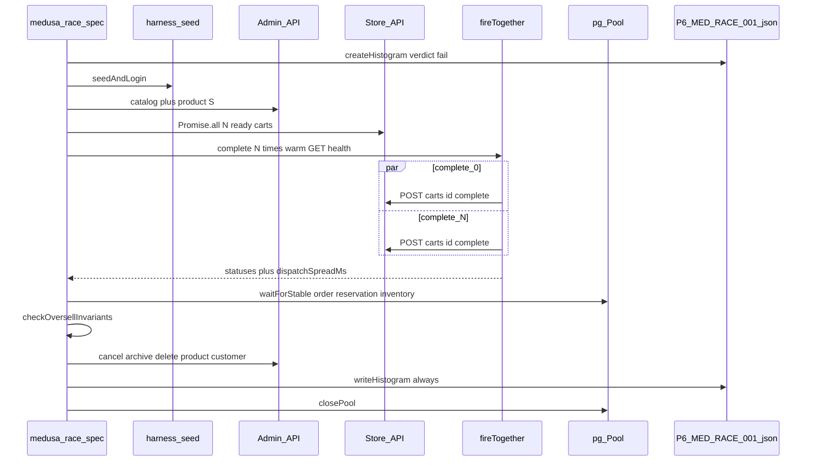

# P6 Phase 1 Task 2: Medusa oversell P6-MED-RACE-001 (plan only)

This is the implementation plan a weaker model will build from. Do not write test or helper
code until Jayami approves this document.

Structure and depth follow
[docs/reference/p1-plan-example-medusa.md](../reference/p1-plan-example-medusa.md)
(copied unchanged from P1). P1 UI-assertion and page-object rules do **not** apply. P6 asserts
through the HTTP API and the database.

Reuse the merged Task 1 framework as-is:
[docs/plans/2026-10-18-p6-phase1-task1-race-framework.md](2026-10-18-p6-phase1-task1-race-framework.md).
Extend it only where this probe proved a gap (admin env getters), and unit-test that change.

## Context

- Repo: [Jayami123/k6-load-concurrency-suite](https://github.com/Jayami123/k6-load-concurrency-suite).
  P6.
- Branch: `feat/2026-10-18-p6-med-race-001` from `origin/main` at
  `e61e083df77f7d9f461f27fcf64ad9e3a9d8ae32` (PR #6 merge: CI race self-test). Local `main` at
  session start was stale `45e33de`; always branch from fetched `origin/main`.
- Harness: `qa-portfolio-harness#v0.2.11`. Medusa fork: `Jayami123/medusa-dtc-starter` @
  `f677db438f27294fc50e4c7c6612e71ff38eeff5` (`@medusajs/medusa` 2.21.2). Never edit the fork.
  Never start, stop or edit the product by hand; the harness owns it.
- Phase 1 has 7 tasks, one PR each. This is Task 2 only. Mapped ID that this PR must implement:
  `P6-MED-RACE-001`. Do not invent or renumber case IDs. Extra cases are named
  `extra (unmapped): <short name>`. Not this PR: Cal wiring (Task 3), Cal races (Task 4),
  Documenso (Task 5), CI races job 50+ trials (Task 6), closeout (Task 7), multi-instance
  `P6-MED-RACE-002/003` (Phase 4).
- PATH before every harness command: `export PATH="/usr/local/bin:$PATH"` (Cursor puts Node 22.14
  first; Medusa needs 22.23).
- Status: Step 1 probe done once in this session. Review answers **OQ1–OQ2 applied** (D15, D2)
  plus mixed-mode, unique-order-id, leak-`LIKE`, and no-PR rules (2026-10-18). Built, then
  tightened after review (status split, stock/reservation cross-checks, setup status checks).
  Probe scripts lived only in `/tmp/p6-med-race-001-probe/` and were not written to the repo,
  harness or fork. Medusa was stopped with `npm run down:medusa` (exit 0).

Master-plan names used as-is ([docs/master-plan.html](../master-plan.html) MED01 plus §§5, 7, 9):

- MED01: `P6-MED-RACE-001` "N carts vs stock S → orders≤S". Preconditions: variant qty S=5; N=20
  carts each qty 1. Complete all in parallel. Expected: orders created ≤5; reservations ≤5;
  available=0. Priority P0. Automation: Playwright API + DB.
- §4 Medusa oracle: order count, `reservation_item` sum, inventory quantity.
- §7: race histograms (JSON) per primitive; DB oracle query text; on failure product logs and
  sample conflicting rows.
- §9 Phase 1: Medusa oversell (this task). Phase 4: multi-instance Medusa.

CI already runs `RACE_TRIALS=3 npm run race:medusa` in `medusa-smoke` and uploads `results/races/`
as `race-histograms-medusa`. The new spec must run inside that step automatically. This PR does
not add a job or change `perf.yml`.

## 1. Header

- Probe date: 2026-10-18, this cloud VM. Node after PATH: **v22.23.3** at `/usr/local/bin/node`.
- `npm ci` with `PLAYWRIGHT_SKIP_BROWSER_DOWNLOAD=1`: exit 0, real **4.381** s (27 packages).
- Docker already running (`start-user.status` 0). Product tree: `PRODUCTS_ROOT=/home/ubuntu/products`.
- Admin credentials for the probe were generated the same way CI does
  (`MEDUSA_ADMIN_EMAIL=admin@qa.local`, `openssl rand -hex 16` into `MEDUSA_ADMIN_PASSWORD`). They
  were exported in the shell only (file mode `0600` under `/tmp`). **Never printed. Not committed.**
- Timings here prove a test works. They are never published as performance numbers (AGENTS.md /
  README).

## 2. Probe findings (required; no guessed values)

### 2.1 Bring-up

```bash
export PATH="/usr/local/bin:$PATH"
node --version   # v22.23.3
TIMEFORMAT=$'real %R\nuser %U\nsys %S'
time npm run up:medusa
```

Observed (exit 0, real **56.481**):

- Wrapper: `harness up medusa (PRODUCTS_ROOT=/home/ubuntu/products)`
- Cold Postgres image pull, then compose project `qa-harness-medusa`
- `pnpm medusa db:migrate finished in 12.4 s` including `initial-data-seed.ts` (Europe region,
  European Warehouse, Standard/Express Shipping, published products, inventory levels)
- `pnpm medusa build finished in 25.1 s`
- `Medusa GET /health returned HTTP 200 in 4.0 s (http://127.0.0.1:9000/health).`
- `Medusa backend is up at http://127.0.0.1:9000 (production, 4.0 s from spawn to HTTP 200).`
- `MEDUSA_SKIP_STOREFRONT=1; storefront not started.`

**`up()` does not create an admin user and does not call `seed()`.** Confirmed in
`node_modules/qa-portfolio-harness/src/adapters/medusa.adapter.ts` (`up()` ends at storefront skip;
`seed()` is a separate method). P6 CI already sets `MEDUSA_ADMIN_EMAIL` / generates
`MEDUSA_ADMIN_PASSWORD` but never seeds today (Task 1 needed neither).

### 2.2 How admin auth is exposed (no secret values)

Industry path, confirmed live:

| Item            | Source                                                                                                                                                                                                                                                           | Observed                                                                                          |
| --------------- | ---------------------------------------------------------------------------------------------------------------------------------------------------------------------------------------------------------------------------------------------------------------- | ------------------------------------------------------------------------------------------------- |
| Email           | `MEDUSA_ADMIN_EMAIL` (P6 `.env` / CI job env). `.env.example` already names it. CI value: `admin@qa.local`.                                                                                                                                                      | Probe used `admin@qa.local`.                                                                      |
| Password        | `MEDUSA_ADMIN_PASSWORD`. CI: `openssl rand -hex 16` then `GITHUB_ENV`. Local: same names in `.env`, never committed.                                                                                                                                             | Probe: SET, length 32. Never printed.                                                             |
| Create user     | Harness `adapter.seed()` → `ensureMedusaAdminUser` → `pnpm medusa user -e <email> -p <password>` (password redacted in harness logs).                                                                                                                            | `User created successfully.` / `Medusa admin user created for admin@qa.local.`                    |
| Login           | `POST /auth/user/emailpass` `{ email, password }`                                                                                                                                                                                                                | HTTP **200**, body shape `{ token: string }`. Token length **504**.                               |
| Admin calls     | `Authorization: Bearer <token>`                                                                                                                                                                                                                                  | `GET /admin/users/me` HTTP **200**, `user.email` = `admin@qa.local`. Harness `proveAuth` matched. |
| Publishable key | `GET /admin/api-keys?limit=50&fields=*sales_channels`, type `publishable`, `revoked_at` null, linked to `Default Sales Channel`. Also returned by `adapter.authenticate().raw.publishableApiKey` (length 67, starts with `pk_`). Harness seed logs `(redacted)`. | Never print the token. Store APIs need header `x-publishable-api-key`.                            |

Seed after first `up` (harness public API, not a product-hand start):

```
seed.created true
seed.users.emails [ 'admin@qa.local' ]
seed.notes German Warehouse created. German Warehouse sales channel linked. German Warehouse
  inventory levels linked. Collection Featured created with four products. Promotion QA10 created
  (10%). Customer customer@test.com created. United States region created.
seed total 0.621 s after user create; wall including CLI user create 3.746 s
```

Subsequent `seed()` is idempotent (harness skips existing rows).

### 2.3 Catalog a cart needs (live Admin GET)

| Resource         | Request                                                            | Observed                                                                                                                                                                                                                            |
| ---------------- | ------------------------------------------------------------------ | ----------------------------------------------------------------------------------------------------------------------------------------------------------------------------------------------------------------------------------- |
| Region           | `GET /admin/regions?limit=50` and `?fields=*payment_providers`     | **Europe**, `currency_code: "eur"`, countries `dk,fr,de,it,es,se,gb`. Payment provider **`pp_system_default`** (`is_enabled: true`). United States (`usd`) has **no** payment providers — do not use it.                            |
| Sales channel    | `GET /admin/sales-channels?limit=20`                               | **Default Sales Channel** (the only one).                                                                                                                                                                                           |
| Stock location   | `GET /admin/stock-locations?limit=50&fields=*sales_channels`       | **European Warehouse** (migrate seed, fulfillment set "European Warehouse delivery") **and** **German Warehouse** (harness seed). Both linked to Default Sales Channel. Checkout in this probe stocked **European Warehouse** only. |
| Shipping profile | `GET /admin/shipping-profiles?limit=20`                            | **Default Shipping Profile**, `type: "default"`. Required on `POST /admin/products`.                                                                                                                                                |
| Shipping options | `GET /store/shipping-options?cart_id=<id>` with publishable key    | **Express Shipping** amount 10, **Standard Shipping** amount 10. P1 and this probe pick **Standard Shipping** by name.                                                                                                              |
| Payment          | `POST .../payment-sessions` `{ provider_id: "pp_system_default" }` | HTTP 200, `payment_sessions[0].provider_id` = `pp_system_default`.                                                                                                                                                                  |

### 2.4 Create a product with inventory S=5 (API only)

`POST /admin/products` HTTP **200**. Body used:

```json
{
  "title": "<prefix>-oversell",
  "handle": "<prefix-lower>-oversell",
  "status": "published",
  "shipping_profile_id": "<default profile>",
  "sales_channels": [{ "id": "<Default Sales Channel>" }],
  "options": [{ "title": "Default", "values": ["Default"] }],
  "variants": [
    {
      "title": "Default",
      "sku": "<prefix-lower>-oversell-sku",
      "manage_inventory": true,
      "allow_backorder": false,
      "options": { "Default": "Default" },
      "prices": [{ "currency_code": "eur", "amount": 1000 }]
    }
  ]
}
```

Response `product.variants[0]`: `manage_inventory: true`. No `inventory_quantity` field on the
variant (keys listed in the probe log). Then:

- `GET /admin/products/{id}?fields=*variants,*variants.inventory_items` →
  `variants[0].inventory_items[0].inventory_item_id` (id prefix `iitem_`).
- `POST /admin/inventory-items/{inventoryItemId}/location-levels`
  `{ "location_id": "<European Warehouse>", "stocked_quantity": 5 }` → HTTP **200**.
- `GET /admin/inventory-items/{id}?fields=*location_levels` → `stocked_quantity: 5`,
  `reserved_quantity: 0`, available 5.

### 2.5 One sequential checkout (P1 store-order path, confirmed live)

Address (P1 `STORE_ADDRESS`, works with Europe):
`{ first_name, last_name, address_1, city, country_code: "de", postal_code }` — Berlin.

| #   | Method | Path                                               | Body (no secrets)                              | Status | Response shape (key fields)                                                            |
| --- | ------ | -------------------------------------------------- | ---------------------------------------------- | ------ | -------------------------------------------------------------------------------------- |
| 1   | POST   | `/store/carts`                                     | `{ region_id, email, sales_channel_id }`       | 200    | `{ cart: { id, currency_code, email, region_id, completed_at: null, … } }`             |
| 2   | POST   | `/store/carts/{id}/line-items`                     | `{ variant_id, quantity: 1 }`                  | 200    | `{ cart: … }`                                                                          |
| 3   | POST   | `/store/carts/{id}`                                | `{ email, shipping_address, billing_address }` | 200    | `{ cart: … }`                                                                          |
| 4   | GET    | `/store/shipping-options?cart_id={id}`             | —                                              | 200    | `{ shipping_options: [{ name, amount, id }] }`                                         |
| 5   | POST   | `/store/carts/{id}/shipping-methods`               | `{ option_id }` Standard Shipping              | 200    | `{ cart: … }`                                                                          |
| 6   | POST   | `/store/payment-collections`                       | `{ cart_id }`                                  | 200    | `{ payment_collection: { id, currency_code, amount, payment_sessions: [] } }`          |
| 7   | POST   | `/store/payment-collections/{id}/payment-sessions` | `{ provider_id: "pp_system_default" }`         | 200    | `{ payment_collection: { payment_sessions: [{ provider_id: "pp_system_default" }] } }` |
| 8   | POST   | `/store/carts/{id}/complete`                       | none                                           | 200    | `{ type: "order", order: { id, … } }` keys `["type","order"]`                          |

One-cart prepare wall: **964.7 ms**. Complete: **206.7 ms**.

Store calls need `x-publishable-api-key` on every request. No `Authorization` on guest checkout.

### 2.6 Refused completion (exact status and error)

| Situation                                                           | HTTP    | JSON                                                                                                                                               |
| ------------------------------------------------------------------- | ------- | -------------------------------------------------------------------------------------------------------------------------------------------------- |
| Oversell loser (complete a prepared qty-1 cart after stock is gone) | **400** | `{ "type": "not_allowed", "message": "Not enough stock available for item <inventoryItemId> at location <locationId>" }` keys `["type","message"]` |
| S=0 add line-item                                                   | **400** | `{ "type": "not_allowed", "message": "Some variant does not have the required inventory" }`                                                        |
| Complete a cart with no items (S=0 after the add failed)            | **400** | `{ "type": "invalid_data", "message": "Cannot complete a cart with no items" }`                                                                    |
| Same cart completed again (sequential or parallel)                  | **200** | `{ "type": "order", "order": { "id": "<same id>" } }` — idempotent success, **not** a loser                                                        |

No 409 was observed. No 5xx was observed. A 5xx is a **PRODUCT BUG** (report, do not hide).

### 2.7 Oracle tables and when stock moves

Read-only SELECTs (public schema). `"order"` must stay quoted.

**How an order links to the variant** (live join, r3 of 20-vs-5):

```sql
SELECT COUNT(DISTINCT o.id)::int AS n
FROM "order" o
JOIN order_item oi ON oi.order_id = o.id AND oi.deleted_at IS NULL
JOIN order_line_item oli ON oli.id = oi.item_id AND oli.deleted_at IS NULL
WHERE oli.variant_id = $1
  AND o.deleted_at IS NULL;
```

- `"order"`: `id`, `email` (stored **lowercased**), `status` (`pending` on create), `deleted_at`,
  `canceled_at`. No `cart_id` column on `"order"`.
- `order_cart`: `order_id`, `cart_id`, `deleted_at`. Some racy extra links are soft-deleted within
  ~150 ms (compensation). Do not count orders through this table alone.
- `order_item`: `order_id`, `item_id` (= `order_line_item.id`), `quantity` (numeric, pg string).
- `order_line_item`: `variant_id`, `product_id`, `variant_sku`, `title`.
- `product_variant_inventory_item`: `variant_id`, `inventory_item_id`, `required_quantity` (`"1"`).
- `reservation_item`: `inventory_item_id`, `quantity`, `line_item_id`, `location_id`, `deleted_at`.
- `inventory_level`: `inventory_item_id`, `location_id`, `stocked_quantity`, `reserved_quantity`
  (both numeric → pg strings).

**Available:** `Number(stocked_quantity) - Number(reserved_quantity)`. After one complete:
`stocked_quantity` stayed **5**, `reserved_quantity` became **1**, one `reservation_item` qty 1,
`deleted_at` null. After +2 s: **unchanged**. Completing a cart **reserves**; it does **not**
decrement `stocked_quantity`. `available = 0` means reserved has caught stocked, not that stocked
is zero.

r3 (20 vs 5) after wait: orders for variant **5**, reservations **n=5 qty=5**,
`stocked_quantity="5"`, `reserved_quantity="5"`, available 0.

### 2.8 Email case (isolation bug if ignored)

Prefix used in the probe: `p6-probe-20261018T143056Z`. Carts were created with that mixed-case
local-part. `"order".email` stored `p6-probe-20261018t143056z-…@qa.local` (T/Z lowercased). A
case-sensitive `LIKE` against the original prefix returned **0 rows** even though HTTP returned
orders. Handle, SKU also lowercased in DB. **Emails, handles and SKUs must be built already
lowercased**, and SQL for emails must use `ILIKE` or a lowercased prefix.

### 2.9 Race: 20 prepared carts vs S=5 through `fireTogether`

Warm function: `GET /health` (never `complete`). `makeRequest`: `POST /store/carts/{id}/complete`.

Parallel setup of 20 carts: **7.7–8.0 s**. Sequential setup: **13.0 s**. One race burst: **~2.0–2.2 s**.
`dispatchSpreadMs` (Node start times): **0.710, 1.007, 1.403** ms across three parallel-setup
rounds (all < default 5). Sequential-setup race spread was still < 2 ms; the win of parallel
setup is wall time, not spread.

Three rounds, parallel setup, same result:

| Round | HTTP          | Winners (`type=order`) | Losers                           | spread ms | race ms | setup ms |
| ----- | ------------- | ---------------------- | -------------------------------- | --------- | ------- | -------- |
| r1    | 200×5, 400×15 | 5                      | 15 × `not_allowed` stock message | 0.710     | 2220    | 7852     |
| r2    | 200×5, 400×15 | 5                      | 15 × same type                   | 1.007     | 1960    | 7845     |
| r3    | 200×5, 400×15 | 5                      | 15 × same type                   | 1.403     | 2101    | 7750     |

No 5xx. Loser body shape identical every time (`type` + `message` only). Inventory after each
round: stocked 5, reserved 5, five `reservation_item` qty 1. Follow-up SQL on r3: **5** orders for
that `variant_id`. HTTP unique order ids = DB order count = 5.

**Liveness:** every round produced **exactly S=5** orders, and `available=0`. Combined with the
master-plan checks (`orders ≤ S`, `reservations ≤ S`, `available = 0` when S succeeded, reservation
qty = order count for qty-1 carts) this **is** "exactly S" for the mapped case. A product that
created 0 orders would fail `available=0`. Assert `orderCount === S` on the mapped qty-1 case
with this evidence — not as a new RTM sentence, as the closed set of the map's expected column.

Async: mapped inventory did not change between t=0 and t=+2 s. Mixed `order_cart` rows can be
soft-deleted shortly after insert. Always `waitForStable` on
`{ orderCount, reservationQty, stocked, reserved }` after the burst.

### 2.10 Extra cases (live)

| Extra                        | HTTP                                                                                                                                                  | DB / inventory                                                           | Notes                                                                                                                                    |
| ---------------------------- | ----------------------------------------------------------------------------------------------------------------------------------------------------- | ------------------------------------------------------------------------ | ---------------------------------------------------------------------------------------------------------------------------------------- |
| S=1 vs N=2                   | 200×1, 400×1 `not_allowed`                                                                                                                            | 1 order, reserved 1, stocked 1, available 0                              | Same loser shape as mapped.                                                                                                              |
| S=0 vs N=5                   | add-item 400 `not_allowed` "Some variant does not have the required inventory"; complete 400 `invalid_data` "Cannot complete a cart with no items" ×5 | 0 orders, 0 reservations, stocked 0, reserved 0                          | The inventory gate is **add line-item**, not complete. Complete-of-empty is a follow-on. Still 0 orders.                                 |
| Mixed qty (3+1+1+1+1 vs S=5) | 200×3, 400×2 `not_allowed`                                                                                                                            | this round: reservations qty **3+1+1=5**, 3 orders, stocked 5 reserved 5 | Probe outcome A (qty-3 won). Outcome B (qty-3 loses, 4×qty-1, available 1) is also valid (D11).                                          |
| Same cart ×10                | 200×10, all `type=order`                                                                                                                              | **1** order, **1** reservation qty 1, reserved 1                         | Follow-up 5-wide parallel: **the same `order.id` five times**. Idempotent HTTP 200 is success, not oversell. Count **unique** order ids. |
| Sequential complete twice    | 200 then 200, same keys                                                                                                                               | 1 order                                                                  | Matches the parallel same-cart result.                                                                                                   |

### 2.11 Cleanup the Admin API actually allows

| Action                                                 | Result                                                                                                     |
| ------------------------------------------------------ | ---------------------------------------------------------------------------------------------------------- |
| `DELETE /admin/products/{id}` unused product           | 200 `{ id, object: "product", deleted: true }`                                                             |
| `DELETE /admin/products/{id}` while reservations exist | **400** `invalid_data` "Cannot remove following inventory item(s) since they have reservations: [iitem_…]" |
| `POST /admin/orders/{id}/cancel`                       | 200, status `canceled`; reservation `deleted_at` set; `reserved_quantity` → 0                              |
| `POST /admin/orders/{id}/archive`                      | 200, status `archived`                                                                                     |
| `DELETE /admin/orders/{id}`                            | **404** (no route)                                                                                         |
| `DELETE /admin/carts/{id}`                             | **404**                                                                                                    |
| `DELETE /store/carts/{id}`                             | **404**                                                                                                    |
| `DELETE /admin/customers/{id}`                         | 200 `{ deleted: true }` (guest customer is created on complete)                                            |

Orders and carts **cannot be deleted**. Isolation is the prefix. Products can be deleted after
cancel (reservations released). Completing creates a customer that **can** be deleted.

### 2.12 Timing for CI

| Step                                                                            | Wall                               |
| ------------------------------------------------------------------------------- | ---------------------------------- |
| `npm ci` (this VM, skip browser)                                                | 4.4 s                              |
| `up:medusa` cold (pull+migrate+build)                                           | 56.5 s                             |
| harness `seed()` first admin                                                    | 3.7 s (later ~0.6 s)               |
| 20-cart parallel setup                                                          | 7.7–8.0 s                          |
| 20-cart sequential setup                                                        | 13.0 s                             |
| one `fireTogether` complete burst                                               | ~2.0–2.2 s                         |
| one mapped trial (product + 20 carts + burst, no Playwright)                    | ~10–12 s                           |
| Current `RACE_TRIALS=3 npm run race:medusa` (self-test only, Medusa already up) | **1 passed, 189 ms, real 1.353 s** |
| `down:medusa`                                                                   | 0.565 s                            |

Estimate after this task, `RACE_TRIALS=3`, same job step: self-test ~0.2 s + mapped 3×~12 s ≈ 36 s

- four extras (about 3+2+5+4 s × 3 trials if they also use `RACE_TRIALS`) ≈ 40–60 s extras if
  uncapped, or ~15 s if extras cap at 3 short trials. **Decision D15:** extras run `min(RACE_TRIALS, 3)`
  so Task 6's 50 does not multiply four extras. Mapped case uses full `RACE_TRIALS`. Expected CI race
  step at 3 trials: **about one minute** after Medusa is up. Job timeout stays 45 minutes.

Task 6 estimate (not this PR): 50 mapped trials × 12 s ≈ 10 min, plus extras capped at 3. Still
inside 45 min.

### 2.13 Tear-down

```bash
export PATH="/usr/local/bin:$PATH"
time npm run down:medusa
```

Exit 0, real **0.565** s. `/health` connection refused. `docker ps` empty. Volumes kept. Probe
created prefixed products, carts, orders, customers; leftover rows stay isolated by prefix (orders
cannot be deleted). Nothing was committed from `/tmp`.

## 3. Resolved decisions

Lead with the industry-standard approach, then the rejected alternative.

- **D1 Admin auth = env credentials + `POST /auth/user/emailpass` Bearer token.** Industry
  standard for API tests is a documented login endpoint and a short-lived JWT, same as P1
  `loginAdminToken` and harness `authenticate()`. Names: `MEDUSA_ADMIN_EMAIL`,
  `MEDUSA_ADMIN_PASSWORD` (already in `.env.example` and CI). Never log the password or token;
  errors say the env name is unset, not the value. Rejected: cookie `POST /auth/session` (P1 UI
  only). Rejected: reading the publishable key from Postgres in the spec (Admin GET is enough;
  oracle stays SELECT-only for assertions). Rejected: hard-coding `admin@test.com` from the fork
  README.

- **D2 Seed the admin through the harness, inside the spec `beforeAll`.** Industry standard: the
  product owner (harness) creates the user; tests only log in. Call `getAdapter("medusa").seed()`
  then login. `up()` does not seed (probe §2.1). CI already exports the env vars, so no
  `perf.yml` change is required for the spec to run in `npm run race:medusa`. `seed()` is
  idempotent (0.6 s when already done). Rejected: a new CI "Seed Medusa" step (Task 6 owns job
  shape; the user asked the spec to run in the existing step). Rejected: `pnpm medusa user` from
  the spec (that is starting the product by hand). **Approved 2026-10-18 (OQ2):** keep seed in
  `beforeAll`; do not edit `perf.yml`.

- **D3 Catalog = Europe / EUR / Default Sales Channel / European Warehouse / Standard Shipping /
  `pp_system_default`.** Probe §2.3. P1 uses the same region, channel, shipping name and provider
  (`store-order.ts`). Rejected: United States region (no payment provider). Rejected: stocking
  German Warehouse (no fulfillment set in migrate seed; MED-RACE-004 location preference is out of
  scope). Rejected: Express Shipping (name is not the P1 default).

- **D4 Setup through the Store + Admin HTTP API only; never INSERT/UPDATE the database.** Industry
  standard: tests use the same API as a client. Oracle is read-only (`src/oracles/pg.ts` unchanged).

- **D5 Race only `POST /store/carts/{id}/complete`; warm is `GET /health`.** Task 1 D1: `warm` must
  not call `makeRequest`. Completing in warm would consume stock before the gate. Rejected:
  warming with complete. Rejected: racing line-item add for the mapped case (the map says complete
  all carts).

- **D6 Prepare N carts in parallel with `Promise.all`, indexed emails.** Probe: 8 s vs 13 s
  sequential, same race outcome across 3 rounds. Deterministic: index `i` → email and quantity.
  Rejected: sequential setup (slower CI). Rejected: a second `fireTogether` for setup (setup is
  not the race).

- **D7 Count orders by `variant_id` via `"order"` → `order_item` → `order_line_item`, not by
  email-only and not by `order_cart`.** Email LIKE missed rows until lowercased (§2.8).
  `order_cart` can be briefly extra then soft-deleted. HTTP winners = **unique** `order.id` from
  `type==="order"` bodies, then compared to the DB count. For every mode **except** `sameCart`,
  also `httpWinnerCount === uniqueOrderIds` (two carts must not share an order id). `sameCart`
  is the opposite: many 200s, one id.

- **D8 `available = stocked_quantity - reserved_quantity`. Do not wait for stocked to drop.**
  Probe: stocked stays 5; reserved goes to 5. `waitForStable` on
  `{ orderCount, reservationQty, stocked, reserved }` because mixed `order_cart` compensation is
  async; mapped inventory itself was already stable at t=0.

- **D9 Mapped qty-1 case asserts `orderCount === S` as well as `<= S`.** Master plan expected
  column is `orders created ≤5; reservations ≤5; available=0`. For qty 1, `available=0` plus
  `reservationQty === orderCount` plus `orderCount <= S` already implies `orderCount === S`. Probe
  produced exactly 5 in 3/3 rounds. A silent "accept 0 orders" would fail `available=0`. Rejected:
  only `<= S` without `available=0` (would hide a dead checkout). Rejected: dropping `available=0`.

- **D10 Loser oracle for mapped qty-1: HTTP 400, `type === "not_allowed"`, message contains
  `Not enough stock available`. Any 5xx or `status === null` is PRODUCT BUG.** Do not treat 409 as
  expected (never seen). S=0 extras use the add-item / empty-complete messages from §2.6. Same-cart
  extras expect 200 + identical order id, not 400.

- **D11 Mixed extra: do not require `orderQty === S` or `reservationQty === S`.** Which carts win
  is non-deterministic. If the qty-3 cart wins with two qty-1 carts, 5 units sell and
  `available === 0`. If the qty-3 cart loses, the four qty-1 carts sell 4 and `available === 1`.
  Both are correct. Assert instead: `orderQty <= S`, `reservationQty === orderQty` (not order
  count), `available === stocked - reserved >= 0`, and **every loser's quantity > the final
  available** (no refused cart could still have fit). Rejected: requiring a full sell-out of S
  (false-fails the qty-3-loses outcome). Rejected: applying qty-1 `reservationQty === orderCount`
  (probe: 3 orders, 5 units).

- **D12 Prefix isolation; emails/handles/SKUs lowercased.** `p6RunPrefix()` plus `-t{trial}-c{i}`.
  `p6RunPrefix` contains `T` and `Z`; Medusa lowercases emails. Helper `prefixedEmail(prefix, leaf)`
  returns `${prefix.toLowerCase()}-${leaf}@qa.local`. SQL uses the same lowercased string. Leak
  `LIKE` patterns go through `likeLiteralPrefix` (D18): the prefix must match `^[a-z0-9-]+$` so
  `_` or `%` can never widen the match.

- **D13 Cleanup through Admin where it works: cancel → archive orders, DELETE products, DELETE
  customers. Leave carts and archived orders.** Leak check binds `likeLiteralPrefix(lowerPrefix)`
  (D18) so `_` or `%` can never widen the `LIKE` match: 0 live products with our handle prefix;
  0 non-archived orders with our email prefix; 0 live reservations for our inventory items; pool
  closed. Leftover carts and archived orders are expected and isolated by prefix.

- **D14 No `perf.yml` change.** The `medusa-race` project already globs `tests/medusa/races`. New
  spec is picked up automatically. Raise timeout on the oversell `describe` only (`180_000`), not
  the global 60 s (self-test stays fast).

- **D15 Extras cap at `min(RACE_TRIALS, 3)` trials.** Mapped case uses `RACE_TRIALS` (CI=3, local
  default 5). Uncapped extras at Task 6's 50 would dominate the job for little extra evidence.
  **Approved 2026-10-18 (OQ1).** Rejected: extras at full `RACE_TRIALS` (four extras × 50 trials
  would dominate the CI race step).

- **D16 Framework gap: add `medusaAdminEmailFromEnv` / `medusaAdminPasswordFromEnv` to
  `src/races/env.ts`.** Unit-test them. Do not change `fireTogether`, `runTrials`, histogram
  writers, prefix, `recordTrial`, or `src/oracles/pg.ts` unless a build-step probe shows a new
  gap (none found).

- **D17 No `test.fail()` on this branch.** Probe did not prove a product bug. Oversell held.
  Same-cart 10×200 with one id is correct idempotency, not a bug. If implementation sees a 5xx or
  `orderCount > S`, fail hard with PRODUCT BUG + HTTP/DB evidence. Do not skip.

- **D18 Leak `LIKE` is a literal prefix.** Industry standard: never concatenate an untrusted or
  unvalidated string into `LIKE` with `%`/`_` as wildcards. Helper `likeLiteralPrefix(prefix)`
  throws `TEST BUG` unless `prefix` matches `^[a-z0-9-]+$`, then returns `` `${prefix}%` ``.
  `p6RunPrefix()` lowercased is already in that class (`p6-qa-` + UTC digits + `t`/`z` + hex).
  Rejected: raw `prefix + "%"` (a `_` would match any character). Rejected: SQL `ESCAPE` only
  without a charset assert (the generator must not emit wildcards; fail loud if it does).

## 4. Goal and scope

**In:**

- `src/medusa/{admin,store,payloads,oracle,invariants}.ts` — API setup and pure checkers
- Env getters for admin email/password (D16)
- Live spec `tests/medusa/races/med-race-001-oversell.spec.ts` in project `medusa-race`
- Mapped `P6-MED-RACE-001` (S=5, N=20, qty 1) with histogram `results/races/P6-MED-RACE-001.json`
- Four extras (unmapped), each its own `test()`, own histogram file, same oracle helpers
- Unit tests for payloads (including `likeLiteralPrefix`), invariants (including mixed A/B and
  shared order ids), new env getters
- README: how to read the oversell histogram; 400 `not_allowed` vs 5xx

**Out:** see §18.

## 5. Test-case mapping

| ID                                 | File                                               | Project       | Histogram `caseId` | Title                                            | Oracle                                                                                            |
| ---------------------------------- | -------------------------------------------------- | ------------- | ------------------ | ------------------------------------------------ | ------------------------------------------------------------------------------------------------- |
| P6-MED-RACE-001                    | `tests/medusa/races/med-race-001-oversell.spec.ts` | `medusa-race` | `P6-MED-RACE-001`  | `N carts vs stock S → orders≤S`                  | §9 SQL; HTTP unique order ids; 400 `not_allowed` losers; spread; `available=0`; `orderCount===5`  |
| extra (unmapped): S=1 vs N=2       | same file, own `test()`                            | same          | `extra-s1-n2`      | `extra (unmapped): S=1 vs N=2`                   | same, S=1, N=2                                                                                    |
| extra (unmapped): S=0 vs N=5       | same                                               | same          | `extra-s0-n5`      | `extra (unmapped): S=0 vs N=5`                   | 0 orders; add-item 400 `not_allowed`; complete 400 `invalid_data`; reserved 0                     |
| extra (unmapped): mixed quantities | same                                               | same          | `extra-mixed-qty`  | `extra (unmapped): mixed quantities`             | D11: `orderQty <= 5`, `reservationQty === orderQty`, `available >= 0`, each loser qty > available |
| extra (unmapped): same cart ×10    | same                                               | same          | `extra-same-cart`  | `extra (unmapped): same cart completed 10 times` | unique order ids === 1; HTTP 200 ×10; reservation qty 1                                           |

Framework self-test stays. Do not rename its `caseId`.

## 6. Extra risky cases (unmapped, required)

All share `checkOversellInvariants` with flags:

1. **S=1 vs N=2** — boundary. Expect 1 order, 1 loser 400 `not_allowed`, available 0.
2. **S=0 vs N=5** — `prepareReadyCart` records line-item 400; still `fireTogether` complete; 0
   orders; complete 400 `invalid_data`; no reservations. Do not hide the add-item error.
3. **Mixed** — quantities `[3,1,1,1,1]`, S=5, N=5. Both probe-possible outcomes pass (D11): qty-3
   wins → 5 sold, available 0; qty-3 loses → 4 sold, available 1. Fail if a qty-1 cart is refused
   while `available >= 1`.
4. **Same cart ×10** — one prepared cart, `fireTogether(10, complete that id)`. Unique HTTP
   `order.id` length 1; DB 1; all status 200; `type=order`. Fail if 10 different ids (PRODUCT BUG
   oversell) or if any 5xx.

No further extras; the probe did not show another distinct risk (Express vs Standard, German
Warehouse, US region are configuration mistakes, not extra races).

## 7. Architecture (every file touched, one responsibility each)

New:

| Path                                               | Responsibility                                                                                  |
| -------------------------------------------------- | ----------------------------------------------------------------------------------------------- |
| `src/medusa/payloads.ts`                           | Pure JSON builders plus `prefixedEmail` / `prefixedHandle` / `likeLiteralPrefix`. No I/O.       |
| `src/medusa/invariants.ts`                         | Pure `checkOversellInvariants` → `string[]` violations. No I/O.                                 |
| `src/medusa/admin.ts`                              | `seedAndLogin`, `loadCatalog`, `createStockedVariant`, cancel/archive, delete product/customer. |
| `src/medusa/store.ts`                              | `prepareReadyCart`, `prepareReadyCarts` (parallel), `completeCart`.                             |
| `src/medusa/oracle.ts`                             | SELECT helpers using `selectRows` / `waitForStable`. Exact SQL §9.                              |
| `tests/medusa/races/med-race-001-oversell.spec.ts` | Live tests.                                                                                     |
| `tests/unit/medusa-payloads.test.ts`               | Payload builders.                                                                               |
| `tests/unit/medusa-invariants.test.ts`             | Invariant matrix: qty1, mixed A/B + fit-violation, same-cart, shared HTTP order ids.            |

Modified:

| Path                     | Change                                                           |
| ------------------------ | ---------------------------------------------------------------- |
| `src/races/env.ts`       | `medusaAdminEmailFromEnv`, `medusaAdminPasswordFromEnv`          |
| `tests/unit/env.test.ts` | unset / trim / present cases; never assert a real password value |
| `README.md`              | Oversell histogram, 400 vs 5xx                                   |
| `playwright.config.ts`   | **no global timeout change**                                     |

Unchanged: `src/oracles/pg.ts`, `src/races/fire-together.ts`, `run-trials.ts`, `histogram.ts`,
`prefix.ts`, `trial-record.ts`, `types.ts`, `perf.yml`, fork, harness, k6.



## 8. Histogram fields for this case

Reuse `RaceHistogram` / `createHistogram` / `writeHistogram` / `recordTrial` unchanged.
`product: "medusa"`. Mapped:

- `caseId`: `P6-MED-RACE-001`
- `title`: `N carts vs stock S → orders≤S`
- `concurrency`: 20

Per-trial `oracle` keys (all numbers or strings, no secrets, no connection string, no token, no
pk):

```
s, n, orderCount, httpWinnerCount, uniqueOrderIds, reservationQty, stocked, reserved, available,
loserStatus, loserType
```

`statusCounts` keys include `"200"`, `"400"`, and `"500"` / `"error"` if they appear. On failure
still write the file (`try/finally`, histogram created before `try` with `verdict: "fail"`).

## 9. Oracle design (exact SQL)

`src/medusa/oracle.ts` uses `selectRows` so `assertSelectOnly` runs. Parameterized:

```ts
export const ORDERS_FOR_VARIANT_SQL = `
SELECT COUNT(DISTINCT o.id)::int AS n
FROM "order" o
JOIN order_item oi ON oi.order_id = o.id AND oi.deleted_at IS NULL
JOIN order_line_item oli ON oli.id = oi.item_id AND oli.deleted_at IS NULL
WHERE oli.variant_id = $1
  AND o.deleted_at IS NULL
`;

export const ORDER_QTY_FOR_VARIANT_SQL = `
SELECT COALESCE(SUM(oi.quantity), 0)::text AS qty
FROM "order" o
JOIN order_item oi ON oi.order_id = o.id AND oi.deleted_at IS NULL
JOIN order_line_item oli ON oli.id = oi.item_id AND oli.deleted_at IS NULL
WHERE oli.variant_id = $1
  AND o.deleted_at IS NULL
`;

export const RESERVATION_QTY_SQL = `
SELECT COALESCE(SUM(quantity), 0)::text AS qty, COUNT(*)::int AS n
FROM reservation_item
WHERE inventory_item_id = $1
  AND deleted_at IS NULL
`;

export const INVENTORY_LEVEL_SQL = `
SELECT stocked_quantity::text AS stocked, reserved_quantity::text AS reserved
FROM inventory_level
WHERE inventory_item_id = $1
  AND location_id = $2
  AND deleted_at IS NULL
`;

export const LEAK_PRODUCTS_SQL = `
SELECT COUNT(*)::int AS n FROM product
WHERE handle LIKE $1 AND deleted_at IS NULL
`;

export const LEAK_LIVE_ORDERS_SQL = `
SELECT COUNT(*)::int AS n FROM "order"
WHERE email LIKE $1 AND deleted_at IS NULL AND status <> 'archived' AND status <> 'canceled'
`;
```

`waitForStable` queryFn returns
`{ orderCount, orderQty, reservationQty, stocked, reserved }` with `Number(...)` on every numeric
text. Defaults: interval 50, stableReads 2, timeout 10_000.

`checkOversellInvariants` (pure; unit-tested):

```ts
export type OversellMode = "qty1" | "mixed" | "sameCart" | "s0";

export function checkOversellInvariants(input: {
  mode: OversellMode;
  s: number;
  n: number;
  orderCount: number;
  orderQty: number;
  httpWinnerCount: number;
  uniqueOrderIds: number;
  reservationQty: number;
  stocked: number;
  reserved: number;
  available: number;
  statuses: Array<number | null>;
  loserTypes: string[]; // parsed `type` for non-200
  loserQuantities: number[]; // cart qty of each non-200; required for mixed
  dispatchSpreadMs: number;
  spreadLimit: number;
}): string[] {
  // returns PRODUCT BUG / TEST BUG strings; empty = pass
}
```

Rules (implement exactly):

- Any `status === null` or `status >= 500` → `PRODUCT BUG: HTTP ${status} …` (include body
  summary already on the request; cap 200 chars via existing `summariseBody`).
- `dispatchSpreadMs >= spreadLimit` → `TEST BUG: dispatchSpreadMs …`.
- `orderCount > s` or `reservationQty > s` or `orderQty > s` → `PRODUCT BUG: oversold`.
- `available !== stocked - reserved` → `TEST BUG: available is not stocked - reserved`.
- `stocked - reserved < 0` (equivalently `available < 0`) → `PRODUCT BUG: available negative`.
- For every mode **except** `sameCart`: `httpWinnerCount === uniqueOrderIds`. If they differ:
  `PRODUCT BUG: HTTP winners ${httpWinnerCount} shared order ids (unique ${uniqueOrderIds})`.
  `sameCart` allows many 200s for one id.
- For every mode including `sameCart`: `uniqueOrderIds === orderCount` (no phantom / lost
  orders vs DB). If they differ:
  `PRODUCT BUG: HTTP unique order ids ${uniqueOrderIds} != DB orders ${orderCount}`.
- `stocked === s` (setup put exactly S on the level) → else `TEST BUG`.
- `reserved === reservationQty` (inventory level matches `reservation_item` rows) → else
  `PRODUCT BUG`.
- `statuses.length === n` → else `TEST BUG`. `httpWinnerCount` equals the number of HTTP 200s
  (every 200 returned `type: "order"`). Except `sameCart`, every status is 200 or 400.
- Cart setup (line item outside `s0`, address, shipping method, payment collection and session)
  must return 200 or the trial fails as `TEST BUG`, so a broken setup is never read as a stock
  loser. `completeCart` never throws, so a 5xx keeps its real status in `statusCounts`.
- mode `qty1`: statuses exactly 200×`s` and 400×(`n - s`), `orderCount === s`, `reservationQty === orderCount`, `available === 0`, every
  non-200 has `type === "not_allowed"` and message includes `Not enough stock available`.
- mode `mixed`: **do not** require `orderQty === s` or `reservationQty === s`. Require
  `orderQty <= s`, `reservationQty === orderQty`, `available === stocked - reserved >= 0`,
  and every entry of `loserQuantities` is `> available` (a refused cart could not still have
  fit). Do not require `reservationQty === orderCount`.
- mode `s0`: `orderCount === 0`, `reservationQty === 0`, `reserved === 0`, complete statuses all
  400, loser type `invalid_data`.
- mode `sameCart`: `uniqueOrderIds === 1`, `orderCount === 1`, `reservationQty === 1`, every
  status 200.

## 10. Test data, isolation, cleanup and leak check

- Run prefix: `p6RunPrefix()` once per spec file (`beforeAll`). Per trial leaf:
  `${prefix.toLowerCase()}-t${trial}`. Product title/handle/sku and emails all lowercased.
  Example email: `p6-qa-20261018t143012z-a1b2c3d4-t1-c00@qa.local`.
- Isolation: `workers: 1`; unique prefix; do not truncate seed tables; do not use harness seed
  SKUs (`customer@test.com`, promo `QA10`) as assertions.
- Cleanup per trial `finally`: for each created order id, `POST /admin/orders/{id}/cancel` then
  `/archive` (ignore 400 if already canceled); `DELETE /admin/products/{id}`;
  `DELETE /admin/customers/{id}` found by `GET /admin/customers?q=<email>`. Carts stay.
- Leak check at end of each test (after cleanup): `LEAK_PRODUCTS_SQL` / `LEAK_LIVE_ORDERS_SQL`
  bind `likeLiteralPrefix(lowerPrefix)` (D18), never a raw `prefix + "%"`. Counts = 0. Live
  reservations for inventory items created in this test = 0. On mismatch: push TEST BUG (or
  PRODUCT BUG if cancel did not release a reservation — paste inventory_item id, not secrets)
  onto `histogram.invariantViolations`, set `verdict: "fail"`, then `expect`.
- `closePool` in the spec `finally`.

## 11. Known-bug handling

None expected. Probe: 3/3 mapped rounds held S=5 with clean 400 losers. Do **not** add
`test.fail()`.

If a live run disagrees:

- `orderCount > S` or `available < 0` → PRODUCT BUG, attach HTTP status histogram + SQL rows
  (ids, quantities, no tokens).
- 5xx → PRODUCT BUG, paste status and body summary.
- Spread ≥ limit with otherwise valid results → TEST BUG, paste `dispatchSpreadMs`.
- Login 401 after `seed()` → TEST BUG (env credentials), do not print the password.
- Histogram schema missing fields → TEST BUG.

Place any future `test.fail()` immediately before the product assertion, after setup assertions,
and only with evidence from two runs — not on this branch.

## 12. CI impact

File `.github/workflows/perf.yml` is **not** edited.

The existing step `Race self-test (medusa-race, 3 trials)` already runs `npm run race:medusa` with
`RACE_TRIALS=3`. Playwright will collect the new file automatically. Artifact
`race-histograms-medusa` already uploads `results/races/`. Expected new files:
`P6-MED-RACE-001.json`, `extra-s1-n2.json`, `extra-s0-n5.json`, `extra-mixed-qty.json`,
`extra-same-cart.json`, plus existing `framework-self-test.json`.

CI already sets `MEDUSA_ADMIN_EMAIL` and generates `MEDUSA_ADMIN_PASSWORD` **before** `up:medusa`.
`beforeAll` `seed()` will create `admin@qa.local` on the ephemeral DB.

Measured: current race step 1.35 s. After this task, about **60 s** at 3 trials (D15). Job
`timeout-minutes: 45` stays.

## 13. Risks and unknowns (each with a probe)

- **R1 `up()` does not seed admin.** Probed. Mitigated by D2.
- **R2 Email / handle / SKU lowercasing hides oracle rows.** Probed (§2.8). Mitigated by D12.
- **R3 `order_cart` extra rows then `deleted_at`.** Probed on mixed. Mitigated by variant join +
  `waitForStable`.
- **R4 Same-cart HTTP 200 × N looks like oversell if counting statuses.** Probed: same `order.id`.
  Count unique ids (D7, D11).
- **R5 Product DELETE blocked by reservations.** Probed. Cancel first (D13).
- **R6 Playwright 60 s timeout vs 5 local trials × 12 s.** Mitigated by `test.describe.configure({ timeout: 180_000 })` on the oversell describe only.
- **R7 S=0 is an add-item race, not a complete race.** Probed. Extra still completes and asserts 0
  orders; histogram records add-item status in `oracle` (`lineItemStatus`).
- **R8 Actions spread noise on 20 POSTs.** This VM max 1.40 ms. Keep `RACE_MAX_SPREAD_MS` default
  5; Task 6 may raise the env, not the helper (Task 1 D5).
- **R9 `getAdapter("medusa").seed()` needs `PRODUCTS_ROOT`.** Already set in P6 `.env` and CI.
- **R10 Default undici connection pool (Task 1 R3).** Complete burst ~2 s, starts still < 2 ms.
  No Agent change in this task.

## 14. Build steps (repo root; PATH export first; on any differing output: stop and report)

Do not start these until Jayami approves this plan. Never `git add -A`. Never print secrets.

### Step 0. Branch

The plan-only commits already live on `feat/2026-10-18-p6-med-race-001`. After approval:

```bash
export PATH="/usr/local/bin:$PATH"
git fetch origin feat/2026-10-18-p6-med-race-001
git checkout feat/2026-10-18-p6-med-race-001
git rev-parse --abbrev-ref HEAD   # feat/2026-10-18-p6-med-race-001
```

### Step 1. Env getters + payloads + invariants (no product)

`src/races/env.ts` add (never interpolate the password into errors):

```ts
function requiredEnv(env: NodeJS.ProcessEnv, name: string): string {
  const raw = env[name];
  if (raw === undefined || raw.trim() === "") {
    throw new Error(`TEST BUG: ${name} is unset or empty`);
  }
  return raw.trim();
}

export function medusaAdminEmailFromEnv(env: NodeJS.ProcessEnv = process.env): string {
  return requiredEnv(env, "MEDUSA_ADMIN_EMAIL");
}

export function medusaAdminPasswordFromEnv(env: NodeJS.ProcessEnv = process.env): string {
  return requiredEnv(env, "MEDUSA_ADMIN_PASSWORD");
}
```

`src/medusa/payloads.ts`:

```ts
export const EUR_UNIT_PRICE = 1000;

export function productCreateBody(input: {
  title: string;
  handle: string;
  sku: string;
  shippingProfileId: string;
  salesChannelId: string;
}): Record<string, unknown> {
  return {
    title: input.title,
    handle: input.handle,
    status: "published",
    shipping_profile_id: input.shippingProfileId,
    sales_channels: [{ id: input.salesChannelId }],
    options: [{ title: "Default", values: ["Default"] }],
    variants: [
      {
        title: "Default",
        sku: input.sku,
        manage_inventory: true,
        allow_backorder: false,
        options: { Default: "Default" },
        prices: [{ currency_code: "eur", amount: EUR_UNIT_PRICE }],
      },
    ],
  };
}

export const STORE_ADDRESS = {
  first_name: "P6",
  last_name: "QA",
  address_1: "Teststr 1",
  city: "Berlin",
  country_code: "de",
  postal_code: "10115",
} as const;

export function cartCreateBody(regionId: string, email: string, salesChannelId: string) {
  return { region_id: regionId, email, sales_channel_id: salesChannelId };
}

export function lineItemBody(variantId: string, quantity: number) {
  return { variant_id: variantId, quantity };
}

export function paymentSessionBody() {
  return { provider_id: "pp_system_default" };
}

export function prefixedEmail(prefix: string, leaf: string): string {
  return `${prefix.toLowerCase()}-${leaf}@qa.local`;
}

export function prefixedHandle(prefix: string, leaf: string): string {
  return `${prefix.toLowerCase()}-${leaf}`;
}

/** Leak SQL LIKE argument. Throws TEST BUG unless prefix is [a-z0-9-]. */
export function likeLiteralPrefix(prefix: string): string {
  if (!/^[a-z0-9-]+$/.test(prefix)) {
    throw new Error("TEST BUG: prefix is not a safe LIKE literal");
  }
  return `${prefix}%`;
}
```

Implement `checkOversellInvariants` per §9.

Unit tests (node --test):

- `tests/unit/env.test.ts`: unset / blank email and password throw `TEST BUG` containing the env
  **name** only; `" admin@qa.local "` trims.
- `tests/unit/medusa-payloads.test.ts`: `manage_inventory: true`, `allow_backorder: false`,
  `provider_id: "pp_system_default"`, `prefixedEmail` lowercases `T`/`Z`;
  `likeLiteralPrefix("p6-qa-20261018t143012z-a1b2c3d4")` → that string plus `%`;
  `likeLiteralPrefix("foo_bar")` and `likeLiteralPrefix("foo%bar")` throw `TEST BUG` (must not
  mention the thrown prefix as a SQL pattern).
- `tests/unit/medusa-invariants.test.ts` (table):
  - qty1 happy: 5 orders, 5 unique, httpWinnerCount 5, 15×400 `not_allowed`, available 0, spread 1 → `[]`
  - qty1 oversell 6 orders → violation contains `PRODUCT BUG` and `oversold`
  - qty1 5xx → `PRODUCT BUG` and `500`
  - qty1 spread 9 with limit 5 → `TEST BUG` and `dispatchSpreadMs`
  - qty1 two carts same order id: httpWinnerCount 5, uniqueOrderIds 4, orderCount 4 → `PRODUCT BUG`
    and `shared order ids`
  - mixed qty-3 wins: orderCount 3, orderQty 5, reservationQty 5, stocked 5, reserved 5, available 0,
    loserQuantities `[1, 1]` → `[]`
  - mixed qty-3 loses: orderCount 4, orderQty 4, reservationQty 4, stocked 5, reserved 4, available 1,
    loserQuantities `[3]` → `[]`
  - mixed violation: qty-1 loser while available >= 1 (orderQty 4, available 1, loserQuantities `[1]`)
    → `PRODUCT BUG` (loser still fits)
  - sameCart: httpWinnerCount 10, uniqueOrderIds 1, orderCount 1 → `[]` (the shared-id rule is skipped)
  - sameCart uniqueOrderIds 10 → `PRODUCT BUG`
  - s0: orderCount 0, all 400 `invalid_data` → `[]`
  - phantom: uniqueOrderIds 5, orderCount 4 → `PRODUCT BUG` and `unique order ids`

Command: `npm run test:unit` → previous 8 files plus 2 new, all pass. `npm run check` exit 0.

Commit: `feat(races): add medusa admin env, payloads and oversell invariants`.

### Step 2. Admin + store helpers (still no live spec)

`src/medusa/admin.ts` skeletons:

```ts
import { getAdapter } from "qa-portfolio-harness";
import {
  medusaBaseUrlFromEnv,
  medusaAdminEmailFromEnv,
  medusaAdminPasswordFromEnv,
} from "../races/env.ts";
import { productCreateBody, prefixedHandle } from "./payloads.ts";

export interface MedusaCatalog {
  token: string; // in memory only; never log
  publishableKey: string;
  regionId: string;
  salesChannelId: string;
  locationId: string;
  shippingProfileId: string;
}

async function adminJson(path: string, token: string, init?: { method?: string; body?: unknown }) {
  /* fetch BASE+/admin... Bearer; throw TEST BUG on 401, PRODUCT BUG on 5xx; return { status, json } */
}

export async function seedAndLogin(): Promise<string> {
  const adapter = getAdapter("medusa");
  await adapter.seed();
  const email = medusaAdminEmailFromEnv();
  const password = medusaAdminPasswordFromEnv();
  const res = await fetch(`${medusaBaseUrlFromEnv()}/auth/user/emailpass`, {
    method: "POST",
    headers: { "Content-Type": "application/json", Accept: "application/json" },
    body: JSON.stringify({ email, password }),
  });
  const json = (await res.json()) as { token?: string };
  if (res.status !== 200 || !json.token) {
    throw new Error(`TEST BUG: POST /auth/user/emailpass HTTP ${res.status}`);
  }
  return json.token;
}

export async function loadCatalog(token: string): Promise<MedusaCatalog> {
  /* GET api-keys, regions, sales-channels, stock-locations, shipping-profiles; pick D3 names; throw TEST BUG if missing */
}

export async function createStockedVariant(input: {
  token: string;
  catalog: MedusaCatalog;
  prefix: string;
  leaf: string;
  s: number;
}): Promise<{ productId: string; variantId: string; inventoryItemId: string; title: string }> {
  // POST /admin/products productCreateBody
  // GET product fields=*variants,*variants.inventory_items
  // POST location-levels { location_id: catalog.locationId, stocked_quantity: input.s }
}

export async function cancelAndArchive(token: string, orderId: string): Promise<void> {
  /* cancel then archive; treat already-canceled as ok */
}
export async function deleteProduct(token: string, productId: string): Promise<void> {}
export async function deleteCustomersByEmail(token: string, email: string): Promise<void> {}
```

`src/medusa/store.ts`:

```ts
export async function prepareReadyCart(input: {
  baseUrl: string;
  publishableKey: string;
  regionId: string;
  salesChannelId: string;
  variantId: string;
  email: string;
  quantity: number;
}): Promise<{
  cartId: string;
  lineItemStatus: number;
  lineItemType: string | null;
  lineItemMessage: string | null;
}> {
  // steps §2.5 1–7; pick shipping option name === "Standard Shipping"
  // if line-item !== 200, still return cartId (S=0 extra) and do not throw
}

export async function prepareReadyCarts(
  n: number,
  makeInput: (i: number) => Parameters<typeof prepareReadyCart>[0],
) {
  return Promise.all(Array.from({ length: n }, (_, i) => prepareReadyCart(makeInput(i))));
}

export async function completeCart(baseUrl: string, publishableKey: string, cartId: string) {
  const res = await fetch(`${baseUrl}/store/carts/${cartId}/complete`, {
    method: "POST",
    headers: { Accept: "application/json", "x-publishable-api-key": publishableKey },
  });
  const body = await res.text();
  return { status: res.status, body };
}
```

`src/medusa/oracle.ts`: wrappers around §9 SQL + `waitForStable`.

No live commit required until Step 3 if `tsc` is clean; prefer one commit with the spec.

Commit (if split): `feat(medusa): add admin catalog, store checkout and oversell SQL`.

### Step 3. Live spec

`tests/medusa/races/med-race-001-oversell.spec.ts` outline:

```ts
test.describe("P6-MED-RACE-001 Medusa oversell", () => {
  test.describe.configure({ timeout: 180_000 });
  let token: string;
  let catalog: MedusaCatalog;
  const runPrefix = p6RunPrefix();

  test.beforeAll(async () => {
    token = await seedAndLogin();
    catalog = await loadCatalog(token);
  });

  test("P6-MED-RACE-001 N carts vs stock S → orders≤S", async () => {
    await runMappedCase({
      s: 5,
      n: 20,
      mode: "qty1",
      caseId: "P6-MED-RACE-001",
      title: "N carts vs stock S → orders≤S",
      trials: raceTrialsFromEnv(),
    });
  });

  test("extra (unmapped): S=1 vs N=2", async () => {
    /* min(RACE_TRIALS,3), mode qty1, s=1 n=2, caseId extra-s1-n2 */
  });
  test("extra (unmapped): S=0 vs N=5", async () => {
    /* mode s0 */
  });
  test("extra (unmapped): mixed quantities", async () => {
    /* mode mixed, quantities [3,1,1,1,1] */
  });
  test("extra (unmapped): same cart completed 10 times", async () => {
    /* mode sameCart, n=10 completes of 1 cart, s=5 */
  });
});
```

Shared `runMappedCase` (in the spec file or `src/medusa/run-case.ts` if it stays under 80 lines in
the spec — prefer `src/medusa/run-case.ts` if the spec would duplicate histogram wiring):

1. `createHistogram` first (`verdict: "fail"`).
2. `const pool = createReadOnlyPool()`.
3. `try`: `runTrials(trials, async (trial) => { ... })`.
4. Each trial: `createStockedVariant` S; `prepareReadyCarts` N (or 1 cart for sameCart);
   `fireTogether(N or 10, (i) => completeCart(..., cartIds[i]), { warm: () => fetch health })`;
   parse JSON for `type` / `order.id` / `error type`; pass each non-200 cart's quantity as
   `loserQuantities` (needed by mixed D11); `waitForStable` oracle snapshot;
   `recordTrial` → `validate` calls `checkOversellInvariants` and throws the joined violations;
   push record; `mergeStatusCounts`; cleanup cancel/archive/delete (even on trial failure).
5. Leak check. `verdict` pass only if every trial `ok` and no leak violations.
6. `finally`: `writeHistogram`, `closePool`.
7. After finally: `expect(histogram.verdict).toBe("pass")` so Playwright fails too.

Warm: `fetch(`${base}/health`)` then `text()`. Never complete.

Commit: `test(medusa): add P6-MED-RACE-001 oversell race and extras`.

### Step 4. README

Add under the existing race section:

- Mapped histogram path `results/races/P6-MED-RACE-001.json`.
- `statusCounts["200"]` are completions that returned `{ type: "order" }`. For the mapped case
  unique order ids must equal S. For the same-cart extra, many 200s may share one id.
- `statusCounts["400"]` with oracle `loserType=not_allowed` is a **clean refusal** (stock). That is
  a passing loser.
- Any `"500"` or `"error"` is a **PRODUCT BUG**. Do not treat it as a loser.
- `dispatchSpreadMs` still means Node start spread (Task 1 README sentence stays).
- Needs `MEDUSA_ADMIN_EMAIL` and `MEDUSA_ADMIN_PASSWORD` (CI generates the password; locally copy
  `.env.example`). The spec calls harness `seed()`.

Commit: `docs: explain medusa oversell histogram and refusals`.

## 15. Verification gate (hard gate before any implementation push)

PATH export first. Then:

1. `npm run check` → exit 0. Unit tests include the new env / payload / invariant names above.
2. `npx playwright test --list --project=medusa-race` → **6** tests: 1 self-test + 1 mapped + 4
   extras. Names contain `P6-MED-RACE-001` and `extra (unmapped):`.
3. `npm run up:medusa` → health 200 as in the probe. Env must already contain admin email/password
   (CI does; locally set them without committing).
4. `RACE_TRIALS=3 npm run race:medusa` → **6 passed**, 0 failed, 0 flaky. Files exist:
   `results/races/P6-MED-RACE-001.json` (`trials` 3, `concurrency` 20, `verdict` `pass`,
   `statusCounts["200"]` 15, `statusCounts["400"]` 45, `dispatchSpreadMs.max` < 5,
   per-trial `oracle.orderCount` 5, `available` 0) and the four extra JSON files plus
   `framework-self-test.json`.
5. `npm run down:medusa` → exit 0.
6. `git diff --name-only` must not include `products/`, harness source, or the Medusa fork.

If step 4 fails, classify PRODUCT BUG vs TEST BUG with status+body or SQL rows, stop, do not retry
to “make it pass”.

## 16. Commit plan (Conventional, lowercase subjects, explicit paths, never `git add -A`)

**Plan and build: commit and push only. Never open a pull request.** That applies to these
plan-only commits and to every implementation commit after approval.

Plan-only commits on `feat/2026-10-18-p6-med-race-001`:

1. `docs: add p6 phase 1 task 2 medusa oversell plan` —
   `docs/plans/2026-10-18-p6-phase1-task2-med-race-001.md` only
2. `docs: revise p6 task 2 plan after review` — same file (this revision)

After Jayami approves (implementation, later commits on this branch, still **no pull request**):

3. `feat(races): add medusa admin env, payloads and oversell invariants`
   (`src/races/env.ts`, `src/medusa/payloads.ts`, `src/medusa/invariants.ts`, unit tests)
4. `feat(medusa): add admin catalog, store checkout and oversell SQL`
   (`src/medusa/admin.ts`, `store.ts`, `oracle.ts`, optional `run-case.ts`)
5. `test(medusa): add P6-MED-RACE-001 oversell race and extras`
   (`tests/medusa/races/med-race-001-oversell.spec.ts`)
6. `docs: explain medusa oversell histogram and refusals` (`README.md`)

No merge, tag, force-push, or pull request. No Co-Authored-By. No `Generated with` / attribution
lines. No CodeRabbit from the builder (Jayami runs review). Never the Bridge-bss account.

## 17. Docs

- This plan file.
- `README.md` §14 Step 4 (oversell histogram, 400 vs 5xx, admin env, seed).
- No ADR. No master-plan HTML edits. No `.env` values.

## 18. Will NOT do

- `P6-MED-RACE-002` / `003` multi-instance (Phase 4)
- `P6-MED-RACE-004` location preference, campaign, gift-card, refund races
- Cal / Documenso / Twenty
- New CI job, `RACE_TRIALS=50`, `perf.yml` edits (Task 6)
- k6 scenarios, thresholds, dashboards
- Fork or harness source edits; `medusa develop` by hand; compose edits
- Successful writes to Postgres from P6 code; `TRUNCATE`
- Logging of tokens, passwords, publishable keys, or database URLs
- Page objects, UI assertions, `waitForTimeout` as a gate, retries, `workers` > 1
- Inventing RTM IDs; `test.fail()` without a proven product bug
- Stocking German Warehouse; United States region; Stripe
- Warm-up that completes carts
- Published RPS/p95 from this VM
- Opening a pull request at any point on this task (plan commits **and** implementation
  commits: commit and push only)
- Co-Authored-By / Generated-with / force-push / merge

## 19. Open questions for Jayami

None remaining. OQ1–OQ2 were answered 2026-10-18 and are recorded as:

1. **OQ1** Extras run `min(RACE_TRIALS, 3)` (D15). Not full `RACE_TRIALS`.
2. **OQ2** Harness `seed()` in spec `beforeAll` (D2). No `perf.yml` change.

Probe is done. Review edits are in this file. Building still waits on approval of this plan.
