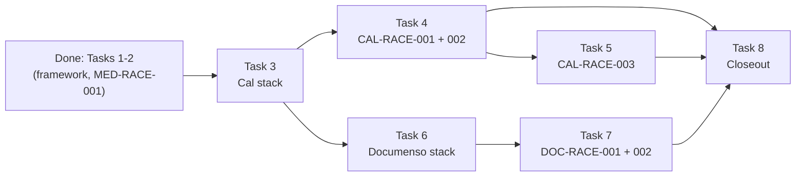

# P6 Phase 1 roadmap (Tasks 3–8)

This is a roadmap, not a build plan. It fixes the order, the scope and the done criteria for the
rest of P6 Phase 1. Each task gets its own junior-engineer plan just before it starts, in the
structure of [docs/reference/p1-plan-example-medusa.md](../reference/p1-plan-example-medusa.md)
(as Tasks 1 and 2 did), and every such plan starts with a **live probe**. Nothing in this file is a
probed value unless it cites a file in this repo or the pinned harness; open values are listed
under "the live probe must confirm".

## Context

- Repo: [Jayami123/k6-load-concurrency-suite](https://github.com/Jayami123/k6-load-concurrency-suite)
  (P6). Written from `main` at `bd2b068`.
- Source of the scope: [docs/master-plan.html](../master-plan.html) §9 "Phased build order", Phase 1
  = "Cal identical+overlap races; Medusa oversell; Documenso double-complete; histogram artefacts",
  and the case tables **CAL01** (`P6-CAL-RACE-001`, `P6-CAL-RACE-002`), **CAL02**
  (`P6-CAL-RACE-003`) and **DOC05** (`P6-DOC-RACE-001`, `P6-DOC-RACE-002`). §4 gives the per-product
  oracle ideas; §6 the CI outline (one race job per product); §7 the artefacts.
- Harness: `qa-portfolio-harness#v0.2.11` ([package.json](../../package.json)). It already ships
  Cal and Documenso adapters (`node_modules/qa-portfolio-harness/src/adapters/cal.adapter.ts`,
  `documenso.adapter.ts`), so P6 does not start products itself;
  [scripts/harness.mjs](../../scripts/harness.mjs) already accepts `cal` and `documenso`.
- Rules that hold for every task below ([AGENTS.md](../../AGENTS.md), [README.md](../../README.md)):
  - P6 is API + DB-oracle race testing (Playwright API projects, no browser) and k6 load. P1's
    UI-assertion and page-object rules do not apply. Assertions come from the DB oracle and HTTP
    status histograms.
  - Race product bugs need repeated trials (master plan §1: "N≥50 … not a single lucky pass").
    `test.fail()` only for a proven product bug with evidence from repeated runs.
  - Never edit product forks or harness source. `scripts/harness.mjs` owns starting/stopping.
  - Timings from Cursor Cloud or Claude cloud sessions prove a test works; they are never
    published. Published numbers come only from GitHub Actions, median of ≥ 3 runs.
  - No secrets in any file; [.env.example](../../.env.example) keeps names only.
  - `npm run check` before every push. One PR per task.

## Already done (not re-planned)

| Item                                      | PR  | Where                                                                                                                            |
| ----------------------------------------- | --- | -------------------------------------------------------------------------------------------------------------------------------- |
| Phase 0 bootstrap (harness, k6 smoke)     | #1  | [scripts/bootstrap.sh](../../scripts/bootstrap.sh), [scripts/harness.mjs](../../scripts/harness.mjs), `k6/smoke/`                |
| Feasibility report (Cursor Cloud, Medusa) | #2  | [docs/feasibility/2026-10-18-cursor-cloud-medusa.md](../feasibility/2026-10-18-cursor-cloud-medusa.md)                           |
| Plan reference (P1 example)               | #3  | [docs/reference/p1-plan-example-medusa.md](../reference/p1-plan-example-medusa.md)                                               |
| Task 1: race framework                    | #5  | [2026-10-18-p6-phase1-task1-race-framework.md](2026-10-18-p6-phase1-task1-race-framework.md), `src/races/*`, `src/oracles/pg.ts` |
| CI race self-test + histogram upload      | #6  | [.github/workflows/perf.yml](../../.github/workflows/perf.yml) job `medusa-smoke`, artefact `race-histograms-medusa`             |
| Task 2: `P6-MED-RACE-001` + 4 extras      | #8  | [2026-10-18-p6-phase1-task2-med-race-001.md](2026-10-18-p6-phase1-task2-med-race-001.md), `src/medusa/*`, green in CI            |

What the framework gives every later task (reuse as-is, extend only where a probe proves a gap):

- `src/races/fire-together.ts`: start-line barrier over Node `fetch`, separate `warm` function,
  `dispatchSpreadMs`, `summariseBody`.
- `src/races/run-trials.ts`, `src/races/trial-record.ts`: trial loop and per-trial record.
- `src/races/histogram.ts`, `src/races/types.ts`: `createHistogram` / `writeHistogram` to
  `results/races/<caseId>.json`, status counts, spread aggregate. `RaceProduct` already includes
  `cal` and `documenso`.
- `src/races/env.ts`: `RACE_TRIALS`, `RACE_MAX_SPREAD_MS`, Medusa URL/DB/admin getters.
- `src/races/prefix.ts`: run prefix `p6-qa-<utc>-<8 hex>` for data isolation.
- `src/oracles/pg.ts`: read-only pool (`default_transaction_read_only=on`) + `assertSelectOnly`,
  `selectRows`, `waitForStable`, `closePool`. `createReadOnlyPool(connectionString)` already takes
  a URL; only its default is Medusa.
- `src/medusa/*` is the pattern for a product module: `payloads.ts` (pure bodies), `oracle.ts`
  (SQL constants + snapshot + leak check), `invariants.ts` (pure, unit-tested), `run-case.ts`
  (trial loop that always writes the histogram).
- [playwright.config.ts](../../playwright.config.ts): one project `medusa-race`, `retries: 0`,
  `workers: 1`.

Note on numbering: the Task 1 and Task 2 plans used an older split (Task 5 Documenso, Task 6
"CI ≥ 50 trials", Task 7 closeout). This roadmap replaces it. The old Task 6 work (trial counts and
per-product race jobs) is folded into the task that owns each product's CI job (Tasks 3, 4, 6) and
into the closeout (Task 8).

## Remaining Phase 1 cases

| Case ID           | Master-plan source | Summary                                                                                           | Pri |
| ----------------- | ------------------ | ------------------------------------------------------------------------------------------------- | --- |
| `P6-CAL-RACE-001` | CAL01              | Identical slot, N=20 parallel POST × 50 trials; DB ACCEPTED count = 1 per trial                   | P0  |
| `P6-CAL-RACE-002` | CAL01              | Publish the status histogram artefact; README cites measured rates only                           | P2  |
| `P6-CAL-RACE-003` | CAL02              | 30-min and 60-min overlapping bookings on the same host × 30 trials; SQL overlap oracle           | P0  |
| `P6-DOC-RACE-001` | DOC05              | Two last recipients complete in parallel: 1 sealed PDF, 1 COMPLETED, 1 completed email, 1 webhook | P0  |
| `P6-DOC-RACE-002` | DOC05              | Same recipient double submit, N=10: one success, others 4xx, single seal                          | P0  |

## Task table

| Task | Title                     | Cases                                | Depends on | Can be planned in parallel with |
| ---- | ------------------------- | ------------------------------------ | ---------- | ------------------------------- |
| 3    | Cal stack in P6           | none (stack + smoke)                 | —          | 6 (plan only)                   |
| 4    | Cal identical-slot race   | `P6-CAL-RACE-001`, `P6-CAL-RACE-002` | 3          | 6                               |
| 5    | Cal overlap race          | `P6-CAL-RACE-003`                    | 4          | 6, 7                            |
| 6    | Documenso stack in P6     | none (stack + smoke + receivers)     | 3          | 4, 5                            |
| 7    | Documenso completion race | `P6-DOC-RACE-001`, `P6-DOC-RACE-002` | 6          | 5                               |
| 8    | Phase 1 closeout          | all Phase 1 cases (evidence only)    | 4, 5, 7    | —                               |

"Planned in parallel" means the probe and plan can be written while the other task is being built.
Only one product stack runs at a time on a cloud VM (memory); probes for two products are never run
together.

### Changes to the proposed order, and why

The proposed order 3 → 8 is kept. Three refinements:

1. **Task 6 depends on Task 3, not on Tasks 4–5.** Task 3 makes the shared code multi-product
   (per-product env getters, a per-product oracle pool, a second Playwright project, a second CI
   job). Once that exists, the Documenso stack only reuses the pattern. So Task 6 can be probed and
   planned while Tasks 4–5 are being built, which shortens the critical path. It is still built
   after Task 3 merges, so the multi-product refactor happens once, against one new product.
2. **The multi-product refactor of `src/races/env.ts` and `src/oracles/pg.ts` lands in Task 3**,
   not in the first race task. Today the pool default and every URL getter are Medusa-only. Doing
   the refactor with the stack (and its unit tests) keeps Task 4 a pure race-case PR.
3. **Trial counts move out of a separate "CI 50 trials" task.** `P6-CAL-RACE-001` defines 50 trials
   and `P6-CAL-RACE-003` 30 trials in the case itself, so each case task sets its own count in its
   own CI job. Raising `P6-MED-RACE-001` from the current CI `RACE_TRIALS=3` to the master plan's
   N≥50 is a closeout item (Task 8), because it is a Medusa-job change that no new case needs.
   Every race job follows the PR / full-run split in D2 under "Decisions (2026-10-20)".

## Task 3: Cal stack in P6

- **Goal.** Cal starts, answers a smoke check and stops through the harness, locally and in CI, at
  a pinned fork commit. No race case yet.
- **Cases.** None mapped. One unmapped self-test (Cal health + read-only oracle `SELECT 1` on the
  Cal DB), mirroring Task 1's `framework-self-test`.
- **Depends on.** Tasks 1–2 (done).
- **Scope.**
  - Pin `CAL_REF` in [scripts/bootstrap.sh](../../scripts/bootstrap.sh) to a 40-char commit (it is
    `main` today, the only unpinned product). Use the commit the P1 Cal CI pins if one exists, else
    the fork head on the probe day; record which.
  - Cal dependency install in `bootstrap.sh` (today only Medusa installs; others log "not automated
    yet"). The adapter needs Cal `node_modules` and `yarn` (`cal.adapter.ts` errors with "Cal
    node_modules missing … Run `yarn` there first").
  - `up:cal`, `down:cal`, `smoke:cal` in [package.json](../../package.json) through
    `scripts/harness.mjs` (no new start logic); `k6/smoke/cal-health.js`.
  - Multi-product env and oracle: Cal URL/API URL/DB getters next to the Medusa ones; oracle pool
    built from a product's URL. The harness default `CAL_DB_URL` uses `localhost`
    (`config.ts`); P6 uses `127.0.0.1` only, so P6 sets its own default.
  - Playwright project `cal-race` (`retries: 0`, `workers: 1`) and `race:cal`.
  - A new CI job `cal-smoke` in [.github/workflows/perf.yml](../../.github/workflows/perf.yml)
    (checkout fork at `CAL_REF`, verify HEAD, install, cache, `up:cal`, k6 smoke, race self-test,
    upload `race-histograms-cal`, `down:cal` always). The Medusa job is not touched.
- **Main risk: Cal build/start time and memory.** The harness default is production mode
  (`next build` + `next start`) with `NODE_OPTIONS=--max-old-space-size=8192`
  (`cal.adapter.ts`), plus a Turbo build of `@calcom/trpc` and `copy-app-store-static`. That can
  exceed the memory of a standard GitHub-hosted runner and of a Cursor Cloud / Claude cloud VM, and
  the cold build may take tens of minutes. The adapter skips the build when the `.next` marker
  matches HEAD, so CI must cache `.next` keyed on `CAL_REF` + harness version (like the Medusa
  build cache). Decided (D1): keep the production build and cache it on `CAL_REF`; if one cold
  build runs out of memory, add swap on the runner first, then a larger runner; `CAL_WEB_MODE=dev`
  only as a last resort, labelled as such in the README.
- **The live probe must confirm (before the plan is written).**
  1. Cold and warm `up:cal` wall time and peak memory on the cloud VM (proof only, not published),
     and whether the build completes at all with the VM's RAM; then the same on one GitHub Actions
     run of a probe branch, cold and with the `.next` cache restored, and whether swap is needed
     for the cold build (D1).
  2. Which booking API the booker actually uses: master plan §4 says
     "`POST /api/book/event` or `POST /v2/bookings` (pick one; document)". The harness health check
     hits the API v2 base (`CAL_API_BASE_URL`, default `:5555`, `/health`) and says "this fork has
     no web /api/health". Confirm whether API v2 is started by `up:cal` at all; if not, the race
     uses the web `/api/book/event` route.
  3. How auth and a free slot are seeded: what `seed()` creates (users, API key — the adapter keeps
     a `seededApiKey`), which event types exist with 30- and 60-minute lengths on one host, and how
     to find a free slot (availability endpoint, or schedule rows) without UI.
  4. Postgres access for the oracle: the harness compose publishes port 5450, db `calendso`; confirm
     credentials, that `default_transaction_read_only=on` is accepted (SQLSTATE `25006` on INSERT),
     and the `"Booking"` columns (`status`, `startTime`, `endTime`, `userId`, `eventTypeId`,
     `idempotencyKey`, `uid`).
  5. `down:cal` leaves no web process or port bound; a second `up:cal` reuses the build.
- **Reused.** `fireTogether` (self-test burst on the health URL), `createHistogram`/`writeHistogram`,
  `createReadOnlyPool`, `selectRows`, `assertSelectOnly`, `p6RunPrefix`, `raceTrialsFromEnv`.
- **New files (names only).** `k6/smoke/cal-health.js`, `src/cal/env.ts` (or getters added to
  `src/races/env.ts`, plan decides), `tests/cal/races/cal-self-test.spec.ts`,
  `tests/unit/cal-env.test.ts`, `docs/plans/<date>-p6-phase1-task3-cal-stack.md`.
- **CI change.** New job `cal-smoke` (own timeout, own caches, including the `.next` build cache
  keyed on `CAL_REF` + harness version, saved on `main` like the Medusa build cache; a swap step
  only if the probe shows the cold build needs it). `Stub harness product roots` in the Medusa job
  stays.
- **Done when.** `CAL_REF` is a commit SHA; `up:cal` / `smoke:cal` / `race:cal` / `down:cal` work on
  a cloud VM; `cal-smoke` is green on the PR and once on `main`; the self-test histogram is uploaded;
  `npm run check` green; README has a "Run Cal" section with no timing claims.
- **Main risks.** Build memory/time (above); API v2 not part of `up:cal`; harness Cal adapter
  assumptions that only held on Windows (the adapter has Windows-specific port handling); Docker
  disk on the VM.

## Task 4: `P6-CAL-RACE-001` + `P6-CAL-RACE-002`

- **Goal.** Prove the identical-slot guard holds under contention and publish the histogram.
- **Cases.** `P6-CAL-RACE-001` (P0), `P6-CAL-RACE-002` (P2).
- **Depends on.** Task 3.
- **Scope.** Each trial: one fresh free 30-minute slot on the seeded host, N=20 parallel booking
  POSTs with identical start/end through `fireTogether`, distinct attendee emails stamped with the
  run prefix. Oracle per trial: `COUNT(*)` of `"Booking"` rows with `status = 'ACCEPTED'` for that
  host + start + end must be exactly 1. Histogram: status counts across all trials; 409 /
  booking-conflict responses are allowed losers; any 5xx or a second ACCEPTED row is a PRODUCT BUG
  with the rows attached (ids, status, times; no tokens). `P6-CAL-RACE-002`: the histogram is
  uploaded from CI and README states only rates measured in GitHub Actions runs.
- **The live probe must confirm.** One sequential booking end-to-end on the chosen route (request
  body, required headers/auth, success status and body); the exact loser status and body when the
  slot is taken (409 vs 400 vs other); whether `idempotencyKey` is set on ACCEPTED rows; how many
  distinct free slots exist per host for 50 trials (or how to advance the date); whether bookings
  can be cancelled/deleted through the API for cleanup and what that does to the key; time per
  trial (sets the CI step timeout).
- **Reused.** All of `src/races/*`; `src/oracles/pg.ts` (`waitForStable` if booking side effects
  are async); the `src/medusa/run-case.ts` shape (histogram always written in `finally`, leak check
  by prefix).
- **New files (names only).** `src/cal/payloads.ts`, `src/cal/oracle.ts`, `src/cal/invariants.ts`,
  `src/cal/run-case.ts`, `src/cal/api.ts`, `tests/cal/races/cal-race-001-identical-slot.spec.ts`,
  `tests/unit/cal-payloads.test.ts`, `tests/unit/cal-invariants.test.ts`,
  `tests/unit/cal-oracle.test.ts`, `docs/plans/<date>-p6-phase1-task4-cal-race-001.md`.
- **CI change.** Add the nightly `schedule` trigger to `perf.yml` (first task that needs it).
  `cal-smoke` runs `race:cal` at about 5 trials on PRs and 50 on `main`, nightly and
  `workflow_dispatch` (D2), and uploads `results/races/P6-CAL-RACE-001.json` in
  `race-histograms-cal`. The workflow's `concurrency` group is `perf-${{ github.ref }}` with
  `cancel-in-progress: true`, so a nightly run and a push to `main` can cancel each other; the plan
  gives scheduled runs their own group.
- **Done when.** The PR run passes at about 5 trials, and one `main` (or nightly) run passes all 50
  trials with ACCEPTED = 1 in every trial and no 5xx (or a proven product bug recorded with
  `test.fail()` and evidence from repeated runs); histogram artefact on the run; README section
  explains 409 vs 500 for Cal and cites only `main`/nightly rates; leak check by prefix passes;
  `npm run check` green.
- **Main risks.** Slot supply for 50 trials (availability window, minimum notice, booking limits
  on the event type); rate limiting on the booking route; async side effects (emails/webhooks)
  slowing trials; client spread on noisy runners (raise `RACE_MAX_SPREAD_MS` in env, not the
  helper).

## Task 5: `P6-CAL-RACE-003`

- **Goal.** Prove that overlapping but non-identical windows (which bypass the unique key, master
  plan CAL02) cannot both be ACCEPTED for the same host.
- **Cases.** `P6-CAL-RACE-003` (P0).
- **Depends on.** Task 4 (booking client, payloads, cleanup and Cal oracle module).
- **Scope.** Two event types on one host (30 and 60 minutes). Each trial: book the 30-minute and
  the overlapping 60-minute window in parallel; 30 trials. Oracle: an SQL overlap query over
  ACCEPTED bookings of that host
  (`a."startTime" < b."endTime" AND b."startTime" < a."endTime"`, `a.id < b.id`) returns at most
  one booking per window, i.e. zero overlapping ACCEPTED pairs. A pair is a PRODUCT BUG with both
  rows attached. If the product does allow it, `test.fail()` only after repeated runs prove it.
- **The live probe must confirm.** Both event types exist (or can be created by API) on the same
  host; the sequential case (book 60 then 30 overlapping) is refused, with which status — if even
  the sequential case is accepted, that is a product configuration question to raise before
  racing; the overlap query's plan on the real schema (indexes, `timestamp` type, time zone);
  whether N>2 per trial adds signal (plan decides; the case defines a pair).
- **Reused.** `src/cal/*` from Task 4, `fireTogether`, `runTrials`, histogram, oracle pool.
- **New files (names only).** `tests/cal/races/cal-race-003-overlap.spec.ts`, overlap SQL in
  `src/cal/oracle.ts`, `tests/unit/cal-overlap.test.ts`,
  `docs/plans/<date>-p6-phase1-task5-cal-race-003.md`.
- **CI change.** Same `cal-smoke` race step; about 5 trials on PRs, 30 on `main`, nightly and
  `workflow_dispatch` (D2); artefact `P6-CAL-RACE-003.json` in `race-histograms-cal`.
- **Done when.** The PR run passes at about 5 trials, and one `main` (or nightly) run passes all 30
  trials with zero overlapping ACCEPTED pairs (or a proven, recorded product bug); histogram
  uploaded; `npm run check` green.
- **Main risks.** Seeded event types may not share a host or schedule; buffer times or
  "seats" settings change what counts as overlap; job time with Task 4's 50 trials in the same job.

## Task 6: Documenso stack in P6

- **Goal.** Documenso starts, answers a smoke check and stops through the harness locally and in
  CI, with everything `P6-DOC-RACE-001/002` need: an API token, a signing certificate, rate limits
  off in the test environment, and email + webhook capture.
- **Cases.** None mapped. One unmapped self-test (health, oracle `SELECT 1`, one email visible in
  the receiver, one webhook delivered to the P6 receiver).
- **Depends on.** Task 3 (multi-product env/oracle, second CI job pattern).
- **Scope.**
  - `DOCUMENSO_REF` is already pinned in `bootstrap.sh`; add its dependency install there.
  - `up:documenso`, `down:documenso`, `smoke:documenso` through `scripts/harness.mjs`;
    `k6/smoke/documenso-health.js`.
  - Signing certificate: the adapter calls `assertDocumensoSigningCert` before starting. The cert is
    generated at setup (CI step / bootstrap), never committed; only its env name goes in
    `.env.example`.
  - Rate limits disabled in the test environment, the standard practice for functional and race
    tests (a limiter would turn a race into a 429 count). Done through env passed to the harness,
    never by editing the fork.
  - Email receiver: the harness compose already runs Inbucket (`documenso.adapter.ts`: "Inbucket
    (SMTP 127.0.0.1:2525)"); P6 reads it over its HTTP API.
  - Webhook receiver: a small in-process HTTP server started by the spec (or a fixture) that
    records `DOCUMENT_COMPLETED` deliveries; plus the DB `WebhookCall` table as the second oracle
    (master plan §4).
  - Playwright project `documenso-race`, `race:documenso`, CI job `documenso-smoke`, artefact
    `race-histograms-documenso`.
- **The live probe must confirm.** Cold/warm `up:documenso` time and memory (proof only); how an API
  token is obtained — the harness marks minting as `TODO(verify)` and asks for a pasted
  `DOCUMENSO_API_TOKEN`, so the probe must find a scripted, secret-free way (seeded user + API, or
  DB-seeded token generated per run) and the plan must not commit it; the env names that disable
  rate limits on this fork commit; the signing-cert env names and file format; the Inbucket HTTP
  port and message API; whether webhooks to `127.0.0.1` are allowed (some builds block private
  IPs for SSRF safety — if so, the plan records the setting used); Postgres on 5451 with
  `default_transaction_read_only=on`; table names for documents/envelopes, recipients,
  `BackgroundJob`, `WebhookCall`.
- **Reused.** Everything Task 3 generalised; `fireTogether` for the self-test burst.
- **New files (names only).** `k6/smoke/documenso-health.js`, `src/documenso/env.ts`,
  `src/documenso/inbucket.ts`, `src/documenso/webhook-receiver.ts`,
  `tests/documenso/races/documenso-self-test.spec.ts`, `tests/unit/documenso-env.test.ts`,
  `tests/unit/webhook-receiver.test.ts`, `docs/plans/<date>-p6-phase1-task6-documenso-stack.md`.
- **CI change.** New job `documenso-smoke`, independent of the Cal and Medusa jobs.
- **Done when.** Up/smoke/self-test/down work on a cloud VM and in CI (green on the PR and once on
  `main`); self-test proves one email and one webhook are captured; no secret or cert in git;
  `npm run check` green.
- **Main risks.** API token minting (harness TODO); webhook delivery to localhost blocked;
  background jobs (seal) needing a separate worker process the harness may not start; cert
  handling in CI.

## Task 7: `P6-DOC-RACE-001` + `P6-DOC-RACE-002`

- **Goal.** Prove completion is single-shot under concurrency: no double seal, double email or
  double webhook.
- **Cases.** `P6-DOC-RACE-001` (P0), `P6-DOC-RACE-002` (P0).
- **Depends on.** Task 6.
- **Scope.**
  - `P6-DOC-RACE-001`: per trial, create a document with two unsigned last recipients in parallel
    signing order, fill their fields, then complete both tokens through `fireTogether`. Oracle:
    exactly 1 sealed PDF, document status COMPLETED once, exactly 1 completed email in Inbucket for
    the document, exactly 1 `DOCUMENT_COMPLETED` webhook (receiver count and `WebhookCall` rows),
    seal jobs = 1 in `BackgroundJob`. All counts read with `waitForStable` (sealing is async).
  - `P6-DOC-RACE-002`: per trial, one pending recipient completes N=10 times in parallel. Oracle:
    one 2xx, the other nine 4xx (any 5xx is a PRODUCT BUG), one seal.
  - Trial count: the master plan sets none for DOC05; the plan proposes the full count from probe
    timing, with master plan §1's N≥50 as the target. PRs run about 5 trials (D2).
- **The live probe must confirm.** The API sequence to create a document, add two recipients,
  place signature fields and send (v1 or v2 API on this commit); the exact "complete" endpoint the
  signing page calls and its auth (recipient token); what "sealed PDF" is in the DB (document data
  row / storage key) and how to count it; how long sealing and email take (sets `waitForStable`
  limits); the loser status and body for a second completion; cleanup the API allows (delete
  document) and what it leaves behind.
- **Reused.** `src/races/*`, `src/oracles/pg.ts` (`waitForStable`), Task 6 receivers, the
  `run-case.ts` shape.
- **New files (names only).** `src/documenso/api.ts`, `src/documenso/payloads.ts`,
  `src/documenso/oracle.ts`, `src/documenso/invariants.ts`, `src/documenso/run-case.ts`,
  `tests/documenso/races/doc-race-001-last-recipients.spec.ts`,
  `tests/documenso/races/doc-race-002-double-submit.spec.ts`, matching `tests/unit/*.test.ts`,
  `docs/plans/<date>-p6-phase1-task7-doc-races.md`.
- **CI change.** `documenso-smoke` runs `race:documenso` at about 5 trials on PRs and the full
  count on `main`, nightly and `workflow_dispatch` (D2), and uploads the two histograms.
- **Done when.** Both cases pass at about 5 trials on the PR and at their full count in one `main`
  (or nightly) run (or a proven product bug is
  recorded with `test.fail()` and evidence from repeated runs); histograms uploaded; leak check by
  prefix; `npm run check` green.
- **Main risks.** Trial time (PDF seal per trial); flaky async counts if `waitForStable` limits are
  too short; email dedup in Inbucket making counts look right when they are not (count by document
  id, not by subject).

## Task 8: Phase 1 closeout

- **Goal.** Phase 1 is evidenced, not just merged.
- **Cases.** All Phase 1 cases: `P6-MED-RACE-001`, `P6-CAL-RACE-001`, `P6-CAL-RACE-002`,
  `P6-CAL-RACE-003`, `P6-DOC-RACE-001`, `P6-DOC-RACE-002`. No new cases.
- **Depends on.** Tasks 4, 5, 7.
- **Scope.** Run `P6-MED-RACE-001` at the master plan's N≥50 on `main`, nightly and
  `workflow_dispatch`; PRs keep `RACE_TRIALS=3` (D2; extras stay capped at 3, Task 2 D15). All three
  product jobs green on `main` twice (two separate full-count runs, `main` or nightly).
  README: one table per product with the measured rates from `main` and nightly GitHub Actions
  runs only (median of ≥ 3 runs
  for any timing), links to the run and histogram artefacts; no number from a cloud VM. Mark
  master-plan Phase 1 done in README (the master-plan HTML is not edited).
- **The live probe must confirm.** Nothing new on products; it collects the CI run ids and
  artefacts, and checks the 50-trial Medusa step fits the job timeout (Task 2 §2.12 estimated
  about 10 minutes).
- **Reused.** Everything; no new helpers.
- **New files (names only).** `docs/plans/<date>-p6-phase1-task8-closeout.md`; README and
  `perf.yml` edits only.
- **CI change.** Medusa race step trial count by event (PR vs full run); nothing else unless a run
  proves a timeout.
- **Done when.** Two green `main` runs with all histograms attached; README cites only those runs;
  every open product bug has its evidence linked; `npm run check` green.
- **Main risks.** Total CI minutes across three heavy jobs; a flaky-looking failure that must be
  root-caused rather than re-run.

## Later (not Phase 1)

- `P6-CAL-RACE-004` reschedule vs new booking (Phase 2 or later).
- `P6-CAL-RACE-005` cancel then rebook race (Phase 2 or later).
- `P6-CAL-RACE-006` private-link usage cap race (Phase 2).
- `P6-CAL-RACE-007` confirm vs cancel on a PENDING booking (Phase 2).
- `P6-DOC-RACE-003` signing token concurrent reuse (later).
- `P6-MED-RACE-002`, `P6-MED-RACE-003` multi-instance oversell (Phase 4).
- `P6-MED-RACE-004` multi-location reservation bias (later).
- `P6-MED-RACE-005`, `P6-MED-RACE-006`, `P6-MED-RACE-007` campaign budget, gift card, refunds
  (Phase 2).
- Twenty races including `P6-TW-RACE-001` (Phase 2).
- Moving P1 Medusa X04/X05 into P6 (backlog).
- All k6 LOAD cases (`P6-*-LOAD-*`), baselines and dashboards (Phase 3+).

## Decisions (2026-10-20)

- **D1 Cal build on CI: production build, cached on `CAL_REF` + harness version.** Keep the
  harness default (production `next build` + `next start`). Cache the Cal `.next` build in CI keyed
  on `CAL_REF` + harness version (for example `h0.2.11`), so it rebuilds only when the pin or the
  harness changes. If a cold build runs out of memory, add swap on the runner first (free). A
  larger runner (paid) is second. `CAL_WEB_MODE=dev` is the last resort and must be labelled in
  the README, because dev mode compiles pages on demand and distorts race timing.
- **D2 Trial counts: small on PRs, full count on `main`, nightly and manual runs.** PRs run a small
  count (about 5 trials) as a smoke; Medusa keeps its existing 3. Pushes to `main`, a nightly
  `schedule` and `workflow_dispatch` run the full count: 50 for `P6-CAL-RACE-001`, 30 for
  `P6-CAL-RACE-003`, 50 for `P6-MED-RACE-001` (from Task 8) and the Task 7 count for Documenso.
  The README cites only `main` and nightly GitHub Actions runs as evidence. Each case task's plan
  decides how a case's full count is selected, without changing `fireTogether` or `runTrials`.

Task 3 probe (2026-10-20) applied D1: the cold production build peaked at 6.9 GB of 16 GB on a
4 vCPU cloud VM, so no swap step is planned. See
[2026-10-20-p6-phase1-task3-cal-stack.md](2026-10-20-p6-phase1-task3-cal-stack.md).
