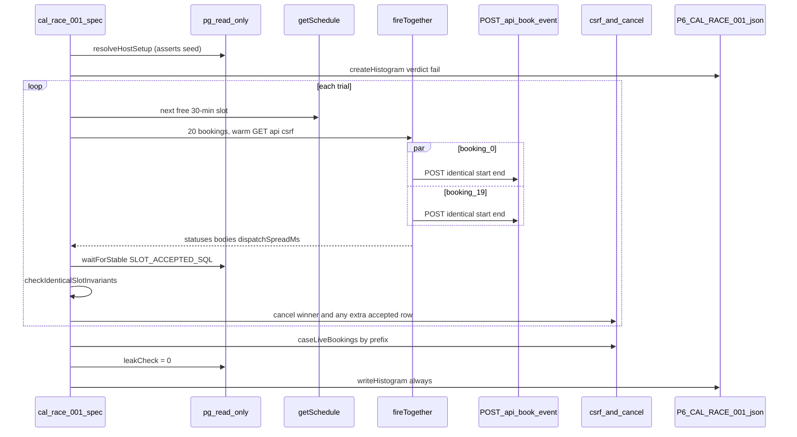

# P6 Phase 1 Task 4: Cal identical-slot race P6-CAL-RACE-001 + P6-CAL-RACE-002 (plan only)

This is the implementation plan a weaker model will build from. Do not write test or helper code
until Jayami approves this document.

Structure and depth follow
[docs/reference/p1-plan-example-medusa.md](../reference/p1-plan-example-medusa.md) and
[2026-10-18-p6-phase1-task2-med-race-001.md](2026-10-18-p6-phase1-task2-med-race-001.md). P1
UI-assertion and page-object rules do **not** apply. P6 asserts through HTTP status histograms and
the read-only database oracle.

The source of this task is [2026-10-20-p6-phase1-roadmap.md](2026-10-20-p6-phase1-roadmap.md),
section "Task 4", and its Decisions D1/D2. The Cal stack facts come from
[2026-10-20-p6-phase1-task3-cal-stack.md](2026-10-20-p6-phase1-task3-cal-stack.md) (probe table
P1–P9).

## Context

- Repo: [Jayami123/k6-load-concurrency-suite](https://github.com/Jayami123/k6-load-concurrency-suite)
  (P6).
- Branch: `feat/2026-10-20-p6-cal-race-001`, created from `origin/feat/2026-10-20-p6-cal-stack`
  (PR #12, Task 3, not merged yet) at **`09d04fed33cf88b6b0374f3f87ee293c1bb63aff`**
  ("ci(races): allow 20 ms dispatch spread on shared runners"). After PR #12 merges, this branch
  is rebased onto `main` before the build starts.
- Harness: `qa-portfolio-harness#v0.2.11`. Cal fork `Jayami123/cal` @
  `c2b7ac44c66f24ffef1662b276f0653988a609a3`. Never edit the harness or the fork. Never start or
  stop Cal by hand: `npm run up:cal` / `npm run down:cal` only.
- Mapped IDs in this task: **`P6-CAL-RACE-001`** (P0) and **`P6-CAL-RACE-002`** (P2). Extras are
  named `extra (unmapped): <short name>`. Not this task: `P6-CAL-RACE-003` overlap (Task 5),
  `P6-CAL-RACE-004`–`007` (later phases).
- PATH before every harness command: `export PATH="/usr/local/bin:$PATH"` (AGENTS.md).
- Probe status: done once on 2026-10-20 in a Claude Code cloud session (section 2). Probe scripts
  lived only in the session scratchpad and imported the real `src/races/fire-together.ts`,
  `src/oracles/pg.ts` and `src/races/prefix.ts`. Nothing was written to the repo, harness or fork.
  Every probe booking was cancelled (leak query in §2.9 shows 0 accepted probe rows). Cal was
  stopped with `npm run down:cal` at the end.
- Review answers (2026-10-20) are applied: §19 lists them. The 400-instead-of-409 finding has the
  ID **`P6-OBS-CAL-001`** (an observation ID, not a test case ID); a draft upstream issue for
  Jayami to file is in Appendix A.

Master-plan names used as-is (roadmap "Remaining Phase 1 cases"):

- `P6-CAL-RACE-001` "Identical slot, N=20 parallel POST × 50 trials; DB ACCEPTED count = 1 per
  trial" (CAL01, P0).
- `P6-CAL-RACE-002` "Publish the status histogram artefact; README cites measured rates only"
  (CAL01, P2).

## 1. Header

- Probe date: 2026-10-20. VM: 4 vCPU, 16093 MB RAM, Docker 29.9.1, Node **v22.23.3** at
  `/usr/local/bin/node`. `PRODUCTS_ROOT=/home/user/products`.
- Bring-up: `bash scripts/bootstrap.sh cal` (fresh clone at the pin, `yarn install` 3 min 35 s,
  `.env` written with generated secrets, never printed), then `npm run up:cal`: exit 0, cold
  **343 s** to `Cal web is up at http://127.0.0.1:3000/`. `GET /pro/30min` → 200.
- Baseline on the base commit: `npm run check` green, `# tests 67`, `# pass 67`, `# fail 0`.
- The Cal seed prints demo passwords and a demo API key. **No plan, README, test or report copies
  them.** The race uses the anonymous booking route; it needs neither.
- Timings here prove a test works. They are never published as performance numbers (AGENTS.md);
  published numbers come only from GitHub Actions `main`/nightly runs (median of ≥ 3).

## 2. Probe findings (required; no guessed values)

### 2.1 Summary

| #   | Question                         | Observed                                                                                                                                                                                                                                                                      |
| --- | -------------------------------- | ----------------------------------------------------------------------------------------------------------------------------------------------------------------------------------------------------------------------------------------------------------------------------- |
| Q1  | Sequential booking               | `POST /api/book/event` → **200** in 285 ms, body `status: "ACCEPTED"`. DB row `status = 'accepted'`, `idempotencyKey` **set** (non-null). No auth, no cookie (§2.2).                                                                                                          |
| Q1  | Sequential second attendee       | **409** `{"message":"no_available_users_found_error","data":{"traceId":"trace_…"}}` (same as Task 3 P5).                                                                                                                                                                      |
| Q2  | **Concurrent loser shape**       | **400** `{"message":"An error occurred while querying the database.","data":{"traceId":"trace_…"}}` for **1162 of 1162** concurrent losers (61 rounds, three modes). **No 409, no 5xx, no 429, no network error** in any concurrent round (§2.3).                             |
| Q2  | Why 400, not 409                 | Server log: Prisma `P2002`, Postgres `23505` `duplicate key value violates unique constraint "Booking_idempotencyKey_key"`. Cal maps P2002 → **409 `booking_conflict_error`**, but in production the cause is redacted first, so the mapping never fires (§2.4). PRODUCT BUG. |
| Q2  | Accepted rows per slot           | **Exactly 1** in 61/61 concurrent rounds, at t=0 and again at t=+2 s. The one 2xx `uid` equals that row's `uid` in 61/61.                                                                                                                                                     |
| Q3  | Slot supply                      | Event type 3 `30min`: `periodType` unlimited, `minimumBookingNotice` 120 min, no booking/duration limits, no seats, buffers 0. Host `pro` Mon–Fri 09:00–17:00 Europe/London. **310–320 free 30-min slots per 28-day window** from getSchedule. ≥ 50 slots proven (§2.5).      |
| Q4  | Cleanup                          | csrf + `POST /api/cancel` → **200** `{"success":true,"message":"Booking successfully cancelled.",…}`; row → `cancelled`, `idempotencyKey` → **NULL**; slot is free again in getSchedule and re-books with 200. Cancel p50 **74 ms**, max 106 ms (§2.6).                       |
| Q5  | Time per trial (N=20)            | Slot query + burst + oracle + cancel: p50 **1214 ms**, p90 1393 ms, max 1938 ms over 50 trials (§2.7).                                                                                                                                                                        |
| Q6  | Rate limit                       | 50 trials × 20 POST back-to-back: **0 × 429**. `checkRateLimitAndThrowError` is off because `UNKEY_ROOT_KEY` is empty in the product `.env` (Task 3 §2.1).                                                                                                                    |
| Q6  | Async side effects               | No `Webhook` rows (0), no `Task` rows, no `ReminderMail` rows. Emails fail fire-and-forget (`ECONNREFUSED 127.0.0.1:1025`, no SMTP server) and do not change the response or slow the burst. Accepted count equal at t=0 and t=+2 s in every round.                           |
| Q7  | Client spread                    | 50-trial run: min 0.96, p50 1.47, p90 2.74, max **5.87** ms; **3 of 50** trials ≥ 5 ms, 0 ≥ 20 ms. All 61 rounds: max **7.59** ms (the very first burst after `up`).                                                                                                          |
| X1  | Same attendee ×20                | 3 rounds: 200×1 + 400×19 each, 1 accepted row each. Same loser shape.                                                                                                                                                                                                         |
| X2  | One instant, three spellings ×21 | `…T09:00:00Z`, `…T09:00:00.000Z`, `…T09:00:00+00:00` (7 requests each): 3 rounds, 200×1 + 400×20 each, **1 accepted row** each. The key is computed from parsed `Date`s, so it normalises.                                                                                    |

### 2.2 Sequential booking (exact)

```http
POST http://127.0.0.1:3000/api/book/event
Content-Type: application/json

{"responses":{"name":"p6 probe","email":"p6-qa-20261020t120859z-8a52f48e-seq-a@example.com",
  "guests":[],"location":{"value":"integrations:daily","optionValue":""}},
 "user":"pro","start":"2026-10-28T16:30:00Z","end":"2026-10-28T17:00:00Z",
 "eventTypeId":3,"eventTypeSlug":"30min","timeZone":"UTC","language":"en",
 "metadata":{},"hasHashedBookingLink":false}
```

Response **200**, `content-type: application/json; charset=utf-8`, 285 ms. Trimmed body:

```json
{
  "id": 31,
  "uid": "si6td3kMbveHG6AtKQBMH3",
  "idempotencyKey": "<uuid>",
  "userId": 4,
  "eventTypeId": 3,
  "startTime": "2026-10-28T16:30:00.000Z",
  "endTime": "2026-10-28T17:00:00.000Z",
  "status": "ACCEPTED",
  "attendees": [{ "email": "p6-qa-20261020t120859z-8a52f48e-seq-a@example.com" }]
}
```

The body has 50 top-level keys (`user`, `attendees`, `references`, `luckyUsers`, `isDryRun`, …).
P6 reads only `uid` and `status`.

DB right after (`SLOT_ROWS_SQL`, §9):

```json
[
  {
    "id": 31,
    "uid": "si6td3kMbveHG6AtKQBMH3",
    "status": "accepted",
    "start": "2026-10-28T16:30:00.000Z",
    "end": "2026-10-28T17:00:00.000Z",
    "hasKey": true
  }
]
```

### 2.3 Concurrent identical-slot bursts (the deciding probe)

Each round: a fresh free slot from getSchedule, `fireTogether(N, …)` with warm `GET /api/csrf`
(never a booking), distinct attendee emails `<prefix>-r<round>-c<NN>@example.com` unless noted,
then the oracle at t=0 and t=+2 s, then cancel every accepted row.

| Run               | Rounds | N   | HTTP total           | Per-round counts      | Accepted rows / round | Winner uid = row | Spread ms (max) |
| ----------------- | ------ | --- | -------------------- | --------------------- | --------------------- | ---------------- | --------------- |
| distinct (warm-1) | 5      | 20  | 200×5, 400×95        | `{200:1, 400:19}` ×5  | 1 (5/5)               | 5/5              | 7.59 (r1)       |
| distinct (full)   | 50     | 20  | 200×50, 400×950      | `{200:1, 400:19}` ×50 | 1 (50/50)             | 50/50            | 5.87            |
| same attendee     | 3      | 20  | 200×3, 400×57        | `{200:1, 400:19}` ×3  | 1 (3/3)               | 3/3              | 4.70            |
| three spellings   | 3      | 21  | 200×3, 400×60        | `{200:1, 400:20}` ×3  | 1 (3/3)               | 3/3              | 4.49            |
| **Total**         | **61** |     | **200×61, 400×1162** | one shape only        | **1 every round**     | **61/61**        | **7.59**        |

Every loser body had exactly the keys `message`, `data` and `data.traceId`:

```json
{ "message": "An error occurred while querying the database.", "data": { "traceId": "trace_…" } }
```

Distinct body shapes over all 1223 concurrent responses: `200 status=ACCEPTED` and the 400 above.
Nothing else. The sequential 409 `no_available_users_found_error` shape (§2.1) did **not** appear
under concurrency on this VM, but it is the response for any request whose availability check runs
after the winner commits, so a slower runner can produce it. Both are allowed losers (D4).

### 2.4 Root cause of the 400 (code + log; recorded, not fixed)

Server log (`node_modules/qa-portfolio-harness/.harness/cal-web.log`) for every loser, 95 of 95 in
the first run (counted with `grep -c P2002`):

```
[redactError] Error: {"code":"P2002","meta":{"modelName":"Booking","driverAdapterError":{…
  "originalCode":"23505","originalMessage":"duplicate key value violates unique constraint
  \"Booking_idempotencyKey_key\"" …
… "Booking 3 failed","Error when saving booking to db" …
… "api_book_event request failed","Error: An error occurred while querying the database. …"
```

Code path at the pinned fork commit:

1. `packages/prisma/extensions/booking-idempotency-key.ts`: on `booking.create` with status
   ACCEPTED, `idempotencyKey = uuidv5("<start>.<end>.<userId>")`. `startTime`/`endTime` are
   `Date`s (`dayjs.utc(evt.startTime).toDate()` in `handleNewBooking/createBooking.ts:188`), so
   `Z`, `.000Z` and `+00:00` give the same key (X2).
2. The losers' INSERTs violate `Booking_idempotencyKey_key` → Prisma `P2002`.
3. `packages/features/bookings/lib/service/RegularBookingService.ts:1819-1826`:
   `err = getServerErrorFromUnknown(_err)`, then
   `if (err.cause … && err.cause.code === "P2002") throw new HttpError({ statusCode: 409, message: ErrorCode.BookingConflict })`
   (`booking_conflict_error`).
4. But `getServerErrorFromUnknown` → `getServerErrorFromPrismaError` → `getHttpError({ statusCode: 400, cause })`
   calls `redactError(cause)` (`packages/lib/redactError.ts`), which, when `IS_PRODUCTION`
   (`CALCOM_ENV === "production"`, true under the harness's `next start`), replaces any Prisma
   error with `new Error("An error occurred while querying the database.")`. The `code` is gone,
   step 3's check is false, and the generic **400** is returned.

So the **double-booking guard holds** (exactly one ACCEPTED row), but the **loser error contract is
broken**: the product's own intended response is 409 `booking_conflict_error`; it returns a generic
400 that hides the conflict. That is a PRODUCT BUG (wrong status for a client-retriable conflict),
reproducible 1162/1162, production mode only. It is **not** a 5xx. It is recorded by the extra in
§6.3 with `test.fail()`; it does not fail `P6-CAL-RACE-001`. Finding ID: **`P6-OBS-CAL-001`**.

**Upstream check (2026-10-20).** `calcom/cal.com` `main` at
**`0f19cc46ef6b6426ee398c670575b3c96be7af9e`** (from `git ls-remote`; files fetched from
`raw.githubusercontent.com` at that SHA) was compared with the fork pin `c2b7ac4`. These five
files are **byte-identical** (`diff -q`):

| File                                                              | Role in the bug                                            |
| ----------------------------------------------------------------- | ---------------------------------------------------------- |
| `packages/lib/redactError.ts`                                     | Replaces Prisma errors in production                       |
| `packages/lib/server/getServerErrorFromUnknown.ts`                | Prisma error → `getHttpError(400)` → `redactError`         |
| `packages/features/bookings/lib/service/RegularBookingService.ts` | `err.cause.code === "P2002"` → 409 check (lines 1821–1826) |
| `packages/prisma/extensions/booking-idempotency-key.ts`           | Sets the unique `idempotencyKey`                           |
| `packages/lib/constants.ts`                                       | `IS_PRODUCTION = CALCOM_ENV === "production"`              |

So the bug is not fork-specific and is still present upstream. Appendix A holds a draft issue for
Jayami to file; P6 does not file it and does not patch the fork.

### 2.5 Slot supply

Event type rows (read-only SELECT on `"EventType"`, ids 3 and 4, host `userId` 4):

| Column                                                          | id 3 `30min` | id 4 `60min` |
| --------------------------------------------------------------- | ------------ | ------------ |
| `length`                                                        | 30           | 60           |
| `minimumBookingNotice`                                          | 120          | 120          |
| `periodType`                                                    | unlimited    | unlimited    |
| `bookingLimits`, `durationLimits`, `maxActiveBookingsPerBooker` | null         | null         |
| `seatsPerTimeSlot`                                              | null         | null         |
| `beforeEventBuffer`, `afterEventBuffer`                         | 0, 0         | 0, 0         |
| `requiresConfirmation`                                          | false        | false        |
| `slotInterval`, `scheduleId`                                    | null, null   | null, null   |

Host `pro`: `users.id` 4, `timeZone` Europe/London, one `Availability` row `days [1..5]`,
09:00–17:00. Seed bookings for host 4: 11 accepted and 7 pending between 2026-10-16 and
2026-12-31 (they remove some slots; getSchedule already excludes them).

getSchedule (Task 3 §2.3 request, `eventTypeId` 3, `usernameList ["pro"]`, `timeZone` UTC):

| Window (UTC)                     | Free 30-min slots |
| -------------------------------- | ----------------- |
| +2 d … +9 d (2026-10-22 → 10-29) | 76                |
| 2026-11-03 → 2026-12-01 (28 d)   | 310               |
| 2026-12-19 → 2027-01-16 (28 d)   | 320               |

The 50-trial run used 50 consecutive free slots (2026-11-17 → 2026-11-24, 16 per weekday), each
taken from a fresh getSchedule call (p50 72 ms, max 119 ms). Slot times are always read from
getSchedule, never computed: the host is on Europe/London, so UTC hours shift at DST (Task 3 R7).

### 2.6 Cleanup (exact)

1. `GET /api/csrf` → 200, `Set-Cookie: calcom.csrf_token=…`, JSON `{ csrfToken }`.
2. `POST /api/cancel`, `Content-Type: application/json`, `Cookie: calcom.csrf_token=…`, body
   `{"uid":"<uid>","cancellationReason":"p6 cleanup","cancelledBy":"p6-qa@example.com","csrfToken":"<csrfToken>"}`
   → **200** `{"success":true,"message":"Booking successfully cancelled.","onlyRemovedAttendee":false,"bookingId":31,"bookingUid":"si6…"}`.

DB after: `status = 'cancelled'`, `hasKey: false` (`idempotencyKey` NULL). getSchedule lists the slot
again; a new booking there → 200, a second row; cancelling it leaves two `cancelled` rows. Cancel
p50 74 ms, max 106 ms per accepted booking (one per trial). Without the cookie → 400 (Task 3 P7).
Cancelled rows cannot be deleted through the API; they stay, isolated by attendee email prefix.

### 2.7 Timing (proof only, not published)

| Step                                         | p50     | max     |
| -------------------------------------------- | ------- | ------- |
| getSchedule (28-day window)                  | 72 ms   | 119 ms  |
| `fireTogether` 20 × POST `/api/book/event`   | 1057 ms | 1742 ms |
| oracle (one SELECT)                          | 4 ms    | 17 ms   |
| cancel winner (csrf + cancel)                | 74 ms   | 106 ms  |
| **trial total**                              | 1214 ms | 1938 ms |
| 50 trials, back to back (without probe wait) | ≈ 61 s  |         |
| `up:cal` cold (build + seed)                 | 343 s   |         |

Client dispatch spread (`dispatchSpreadMs`, Node start times) against the helper default
(`RACE_MAX_SPREAD_MS` unset = 5) and the CI value (`RACE_MAX_SPREAD_MS=20`, set on both race jobs
since base commit `09d04fe`):

| Run                    | Rounds | min ms | p50 ms | p90 ms | max ms | ≥ 5 ms (default) | ≥ 20 ms (CI) |
| ---------------------- | ------ | ------ | ------ | ------ | ------ | ---------------- | ------------ |
| distinct, first 5      | 5      | 1.73   | 2.57   | 2.96   | 7.59   | 1                | 0            |
| distinct, 50 trials    | 50     | 0.96   | 1.47   | 2.74   | 5.87   | 3                | 0            |
| same attendee          | 3      | 1.57   | 4.29   | 4.29   | 4.70   | 0                | 0            |
| three spellings (N=21) | 3      | 3.33   | 4.15   | 4.15   | 4.49   | 0                | 0            |
| **All**                | **61** | 0.96   | 1.60   | 4.29   | 7.59   | **4 (6.6 %)**    | **0**        |

At the CI limit no round would have failed as `TEST BUG: dispatchSpreadMs`; at the default 5 ms,
4 of 61 would. That is why local verification also sets `RACE_MAX_SPREAD_MS=20` (D8).

### 2.8 Rate limit and async effects

- 1000 POSTs in 50 bursts over ≈ 2.7 min: no 429. `UNKEY_ROOT_KEY=` is empty in the product
  `.env` written by `bootstrap.sh` (names checked, values not printed), so the limiter is disabled
  (`packages/lib/rateLimit.ts`). A 429 in a P6 run therefore means the environment changed (ENV).
- `"Webhook"` count 0; `"Task"` empty; `"ReminderMail"` empty. Confirmation emails fail with
  `ECONNREFUSED 127.0.0.1:1025` in the web log, asynchronously; the booking still returns 200.
- The accepted count was identical at t=0 and t=+2 s in 61/61 rounds. The oracle still reads it
  through `waitForStable` (cheap: two reads 50 ms apart), the same as Medusa.

### 2.9 Leak query by prefix (live)

```sql
SELECT b.status::text AS status, COUNT(DISTINCT b.id)::int AS n
FROM "Booking" b JOIN "Attendee" a ON a."bookingId" = b.id
WHERE a.email LIKE $1
GROUP BY 1
-- $1 = 'p6-qa-%'  →  [{"status":"cancelled","n":63}]   (0 accepted, 0 pending)
```

`"Attendee"` columns: `id`, `email`, `name`, `timeZone`, `bookingId`, `locale`, `phoneNumber`,
`noShow`. Attendee emails are stored as sent (the probe sent lowercase). The read-only guard
refused `EXPLAIN …` ("TEST BUG: oracle query is not SELECT-only"), as designed; the oracle uses
plain SELECTs only.

## 3. Resolved decisions

Lead with the industry-standard approach, then the rejected alternative.

- **D1 Route = anonymous web `POST /api/book/event`** with the exact body of §2.2 (Task 3 D2).
  Rejected: API v2 `/v2/bookings` (not started by the harness).
- **D2 One fresh free slot per trial, from getSchedule, shared across the spec file.** A
  `SlotAllocator` queries getSchedule for event type 3 from the start of UTC day today + 2
  (clears the 120-minute notice), window 28 days; it picks the earliest slot not already used in
  this run and remembers it. If the window is empty it moves forward 28 days (at most 6 windows,
  then `TEST BUG: no free 30-min slot`). Industry standard: discover availability through the
  product API, never hard-code times. Rejected: computing times from the schedule rows (DST,
  seed bookings); deleting bookings (no API).
- **D3 Oracle = count of ACCEPTED rows for host + exact start + exact end**, any event type, in
  SQL with lowercase `'accepted'`. Must be exactly 1. The single 2xx response's `uid` must equal
  that row's `uid`, and the row must have a non-null `idempotencyKey`. Read through
  `waitForStable`. Rejected: counting by attendee email (a double booking might carry another
  attendee); counting HTTP 200s only.
- **D4 Allowed losers for `P6-CAL-RACE-001`** (classified by `classifyLoser`, unit-tested):
  - `slot-taken`: 409 + `message === "no_available_users_found_error"` (sequential path, §2.1);
  - `booking-conflict`: 409 + `message === "booking_conflict_error"` (the product's intended P2002
    mapping; never seen here, allowed so a fixed product still passes);
  - `db-unique-redacted`: 400 + `message === "An error occurred while querying the database."`
    (every concurrent loser observed, §2.3–2.4).

  Anything else fails the trial: `status === null` or ≥ 500 → **PRODUCT BUG**; 429 → **ENV**
  (limiter on); any other status/message → **TEST BUG** (payload or contract drift; investigate
  before relabelling). Rejected: "any 4xx is a loser" (would hide a broken payload as a loser);
  requiring 409 in the mapped case (the guard holds; the error-contract bug belongs to its own
  extra, §6.3).

- **D5 Distinct attendees stamped with the case prefix.** Email
  `${casePrefix(runPrefix, caseId)}-t${trial}-c${NN}@example.com`, name `p6 c${NN}`. All lowercase,
  `[a-z0-9-]` before `@`. `@example.com` is reserved (RFC 2606), and SMTP is down anyway.
  Reuse `casePrefix`, `caseLeakPattern`, `likeLiteralPrefix`, `cleanupFailure` from
  `src/medusa/payloads.ts` (import, do not copy, do not move in this PR; Task 8 may move them to
  `src/races/`).
- **D6 Cleanup per trial in `finally`, sweep per case in `finally`, then the leak check.**
  Per trial: cancel the uid of every 2xx body **and** every ACCEPTED row in the trial's slot whose
  attendee email matches the case prefix (so a double booking is also cancelled). Per case: a
  sweep selects every ACCEPTED/PENDING booking whose attendee email matches `caseLeakPattern` and
  cancels it. Leak check: 0 such rows after the sweep. A failed cancel pushes
  `cleanupFailure("booking", uid, err)`. Rejected: leaving accepted rows (they would consume the
  slot supply locally, where the DB volume persists, Task 3 H4).
- **D7 Trial counts (roadmap D2) via env only.** The mapped case uses `RACE_TRIALS`; extras use
  `min(RACE_TRIALS, 3)` (Task 2 D15). CI sets `RACE_TRIALS` to **5 on `pull_request`** and **50 on
  `push` to `main`, `schedule` and `workflow_dispatch`** in a separate step. `fireTogether` and
  `runTrials` are unchanged. Rejected: a new `CAL_RACE_TRIALS` variable (one name is enough);
  running the self-test at 50 (it would not add evidence and its test timeout is 120 s).
- **D8 Spread limit stays an env value.** CI already sets `RACE_MAX_SPREAD_MS: "20"` on the Cal
  self-test (base commit `09d04fe`); the new step uses the same (**confirmed by Jayami, answer 4**).
  The probe saw 4/61 rounds ≥ 5 ms, 0/61 ≥ 20 ms, max 7.59 ms (§2.7). Local verification also runs
  with `RACE_MAX_SPREAD_MS=20`. Rejected: changing the helper default (Task 1 D5); tightening to
  10 ms (Jayami kept 20).
- **D9 Playwright timeout per describe = `60_000 + trials × 10_000` ms** (50 trials → 560 s).
  Probe max trial 1.94 s; 10 s per trial leaves room for a slower runner and cleanup. Rejected:
  raising the global 60 s timeout.
- **D10 `P6-CAL-RACE-002` is its own `test()` after `P6-CAL-RACE-001` in a serial describe.** It
  reads `results/races/P6-CAL-RACE-001.json` and checks the artefact contract (§8). CI uploads it in
  `race-histograms-cal` (already the whole `results/races/` folder). README rates come only from
  `main`/nightly runs (§17). Rejected: folding 002 into 001 (002 is a separate mapped ID with its
  own pass/fail).
- **D11 Setup asserted before the race.** `beforeAll` resolves host and event type from the DB
  (`users.username = 'pro'`, `"EventType".slug = '30min'` for that user) and asserts
  `length = 30`, `seatsPerTimeSlot IS NULL`, `requiresConfirmation = false`,
  `periodType = 'unlimited'`; any mismatch is `TEST BUG: seed changed`. Each trial asserts the chosen slot was in
  getSchedule (free) before firing.
- **D12 Known product bug handling.** Only the loser-contract extra (§6.3) uses `test.fail()`,
  placed right after `expect(histogram.verdict).toBe("pass")` (setup and the main invariant pass
  first) and right before the strict 409 assertion. Evidence: 1162/1162 losers, three modes, log +
  code path §2.4 (finding `P6-OBS-CAL-001`; **kept as planned, answer 1**). If Cal fixes the
  mapping, that test turns red ("expected to fail but passed") and the `test.fail()` line is
  removed. `P6-CAL-RACE-001` has no `test.fail()`.
- **D13 CI: nightly `schedule`, own concurrency group.** `schedule: cron "17 2 * * *"` (02:17 UTC,
  off the top of the hour). Concurrency group becomes
  `perf-${{ github.event_name == 'schedule' && 'nightly' || github.ref }}`, so a nightly run never
  cancels or is cancelled by a push to `main`. `medusa-smoke` is not edited (it also runs nightly,
  unchanged, at its 3 trials).

## 4. Goal and scope

**In:**

- `src/cal/{payloads,api,oracle,invariants,run-case}.ts`
- `tests/cal/races/cal-race-001-identical-slot.spec.ts` in project `cal-race`
- `P6-CAL-RACE-001` (N=20, 50 trials on full runs), `P6-CAL-RACE-002` (artefact contract)
- Three extras (§6), each its own `test()` and histogram
- Unit tests `tests/unit/cal-{payloads,invariants,oracle}.test.ts`
- `perf.yml`: schedule, concurrency group, new race step with D2 trial counts and step timeout
- README section "Cal identical-slot histogram (`P6-CAL-RACE-001`)"

**Out:** see §18.

## 5. Test-case mapping

| ID                                        | File                                                  | Project    | Histogram `caseId`     | Title                                                        | Oracle                                                                              |
| ----------------------------------------- | ----------------------------------------------------- | ---------- | ---------------------- | ------------------------------------------------------------ | ----------------------------------------------------------------------------------- |
| P6-CAL-RACE-001                           | `tests/cal/races/cal-race-001-identical-slot.spec.ts` | `cal-race` | `P6-CAL-RACE-001`      | `Identical slot, N=20 parallel POST; DB ACCEPTED count = 1`  | §9 `SLOT_ACCEPTED_SQL` = 1 row; 1 × 2xx; uid match; key set; D4 losers              |
| P6-CAL-RACE-002                           | same file, next `test()`                              | same       | (reads 001's file)     | `Status histogram artefact for P6-CAL-RACE-001`              | §8 artefact contract                                                                |
| extra (unmapped): same attendee ×20       | same file                                             | same       | `extra-same-attendee`  | `extra (unmapped): same attendee double-submit ×20`          | same as 001                                                                         |
| extra (unmapped): one instant 3 spellings | same file                                             | same       | `extra-time-spellings` | `extra (unmapped): one instant written three ways ×21`       | same as 001                                                                         |
| extra (unmapped): loser error contract    | same file                                             | same       | `extra-loser-contract` | `extra (unmapped): concurrent losers get 409, never 400/5xx` | same as 001, then every loser kind ∈ {slot-taken, booking-conflict} (`test.fail()`) |

The Task 3 `cal-self-test` stays unchanged.

## 6. Extra risky cases (unmapped, required; all probe-proven feasible)

1. **Same attendee ×20** (retry/double-submit idempotency). Every request has the same email and
   name. Probe X1: one accepted row, 19 losers of the same 400 shape. Fails if two rows are accepted
   (a client retry storm would double-book).
2. **One instant written three ways ×21** (idempotency-key normalisation). Requests `i % 3`: `…Z`,
   `….000Z`, `…+00:00` for both start and end. Probe X2: one accepted row. Fails if the key were
   built from the raw string (up to three accepted rows). N=21 so each spelling gets 7.
3. **Loser error contract** (no 5xx and no generic 400 when the unique constraint fires). Runs the
   distinct-attendee burst, asserts the main invariant (`verdict === "pass"`), then `test.fail()`,
   then `expect(nonConflictLosers, …).toBe(0)` where a non-conflict loser is any loser whose kind is
   not `slot-taken` or `booking-conflict`. Known PRODUCT BUG (§2.4): today every loser is
   `db-unique-redacted`, so the strict assertion fails, as expected.

Rejected extras: N=2 boundary (adds nothing over N=20 on a unique-key guard; not probed);
reschedule/cancel races (`P6-CAL-RACE-004/005`, later phases).

## 7. Architecture (every file touched, one responsibility each)

New:

| Path                                                  | Responsibility                                                                                                                 |
| ----------------------------------------------------- | ------------------------------------------------------------------------------------------------------------------------------ |
| `src/cal/payloads.ts`                                 | Pure: `bookingBody`, `attendeeEmail`, `slotEnd`, `timeSpellings`, `pickFreeSlot`, `parseBookingResponse`. No I/O.              |
| `src/cal/api.ts`                                      | HTTP: `getFreeSlots`, `createBooking`, `cancelBooking`, `createSlotAllocator`.                                                 |
| `src/cal/oracle.ts`                                   | SQL constants, `toDbTimestamp`, `rowEvidence` (pure); `resolveHostSetup`, `readSlotAccepted`, `caseLiveBookings`, `leakCheck`. |
| `src/cal/invariants.ts`                               | Pure: `classifyLoser`, `checkIdenticalSlotInvariants`, `nonConflictLosers`.                                                    |
| `src/cal/run-case.ts`                                 | `runIdenticalSlotCase`: trial loop; histogram created before `try`, written in `finally`; sweep + leak check.                  |
| `tests/cal/races/cal-race-001-identical-slot.spec.ts` | Live tests (§5).                                                                                                               |
| `tests/unit/cal-payloads.test.ts`                     | Payload builders, slot picker, response parser.                                                                                |
| `tests/unit/cal-invariants.test.ts`                   | Loser classifier and invariant matrix.                                                                                         |
| `tests/unit/cal-oracle.test.ts`                       | SQL constants SELECT-only and shape; `toDbTimestamp`; `rowEvidence`.                                                           |

Modified:

| Path                         | Change                                                                     |
| ---------------------------- | -------------------------------------------------------------------------- |
| `.github/workflows/perf.yml` | `schedule`, concurrency group, self-test step scoped to its file, new step |
| `README.md`                  | New section after "Run Cal"                                                |

Unchanged: `src/races/*`, `src/oracles/pg.ts`, `src/medusa/*`, `playwright.config.ts` (the
`cal-race` project already globs `tests/cal/races`), `package.json`, `scripts/*`, `medusa-smoke`,
harness, fork, k6.



## 8. Histogram fields (P6-CAL-RACE-002 contract)

Reuse `RaceHistogram` / `createHistogram` / `writeHistogram` / `recordTrial` /
`mergeStatusCounts` / `aggregateDispatchSpread` unchanged. `product: "cal"`. Mapped:
`caseId: "P6-CAL-RACE-001"`, `title: "Identical slot, N=20 parallel POST; DB ACCEPTED count = 1"`,
`concurrency: 20`, `trials: RACE_TRIALS`.

- `statusCounts`: status → count across all trials (e.g. `{"200": 50, "400": 950}` at 50 trials
  if today's behaviour holds). This is the published histogram.
- Histogram-level `oracle` (numbers only): `hostUserId`, `eventTypeId`, `loser_slot-taken`,
  `loser_booking-conflict`, `loser_db-unique-redacted`, `loser_unexpected`, `acceptedTotal`
  (sum of per-trial accepted), `leakAccepted` (after the sweep).
- Per-trial `oracle`: `slotStart` (ISO), `acceptedCount`, `httpWinners`, `winnerUidMatches`
  (bool), `hasIdempotencyKey` (bool), `slotRowsTotal`, and the four `loser_*` counts.
- On a violation, the per-trial `invariantViolations` carries `rowEvidence(rows)` text:
  `id`, `uid`, `status`, `start`, `end` only. No tokens, no cookies, no seed credentials.

`P6-CAL-RACE-002` passes when the file exists and: `caseId === "P6-CAL-RACE-001"`,
`product === "cal"`, `concurrency === 20`, `trials === RACE_TRIALS`,
`perTrial.length === trials`, sum of `statusCounts` values `=== trials × 20`, every key of
`statusCounts` is a 3-digit status or `"error"`, `commitSha` non-empty, `finishedAt` set,
`verdict === "pass"`.

## 9. Oracle design (exact SQL)

`src/cal/oracle.ts` (every query through `selectRows`, so `assertSelectOnly` runs):

```ts
import type pg from "pg";
import { selectRows, waitForStable } from "../oracles/pg.ts";

export const HOST_SETUP_SQL = `
SELECT u.id AS "userId", e.id AS "eventTypeId", e.length, e."seatsPerTimeSlot",
  e."requiresConfirmation", e."periodType"::text AS "periodType"
FROM users u JOIN "EventType" e ON e."userId" = u.id
WHERE u.username = $1 AND e.slug = $2
`;

// "Booking" times are timestamp without time zone, stored as UTC (DB TimeZone Etc/UTC).
export const SLOT_ACCEPTED_SQL = `
SELECT id, uid, status::text AS status,
  to_char("startTime", 'YYYY-MM-DD"T"HH24:MI:SS.MS"Z"') AS start,
  to_char("endTime", 'YYYY-MM-DD"T"HH24:MI:SS.MS"Z"') AS "end",
  ("idempotencyKey" IS NOT NULL) AS "hasKey"
FROM "Booking"
WHERE "userId" = $1 AND "startTime" = $2::timestamp AND "endTime" = $3::timestamp
  AND status = 'accepted'
ORDER BY id
`;

// Bookings of this case still holding a slot (the sweep cancels them; the leak check wants 0).
export const CASE_LIVE_BOOKINGS_SQL = `
SELECT DISTINCT b.id, b.uid, b.status::text AS status,
  to_char(b."startTime", 'YYYY-MM-DD"T"HH24:MI:SS.MS"Z"') AS start,
  to_char(b."endTime", 'YYYY-MM-DD"T"HH24:MI:SS.MS"Z"') AS "end"
FROM "Booking" b JOIN "Attendee" a ON a."bookingId" = b.id
WHERE a.email LIKE $1 AND b.status IN ('accepted', 'pending')
ORDER BY b.id
`;

export type SlotRow = { id: number; uid: string; status: string; start: string; end: string };

/** "2026-11-03T09:00:00Z" | "…00.000Z" | "…00+00:00" → "2026-11-03 09:00:00.000". Throws TEST BUG otherwise. */
export function toDbTimestamp(iso: string): string {
  const ms = Date.parse(iso);
  if (!/(Z|\+00:00)$/.test(iso) || Number.isNaN(ms)) {
    throw new Error(`TEST BUG: not a UTC instant: ${iso}`);
  }
  return new Date(ms).toISOString().replace("T", " ").replace("Z", "");
}

/** Evidence text for a violation: ids, uids, status and times only. */
export function rowEvidence(rows: SlotRow[]): string {
  return rows
    .map((r) => `id=${r.id} uid=${r.uid} status=${r.status} ${r.start}..${r.end}`)
    .join(" | ");
}

export async function resolveHostSetup(
  pool: pg.Pool,
): Promise<{ userId: number; eventTypeId: number }> {
  const rows = await selectRows<{
    userId: number;
    eventTypeId: number;
    length: number;
    seatsPerTimeSlot: number | null;
    requiresConfirmation: boolean;
    periodType: string;
  }>(pool, HOST_SETUP_SQL, ["pro", "30min"]);
  const r = rows[0];
  if (
    rows.length !== 1 ||
    !r ||
    r.length !== 30 ||
    r.seatsPerTimeSlot !== null ||
    r.requiresConfirmation ||
    r.periodType !== "unlimited"
  ) {
    throw new Error(`TEST BUG: seed changed: pro/30min ${JSON.stringify(rows)}`);
  }
  return { userId: r.userId, eventTypeId: r.eventTypeId };
}

export async function readSlotAccepted(
  pool: pg.Pool,
  userId: number,
  start: string,
  end: string,
): Promise<Array<SlotRow & { hasKey: boolean }>> {
  return waitForStable(() =>
    selectRows<SlotRow & { hasKey: boolean }>(pool, SLOT_ACCEPTED_SQL, [
      userId,
      toDbTimestamp(start),
      toDbTimestamp(end),
    ]),
  );
}

export async function caseLiveBookings(pool: pg.Pool, likePattern: string): Promise<SlotRow[]> {
  return selectRows<SlotRow>(pool, CASE_LIVE_BOOKINGS_SQL, [likePattern]);
}
```

`leakCheck(pool, likePattern)` returns `[]` or
`["TEST BUG: leak live bookings attendee LIKE <pattern>: <rowEvidence>"]`.

`src/cal/invariants.ts` (pure; unit-tested):

```ts
export const LOSER_SLOT_TAKEN = "no_available_users_found_error";
export const LOSER_BOOKING_CONFLICT = "booking_conflict_error";
export const LOSER_DB_REDACTED = "An error occurred while querying the database.";

export type LoserKind = "slot-taken" | "booking-conflict" | "db-unique-redacted" | "unexpected";

export function classifyLoser(status: number | null, message: string | null): LoserKind {
  if (status === 409 && message === LOSER_SLOT_TAKEN) return "slot-taken";
  if (status === 409 && message === LOSER_BOOKING_CONFLICT) return "booking-conflict";
  if (status === 400 && message === LOSER_DB_REDACTED) return "db-unique-redacted";
  return "unexpected";
}

export type ParsedResponse = {
  status: number | null;
  uid: string | null;
  bodyStatus: string | null;
  message: string | null;
  summary: string;
};

export function checkIdenticalSlotInvariants(input: {
  n: number;
  responses: ParsedResponse[];
  accepted: Array<{
    id: number;
    uid: string;
    status: string;
    start: string;
    end: string;
    hasKey: boolean;
  }>;
  dispatchSpreadMs: number;
  spreadLimit: number;
}): string[];

/** Losers whose kind is not a 409 conflict (the §6.3 contract). */
export function nonConflictLosers(responses: ParsedResponse[]): ParsedResponse[];
```

`checkIdenticalSlotInvariants` rules (implement exactly; each pushes one string):

- `responses.length !== n` → `TEST BUG: expected ${n} responses, got …`.
- each `status === null` or `>= 500` → `PRODUCT BUG: HTTP ${status ?? "error"} ${summary}` (the
  summary keeps the `traceId`).
- each `status === 429` → `ENV: HTTP 429 rate limited (UNKEY_ROOT_KEY set?)`.
- each other non-2xx with `classifyLoser(...) === "unexpected"` →
  `TEST BUG: unexpected loser ${summary}`.
- `accepted.length > 1` → `PRODUCT BUG: ${accepted.length} ACCEPTED bookings for one slot: ${rowEvidence(accepted)}`.
- `accepted.length === 0` → `PRODUCT BUG: no ACCEPTED booking for a free slot`.
- count of 2xx `!== 1` → `PRODUCT BUG: ${k} HTTP 2xx for one slot`.
- the 2xx body must have `bodyStatus === "ACCEPTED"` and `uid === accepted[0].uid` →
  else `PRODUCT BUG: HTTP winner uid ${uid} != DB ACCEPTED uid ${accepted[0].uid}`.
- `accepted.length === 1 && !accepted[0].hasKey` → `PRODUCT BUG: ACCEPTED row has no idempotencyKey`.
- `dispatchSpreadMs >= spreadLimit` → `TEST BUG: dispatchSpreadMs ${…} >= ${spreadLimit}`.

## 10. Test data, isolation, cleanup and leak check

- Run prefix: `p6RunPrefix()` once per spec file. Case prefix
  `casePrefix(runPrefix, caseId)`, e.g. `p6-qa-20261020t120912z-e0ccf836-p6-cal-race-001`.
  Attendee email `${casePrefix}-t${trial}-c${NN}@example.com` (`NN` 2-digit); same-attendee extra
  uses `-t${trial}-same@example.com`.
- Slots: one `createSlotAllocator` per spec file (shared by every test), so no two trials in a run
  use the same slot.
- `workers: 1` (config), tests in file order, mapped + 002 in `test.describe.serial`.
- Per-trial `finally` (D6): `cancelBooking` for each uid from 2xx bodies, plus each
  `SLOT_ACCEPTED_SQL` row whose uid is not yet cancelled and whose attendee matches the case prefix
  (look it up with `caseLiveBookings` filtered to the slot). Errors → `cleanupFailure`.
- Per-case `finally` (inside `runIdenticalSlotCase`, before `writeHistogram`): sweep
  `caseLiveBookings(pool, caseLeakPattern(runPrefix, caseId))` → cancel each; then `leakCheck`
  must return `[]`, else the violation goes into `histogram.invariantViolations` and
  `verdict = "fail"`.
- Cancelled rows stay (no delete API); they hold no slot and no key, and only this run's prefix
  matches them.
- `closePool` in `afterAll`.

## 11. Known-bug handling

| Observation                                                                  | Label           | Action                                                                                                                                           |
| ---------------------------------------------------------------------------- | --------------- | ------------------------------------------------------------------------------------------------------------------------------------------------ |
| Losers 400 `An error occurred while querying the database.` (P2002 redacted) | **PRODUCT BUG** | `P6-OBS-CAL-001`. Allowed loser in 001 (guard holds). Recorded by §6.3 with `test.fail()`. README explains it. Draft upstream issue: Appendix A. |
| ≥ 2 ACCEPTED rows for one slot                                               | **PRODUCT BUG** | Fail hard; rows attached via `rowEvidence`. Repeat ≥ 2 runs before any `test.fail()`.                                                            |
| Any 5xx or network error on the booking POST                                 | **PRODUCT BUG** | Fail hard; status + body summary with `traceId`; grep the web log for that trace id.                                                             |
| 0 ACCEPTED rows, or 2xx count ≠ 1, or uid mismatch                           | **PRODUCT BUG** | Fail hard with the rows and summaries.                                                                                                           |
| Unexpected 4xx (validation etc.)                                             | **TEST BUG**    | Fix payload/contract after reading the body; do not widen D4 without a probe.                                                                    |
| 429                                                                          | **ENV**         | `UNKEY_ROOT_KEY` set or limiter on; fix the environment.                                                                                         |
| Spread ≥ limit                                                               | **TEST BUG**    | Barrier/runner noise; raise `RACE_MAX_SPREAD_MS` in env only.                                                                                    |
| Seed check or getSchedule fails                                              | **TEST BUG**    | `seed changed` / no slot; report the rows.                                                                                                       |
| Leak check non-zero                                                          | **TEST BUG**    | Cleanup failed; paste the rows (ids/uids only).                                                                                                  |

`test.fail()` appears exactly once, in the §6.3 extra, after the setup and invariant assertions,
immediately before the strict loser assertion.

## 12. CI (`.github/workflows/perf.yml`)

1. Triggers:

   ```yaml
   on:
     pull_request:
     push:
       branches: [main]
     workflow_dispatch:
     # Nightly full-count races (roadmap D2). 02:17 UTC, off the top of the hour.
     schedule:
       - cron: "17 2 * * *"
   ```

2. Concurrency:

   ```yaml
   concurrency:
     # Scheduled runs get their own group so a nightly run and a push to main never cancel each other.
     group: perf-${{ github.event_name == 'schedule' && 'nightly' || github.ref }}
     cancel-in-progress: true
   ```

3. In `cal-smoke`, scope the existing self-test step to its file (name and env unchanged):
   `npm run race:cal -- tests/cal/races/cal-self-test.spec.ts`.
4. New step right after it:

   ```yaml
   - name: Race P6-CAL-RACE-001 (cal-race)
     if: ${{ !cancelled() && steps.cal_up.outcome == 'success' }}
     working-directory: ${{ env.P6_WORKING_DIRECTORY }}
     # Probe: ~1.2 s per trial (max 1.9 s) on a 4 vCPU VM; 50 trials + 6 extra trials ≈ 70 s.
     timeout-minutes: ${{ github.event_name == 'pull_request' && 5 || 15 }}
     env:
       # Roadmap D2: about 5 on PRs, the full 50 on main, nightly and manual runs.
       RACE_TRIALS: ${{ github.event_name == 'pull_request' && '5' || '50' }}
       RACE_MAX_SPREAD_MS: "20"
     run: |
       set -euo pipefail
       echo "### P6-CAL-RACE-001 trials: ${RACE_TRIALS}" >> "$GITHUB_STEP_SUMMARY"
       npm run race:cal -- tests/cal/races/cal-race-001-identical-slot.spec.ts
   ```

5. `race-histograms-cal` upload: unchanged; it already uploads `p6/results/races/` with
   `!cancelled()`, so `P6-CAL-RACE-001.json` and the three extras' files ship even when the race
   step fails.
6. `medusa-smoke`: **no edits** (`git diff` inside that job must be empty). Cache-save steps keep
   `github.event_name == 'push'`, so scheduled runs never write caches.
7. Job `timeout-minutes: 60` stays (cold install + build ≈ 10–12 min, race ≈ 2 min).

## 13. Risks and unknowns

- **R1 Loser shape differs on CI.** A slower runner may give some `slot-taken` 409s; both are
  allowed (D4). An unseen shape fails as TEST BUG with the body: probe it before widening D4.
- **R2 Product fixes the P2002 mapping.** 001 still passes (`booking-conflict` allowed); §6.3
  turns red because `test.fail()` passes unexpectedly → remove the line, update README.
- **R3 Slot exhaustion locally.** Cancelled slots become free again (§2.6), so local reruns do not
  drain supply; 6 × 28-day windows ≈ 1800 slots.
- **R4 DST / time zone.** Slots come from getSchedule in UTC; SQL compares
  `timestamp without time zone` against `toDbTimestamp` (UTC). The DB `TimeZone` is `Etc/UTC`.
- **R5 Spread on shared runners.** Env 20 ms (D8). Probe max 7.59 ms.
- **R6 Seed drift.** `resolveHostSetup` fails fast (D11).
- **R7 First burst after `up` is colder** (r1 spread 7.59 ms, burst 1.5 s). Within limits; no
  warm-up trial is added.
- **R8 Email errors in logs.** Expected (no SMTP); not a failure signal.
- **R9 Nightly runs both jobs.** About 15 min of runner time per night (Medusa + Cal warm).

## 14. Build steps (repo root; PATH export first; on any differing output: stop and report, paste it)

Do not start until Jayami approves this plan and PR #12 is merged. Never `git add -A`. Never print
secrets. Always finish with `npm run down:cal`.

### Step 0. Branch, products, baseline

Build branch: **this branch, `feat/2026-10-20-p6-cal-race-001`** (recommended): plan and build land
in one PR, the roadmap rule "one PR per task" that Task 2 followed (PR #8). Only the plan commits are
replayed onto `main`, so the PR diff is just Task 4. If Jayami prefers a separate build branch, run
the same rebase, then `git switch -c feat/<date>-p6-cal-race-001-build` and build there.

```bash
export PATH="/usr/local/bin:$PATH"
git fetch origin main feat/2026-10-20-p6-cal-race-001
git switch feat/2026-10-20-p6-cal-race-001
# PR #12 merged (any merge style): replay only the commits after the Task 3 base 09d04fe.
git rebase --onto origin/main 09d04fed33cf88b6b0374f3f87ee293c1bb63aff
git log --oneline origin/main..HEAD   # only the docs(plans) commits of this task
git push --force-with-lease origin feat/2026-10-20-p6-cal-race-001   # own branch, plan-only history
npm ci
npm run check                         # # tests 67, # fail 0

# Cal checkout: bootstrap ONCE per session, and only if the fork is not cloned yet.
test -d "${PRODUCTS_ROOT:-/home/user/products}/cal/.git" || bash scripts/bootstrap.sh cal
git status --short                    # empty: nothing under products/ ever enters this repo
```

Rules for every later step: never rerun `bootstrap.sh cal` in the same session (it re-runs
`yarn install`, about 3.5 min, and nothing changes); never `git add` anything under `products/`
(the fork lives outside the repo at `PRODUCTS_ROOT`; if a path under `products/` ever shows in
`git status`, stop and report). Before each commit, `git status --short` must list only the paths
of that commit (§16).

### Step 1. Pure helpers + unit tests (no product)

`src/cal/payloads.ts`:

```ts
export const CAL_HOST_USERNAME = "pro";
export const CAL_EVENT_SLUG = "30min";
export const SLOT_MINUTES = 30;

export function attendeeEmail(prefix: string, leaf: string): string {
  return `${prefix.toLowerCase()}-${leaf}@example.com`;
}

export function slotEnd(startIso: string, minutes = SLOT_MINUTES): string {
  return new Date(Date.parse(startIso) + minutes * 60_000).toISOString();
}

/** Same instant three ways: "…Z", "….000Z", "…+00:00". Input must be a UTC ISO string. */
export function timeSpellings(iso: string): [string, string, string] {
  const base = new Date(Date.parse(iso)).toISOString(); // ….000Z
  const z = base.replace(".000Z", "Z");
  return [z, base, base.replace("Z", "+00:00").replace(".000+", "+")];
}

export function bookingBody(input: {
  start: string;
  end: string;
  email: string;
  name: string;
  eventTypeId: number;
}): Record<string, unknown> {
  return {
    responses: {
      name: input.name,
      email: input.email,
      guests: [],
      location: { value: "integrations:daily", optionValue: "" },
    },
    user: CAL_HOST_USERNAME,
    start: input.start,
    end: input.end,
    eventTypeId: input.eventTypeId,
    eventTypeSlug: CAL_EVENT_SLUG,
    timeZone: "UTC",
    language: "en",
    metadata: {},
    hasHashedBookingLink: false,
  };
}

/** Earliest slot not in `used` and not before notBeforeMs. Throws TEST BUG when none. */
export function pickFreeSlot(slots: string[], used: Set<string>, notBeforeMs: number): string {
  const pick = [...slots]
    .map((s) => new Date(Date.parse(s)).toISOString())
    .sort()
    .find((s) => !used.has(s) && Date.parse(s) >= notBeforeMs);
  if (!pick) throw new Error("TEST BUG: no free 30-min slot in window");
  return pick;
}

/** Never throws: non-JSON bodies give nulls. summary = summariseBody(status, body). */
export function parseBookingResponse(status: number | null, body: string): ParsedResponse;
```

(`ParsedResponse` is imported from `invariants.ts`; `summariseBody` from `src/races/fire-together.ts`.)

`src/cal/invariants.ts` and the pure parts of `src/cal/oracle.ts`: per §9.

Unit tests (`node --test`, `assert/strict`):

- `tests/unit/cal-payloads.test.ts`
  - `bookingBody` has exactly the 10 top-level keys of §2.2, `user: "pro"`,
    `eventTypeSlug: "30min"`, `timeZone: "UTC"`, `responses.location.value: "integrations:daily"`.
  - `attendeeEmail("P6-QA-20261020T120912Z-E0CCF836", "t1-c00")` →
    `p6-qa-20261020t120912z-e0ccf836-t1-c00@example.com`.
  - `slotEnd("2026-11-03T09:00:00Z")` → `"2026-11-03T09:30:00.000Z"`.
  - `timeSpellings("2026-11-03T09:00:00Z")` → `["2026-11-03T09:00:00Z", "2026-11-03T09:00:00.000Z", "2026-11-03T09:00:00+00:00"]`;
    all three `Date.parse` to the same number.
  - `pickFreeSlot` skips used and too-early slots, sorts, normalises `.000Z`; throws `TEST BUG` when
    empty.
  - `parseBookingResponse(200, '{"uid":"u1","status":"ACCEPTED"}')` → uid `u1`, bodyStatus
    `ACCEPTED`; `(400, <redacted body>)` → message `LOSER_DB_REDACTED`; `(null, "fetch failed")`
    → all nulls, summary starts `error:`; non-JSON → nulls.
- `tests/unit/cal-invariants.test.ts`
  - `classifyLoser`: (409, slot-taken msg) → `slot-taken`; (409, `booking_conflict_error`) →
    `booking-conflict`; (400, redacted msg) → `db-unique-redacted`; (400, other) / (409, other) /
    (422, …) → `unexpected`.
  - happy: 1 × 200 ACCEPTED uid `u1`, 19 × 400 redacted, accepted `[u1 hasKey]`, spread 1 → `[]`.
  - mixed losers (10 × 409 slot-taken, 9 × 400 redacted) → `[]`.
  - two accepted rows → one entry containing `PRODUCT BUG` and `2 ACCEPTED` and both uids.
  - zero accepted → `PRODUCT BUG` `no ACCEPTED`.
  - one 500 loser → `PRODUCT BUG` and `500`; one `null` → `PRODUCT BUG` and `error`.
  - two 200s, one accepted row → `PRODUCT BUG` `2 HTTP 2xx`.
  - uid mismatch → `PRODUCT BUG` `winner uid`.
  - `hasKey: false` → `PRODUCT BUG` `idempotencyKey`.
  - 422 validation loser → `TEST BUG` `unexpected loser`; 429 → `ENV`.
  - spread 21 with limit 20 → `TEST BUG` `dispatchSpreadMs`.
  - 19 responses for n 20 → `TEST BUG`.
  - `nonConflictLosers`: redacted losers counted, 409s not, the 200 not.
- `tests/unit/cal-oracle.test.ts`
  - `assertSelectOnly` accepts `HOST_SETUP_SQL`, `SLOT_ACCEPTED_SQL`, `CASE_LIVE_BOOKINGS_SQL`.
  - `SLOT_ACCEPTED_SQL` contains `"Booking"` and `status = 'accepted'` (lowercase) and no
    `ACCEPTED`.
  - `toDbTimestamp` on the three spellings → `"2026-11-03 09:00:00.000"`; on
    `"2026-11-03T09:00:00+05:30"` and `"nope"` throws `TEST BUG`.
  - `rowEvidence` output has `id=`, `uid=`, `status=` and no other column names.

Run `npm run test:unit`. Expected: `# tests` = 67 + the new `it` blocks, `# fail 0`.
`npm run check` exit 0. Commit 1.

### Step 2. HTTP helpers and run-case (still no live spec)

`src/cal/api.ts`:

```ts
import { calBaseUrlFromEnv } from "../races/env.ts";
import { pickFreeSlot } from "./payloads.ts";

export async function getFreeSlots(
  fromIso: string,
  toIso: string,
  eventTypeId: number,
): Promise<string[]> {
  const input = {
    json: {
      eventTypeId,
      startTime: fromIso,
      endTime: toIso,
      timeZone: "UTC",
      isTeamEvent: false,
      usernameList: ["pro"],
      eventTypeSlug: "30min",
      orgSlug: null,
    },
  };
  const res = await fetch(
    `${calBaseUrlFromEnv()}/api/trpc/slots/getSchedule?input=${encodeURIComponent(JSON.stringify(input))}`,
  );
  const text = await res.text();
  if (res.status !== 200)
    throw new Error(`TEST BUG: getSchedule HTTP ${res.status} ${text.slice(0, 200)}`);
  const slots = JSON.parse(text).result.data.json.slots as Record<string, Array<{ time: string }>>;
  return Object.values(slots)
    .flat()
    .map((s) => s.time);
}

/** Never throws on an HTTP status; a network error propagates so fireTogether records null. */
export async function createBooking(body: unknown): Promise<{ status: number; body: string }> {
  const res = await fetch(`${calBaseUrlFromEnv()}/api/book/event`, {
    method: "POST",
    headers: { "Content-Type": "application/json" },
    body: JSON.stringify(body),
  });
  return { status: res.status, body: await res.text() };
}

/** csrf cookie + token, then cancel. Throws `cancel <uid> HTTP <status>` unless 200. Never logs the token. */
export async function cancelBooking(uid: string): Promise<void>;

/** One per spec file. next() = fresh getSchedule (28-day windows from UTC midnight today + 2 d, up to 6). */
export function createSlotAllocator(eventTypeId: number): {
  next(): Promise<{ start: string; end: string }>;
};
```

`cancelBooking` body: `{ uid, cancellationReason: "p6 cleanup", cancelledBy: "p6-qa@example.com", csrfToken }`,
header `Cookie: calcom.csrf_token=<value>` taken from `getSetCookie()` (§2.6).

`src/cal/run-case.ts`: copy the shape of `src/medusa/run-case.ts` (histogram before `try`,
`runTrials`, `recordTrial`, `mergeStatusCounts`, failed-trial records, `aggregateDispatchSpread`,
`writeHistogram` in `finally`). Signature:

```ts
export type IdenticalSlotMode = "distinct" | "sameAttendee" | "spellings";

export async function runIdenticalSlotCase(input: {
  pool: pg.Pool;
  setup: { userId: number; eventTypeId: number };
  slots: ReturnType<typeof createSlotAllocator>;
  runPrefix: string;
  caseId: string;
  title: string;
  n: number;
  mode: IdenticalSlotMode;
  trials: number;
}): Promise<{ histogram: RaceHistogram; responses: ParsedResponse[] }>;
```

Per trial: `slots.next()` → `fireTogether(n, i => createBooking(bookingBody(...)), { warm: GET /api/csrf })`
(spellings mode: `timeSpellings(start)[i % 3]` and the same index for end) → parse each body →
`readSlotAccepted` → `recordTrial(trial, fired, () => throw on checkIdenticalSlotInvariants(...))` →
per-trial `oracle` (§8) → `finally` cleanup (§10). After the loop: sweep, `leakCheck`, histogram
`oracle` totals, verdict. `responses` returns all parsed responses (for §6.3).

`npm run typecheck` exit 0. Commit 2.

### Step 3. Live spec

`tests/cal/races/cal-race-001-identical-slot.spec.ts`:

```ts
import { readFile } from "node:fs/promises";
import { test, expect } from "@playwright/test";
import { createSlotAllocator } from "../../../src/cal/api.ts";
import { nonConflictLosers } from "../../../src/cal/invariants.ts";
import { resolveHostSetup } from "../../../src/cal/oracle.ts";
import { runIdenticalSlotCase } from "../../../src/cal/run-case.ts";
import { closePool, createReadOnlyPool } from "../../../src/oracles/pg.ts";
import { calDatabaseUrlFromEnv, raceTrialsFromEnv } from "../../../src/races/env.ts";
import { p6RunPrefix } from "../../../src/races/prefix.ts";

const trials = raceTrialsFromEnv();
const extraTrials = Math.min(trials, 3);
const runPrefix = p6RunPrefix();
const pool = createReadOnlyPool(calDatabaseUrlFromEnv());
let setup: Awaited<ReturnType<typeof resolveHostSetup>>;
let slots: ReturnType<typeof createSlotAllocator>;

test.beforeAll(async () => {
  setup = await resolveHostSetup(pool); // TEST BUG if the seed changed (D11)
  slots = createSlotAllocator(setup.eventTypeId);
});
test.afterAll(async () => closePool(pool));

test.describe.serial("P6-CAL-RACE-001 Cal identical slot", () => {
  test.describe.configure({ timeout: 60_000 + trials * 10_000 });

  test("P6-CAL-RACE-001 Identical slot, N=20 parallel POST; DB ACCEPTED count = 1", async () => {
    const { histogram } = await runIdenticalSlotCase({
      pool,
      setup,
      slots,
      runPrefix,
      caseId: "P6-CAL-RACE-001",
      title: "Identical slot, N=20 parallel POST; DB ACCEPTED count = 1",
      n: 20,
      mode: "distinct",
      trials,
    });
    expect(histogram.invariantViolations, histogram.invariantViolations.join("; ")).toEqual([]);
    expect(histogram.verdict).toBe("pass");
  });

  test("P6-CAL-RACE-002 Status histogram artefact for P6-CAL-RACE-001", async () => {
    const raw = JSON.parse(await readFile("results/races/P6-CAL-RACE-001.json", "utf8"));
    // §8 contract: caseId, product, concurrency, trials, perTrial length, status sum = trials × 20,
    // status keys /^\d{3}$|^error$/, commitSha, finishedAt, verdict.
  });
});

test.describe("Cal identical slot extras (unmapped)", () => {
  test.describe.configure({ timeout: 60_000 + extraTrials * 10_000 });

  test("extra (unmapped): same attendee double-submit ×20", async () => {
    /* mode sameAttendee, n 20 */
  });
  test("extra (unmapped): one instant written three ways ×21", async () => {
    /* mode spellings, n 21 */
  });

  test("extra (unmapped): concurrent losers get 409, never 400/5xx", async () => {
    const { histogram, responses } = await runIdenticalSlotCase({
      pool,
      setup,
      slots,
      runPrefix,
      caseId: "extra-loser-contract",
      title: "extra (unmapped): concurrent losers get 409, never 400/5xx",
      n: 20,
      mode: "distinct",
      trials: extraTrials,
    });
    expect(histogram.verdict).toBe("pass"); // setup + one ACCEPTED per slot hold first
    // PRODUCT BUG (plan §2.4): Cal maps P2002 to 409 booking_conflict_error, but production
    // redactError strips the code, so concurrent losers get 400 "An error occurred while querying
    // the database." Reproduced 1162/1162 on 2026-10-20. Remove this line when Cal returns 409.
    test.fail();
    const bad = nonConflictLosers(responses);
    expect(
      bad.length,
      bad
        .slice(0, 3)
        .map((r) => r.summary)
        .join(" | "),
    ).toBe(0);
  });
});
```

Then:

```bash
npx playwright test --list --project=cal-race   # 6 tests in 2 files (5 new + cal-self-test)
npm run typecheck                               # exit 0
npm run up:cal                                  # exit 0
RACE_TRIALS=5 RACE_MAX_SPREAD_MS=20 npm run race:cal
node -e 'const h=require("./results/races/P6-CAL-RACE-001.json");console.log(h.verdict,h.trials,h.statusCounts,h.oracle)'
npm run down:cal
```

Expected: `6 passed` (the §6.3 test counts as passed because it is an expected failure);
`pass 5 { '200': 5, '400': 95 }` (or some `409`s, both allowed), `oracle.leakAccepted: 0`,
`oracle.acceptedTotal: 5`. Commit 3.

### Step 4. CI

Edit `perf.yml` per §12. Validate:

```bash
npx --yes prettier --check .github/workflows/perf.yml
git diff origin/main -- .github/workflows/perf.yml   # nothing removed inside medusa-smoke
```

Commit 4. Push; on the PR the new step runs 5 trials. After merge, the `main` push and the next
nightly run 50.

### Step 5. README

Add after "Run Cal" (§17). Commit 5.

## 15. Verification gate (hard gate before any implementation push; paste real output)

| Check                                                   | Must show                                                                                                        |
| ------------------------------------------------------- | ---------------------------------------------------------------------------------------------------------------- |
| `npm run check`                                         | Prettier OK, typecheck exit 0, `3 script(s) ok.`, `# fail 0`, tests = 67 + new                                   |
| `npm run up:cal` (twice)                                | exit 0; second prints `cal already running (pgid N)` or reuses the build                                         |
| `RACE_TRIALS=5 RACE_MAX_SPREAD_MS=20 npm run race:cal`  | `6 passed`; `P6-CAL-RACE-001.json` `verdict: "pass"`, `trials: 5`, status sum 100                                |
| Leak query (§2.9) with this run's prefix                | no `accepted`/`pending` rows                                                                                     |
| `npm run down:cal`, then `lsof -iTCP:3000 -sTCP:LISTEN` | exit 0; no listener; `results/harness/cal.pgid` absent; running `down:cal` again also exits 0                    |
| CI on the PR                                            | `cal-smoke` green with 5 trials; artefact `race-histograms-cal` has `P6-CAL-RACE-001.json`; `medusa-smoke` green |
| CI on `main` (and the first nightly)                    | 50 trials, `verdict: "pass"`, accepted = 1 in every trial, no 5xx                                                |

## 16. Commit plan (Conventional, lowercase subjects, explicit paths, never `git add -A`)

1. `feat(cal): add booking payloads, invariants and oracle sql` — `src/cal/payloads.ts`,
   `src/cal/invariants.ts`, `src/cal/oracle.ts`, `tests/unit/cal-*.test.ts`
2. `feat(cal): add booking api and identical-slot run-case` — `src/cal/api.ts`, `src/cal/run-case.ts`
3. `test(cal): add p6-cal-race-001 identical-slot race` — `tests/cal/races/cal-race-001-identical-slot.spec.ts`
4. `ci(cal): run cal races nightly with full trial counts` — `.github/workflows/perf.yml`
5. `docs(cal): explain the identical-slot histogram` — `README.md`

Keep the environment's commit identity. No Co-Authored-By, "Generated with" or session lines.
Push the branch; Jayami opens the PR.

## 17. Docs (README section text)

```markdown
### Cal identical-slot histogram (`P6-CAL-RACE-001`)

Each trial takes one free 30-minute slot of the seeded host `pro` and sends 20 identical
`POST /api/book/event` requests behind one start barrier. The database must then hold exactly one
`accepted` booking for that slot, and the single 2xx response's `uid` must be that booking.
`results/races/P6-CAL-RACE-001.json` (artefact `race-histograms-cal`) counts every HTTP status
across all trials (`P6-CAL-RACE-002`).

- **409** `no_available_users_found_error`: the loser's availability check already saw the winner.
- **400** `An error occurred while querying the database.`: the loser passed the availability check
  and its insert hit the unique `idempotencyKey` (Postgres 23505, Prisma P2002). Cal means to
  answer 409 `booking_conflict_error` here, but in production it redacts the Prisma error first, so
  the conflict comes back as a generic 400. This is a product bug in the error contract; it does
  not double-book. Finding **`P6-OBS-CAL-001`**: same code on upstream `calcom/cal.com` `main`
  (checked 2026-10-20 at `0f19cc4`). The `extra (unmapped): concurrent losers get 409` test records
  it with `test.fail()`.
- **5xx** or a second accepted booking: **PRODUCT BUG**, never an allowed loser.
- Any other 4xx: **TEST BUG** until a probe shows otherwise.

Pull requests run 5 trials; `main`, the nightly schedule and manual runs run 50.

| Run (GitHub Actions)                                                           | Trials | 200 | 400 | 409 | 5xx | Accepted per slot |
| ------------------------------------------------------------------------------ | ------ | --- | --- | --- | --- | ----------------- |
| _filled from the first `main` and nightly runs; links to the run and artefact_ |
```

Only `main`/nightly GitHub Actions numbers go into that table. No cloud-VM number, including this
plan's probe counts.

## 18. Will NOT do

- No `P6-CAL-RACE-003` (overlap, Task 5) or `004`–`007`
- No harness or fork edits; no fix for the redaction bug (report only); no `next start` by hand
- No API v2, API keys, seed credentials or logins
- No changes to `fireTogether`, `runTrials`, histogram writers, `prefix.ts`, `pg.ts`, `src/medusa/*`
- No edits to `medusa-smoke`; no Medusa trial change (Task 8)
- No DB writes from tests (cancel goes through the product API)
- No published timings or probe counts in README
- No `test.fail()` outside §6.3; no retries, `workers` > 1, browsers or page objects

## 19. Answers from Jayami (2026-10-20)

1. **Loser-contract extra: keep it with `test.fail()`** as planned (§6.3, D12).
2. **Upstream: check, then draft.** Checked: `redactError`, `getServerErrorFromUnknown` and the
   P2002 → 409 branch in `RegularBookingService.ts` are byte-identical on upstream `main`
   `0f19cc4` (§2.4). A draft issue is in Appendix A for Jayami to file; P6 files nothing.
   The finding is **`P6-OBS-CAL-001`** in the README section (§17).
3. **Nightly runs both jobs**; `medusa-smoke` stays untouched (D13).
4. **`RACE_MAX_SPREAD_MS=20`** for the new race step (D8); spread against 20 ms is in §2.7.

Also applied: §2.7 spread against both limits; §14 Step 0 bootstraps Cal once per session and
never commits anything under `products/`.

Building starts only after PR #12 merges: rebase this branch onto `main` (§14 Step 0), then build
on it.

## Appendix A. Draft upstream issue (for Jayami to file; not filed by P6)

Search `calcom/cal.com` issues for `booking_conflict_error` and `redactError` first; if one exists,
add the repro there instead.

**Title:** Concurrent bookings of the same slot return 400 "An error occurred while querying the
database." instead of 409 `booking_conflict_error` in production

**Body:**

> **Summary**
>
> When several clients book the same slot at the same time, exactly one booking is created (good:
> the unique `Booking_idempotencyKey_key` prevents a double booking). The losers whose insert hits
> that constraint should get `409 booking_conflict_error`, which `RegularBookingService` maps from
> Prisma `P2002`. In production they get `400 {"message":"An error occurred while querying the
database."}` instead, so clients cannot tell a slot conflict from a database failure.
>
> **Version**
>
> - `calcom/cal.com` `main` at `0f19cc46ef6b6426ee398c670575b3c96be7af9e` (the files below are
>   identical there and at `c2b7ac44c66f24ffef1662b276f0653988a609a3`, where it was reproduced).
> - Production build: `next build` + `next start` (`NODE_ENV=production`). Rate limiting off
>   (`UNKEY_ROOT_KEY` unset). Postgres 18.
>
> **Steps to reproduce**
>
> 1. Seed the dev database (`yarn db-seed`); use user `pro`, event type `30min` (id 3).
> 2. Pick a free slot from `GET /api/trpc/slots/getSchedule` (e.g. `2026-11-03T09:00:00Z`).
> 3. Send 20 `POST /api/book/event` requests for that slot at the same instant, each with a
>    different attendee email, body:
>    `{"responses":{"name":"x","email":"<unique>@example.com","guests":[],"location":{"value":"integrations:daily","optionValue":""}},"user":"pro","start":"2026-11-03T09:00:00Z","end":"2026-11-03T09:30:00Z","eventTypeId":3,"eventTypeSlug":"30min","timeZone":"UTC","language":"en","metadata":{},"hasHashedBookingLink":false}`
>
> **Observed** (61 rounds, 1223 requests): every round 1 × `200` (`status: "ACCEPTED"`) and the rest
> `400 {"message":"An error occurred while querying the database.","data":{"traceId":"…"}}`. The
> server log shows `P2002` / `23505 duplicate key value violates unique constraint
"Booking_idempotencyKey_key"` for each loser. Exactly one `accepted` row per slot.
>
> **Expected**: losers get `409 {"message":"booking_conflict_error"}` (or
> `no_available_users_found_error`), as a sequential second booking already does.
>
> **Cause**
>
> 1. `packages/features/bookings/lib/service/RegularBookingService.ts` (around line 1819) calls
>    `getServerErrorFromUnknown(_err)` and then checks `err.cause.code === "P2002"` to throw
>    `HttpError(409, ErrorCode.BookingConflict)`.
> 2. `packages/lib/server/getServerErrorFromUnknown.ts` → `getServerErrorFromPrismaError` →
>    `getHttpError({ statusCode: 400, cause })`, which calls `redactError(cause)`.
> 3. `packages/lib/redactError.ts` replaces any Prisma error with
>    `new Error("An error occurred while querying the database.")` when `IS_PRODUCTION`, so
>    `err.cause.code` is gone and the 409 branch never runs.
>
> Without redaction (non-production) the 409 branch should be reachable; this was not tested. In production it is never reached.
>
> **Possible fix**: check the original error's `code` (e.g. `isPrismaError(_err) && _err.code ===
"P2002"`) before calling `getServerErrorFromUnknown`, or keep the Prisma `code` on the redacted
> error.

No secrets, tokens, seed credentials or `.env` values are in this draft.
