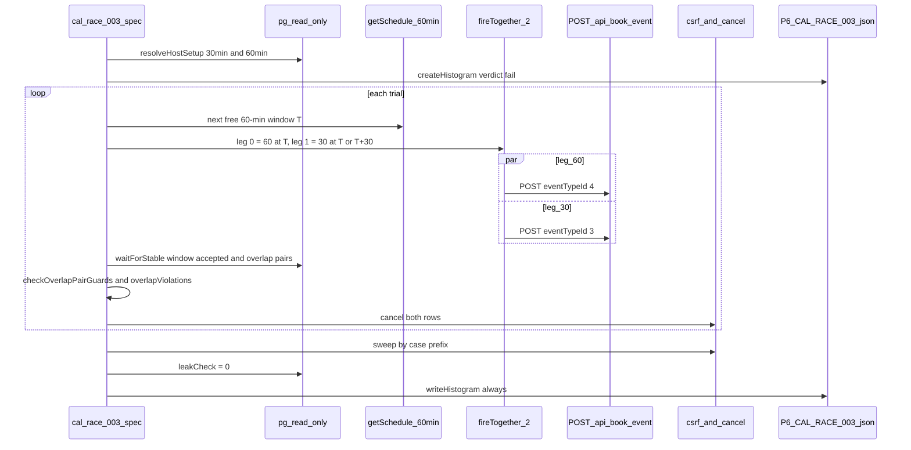

# P6 Phase 1 Task 5: Cal overlap race P6-CAL-RACE-003 (plan only)

This is the implementation plan a weaker model will build from. Do not write test or helper code
until Jayami approves this document.

Structure and depth follow
[docs/reference/p1-plan-example-medusa.md](../reference/p1-plan-example-medusa.md) and
[2026-10-20-p6-phase1-task4-cal-race-001.md](2026-10-20-p6-phase1-task4-cal-race-001.md). P1
UI-assertion and page-object rules do **not** apply. P6 asserts through HTTP status histograms and
the read-only database oracle.

Source of truth: [2026-10-20-p6-phase1-roadmap.md](2026-10-20-p6-phase1-roadmap.md) section
"Task 5" and [docs/master-plan.html](../master-plan.html) **CAL02** ("Overlapping-window race
(different durations / event types, same host)").

## Context

- Repo: [Jayami123/k6-load-concurrency-suite](https://github.com/Jayami123/k6-load-concurrency-suite)
  (P6). PR #13 (Task 4) is merged; `main` = **`c3183d28d40bf919789b9470e7a48231c34da9c8`**.
- Plan branch: **`plan/2026-10-20-p6-phase1`**, created from `origin/main` at `c3183d2` (it did not
  exist). It is long-lived and never deleted; later plans merge `origin/main` into it (merge, not
  rebase).
- Build branch (later): `feat/<build-date>-p6-cal-race-003`, cut from `main`. This plan doc reaches
  `main` through that build PR (§14 Step 0 copies it from the plan branch).
- Harness `qa-portfolio-harness#v0.2.11`; Cal fork `Jayami123/cal` @
  `c2b7ac44c66f24ffef1662b276f0653988a609a3`. Never edit the harness or the fork; never start or
  stop Cal by hand.
- Mapped ID in this task: **`P6-CAL-RACE-003`** (P0) only. Extras are named
  `extra (unmapped): <short name>`. Not this task: `P6-CAL-RACE-001/002` (done, Task 4),
  `P6-CAL-RACE-004`–`007` (later phases), the "rerun a trial on high spread" logic (Task 8).
- Known finding reused, not re-reported: **`P6-OBS-CAL-001`** (production `redactError` turns
  the P2002 → 409 `booking_conflict_error` mapping into a generic 400). Task 4 plan §2.4.
- New finding of this task: **`P6-OBS-CAL-002`**, severity **high** (confirmed by Jayami): two
  overlapping windows of one host are both ACCEPTED under concurrency — a real double booking, not a
  wrong status code. Availability is checked outside a transaction, with no lock and no exclusion
  constraint; byte-identical on upstream `0f19cc4` (§2.5–2.6). Draft upstream issue: Appendix A.
- Review answers (2026-10-20) applied: §19.
- PATH before every harness command: `export PATH="/usr/local/bin:$PATH"` (AGENTS.md).
- Probe status: done once on 2026-10-20 in a Claude Code cloud session (§2). Probe scripts lived only
  in the session scratchpad and imported the merged `src/cal/api.ts`, `src/cal/payloads.ts`,
  `src/cal/invariants.ts`, `src/races/fire-together.ts` and `src/oracles/pg.ts`. Nothing was
  written to the repo, harness or fork. Every probe booking was cancelled (§2.10). Cal was stopped
  with `npm run down:cal`.

Master-plan row used as-is (CAL02):

| ID                | Title                                      | Preconditions             | Steps                                                       | Expected                                                             | Pri |
| ----------------- | ------------------------------------------ | ------------------------- | ----------------------------------------------------------- | -------------------------------------------------------------------- | --- |
| `P6-CAL-RACE-003` | 30-min and 60-min overlapping on same host | Two event types same host | Parallel book overlapping windows; trials=30; `Promise.all` | At most one ACCEPTED in an overlapping set; overlap query returns ≤1 | P0  |

The roadmap states the same oracle as "zero overlapping ACCEPTED pairs" (an overlap query over
pairs `a.id < b.id` returns 0 rows), which is the master plan's "at most one ACCEPTED" for each
overlapping set. This plan uses the pair form.

## 1. Header

- Probe date: 2026-10-20. VM: 4 vCPU, 16093 MB RAM, Docker 29.9.1, Node **v22.23.3**.
  `PRODUCTS_ROOT=/home/user/products`.
- Bootstrap: **not rerun**. The Cal checkout from Task 4's session was still present
  (`products/cal` at `c2b7ac4`, `.env` present, `.next/harness-build.json` present), so
  `bootstrap.sh cal` was skipped (bootstrap once per session). The worker restart had stopped
  Docker; it was started with the repo's own `.claude/hooks/session-start.sh`.
- `npm run up:cal`: exit 0, warm **165 s** (`skipping next build`; seed re-check, Task 3 H1).
- Baseline on `main` `c3183d2`: `npm run check` green, `# tests 98`, `# pass 98`, `# fail 0`.
- No seed passwords, API keys, cookies or tokens are copied anywhere. The race uses the anonymous
  booking route; it needs none.
- Timings here prove a test works. They are never published (AGENTS.md); published numbers come only
  from GitHub Actions `main`/nightly runs.

## 2. Probe findings (required; no guessed values)

### 2.1 Summary

| #   | Question                | Observed                                                                                                                                                                                                                                                    |
| --- | ----------------------- | ----------------------------------------------------------------------------------------------------------------------------------------------------------------------------------------------------------------------------------------------------------- |
| Q1  | 30 + 60 on one host     | Host `pro` (`users.id` 4): event type **3 `30min`** (30 min) and **4 `60min`** (60 min). Both: buffers 0/0, no seats, `minimumBookingNotice` 120, `slotInterval` null, `requiresConfirmation` false, `periodType` unlimited. No API creation needed.        |
| Q1  | getSchedule offers both | 28 days: **681** 30-min slots (`:00` and `:30`), **153** 60-min slots (on the hour). All 153 60-min windows have both 30-min halves offered.                                                                                                                |
| Q2  | Sequential control      | **Refused in all four shapes** (60→30 same start, 60→30 inside, 30→60 same start, 30→60 inside): second booking **409 `no_available_users_found_error`**, one accepted row per window. After a 60 is booked, getSchedule offers 0 30-min slots inside it.   |
| Q3  | Schema                  | `startTime`/`endTime` `timestamp without time zone`, NOT NULL; DB `TimeZone` `Etc/UTC`; `status` enum (lowercase). Indexes include `("userId", status, "startTime")`. **No exclusion constraint** on `"Booking"`.                                           |
| Q3  | Overlap SQL             | The CTE form is **refused** by `assertSelectOnly` (first word `WITH`). A plain `SELECT … JOIN … EXISTS` form passes and returns 0 pairs on a clean prefix. EXPLAIN: seq scans + nested loop (tiny table), fine.                                             |
| Q3  | Seed overlap            | The seed already holds **1** overlapping ACCEPTED pair for host 4 (ids 1 and 4, `30min` + `yoga-class`, 12:03–12:33, inserted by the seed, not by the API). The oracle must be scoped to the case prefix.                                                   |
| Q4  | N > 2                   | N=20 mixed (10×60, 5×30@T, 5×30@T+30) × 5: always **3 winners** (one per distinct window), **2 overlapping pairs per trial**; the 17 losers are identical-window duplicates (400 redacted, `P6-OBS-CAL-001`). No new signal; ~3× time. **Pair (N=2) kept.** |
| Q5  | **Parallel pair**       | **50 of 50 pairs both ACCEPTED** (200 + 200), across three separate runs and both shapes; one overlapping ACCEPTED pair per trial, unchanged after +1 s. **PRODUCT BUG** (§2.5).                                                                            |
| Q5  | Loser shape             | No loser at all in 50 pair trials (100 × 200). N=20 losers: 85 × 400 `An error occurred while querying the database.` (identical-window duplicates only).                                                                                                   |
| Q5  | Spread                  | Pairs: min 0.24, p50 0.35, p90 0.78, max **2.41** ms; **0/50 ≥ 5 ms, 0/50 ≥ 20 ms**. N=20 mixed: max 7.31 ms, 2/5 ≥ 5, 0/5 ≥ 20.                                                                                                                            |
| —   | Time per pair trial     | Slot query + burst + oracle + cancel 2 rows: p50 **400 ms**, p90 490 ms, max 702 ms. Cancelling two rows: p50 140 ms.                                                                                                                                       |
| —   | CI headroom             | `main` run 42 (PR #13 merge): `cal-smoke` **4 min 30 s** total, `P6-CAL-RACE-001` step 62 s for 50 + 9 trials. Task 5 adds ≈ 30–60 s. Job timeout 60 min: fits (§2.9).                                                                                      |

### 2.2 Event types and slot supply (Q1)

Read-only SELECT on `"EventType"` for `"userId" = 4` (selected columns):

| id   | slug                                                | length | buffers | seats | notice | slotInterval | requiresConfirmation | note                               |
| ---- | --------------------------------------------------- | ------ | ------- | ----- | ------ | ------------ | -------------------- | ---------------------------------- |
| 3    | `30min`                                             | 30     | 0/0     | null  | 120    | null         | false                | **used**                           |
| 4    | `60min`                                             | 60     | 0/0     | null  | 120    | null         | false                | **used**                           |
| 5    | `multiple-duration`                                 | 75     | 0/0     | null  | 120    | null         | false                | `multipleDuration [30, 75, 90]`    |
| 6–10 | `paid`, `in-person`, `zoom`, `daily`, `google-meet` | 60     | 0/0     | null  | 120    | null         | false                | integrations / payment, not used   |
| 11   | `yoga-class`                                        | 30     | 0/0     | null  | 120    | null         | false                |                                    |
| 12   | `tennis-class`                                      | 60     | 0/0     | null  | 120    | null         | **true**             | seed has a pending booking from it |

Hosts with both a 30- and a 60-minute event type: `userId` 4 (9 event types) and 5 (2). The plan
uses host 4 with ids 3 and 4, the same host as Task 4.

getSchedule (Task 4 request; `eventTypeId` 4 with `eventTypeSlug` `60min`), window UTC midnight
today + 2 d for 28 d: 153 slots, first `2026-10-22T08:00:00.000Z`, `09:00`, `10:00`, `11:00`; start
minutes `00` only. For event type 3: 681 slots, minutes `00` and `30`. Every 60-min slot's two halves
(`T`, `T+30`) are in the 30-min list (153/153).

The slug does not drive the server: `eventTypeId` 4 with `eventTypeSlug` `30min` booked a 60-min
row (200 ACCEPTED, `eventTypeId` 4, 16:00–17:00), and getSchedule for id 4 returned the same 153
slots with either slug. The plan still sends the real slug (what the booker UI sends; D3).

### 2.3 Sequential control (Q2; required before racing)

Each shape on its own free 60-min window `T`; attendee emails `<prefix>-s<i>-a|b@example.com`.

| Shape                      | First request           | Second request    | Second response                                                                     | Accepted rows in window |
| -------------------------- | ----------------------- | ----------------- | ----------------------------------------------------------------------------------- | ----------------------- |
| A 60 then 30, same start   | 60 `[T, T+60)` → 200    | 30 `[T, T+30)`    | **409** `{"message":"no_available_users_found_error","data":{"traceId":"trace_…"}}` | 1 (the 60)              |
| B 60 then 30, inside (+30) | 60 `[T, T+60)` → 200    | 30 `[T+30, T+60)` | **409** same body                                                                   | 1 (the 60)              |
| C 30 same start, then 60   | 30 `[T, T+30)` → 200    | 60 `[T, T+60)`    | **409** same body                                                                   | 1 (the 30)              |
| D 30 inside, then 60       | 30 `[T+30, T+60)` → 200 | 60 `[T, T+60)`    | **409** same body                                                                   | 1 (the 30)              |

After shape A's 60 was booked, getSchedule for `30min` over `[T, T+60)` returned **0** slots. The
sequential guard works, so this is not a configuration problem: the race below is a real race.

Window B also showed the seeded **pending** `tennis-class` booking (12:03–13:03) overlapping the
13:00 window; it does not block (pending without `requiresConfirmationWillBlockSlot`). The oracle
counts only `accepted` rows of the case prefix, so it is ignored.

### 2.4 Overlap SQL on the real schema (Q3)

Columns (`information_schema`): `startTime`, `endTime` `timestamp without time zone` NOT NULL;
`userId`, `eventTypeId` integer NULL; `status` USER-DEFINED (`"BookingStatus"`, lowercase). DB
`TimeZone` `Etc/UTC`, PostgreSQL 18.6. Indexes on `"Booking"` include
`Booking_userId_status_startTime_idx ("userId", status, "startTime")`,
`Booking_startTime_endTime_status_idx`, `Booking_idempotencyKey_key` (unique). **No `EXCLUDE`
constraint** in the fork's 596 migrations for `"Booking"`.

First attempt (CTE) — **refused** by `selectRows` → `assertSelectOnly`
(`TEST BUG: oracle query is not SELECT-only`, because the first word is `WITH`). The guard is right
to be strict; the plan does not loosen it.

Accepted form (no CTE; `selectRows` runs it; parameters `$1` host user id, `$2` LIKE pattern):

```sql
SELECT a.id AS "aId", a.uid AS "aUid", a."eventTypeId" AS "aEventTypeId",
  to_char(a."startTime", 'YYYY-MM-DD"T"HH24:MI:SS.MS"Z"') AS "aStart",
  to_char(a."endTime", 'YYYY-MM-DD"T"HH24:MI:SS.MS"Z"') AS "aEnd",
  b.id AS "bId", b.uid AS "bUid", b."eventTypeId" AS "bEventTypeId",
  to_char(b."startTime", 'YYYY-MM-DD"T"HH24:MI:SS.MS"Z"') AS "bStart",
  to_char(b."endTime", 'YYYY-MM-DD"T"HH24:MI:SS.MS"Z"') AS "bEnd"
FROM "Booking" a
JOIN "Booking" b ON b."userId" = a."userId" AND a.id < b.id
  AND a."startTime" < b."endTime" AND b."startTime" < a."endTime"
WHERE a."userId" = $1 AND a.status = 'accepted' AND b.status = 'accepted'
  AND EXISTS (SELECT 1 FROM "Attendee" x WHERE x."bookingId" = a.id AND x.email LIKE $2)
  AND EXISTS (SELECT 1 FROM "Attendee" y WHERE y."bookingId" = b.id AND y.email LIKE $2)
ORDER BY a.id, b.id
```

On `$2 = 'p6-qa-%'` (all probe rows cancelled): **0 rows**. EXPLAIN (run through the read-only pool
directly; the guard also refuses `EXPLAIN`, by design):

```
Sort  (cost=57.93..57.95 rows=5 width=8)
  Sort Key: a.id, b.id
  ->  Nested Loop  (cost=37.31..57.87 rows=5 width=8)
        Join Filter: ((a.id < b.id) AND (a."startTime" < b."endTime") AND (b."startTime" < a."endTime"))
        ->  Hash Right Semi Join  (cost=18.66..27.48 rows=12 width=24)
              Hash Cond: (x."bookingId" = a.id)
              ->  Seq Scan on "Attendee" x  (cost=0.00..7.45 rows=155 width=4)
                    Filter: (email ~~ 'p6-qa-%'::text)
              ->  Hash  (cost=18.39..18.39 rows=21 width=24)
                    ->  Seq Scan on "Booking" a  (cost=0.00..18.39 rows=21 width=24)
                          Filter: (("userId" = 4) AND (status = 'accepted'::"BookingStatus"))
        ->  Materialize  (cost=18.66..27.54 rows=12 width=24)
              ->  Hash Right Semi Join  (…same shape for b / y…)
```

`"Booking"` has 98 rows (max id 1260: failed concurrent INSERTs consume sequence values), so seq
scans are expected and cheap; in CI the DB is fresh.

Without the prefix scope, host 4 already has **one** overlapping ACCEPTED pair from the seed
(ids 1 and 4, event types 3 and 11, both 2026-10-21 12:03–12:33, attendees `@example.com`). Hence
D6: both rows of a pair must belong to the trial's prefix.

### 2.5 Parallel pairs (Q5) — the finding

Each trial: a fresh free 60-min window `T` from getSchedule (event type 4), then
`fireTogether(2, …)` with warm `GET /api/csrf`: index 0 = 60 `[T, T+60)` (event type 4), index 1 =
30 at `T` (same-start) or `T+30` (inside) (event type 3). Distinct attendees
`<prefix>-r<round>-c0N-<role>@example.com`. Oracle at t=0 and t=+1 s; then cancel the trial's rows.

| Run                | Trials | HTTP               | Outcome per trial             | Overlapping ACCEPTED pairs | Spread max | Trial p50 |
| ------------------ | ------ | ------------------ | ----------------------------- | -------------------------- | ---------- | --------- |
| same start         | 10     | 200 × 20           | 60 + 30 both ACCEPTED (10/10) | 10 (1 per trial)           | 1.71 ms    | 429 ms    |
| inside (+30)       | 10     | 200 × 20           | 60 + 30 both ACCEPTED (10/10) | 10                         | 1.96 ms    | 456 ms    |
| same start, repeat | 30     | 200 × 60           | 60 + 30 both ACCEPTED (30/30) | 30                         | 2.41 ms    | 386 ms    |
| **Total pairs**    | **50** | **200 × 100**      | **50/50 double-booked**       | **50**                     | **2.41**   | 400       |
| N=20 mixed (Q4)    | 5      | 200 × 15, 400 × 85 | 60 + 30@T + 30@T+30 (5/5)     | 10 (2 per trial)           | 7.31 ms    | 1375 ms   |

Example evidence row (round 1, same start; ids/uids/times only):
`1261/6oCKAPPrkfBaGx9hqH75Pu(et3 2026-11-30T09:00:00.000Z..09:30:00.000Z) x 1262/5Ua4Dxmp59YzjtPByE6Usi(et4 2026-11-30T09:00:00.000Z..10:00:00.000Z)`.
The pair count was the same at t=+1 s in every trial (no async compensation).

So the host is double-booked every time two overlapping, non-identical windows are requested at the
same moment. Sequentially the same requests are refused (§2.3). That is the CAL02 premise ("bypass
the unique key") confirmed: **PRODUCT BUG**, finding **`P6-OBS-CAL-002`**, severity **high**
(the host really is double-booked; compare `P6-OBS-CAL-001`, which is only a wrong status code).

### 2.6 Root cause (code; recorded, not fixed)

At the fork pin, and byte-identical on upstream `calcom/cal.com` `main`
`0f19cc46ef6b6426ee398c670575b3c96be7af9e` (`diff -q`, 2026-10-20):
`packages/features/bookings/lib/handleNewBooking/createBooking.ts`,
`packages/features/bookings/lib/handleNewBooking/ensureAvailableUsers.ts`,
`packages/prisma/extensions/booking-idempotency-key.ts`.

1. `RegularBookingService` calls `ensureAvailableUsers(...)` (lines ~902–936), which reads busy
   times through `getBusyTimesService()` — a read, outside any write transaction.
2. `createBooking.ts:139` then runs `prisma.$transaction(async (tx) => tx.booking.create(…))`:
   default isolation (READ COMMITTED), no `SELECT … FOR UPDATE`, no advisory lock. (The only
   `FOR UPDATE` in bookings is in `handleSeats/create/createNewSeat.ts`, for seated events.)
3. The only database guard is the unique `idempotencyKey` = `uuidv5("<start>.<end>.<userId>")`. It
   stops identical windows (Task 4) but not `[T, T+60)` vs `[T, T+30)` or `[T+30, T+60)`: different
   end or start → different key → both INSERTs succeed.

Check-then-act with no lock or constraint: two requests both see the host free, both insert.

### 2.7 N > 2 (Q4)

N=20 mixed per trial produced exactly one winner per distinct window (60, 30@T, 30@T+30): the
idempotency key serialises the identical duplicates (85 × 400 redacted, `P6-OBS-CAL-001`), and the
overlap is the same defect as the pair, twice. It adds no new signal, triples trial time (1.4 s vs
0.4 s) and mixes in Task 4's loser shape. The case is defined as a pair; the plan keeps N=2 (D2).

### 2.8 Timing and spread (proof only, not published)

| Step (pair trial)                               | p50    | p90    | max    |
| ----------------------------------------------- | ------ | ------ | ------ |
| trial total (slots + burst + oracle + cancel 2) | 400 ms | 490 ms | 702 ms |
| cancel the two accepted rows                    | 140 ms |        | 224 ms |
| `up:cal` warm                                   | 165 s  |        |        |

Dispatch spread against the helper default (5 ms) and CI `RACE_MAX_SPREAD_MS=20`:

| Run            | Rounds | min ms | p50 ms | p90 ms | max ms | ≥ 5 ms | ≥ 20 ms |
| -------------- | ------ | ------ | ------ | ------ | ------ | ------ | ------- |
| pairs (3 runs) | 50     | 0.24   | 0.35   | 0.78   | 2.41   | 0      | **0**   |
| N=20 mixed     | 5      | 2.71   | 3.05   | 6.52   | 7.31   | 2      | **0**   |

With N=2 the spread is far below 20 ms; the case keeps the CI value (D9). No rerun-on-spread logic
(Task 8).

### 2.9 CI job time

GitHub Actions `main` run [39434721131](https://github.com/Jayami123/k6-load-concurrency-suite/actions/runs/39434721131)
(PR #13 merge, caches warm), job `cal-smoke`: started 13:56:09, completed 14:00:39 → **4 min 30 s**.
Steps: `Start Cal (harness up)` 78 s, `Race self-test` 9 s, `Race P6-CAL-RACE-001` **62 s**
(50 mapped + 3 × 3 extra trials of N=20/21).

Task 5 adds one step: 30 mapped pair trials + 3 sequential-control trials. VM: 0.4 s per pair trial
(max 0.7 s) vs 1.2 s for a Task 4 trial; CI ran Task 4 at ~1.05 s per trial (62 s / 59), so
assume ≤ 1 s per pair trial on CI: **≈ 30–45 s**, plus ~5 s Playwright start. New job estimate
**≈ 5–5.5 min** of the 60-min job timeout. Fits with large headroom; PR runs (5 trials) add ~10 s.

### 2.10 Cleanup and leak (live)

Each probe trial cancelled its rows through the Task 4 `cancelBooking` (csrf + `POST /api/cancel`,
200); every run's final sweep found 0 live rows. Final check over all probe prefixes
(`a.email LIKE 'p6-qa-%'`): `[{"status":"cancelled","n":183}]` — 0 accepted, 0 pending.

## 3. Resolved decisions

Lead with the industry-standard approach, then the rejected alternative and its tradeoff.

- **D1 Host and event types = seeded `pro` (id 4), `30min` (id 3), `60min` (id 4).** Same host as
  Task 4; both event types already exist with buffers 0, no seats, no confirmation. Resolve them
  from the DB in `beforeAll` and assert the settings (D11). Rejected: creating event types through
  the API (needs an authenticated session and seed credentials; adds cleanup; nothing gained);
  SQL inserts (forbidden: setup goes through the product).
- **D2 One pair per trial (N=2).** The case is a pair; §2.7 shows N>2 only repeats the same defect
  and mixes in `P6-OBS-CAL-001` losers at 3× the time. Rejected: N=20 mixed (more requests, no new
  signal, harder evidence).
- **D3 Shapes alternate by trial: odd = same start, even = inside.** Index 0 is always the 60
  `[T, T+60)`; index 1 is the 30 at `T` (odd trials) or `T+30` (even trials). Both shapes were
  probed 10/10 double-booked; alternating covers both boundaries (shared start, shared end) with one
  deterministic rule. The body sends the real slug (`60min` / `30min`) for each event type.
  Rejected: random shapes (non-reproducible trials); one shape only (misses the other boundary).
- **D4 Window supply = Task 4 `createSlotAllocator` on event type 4 (60-min slots).** A free 60-min
  slot implies both 30-min halves are free (§2.2, 153/153). Extend the allocator with an optional
  `{ slug, minutes }` (default `30min`/30, so Task 4 is unchanged). Rejected: allocating 30-min
  slots and deriving windows (a free 30 does not imply a free 60).
- **D5 Race primitive unchanged.** `fireTogether(2, …)` with warm `GET /api/csrf` (never a
  booking), `runTrials`, `recordTrial`, histogram helpers, read-only pool. No change to
  `src/races/*` or `src/oracles/pg.ts`.
- **D6 Oracle = zero overlapping ACCEPTED pairs among the trial's own bookings** (§2.4 SQL, both
  sides `EXISTS` an attendee matching the trial pattern `likeLiteralPrefix(casePrefix + "-t<trial>-")`).
  Read through `waitForStable`. Each pair is a **PRODUCT BUG** with both rows attached
  (`pairEvidence`: ids, uids, event type ids, times). Rejected: host-wide without prefix (the seed
  already has a pair, §2.4); a CTE query (the SELECT-only guard refuses it, and loosening the guard
  weakens every oracle); counting HTTP 200s only (does not prove the DB state).
- **D7 Guard checks run before the product assertion.** `checkOverlapPairGuards` (pure) returns
  everything that is not the overlap itself:
  - 2 responses;
  - no 5xx/network error (PRODUCT BUG);
  - no 429 (ENV);
  - losers only `slot-taken` or `booking-conflict` 409 — a `db-unique-redacted` 400 in a pair would
    mean two identical windows were sent (TEST BUG), and anything else is a TEST BUG;
  - at least one 2xx (PRODUCT BUG "no booking for a free window");
  - every 2xx body `ACCEPTED` with a uid in the window's accepted rows, and HTTP 2xx count = DB
    accepted rows in the window (PRODUCT BUG on mismatch);
  - spread < `RACE_MAX_SPREAD_MS` (TEST BUG).

  The overlap pairs are reported separately (`overlapViolations`). Rejected: one combined list (a
  setup failure would then be hidden by `test.fail()`).

- **D8 Known bug → `test.fail()` in the mapped test, placed after the guard assertion and right
  before the overlap assertion.** Evidence: 50/50 pairs, three separate runs, both shapes, code path
  §2.6. The build re-confirms with two local runs before committing the spec (§14 Step 3). If Cal
  fixes it, the test turns red ("expected to fail but passed") and the line is removed. Rejected:
  `test.skip` (hides the race); asserting "≥ 1 pair" (encodes the bug as the expected behaviour).
- **D9 Spread limit = env `RACE_MAX_SPREAD_MS=20`** in CI and local verification (Task 4 D8,
  confirmed by Jayami). Pairs never exceeded 2.41 ms. No rerun logic (Task 8).
- **D10 Trial count in the case itself: `Math.min(raceTrialsFromEnv(), 30)`.** CI already sets
  `RACE_TRIALS` 5 on `pull_request` and 50 on `main`/nightly/dispatch for `cal-smoke`; the case caps
  at 30, so PRs run 5 and full runs 30 (roadmap D2, master plan trials=30). The extra uses
  `min(RACE_TRIALS, 3)`. Rejected: a second env variable (one name is enough; the cap documents the
  case's count where the case is defined); a separate `RACE_TRIALS: 30` step env (count would live
  in YAML, not in the case).
- **D11 Setup asserted.** `resolveHostSetup(pool, "30min", 30)` and `resolveHostSetup(pool, "60min", 60)`
  (extended with optional slug/length, defaults keep Task 4's call) must resolve the same `userId`,
  else `TEST BUG: seed changed`. Every leg must overlap (`windowsOverlap`) and the window must come
  from getSchedule.
- **D12 Data isolation and cleanup = Task 4 pattern.** Case prefix `casePrefix(runPrefix, caseId)`;
  attendee `…-t<trial>-r60@example.com` / `…-t<trial>-r30@example.com`. Per trial `finally`: cancel
  every 2xx uid and every live row of the trial pattern. Per case: sweep `caseLiveBookings` and
  `leakCheck` = 0. Because every race trial double-books, cleanup cancels **two** rows per trial
  (§2.10). Reuse the Task 4 code by extracting its sweep/failed-trial/cancel helpers inside
  `src/cal/run-case.ts` (D13), not by copying.
- **D13 Extend, do not duplicate.** Additions per file in §7; the only refactor is moving three
  private blocks of `runIdenticalSlotCase` into private helpers used by both run-cases. Task 4's
  spec and 98 unit tests must stay green unchanged.
- **D14 One extra: sequential overlap control** (`min(RACE_TRIALS, 3)` trials, shapes A/B/C/D by
  `trial % 4`, first request then second, no barrier). Expected: second 409 `slot-taken`, 0 pairs.
  It proves on every CI run that the guard works sequentially, so the mapped failure stays a race
  finding and not a configuration change. No `test.fail()`. Rejected: no control (a seed change
  that disables the guard would look like the known bug).
- **D15 CI = one new step in `cal-smoke`**, after the `P6-CAL-RACE-001` step, same `if`/env, own
  `timeout-minutes` (5 PR / 10 full); artefact upload unchanged (`results/races/` already uploaded
  as `race-histograms-cal`). `medusa-smoke` untouched.
- **D16 Per-trial double-book counts are recorded, not only the pass/fail** (answer 3). The mapped
  assertion stays "0 overlapping ACCEPTED pairs" (the product expectation). Next to it, the run
  records each trial's pair count (`perTrial[].oracle.overlapPairs`, `doubleBooked`) and a summary
  from a pure, unit-tested `doubleBookSummary` (`trialsDoubleBooked`, `trialsClean`,
  `doubleBookedByTrial`). The summary also goes into the CI step summary and a Playwright
  annotation `P6-OBS-CAL-002`, so a run with some clean trials is visible even though
  `test.fail()` keeps the step green. Rejected: asserting "every trial double-books" (encodes the
  bug as expected behaviour); only the boolean verdict (hides partial reproduction).

## 4. Goal and scope

**In:**

- Small, unit-tested additions to `src/cal/payloads.ts`, `src/cal/api.ts`, `src/cal/oracle.ts`,
  `src/cal/invariants.ts`; `runOverlapPairCase` in `src/cal/run-case.ts`
- `tests/cal/races/cal-race-003-overlap.spec.ts` (mapped + one extra)
- Unit tests added to `tests/unit/cal-payloads.test.ts`, `cal-oracle.test.ts`,
  `cal-invariants.test.ts`
- `perf.yml`: one new step in `cal-smoke`
- README section "Cal overlap histogram (`P6-CAL-RACE-003`)"

**Out:** §18.

## 5. Test-case mapping

| ID                                           | File                                           | Project    | Histogram `caseId`         | Title                                                         | Oracle                                                                        |
| -------------------------------------------- | ---------------------------------------------- | ---------- | -------------------------- | ------------------------------------------------------------- | ----------------------------------------------------------------------------- |
| `P6-CAL-RACE-003`                            | `tests/cal/races/cal-race-003-overlap.spec.ts` | `cal-race` | `P6-CAL-RACE-003`          | `30-min and 60-min overlapping on same host`                  | D7 guards = `[]`, then (`test.fail()`) `OVERLAP_PAIRS_SQL` = 0 rows per trial |
| extra (unmapped): sequential overlap control | same file                                      | same       | `extra-overlap-sequential` | `extra (unmapped): sequential overlapping booking is refused` | guards = `[]`; second request 409 `slot-taken`; 0 pairs; no `test.fail()`     |

## 6. Extra risky cases (unmapped)

1. **Sequential overlap control** (D14). Shapes by `trial % 4`: 1 → A (60 then 30 same start),
   2 → B (60 then 30 inside), 3 → C (30 same start then 60), 0 → D (30 inside then 60). Probe §2.3:
   4/4 refused with 409 `no_available_users_found_error`.

Rejected extras: N=20 mixed (§2.7); reverse index order in the race (the barrier starts both at
once; order inside `fireTogether` is not a variable); 60 vs 60 at `T+30` (getSchedule never offers
a 60 at `:30`, so a client cannot request it through the booker; it would test input validation,
not the race).

## 7. Architecture (every file touched, one responsibility each)

| Path                                                    | Change | Addition (exported unless noted)                                                                                                                                           |
| ------------------------------------------------------- | ------ | -------------------------------------------------------------------------------------------------------------------------------------------------------------------------- |
| `src/cal/payloads.ts`                                   | edit   | `CAL_EVENT_SLUG_60`, `LONG_SLOT_MINUTES`; optional `eventTypeSlug` in `bookingBody`; `OverlapShape`, `OverlapLeg`, `overlapShapeForTrial`, `overlapLegs`, `windowsOverlap` |
| `src/cal/api.ts`                                        | edit   | optional `eventTypeSlug` in `getFreeSlots`; optional `{ slug, minutes }` in `createSlotAllocator`                                                                          |
| `src/cal/oracle.ts`                                     | edit   | optional `slug`, `length` in `resolveHostSetup`; `OVERLAP_PAIRS_SQL`, `WINDOW_ACCEPTED_SQL`, `OverlapPair`, `pairEvidence`, `readOverlapPairs`, `readWindowAccepted`       |
| `src/cal/invariants.ts`                                 | edit   | `checkOverlapPairGuards`, `overlapViolations`, `doubleBookSummary` (D16)                                                                                                   |
| `src/cal/run-case.ts`                                   | edit   | private `makeCanceller`, `failedTrialRecords`, `sweepAndLeakCheck` (moved out of `runIdenticalSlotCase`); new `runOverlapPairCase`                                         |
| `tests/cal/races/cal-race-003-overlap.spec.ts`          | new    | mapped test + extra                                                                                                                                                        |
| `tests/unit/cal-payloads.test.ts`                       | edit   | new `describe` blocks                                                                                                                                                      |
| `tests/unit/cal-oracle.test.ts`                         | edit   | new `describe` blocks                                                                                                                                                      |
| `tests/unit/cal-invariants.test.ts`                     | edit   | new `describe` blocks                                                                                                                                                      |
| `.github/workflows/perf.yml`                            | edit   | step `Race P6-CAL-RACE-003 (cal-race)`                                                                                                                                     |
| `README.md`                                             | edit   | section after the Task 4 Cal section                                                                                                                                       |
| `docs/plans/2026-10-20-p6-phase1-task5-cal-race-003.md` | add    | this plan (copied from the plan branch)                                                                                                                                    |

Unchanged: `src/races/*`, `src/oracles/pg.ts`, `src/medusa/*`, `playwright.config.ts`,
`package.json`, `scripts/*`, `medusa-smoke`, Task 4 spec, harness, fork.



## 8. Histogram fields

Reuse `RaceHistogram` unchanged. `caseId: "P6-CAL-RACE-003"`,
`title: "30-min and 60-min overlapping on same host"`, `product: "cal"`, `concurrency: 2`,
`trials: min(RACE_TRIALS, 30)`.

- `statusCounts`: status → count across trials (probe behaviour would give `{"200": 2 × trials}`).
- Per-trial `oracle`: `windowStart`, `shape` (`same-start` | `inside`), `httpWinners`,
  `windowAccepted`, `overlapPairs` (the trial's double-book count), `doubleBooked` (boolean,
  `overlapPairs > 0`), `winners` (`"60+30"`, `"60"`, `"30"` or `"none"`), and the four `loser_*`
  counts (Task 4 kinds).
- Histogram `oracle` (D16): `hostUserId`, `eventTypeId30`, `eventTypeId60`, `overlapPairsTotal`,
  `trialsDoubleBooked`, `trialsClean`, `doubleBookedByTrial` (per-trial pair counts in trial order,
  comma-joined, e.g. `"1,1,0,1,1"`; a string because `RaceOracleValue` has no arrays),
  `outcome_both`, `outcome_60_only`, `outcome_30_only`, `outcome_none`, the four `loser_*` totals,
  `leakAccepted`. A slower runner with some clean trials therefore shows up as `trialsClean > 0`
  and zeros in `doubleBookedByTrial`, not as a silent pass.
- Per-trial `invariantViolations` carry `pairEvidence` text (ids, uids, event type ids, times). No
  emails, tokens, cookies or seed credentials.
- `verdict`: `"pass"` only if guards, overlap, cleanup and leak are all clean. While the bug exists
  the mapped histogram is honestly `"fail"`; the test passes only through `test.fail()`.

## 9. Oracle and invariants (exact code)

### 9.1 `src/cal/payloads.ts` additions

```ts
export const CAL_EVENT_SLUG_60 = "60min";
export const LONG_SLOT_MINUTES = 60;

// bookingBody: add `eventTypeSlug?: string` to the input type and send
// `eventTypeSlug: input.eventTypeSlug ?? CAL_EVENT_SLUG` (Task 4 callers unchanged).

export type OverlapShape = "same-start" | "inside";

export type OverlapLeg = {
  role: "60" | "30";
  eventTypeId: number;
  eventTypeSlug: string;
  start: string;
  end: string;
};

/** Odd trials share the start, even trials put the 30 in the second half (plan D3). */
export function overlapShapeForTrial(trial: number): OverlapShape {
  return trial % 2 === 1 ? "same-start" : "inside";
}

/** Leg 0 is always the 60 [T, T+60); leg 1 the 30 at T or T+30. T must be a UTC ISO instant. */
export function overlapLegs(
  windowStart: string,
  shape: OverlapShape,
  ids: { eventTypeId30: number; eventTypeId60: number },
): [OverlapLeg, OverlapLeg] {
  const t = new Date(Date.parse(windowStart)).toISOString();
  const start30 = shape === "same-start" ? t : slotEnd(t, SLOT_MINUTES);
  return [
    {
      role: "60",
      eventTypeId: ids.eventTypeId60,
      eventTypeSlug: CAL_EVENT_SLUG_60,
      start: t,
      end: slotEnd(t, LONG_SLOT_MINUTES),
    },
    {
      role: "30",
      eventTypeId: ids.eventTypeId30,
      eventTypeSlug: CAL_EVENT_SLUG,
      start: start30,
      end: slotEnd(start30, SLOT_MINUTES),
    },
  ];
}

/** Half-open overlap, the same predicate as OVERLAP_PAIRS_SQL. */
export function windowsOverlap(
  aStart: string,
  aEnd: string,
  bStart: string,
  bEnd: string,
): boolean {
  return Date.parse(aStart) < Date.parse(bEnd) && Date.parse(bStart) < Date.parse(aEnd);
}
```

### 9.2 `src/cal/api.ts` changes

```ts
export async function getFreeSlots(
  fromIso: string,
  toIso: string,
  eventTypeId: number,
  eventTypeSlug: string = CAL_EVENT_SLUG,
): Promise<string[]> {
  // unchanged body, but `eventTypeSlug` in the input json comes from the parameter
}

export function createSlotAllocator(
  eventTypeId: number,
  opts: { slug?: string; minutes?: number } = {},
): { next(): Promise<{ start: string; end: string }> } {
  const slug = opts.slug ?? CAL_EVENT_SLUG;
  const minutes = opts.minutes ?? SLOT_MINUTES;
  // unchanged loop; call getFreeSlots(from, to, eventTypeId, slug);
  // return { start, end: slotEnd(start, minutes) };
  // final throw: `TEST BUG: no free ${minutes}-min slot`
}
```

`pickFreeSlot` keeps its message (`no free 30-min slot in window`); it is caught inside the loop.

### 9.3 `src/cal/oracle.ts` additions

```ts
// resolveHostSetup(pool, slug = "30min", length = 30): pass [CAL_HOST_USERNAME, slug] to
// HOST_SETUP_SQL; check `r.length !== length`; error text `TEST BUG: seed changed: pro/${slug} …`.
// Task 4's call resolveHostSetup(pool) is unchanged.

export const OVERLAP_PAIRS_SQL = `…exact text of §2.4…`;

// Accepted bookings of a trial pattern that touch [from, to).
export const WINDOW_ACCEPTED_SQL = `
SELECT b.id, b.uid, b.status::text AS status,
  to_char(b."startTime", 'YYYY-MM-DD"T"HH24:MI:SS.MS"Z"') AS start,
  to_char(b."endTime", 'YYYY-MM-DD"T"HH24:MI:SS.MS"Z"') AS "end"
FROM "Booking" b
WHERE b."userId" = $1 AND b.status = 'accepted'
  AND b."startTime" < $3::timestamp AND b."endTime" > $2::timestamp
  AND EXISTS (SELECT 1 FROM "Attendee" x WHERE x."bookingId" = b.id AND x.email LIKE $4)
ORDER BY b.id
`;

export type OverlapPair = {
  aId: number;
  aUid: string;
  aEventTypeId: number | null;
  aStart: string;
  aEnd: string;
  bId: number;
  bUid: string;
  bEventTypeId: number | null;
  bStart: string;
  bEnd: string;
};

/** "1261/uid(et3 s..e) x 1262/uid(et4 s..e) | …" — ids, uids, event types and times only. */
export function pairEvidence(pairs: OverlapPair[]): string {
  return pairs
    .map(
      (p) =>
        `${p.aId}/${p.aUid}(et${p.aEventTypeId} ${p.aStart}..${p.aEnd}) x ` +
        `${p.bId}/${p.bUid}(et${p.bEventTypeId} ${p.bStart}..${p.bEnd})`,
    )
    .join(" | ");
}

export async function readOverlapPairs(
  pool: pg.Pool,
  userId: number,
  likePattern: string,
): Promise<OverlapPair[]> {
  return waitForStable(() =>
    selectRows<OverlapPair>(pool, OVERLAP_PAIRS_SQL, [userId, likePattern]),
  );
}

export async function readWindowAccepted(
  pool: pg.Pool,
  userId: number,
  from: string,
  to: string,
  likePattern: string,
): Promise<SlotRow[]> {
  return waitForStable(() =>
    selectRows<SlotRow>(pool, WINDOW_ACCEPTED_SQL, [
      userId,
      toDbTimestamp(from),
      toDbTimestamp(to),
      likePattern,
    ]),
  );
}
```

### 9.4 `src/cal/invariants.ts` additions

```ts
import { pairEvidence, type OverlapPair, type SlotRow } from "./oracle.ts";

/** Everything except the overlap itself (plan D7). Empty = setup and HTTP contract held. */
export function checkOverlapPairGuards(input: {
  responses: ParsedResponse[];
  windowAccepted: SlotRow[];
  dispatchSpreadMs: number;
  spreadLimit: number;
  expectedResponses?: number; // default 2
}): string[] {
  const out: string[] = [];
  const n = input.expectedResponses ?? 2;
  if (input.responses.length !== n) {
    out.push(`TEST BUG: expected ${n} responses, got ${input.responses.length}`);
  }
  for (const r of input.responses) {
    if (r.status === null || r.status >= 500) {
      out.push(`PRODUCT BUG: HTTP ${r.status ?? "error"} ${r.summary}`);
    } else if (r.status === 429) {
      out.push("ENV: HTTP 429 rate limited (UNKEY_ROOT_KEY set?)");
    } else if (!isWinner(r)) {
      const kind = classifyLoser(r.status, r.message);
      if (kind === "db-unique-redacted") {
        out.push(
          `TEST BUG: idempotency key collided in an overlap pair (identical windows?) ${r.summary}`,
        );
      } else if (kind === "unexpected") {
        out.push(`TEST BUG: unexpected loser ${r.summary}`);
      }
    }
  }
  const winners = input.responses.filter(isWinner);
  if (winners.length === 0) out.push("PRODUCT BUG: no booking accepted for a free window");
  const dbUids = new Set(input.windowAccepted.map((r) => r.uid));
  for (const w of winners) {
    if (w.bodyStatus !== "ACCEPTED" || !w.uid || !dbUids.has(w.uid)) {
      out.push(`PRODUCT BUG: HTTP winner uid ${w.uid} status ${w.bodyStatus} not an ACCEPTED row`);
    }
  }
  if (winners.length !== input.windowAccepted.length) {
    out.push(
      `PRODUCT BUG: HTTP 2xx ${winners.length} != DB accepted ${input.windowAccepted.length} in window`,
    );
  }
  if (input.dispatchSpreadMs >= input.spreadLimit) {
    out.push(`TEST BUG: dispatchSpreadMs ${input.dispatchSpreadMs} >= ${input.spreadLimit}`);
  }
  return out;
}

/** [] or one PRODUCT BUG line with every pair attached (plan D6). */
export function overlapViolations(pairs: OverlapPair[]): string[] {
  if (pairs.length === 0) return [];
  return [`PRODUCT BUG: ${pairs.length} overlapping ACCEPTED pair(s): ${pairEvidence(pairs)}`];
}

/** D16: per-trial pair counts (index = trial - 1) → histogram oracle fields. */
export function doubleBookSummary(pairsByTrial: number[]): {
  trialsDoubleBooked: number;
  trialsClean: number;
  overlapPairsTotal: number;
  doubleBookedByTrial: string;
} {
  const trialsDoubleBooked = pairsByTrial.filter((n) => n > 0).length;
  return {
    trialsDoubleBooked,
    trialsClean: pairsByTrial.length - trialsDoubleBooked,
    overlapPairsTotal: pairsByTrial.reduce((a, b) => a + b, 0),
    doubleBookedByTrial: pairsByTrial.join(","),
  };
}
```

(`isWinner` and `classifyLoser` already exist in this file.)

## 10. Test data, isolation, cleanup and leak check

- Run prefix `p6RunPrefix()` once per spec file. Case prefix `casePrefix(runPrefix, caseId)`
  (`src/medusa/payloads.ts`, reused as in Task 4). Trial pattern
  `likeLiteralPrefix(\`${casePrefix}-t${trial}-\`)`— the trailing`-`keeps`t1-`from matching`t10-`. Attendees `attendeeEmail(casePrefix, \`t${trial}-r60\`)`and`…-r30`.
- One `createSlotAllocator(eventTypeId60, { slug: "60min", minutes: 60 })` per spec file, shared by
  both tests.
- Per-trial `finally`: cancel every 2xx uid, then every row of `caseLiveBookings(pool, trialPattern)`.
  Errors → `cleanupFailure("booking", uid, err)`.
- Per case: sweep `caseLiveBookings(pool, caseLeakPattern(runPrefix, caseId))`, then `leakCheck`
  must return `[]`; results go into `histogram.invariantViolations` and into the guard list the
  test asserts first (a leak is a TEST BUG and must never be hidden by `test.fail()`).
- `workers: 1`; Task 4 and Task 5 specs run in separate CI steps; locally `npm run race:cal` runs
  the files in name order, each with its own prefix.

## 11. Known-bug handling

| Observation                                                           | Label                    | Action                                                                                                                               |
| --------------------------------------------------------------------- | ------------------------ | ------------------------------------------------------------------------------------------------------------------------------------ |
| Both legs 200 ACCEPTED, 1 overlapping pair per trial                  | **PRODUCT BUG (high)**   | `P6-OBS-CAL-002`. 50/50 in the probe. Mapped test asserts 0 pairs after `test.fail()` (D8); per-trial counts in the histogram (D16). |
| Sequential overlap ACCEPTED (extra fails)                             | **PRODUCT BUG / config** | Stop: the guard itself changed. Paste both responses and `pairEvidence`; review `test.fail()` before relabelling.                    |
| Loser 400 `An error occurred while querying the database.` in a pair  | **TEST BUG**             | Windows were identical (key collision). `P6-OBS-CAL-001` belongs to Task 4; not re-reported here.                                    |
| Loser 409 `no_available_users_found_error` / `booking_conflict_error` | allowed loser            | One booking won; fine.                                                                                                               |
| 5xx / network error                                                   | **PRODUCT BUG**          | Status + body summary with `traceId`.                                                                                                |
| 0 winners, or HTTP 2xx ≠ DB accepted                                  | **PRODUCT BUG**          | Attach window rows.                                                                                                                  |
| 429                                                                   | **ENV**                  | Limiter on (`UNKEY_ROOT_KEY`).                                                                                                       |
| Spread ≥ limit                                                        | **TEST BUG**             | Env only; no rerun logic (Task 8).                                                                                                   |
| Seed check / allocator fails, leak ≠ 0, cancel fails                  | **TEST BUG**             | Paste ids/uids only.                                                                                                                 |

`test.fail()` appears exactly once in this task, in the mapped test, after
`expect(guardViolations).toEqual([])` and immediately before `expect(overlapPairs).toBe(0)`.

## 12. CI (`.github/workflows/perf.yml`, job `cal-smoke` only)

Add after `Race P6-CAL-RACE-001 (cal-race)` and before the `race-histograms-cal` upload:

```yaml
- name: Race P6-CAL-RACE-003 (cal-race)
  if: ${{ !cancelled() && steps.cal_up.outcome == 'success' }}
  working-directory: ${{ env.P6_WORKING_DIRECTORY }}
  # Probe: ~0.4 s per pair trial (max 0.7 s) on a 4 vCPU VM; 30 + 3 trials ≈ 30–45 s on CI.
  timeout-minutes: ${{ github.event_name == 'pull_request' && 5 || 10 }}
  env:
    # Same values as the P6-CAL-RACE-001 step; the case caps itself at 30 trials (plan D10).
    RACE_TRIALS: ${{ github.event_name == 'pull_request' && '5' || '50' }}
    RACE_MAX_SPREAD_MS: "20"
  run: |
    set -euo pipefail
    echo "### P6-CAL-RACE-003 trials: $(( RACE_TRIALS < 30 ? RACE_TRIALS : 30 ))" >> "$GITHUB_STEP_SUMMARY"
    status=0
    npm run race:cal -- tests/cal/races/cal-race-003-overlap.spec.ts || status=$?
    # D16: show double-booked vs clean trials even when the step passes through test.fail().
    if [ -f results/races/P6-CAL-RACE-003.json ]; then
      node -e 'const o=require("./results/races/P6-CAL-RACE-003.json").oracle;console.log(`P6-OBS-CAL-002 double-booked trials: ${o.trialsDoubleBooked}, clean: ${o.trialsClean}, pairs by trial: ${o.doubleBookedByTrial}`)' >> "$GITHUB_STEP_SUMMARY"
    fi
    exit "$status"
```

Nothing else changes: triggers, nightly schedule, concurrency group, artefact upload
(`P6-CAL-RACE-003.json` and `extra-overlap-sequential.json` ship in `race-histograms-cal`), job
timeout 60 min, `medusa-smoke`.

## 13. Risks and unknowns

- **R1 CI timing differs.** A slower runner may let the availability check of one leg see the other
  leg's insert → one 409 loser and 0 pairs in some trials. Then the mapped test still fails on the
  trials that double-book (`test.fail()` holds), and the clean trials are visible in
  `trialsClean`, `doubleBookedByTrial`, the step summary and the test annotation (D16). If
  **every** trial is clean on CI, the test turns red ("expected to fail but passed"): report the
  rates; do not remove `test.fail()` on one run.
- **R2 Product fix upstream.** Same as R1's all-clean case: remove `test.fail()` after two clean
  full runs and update README.
- **R3 Seed drift.** `resolveHostSetup` for both slugs fails fast (D11).
- **R4 DST and time zone.** Windows come from getSchedule in UTC; SQL uses `toDbTimestamp`;
  DB `Etc/UTC`.
- **R5 Slot supply.** 153 60-min windows per 28 days, 6 windows of supply; each trial frees its
  window again by cancelling (Task 4 §2.6).
- **R6 Seed overlap / pending rows.** Excluded by the prefix scope and `status = 'accepted'` (§2.4,
  §2.3).
- **R7 Refactor of `runIdenticalSlotCase` breaks Task 4.** The three helpers are moved verbatim;
  the Task 4 spec runs in the verification gate; unit tests unchanged.

## 14. Build steps (repo root; PATH export first; on any differing output: stop and report, paste it)

Do not start until Jayami approves this plan. Never `git add -A`. Never print secrets. Always finish
with `npm run down:cal`.

### Step 0. Branch, plan doc, products, baseline

```bash
export PATH="/usr/local/bin:$PATH"
git fetch origin main plan/2026-10-20-p6-phase1
git switch -c feat/<build-date>-p6-cal-race-003 origin/main
git checkout origin/plan/2026-10-20-p6-phase1 -- docs/plans/2026-10-20-p6-phase1-task5-cal-race-003.md
git status --short            # A  docs/plans/2026-10-20-p6-phase1-task5-cal-race-003.md only
npm ci
npm run check                 # # tests 98, # fail 0 (or main's current count)
# Cal checkout: bootstrap ONCE per session, only if missing; nothing under products/ is committed.
test -d "${PRODUCTS_ROOT:-/home/user/products}/cal/.git" || bash scripts/bootstrap.sh cal
```

Commit 0: `docs(plans): add task 5 cal overlap race plan` (that one path).

### Step 1. Pure additions + unit tests (no product)

Apply §9.1 (`payloads.ts`), §9.3 constants/`pairEvidence`/`resolveHostSetup` defaults
(`oracle.ts`), §9.4 (`invariants.ts`). Unit tests (append; same style as the existing files):

`tests/unit/cal-payloads.test.ts`:

```ts
describe("overlap legs", () => {
  it("odd trials share the start, even trials use the second half", () => {
    assert.equal(overlapShapeForTrial(1), "same-start");
    assert.equal(overlapShapeForTrial(2), "inside");
    assert.equal(overlapShapeForTrial(29), "same-start");
  });

  it("same-start legs: 60 [T, T+60) and 30 [T, T+30)", () => {
    const [l60, l30] = overlapLegs("2026-11-30T09:00:00Z", "same-start", {
      eventTypeId30: 3,
      eventTypeId60: 4,
    });
    assert.deepEqual(l60, {
      role: "60",
      eventTypeId: 4,
      eventTypeSlug: "60min",
      start: "2026-11-30T09:00:00.000Z",
      end: "2026-11-30T10:00:00.000Z",
    });
    assert.deepEqual(l30, {
      role: "30",
      eventTypeId: 3,
      eventTypeSlug: "30min",
      start: "2026-11-30T09:00:00.000Z",
      end: "2026-11-30T09:30:00.000Z",
    });
  });

  it("inside legs put the 30 at T+30", () => {
    const [, l30] = overlapLegs("2026-11-30T09:00:00.000Z", "inside", {
      eventTypeId30: 3,
      eventTypeId60: 4,
    });
    assert.equal(l30.start, "2026-11-30T09:30:00.000Z");
    assert.equal(l30.end, "2026-11-30T10:00:00.000Z");
  });

  it("both shapes overlap; adjacent windows do not", () => {
    for (const shape of ["same-start", "inside"] as const) {
      const [a, b] = overlapLegs("2026-11-30T09:00:00Z", shape, {
        eventTypeId30: 3,
        eventTypeId60: 4,
      });
      assert.equal(windowsOverlap(a.start, a.end, b.start, b.end), true);
    }
    assert.equal(
      windowsOverlap(
        "2026-11-30T09:00:00Z",
        "2026-11-30T09:30:00Z",
        "2026-11-30T09:30:00Z",
        "2026-11-30T10:00:00Z",
      ),
      false,
    );
  });

  it("bookingBody sends the slug it is given, 30min by default", () => {
    const base = { start: "s", end: "e", email: "x@example.com", name: "n", eventTypeId: 4 };
    assert.equal(bookingBody(base).eventTypeSlug, "30min");
    assert.equal(bookingBody({ ...base, eventTypeSlug: "60min" }).eventTypeSlug, "60min");
  });
});
```

`tests/unit/cal-oracle.test.ts`:

```ts
describe("overlap SQL", () => {
  it("is SELECT-only, has no CTE and uses the half-open predicate", () => {
    assertSelectOnly(OVERLAP_PAIRS_SQL);
    assertSelectOnly(WINDOW_ACCEPTED_SQL);
    assert.doesNotMatch(OVERLAP_PAIRS_SQL, /^\s*WITH/i);
    assert.match(OVERLAP_PAIRS_SQL, /a\.id < b\.id/);
    assert.match(
      OVERLAP_PAIRS_SQL,
      /a\."startTime" < b\."endTime" AND b\."startTime" < a\."endTime"/,
    );
    assert.match(OVERLAP_PAIRS_SQL, /a\.status = 'accepted' AND b\.status = 'accepted'/);
    assert.equal((OVERLAP_PAIRS_SQL.match(/email LIKE \$2/g) ?? []).length, 2);
  });

  it("pairEvidence shows ids, uids, event types and times only", () => {
    const text = pairEvidence([
      {
        aId: 1261,
        aUid: "u1",
        aEventTypeId: 3,
        aStart: "2026-11-30T09:00:00.000Z",
        aEnd: "2026-11-30T09:30:00.000Z",
        bId: 1262,
        bUid: "u2",
        bEventTypeId: 4,
        bStart: "2026-11-30T09:00:00.000Z",
        bEnd: "2026-11-30T10:00:00.000Z",
      },
    ]);
    assert.equal(
      text,
      "1261/u1(et3 2026-11-30T09:00:00.000Z..2026-11-30T09:30:00.000Z) x 1262/u2(et4 2026-11-30T09:00:00.000Z..2026-11-30T10:00:00.000Z)",
    );
    assert.doesNotMatch(text, /email|@/);
  });
});
```

`tests/unit/cal-invariants.test.ts` (reuse its `win`, `lose`, `taken`, `redacted` helpers; add a
`slotRow(uid)` helper returning a `SlotRow`):

- both 200, both uids in window, 2 DB rows, spread 1 → `checkOverlapPairGuards` `[]` (the race bug
  is not a guard violation).
- 200 + 409 slot-taken, 1 DB row → `[]`; 200 + 409 `booking_conflict_error` → `[]`.
- 200 + 400 redacted → one `TEST BUG` containing `idempotency key collided`.
- 200 + 422 → `TEST BUG` `unexpected loser`; 200 + 429 → `ENV`.
- 500 + 200 → `PRODUCT BUG` and `500`; `null` → `PRODUCT BUG` and `error`.
- 409 + 409 (no winner), 0 rows → `PRODUCT BUG` `no booking accepted`.
- 200 + 200 but only 1 DB row → `PRODUCT BUG` `HTTP 2xx 2 != DB accepted 1`.
- winner uid not in rows → `PRODUCT BUG` `not an ACCEPTED row`.
- spread 20 with limit 20 → `TEST BUG` `dispatchSpreadMs`.
- 1 response with default 2 → `TEST BUG` `expected 2 responses`.
- `doubleBookSummary([1, 1, 0, 1, 1])` →
  `{ trialsDoubleBooked: 4, trialsClean: 1, overlapPairsTotal: 4, doubleBookedByTrial: "1,1,0,1,1" }`;
  `doubleBookSummary([])` → `{ 0, 0, 0, "" }`; `doubleBookSummary([2, 0])` → 1 double-booked,
  1 clean, 2 pairs, `"2,0"`.
- `overlapViolations([])` → `[]`; one pair → one line with `PRODUCT BUG`, `1 overlapping` and both
  uids.

Run `npm run test:unit`: previous count + the new `it` blocks, `# fail 0`. `npm run check` exit 0.
Commit 1.

### Step 2. API options, oracle readers, run-case (no live spec yet)

1. `api.ts` per §9.2. `oracle.ts`: `readOverlapPairs`, `readWindowAccepted` per §9.3.
2. `run-case.ts`: move three blocks out of `runIdenticalSlotCase` **verbatim** into private
   helpers, and call them from there:

```ts
function makeCanceller(cleanupViolations: string[]) {
  return async (uid: string, cancelled: Set<string>) => {
    if (cancelled.has(uid)) return;
    cancelled.add(uid);
    try {
      await cancelBooking(uid);
    } catch (err) {
      cleanupViolations.push(cleanupFailure("booking", uid, err));
    }
  };
}

function failedTrialRecords(
  trialResults: Array<{ trial: number; ok: boolean; error?: string }>,
  perTrial: RaceTrialResult[],
): RaceTrialResult[] {
  const recorded = new Set(perTrial.map((t) => t.trial));
  return trialResults
    .filter((t) => !t.ok && !recorded.has(t.trial))
    .map((failed) => ({
      trial: failed.trial,
      ok: false,
      statuses: [],
      statusCounts: {},
      dispatchSpreadMs: 0,
      oracle: {},
      invariantViolations: failed.error ? [failed.error] : [],
      error: failed.error,
    }));
}

async function sweepAndLeakCheck(
  pool: pg.Pool,
  leakPattern: string,
  cancelQuietly: (uid: string, cancelled: Set<string>) => Promise<void>,
): Promise<{ leak: string[]; leakAccepted: number }> {
  const sweepCancelled = new Set<string>();
  for (const row of await caseLiveBookings(pool, leakPattern)) {
    await cancelQuietly(row.uid, sweepCancelled);
  }
  const leak = await leakCheck(pool, leakPattern);
  const leakAccepted = (await caseLiveBookings(pool, leakPattern)).length;
  return { leak, leakAccepted };
}
```

3. Add `runOverlapPairCase` (same shape as `runIdenticalSlotCase`: histogram before `try`,
   `writeHistogram` in `finally`):

```ts
export type OverlapRunMode = "race" | "sequential";

export async function runOverlapPairCase(input: {
  pool: pg.Pool;
  setup: { userId: number; eventTypeId30: number; eventTypeId60: number };
  windows: ReturnType<typeof createSlotAllocator>; // 60-min allocator
  runPrefix: string;
  caseId: string;
  title: string;
  mode: OverlapRunMode;
  trials: number;
}): Promise<{
  histogram: RaceHistogram;
  guardViolations: string[];
  overlapPairs: number;
  doubleBook: ReturnType<typeof doubleBookSummary>; // D16
}>;
```

Per trial:

1. `const window = await input.windows.next()`.
2. `const shape = overlapShapeForTrial(trial)`; `const legs = overlapLegs(window.start, shape, input.setup)`.
   Sequential mode instead uses `trial % 4`: 1 → `same-start` order [60, 30]; 2 → `inside` [60, 30];
   3 → `same-start` [30, 60]; 0 → `inside` [30, 60].
3. Throw `TEST BUG: legs do not overlap` unless `windowsOverlap(...)`.
4. Race mode: `fireTogether(2, (i) => createBooking(bookingBody({ start: legs[i].start, end: legs[i].end, email: attendeeEmail(dataPrefix, \`t${trial}-r${legs[i].role}\`), name: \`p6 r${legs[i].role}\`, eventTypeId: legs[i].eventTypeId, eventTypeSlug: legs[i].eventTypeSlug })), { warm: GET /api/csrf })`.
Sequential mode: call `createBooking`for the two legs one after the other and build`fired = { requests: [...], dispatchSpreadMs: 0 }`with`summariseBody`for each`bodySummary`(same`RaceRequestResult` fields).
5. `responses = parseBookingResponse(...)` per request.
6. `windowAccepted = await readWindowAccepted(pool, userId, window.start, window.end, trialPattern)`;
   `pairs = await readOverlapPairs(pool, userId, trialPattern)`.
7. `guards = checkOverlapPairGuards({ responses, windowAccepted, dispatchSpreadMs, spreadLimit })`;
   sequential mode also pushes `PRODUCT BUG: sequential overlap accepted` when both legs are 2xx.
   `product = overlapViolations(pairs)`.
8. `recordTrial(trial, fired, () => { if (guards.length || product.length) throw new Error([...guards, ...product].join("; ")) })`;
   fill per-trial `oracle` (§8, including `overlapPairs: pairs.length` and
   `doubleBooked: pairs.length > 0`); push guards prefixed `t${trial}: ` into `guardViolations`;
   `pairsByTrial[trial - 1] = pairs.length` (array pre-filled with `0`, length `trials`);
   `overlapPairs += pairs.length`.
9. `finally`: cancel every 2xx uid and every row of `caseLiveBookings(pool, trialPattern)`.

After the loop: `failedTrialRecords` (also push each failed trial's error, prefixed `t${trial}: `,
into `guardViolations`, so a trial that died before its oracle can never hide behind
`test.fail()`), `aggregateDispatchSpread`, `sweepAndLeakCheck`, histogram `oracle` (§8) with
`...doubleBookSummary(pairsByTrial)` (D16), push cleanup + leak into
`histogram.invariantViolations` **and** `guardViolations`,
`verdict = all trials ok && no violations ? "pass" : "fail"`; return
`{ histogram, guardViolations, overlapPairs, doubleBook: doubleBookSummary(pairsByTrial) }`.

`npm run typecheck` exit 0; `npm run test:unit` unchanged count from Step 1. Commit 2.

### Step 3. Live spec

`tests/cal/races/cal-race-003-overlap.spec.ts`:

```ts
import { readFile } from "node:fs/promises";
import { test, expect } from "@playwright/test";
import { createSlotAllocator } from "../../../src/cal/api.ts";
import { CAL_EVENT_SLUG_60, LONG_SLOT_MINUTES } from "../../../src/cal/payloads.ts";
import { resolveHostSetup } from "../../../src/cal/oracle.ts";
import { runOverlapPairCase } from "../../../src/cal/run-case.ts";
import { closePool, createReadOnlyPool } from "../../../src/oracles/pg.ts";
import { calDatabaseUrlFromEnv, raceTrialsFromEnv } from "../../../src/races/env.ts";
import { p6RunPrefix } from "../../../src/races/prefix.ts";

// Master plan CAL02: trials=30. CI passes RACE_TRIALS 5 (PR) or 50 (full); the case caps at 30.
const FULL_TRIALS = 30;
const trials = Math.min(raceTrialsFromEnv(), FULL_TRIALS);
const extraTrials = Math.min(raceTrialsFromEnv(), 3);
const runPrefix = p6RunPrefix();
const pool = createReadOnlyPool(calDatabaseUrlFromEnv());
let setup: { userId: number; eventTypeId30: number; eventTypeId60: number };
let windows: ReturnType<typeof createSlotAllocator>;

test.beforeAll(async () => {
  const s30 = await resolveHostSetup(pool, "30min", 30);
  const s60 = await resolveHostSetup(pool, CAL_EVENT_SLUG_60, LONG_SLOT_MINUTES);
  if (s30.userId !== s60.userId)
    throw new Error("TEST BUG: seed changed: 30min and 60min hosts differ");
  setup = { userId: s30.userId, eventTypeId30: s30.eventTypeId, eventTypeId60: s60.eventTypeId };
  windows = createSlotAllocator(setup.eventTypeId60, {
    slug: CAL_EVENT_SLUG_60,
    minutes: LONG_SLOT_MINUTES,
  });
});
test.afterAll(async () => closePool(pool));

const MAPPED_TITLE = "30-min and 60-min overlapping on same host";

test.describe("P6-CAL-RACE-003 Cal overlapping windows", () => {
  test.describe.configure({ timeout: 60_000 + trials * 10_000 });

  test(`P6-CAL-RACE-003 ${MAPPED_TITLE}`, async () => {
    const { histogram, guardViolations, overlapPairs, doubleBook } = await runOverlapPairCase({
      pool,
      setup,
      windows,
      runPrefix,
      caseId: "P6-CAL-RACE-003",
      title: MAPPED_TITLE,
      mode: "race",
      trials,
    });
    // D16: partial reproduction stays visible in the report even when test.fail() keeps it green.
    test.info().annotations.push({
      type: "P6-OBS-CAL-002",
      description: `double-booked ${doubleBook.trialsDoubleBooked}/${trials} trials, clean ${doubleBook.trialsClean}, pairs by trial ${doubleBook.doubleBookedByTrial}`,
    });
    // Setup, HTTP contract, spread, cleanup and leak must hold before the product assertion.
    expect(guardViolations, guardViolations.join("; ")).toEqual([]);
    const raw = JSON.parse(await readFile("results/races/P6-CAL-RACE-003.json", "utf8"));
    expect(raw.trials).toBe(trials);
    expect(raw.concurrency).toBe(2);
    // PRODUCT BUG, severity high (plan §2.5–2.6, P6-OBS-CAL-002): Cal checks availability outside the insert
    // transaction and only the idempotencyKey unique guards the DB, so a 60-min and an overlapping
    // 30-min booking sent together are both ACCEPTED. Reproduced 50/50 pairs on 2026-10-20.
    // Remove this line when Cal serialises overlapping bookings.
    test.fail();
    expect(
      overlapPairs,
      histogram.perTrial
        .flatMap((t) => t.invariantViolations)
        .slice(0, 3)
        .join(" | "),
    ).toBe(0);
  });
});

test.describe("Cal overlap extras (unmapped)", () => {
  test.describe.configure({ timeout: 60_000 + extraTrials * 10_000 });

  test("extra (unmapped): sequential overlapping booking is refused", async () => {
    const { histogram, guardViolations, overlapPairs } = await runOverlapPairCase({
      pool,
      setup,
      windows,
      runPrefix,
      caseId: "extra-overlap-sequential",
      title: "extra (unmapped): sequential overlapping booking is refused",
      mode: "sequential",
      trials: extraTrials,
    });
    expect(guardViolations, guardViolations.join("; ")).toEqual([]);
    expect(overlapPairs).toBe(0);
    expect(histogram.verdict).toBe("pass");
  });
});
```

Then, twice (D8 needs repeated runs before the `test.fail()` lands):

```bash
npx playwright test --list --project=cal-race   # 8 tests in 3 files (6 existing + 2 new)
npm run typecheck                               # exit 0
npm run up:cal                                  # exit 0
RACE_TRIALS=5 RACE_MAX_SPREAD_MS=20 npm run race:cal -- tests/cal/races/cal-race-003-overlap.spec.ts
node -e 'const h=require("./results/races/P6-CAL-RACE-003.json");console.log(h.verdict,h.trials,h.statusCounts,h.oracle.overlapPairsTotal,h.oracle.trialsDoubleBooked,h.oracle.trialsClean,h.oracle.doubleBookedByTrial,h.oracle.leakAccepted)'
RACE_TRIALS=50 RACE_MAX_SPREAD_MS=20 npm run race:cal -- tests/cal/races/cal-race-003-overlap.spec.ts
RACE_TRIALS=5 RACE_MAX_SPREAD_MS=20 npm run race:cal   # whole project: Task 3 + 4 + 5 together
npm run down:cal
```

Expected: `2 passed` (the mapped test passes as an expected failure); histogram
`fail 5 { '200': 10 } 5 5 0 1,1,1,1,1 0` (probe behaviour), then `fail 30 { '200': 60 } 30 30 0 1,…,1 0` with
`RACE_TRIALS=50`; the whole project `8 passed`. If the mapped test reports
"expected to fail but passed" in both runs, stop: the bug did not reproduce; report the histogram
and do not commit the `test.fail()`. Commit 3.

### Step 4. CI

Edit `perf.yml` per §12. Validate:

```bash
npx --yes prettier --check .github/workflows/perf.yml
git diff origin/main -- .github/workflows/perf.yml   # only the new step; nothing in medusa-smoke
```

Commit 4.

### Step 5. README

Add §17 after "Cal identical-slot histogram". Commit 5. Push the branch; Jayami opens the PR.

## 15. Verification gate (paste real output)

| Check                                                               | Must show                                                                                                                                                                                                            |
| ------------------------------------------------------------------- | -------------------------------------------------------------------------------------------------------------------------------------------------------------------------------------------------------------------- |
| `npm run check`                                                     | Prettier OK, typecheck 0, `3 script(s) ok.`, `# fail 0`, tests = 98 + new                                                                                                                                            |
| `npm run up:cal` (twice)                                            | exit 0; second `cal already running` or reused build                                                                                                                                                                 |
| `RACE_TRIALS=5 RACE_MAX_SPREAD_MS=20 npm run race:cal -- …003…` × 2 | `2 passed`; `P6-CAL-RACE-003.json` `trials: 5`, `trialsDoubleBooked` + `trialsClean` = 5, `doubleBookedByTrial` has 5 entries, `overlapPairsTotal` > 0, `leakAccepted: 0`; annotation `P6-OBS-CAL-002` in the report |
| `RACE_TRIALS=50 … -- …003…`                                         | `trials: 30` (cap), `2 passed`                                                                                                                                                                                       |
| `RACE_TRIALS=5 RACE_MAX_SPREAD_MS=20 npm run race:cal`              | `8 passed` (Task 4 unaffected by the refactor)                                                                                                                                                                       |
| leak query `p6-qa-%`                                                | no `accepted`/`pending`                                                                                                                                                                                              |
| `npm run down:cal`                                                  | exit 0; no listener on :3000; no `results/harness/cal.pgid`                                                                                                                                                          |
| CI on the PR                                                        | `cal-smoke` green; new step 5 trials; `race-histograms-cal` has `P6-CAL-RACE-003.json`; `medusa-smoke` green                                                                                                         |
| CI on `main` / nightly                                              | new step 30 trials; job time recorded in the step summary                                                                                                                                                            |

## 16. Commit plan (Conventional, lowercase subjects, explicit paths, never `git add -A`)

0. `docs(plans): add task 5 cal overlap race plan` — `docs/plans/2026-10-20-p6-phase1-task5-cal-race-003.md`
1. `feat(cal): add overlap legs, pair guards and overlap sql` — `src/cal/payloads.ts`,
   `src/cal/oracle.ts`, `src/cal/invariants.ts`, `tests/unit/cal-*.test.ts`
2. `feat(cal): add overlap pair run-case` — `src/cal/api.ts`, `src/cal/oracle.ts`, `src/cal/run-case.ts`
3. `test(cal): add p6-cal-race-003 overlap race` — `tests/cal/races/cal-race-003-overlap.spec.ts`
4. `ci(cal): run p6-cal-race-003 in cal-smoke` — `.github/workflows/perf.yml`
5. `docs(cal): explain the overlap histogram` — `README.md`

Keep the environment's commit identity. No Co-Authored-By, "Generated with" or session lines.
`git status --short` before each commit lists only that commit's paths; nothing under `products/`.

## 17. README section text

```markdown
### Cal overlap histogram (`P6-CAL-RACE-003`)

Each trial takes one free 60-minute window of the seeded host `pro` and books the 60-minute event
and an overlapping 30-minute event (same start on odd trials, second half on even trials) behind
one start barrier. The oracle looks for two ACCEPTED bookings of the trial that overlap
(`a.startTime < b.endTime AND b.startTime < a.endTime`); there must be none.
`results/races/P6-CAL-RACE-003.json` (artefact `race-histograms-cal`) has the status counts and the
overlapping pairs.

- Booked one after the other, Cal refuses the second booking with **409**
  `no_available_users_found_error` (the `extra (unmapped): sequential overlapping booking is
refused` test checks this on every run).
- Booked at the same moment, both are **ACCEPTED**: the host is double-booked. Cal checks
  availability before it inserts, without a lock, and the database only rejects identical windows
  (the unique `idempotencyKey`). Finding **`P6-OBS-CAL-002`**, severity **high** (a real double
  booking; same code on upstream `calcom/cal.com` `main`, checked 2026-10-20 at `0f19cc4`). The
  mapped test records it with `test.fail()`.
- How often it reproduces is in the histogram's `oracle`: `trialsDoubleBooked`, `trialsClean` and
  `doubleBookedByTrial` (pairs per trial). The CI step summary prints the same line, so a run where
  some trials came out clean is visible even though the step is green.
- A **400** `An error occurred while querying the database.` here would mean two identical windows
  were sent (test bug; see `P6-OBS-CAL-001` for that shape in `P6-CAL-RACE-001`).
- **5xx**: product bug. Any other 4xx: test bug until a probe shows otherwise.

Pull requests run 5 trials; `main`, the nightly schedule and manual runs run 30.

| Run (GitHub Actions)                                                           | Trials | Trials double-booked | Trials clean | 409 loser | 5xx | Overlapping pairs |
| ------------------------------------------------------------------------------ | ------ | -------------------- | ------------ | --------- | --- | ----------------- |
| _filled from the first `main` and nightly runs; links to the run and artefact_ |
```

Only `main`/nightly GitHub Actions numbers go into that table, never this plan's probe counts.

## 18. Will NOT do

- No `P6-CAL-RACE-001/002` changes beyond the verbatim helper extraction; no `004`–`007`
- No rerun-on-high-spread logic (Task 8); no spread-limit change
- No harness or fork edits; no fix for the overlap bug; no `next start` by hand
- No event types created (API or SQL); no SQL writes; no tokens or seed credentials read via SQL
- No N>2 race; no API v2, API keys or logins
- No change to `src/races/*`, `src/oracles/pg.ts` (the guard stays strict; no CTE), `src/medusa/*`
- No edits to `medusa-smoke`, triggers or the concurrency group
- No published probe timings or counts in README
- No `test.fail()` outside the mapped test; no retries, `workers` > 1, browsers or page objects

## 19. Answers from Jayami (2026-10-20)

1. **Finding ID: `P6-OBS-CAL-002`, severity high.** Overlapping windows both ACCEPTED under
   concurrency; availability checked outside a transaction, no lock, no exclusion constraint;
   byte-identical on upstream `0f19cc4`. A real double booking, not a wrong status code. Applied in
   Context, §2.5, §11, the spec comment (§14 Step 3) and README text (§17).
2. **Upstream issue draft: yes**, Appendix A, same style as Task 4. Jayami files it; P6 does not.
3. **Mapped assertion stays "0 overlapping ACCEPTED pairs"**, and per-trial double-book counts are
   recorded (D16): `perTrial[].oracle.overlapPairs` / `doubleBooked`, histogram `trialsDoubleBooked`,
   `trialsClean`, `doubleBookedByTrial`, the CI step summary line and a Playwright annotation.

No open questions remain. Building waits on approval of this plan; the build branch is
`feat/<build-date>-p6-cal-race-003` from `main` (§14 Step 0).

## Appendix A. Draft upstream issue for `P6-OBS-CAL-002` (for Jayami to file; not filed by P6)

Search `calcom/cal.com` issues for "double booking", "overlapping" and "race condition" first; if
one exists, add this repro there instead.

**Title:** Concurrent bookings of overlapping (non-identical) slots for the same host are both
ACCEPTED (double booking)

**Body:**

> **Summary**
>
> When two bookings for the same host overlap but are not identical — for example a 60-minute event
> at 09:00–10:00 and a 30-minute event at 09:00–09:30 or 09:30–10:00 — and both requests arrive at
> the same time, Cal accepts both. The host ends up with two ACCEPTED bookings in the same time.
> Sent one after the other, the second request is correctly refused with
> `409 no_available_users_found_error`.
>
> **Version**
>
> - `calcom/cal.com` `main` at `0f19cc46ef6b6426ee398c670575b3c96be7af9e`. The files below are
>   identical there and at `c2b7ac44c66f24ffef1662b276f0653988a609a3`, where it was reproduced.
> - Production build (`next build` + `next start`), Postgres 18, rate limiting off
>   (`UNKEY_ROOT_KEY` unset), default dev seed (`yarn db-seed`).
>
> **Steps to reproduce**
>
> 1. Seed the dev database. Use the seeded user `pro` and its event types `60min` (60 minutes) and
>    `30min` (30 minutes); both have no buffers, no seats and no confirmation.
> 2. Pick a free 60-minute slot from `GET /api/trpc/slots/getSchedule` for `60min`
>    (e.g. `2026-11-30T09:00:00Z`).
> 3. Send two requests to `POST /api/book/event` at the same instant (e.g. `Promise.all`), each with
>    a different attendee email. Both use this body:
>    `{"responses":{"name":"x","email":"<unique>@example.com","guests":[],"location":{"value":"integrations:daily","optionValue":""}},"user":"pro","timeZone":"UTC","language":"en","metadata":{},"hasHashedBookingLink":false}`
>    plus these fields:
>    - `60min`: `"start":"2026-11-30T09:00:00Z","end":"2026-11-30T10:00:00Z","eventTypeId":<60min id>,"eventTypeSlug":"60min"`
>    - `30min`: `"start":"2026-11-30T09:00:00Z","end":"2026-11-30T09:30:00Z","eventTypeId":<30min id>,"eventTypeSlug":"30min"`
> 4. Query the host's bookings:
>    `SELECT a.id, b.id FROM "Booking" a JOIN "Booking" b ON b."userId" = a."userId" AND a.id < b.id AND a."startTime" < b."endTime" AND b."startTime" < a."endTime" WHERE a."userId" = <pro id> AND a.status = 'accepted' AND b.status = 'accepted';`
>
> **Expected**: one request returns 200 ACCEPTED; the other is refused
> (`409 no_available_users_found_error`, as in the sequential case). The query returns no rows.
>
> **Actual** (50 of 50 attempts, both shapes — 30-minute at the same start and in the second half):
> both requests return `200` with `"status":"ACCEPTED"`, and the query returns one overlapping
> pair per attempt. The pair is still there after a second (no later compensation).
>
> **Cause**
>
> 1. `packages/features/bookings/lib/service/RegularBookingService.ts` checks availability through
>    `ensureAvailableUsers` (`packages/features/bookings/lib/handleNewBooking/ensureAvailableUsers.ts`),
>    a read of busy times outside any write transaction.
> 2. `packages/features/bookings/lib/handleNewBooking/createBooking.ts` then inserts in
>    `prisma.$transaction(async (tx) => tx.booking.create(…))` at the default isolation level, with
>    no row lock and no advisory lock.
> 3. The only database guard is the unique `idempotencyKey`
>    (`packages/prisma/extensions/booking-idempotency-key.ts`,
>    `uuidv5("<start>.<end>.<userId>")`). It stops two bookings with exactly the same start, end and
>    user, but overlapping windows have different keys, so both inserts succeed.
>
> This is a check-then-act race: both requests see the host as free, then both insert.
>
> **Possible fixes** (any one closes it; the first is enforced by the database itself)
>
> 1. A Postgres exclusion constraint for ACCEPTED bookings of one host, e.g. with `btree_gist`:
>    `ALTER TABLE "Booking" ADD CONSTRAINT booking_no_overlap EXCLUDE USING gist ("userId" WITH =, tsrange("startTime", "endTime", '[)') WITH &&) WHERE (status = 'accepted');`
>    (seated events, buffers and multi-host/team events need their own handling), and map the
>    resulting `23P01` exclusion violation to `409 booking_conflict_error`.
> 2. Serialise bookings per host inside the booking transaction: take
>    `pg_advisory_xact_lock(<host user id>)` (or `SELECT … FROM users WHERE id = $1 FOR UPDATE`),
>    then re-check overlapping ACCEPTED bookings for that host in the same transaction before
>    `booking.create`.
>
> Related: the same flow also returns a generic `400` instead of `409 booking_conflict_error` when
> the `idempotencyKey` unique fires in production (`redactError`); that is a separate report.

No secrets, tokens, seed credentials or `.env` values are in this draft.
