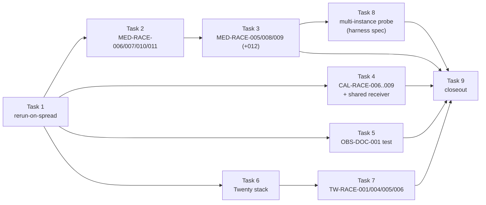

# P6 Phase 2 roadmap (Tasks 1–9)

This is a roadmap, not a build plan. It fixes the order, the scope and the done criteria for P6
Phase 2. Each task gets its own junior-engineer build plan just before it starts, in the structure
of [docs/reference/p1-plan-example-medusa.md](../reference/p1-plan-example-medusa.md) (as every
Phase 1 task did), and every such plan starts with a **live probe**. Nothing in this file is a
probed value unless it cites a file in this repo, the pinned harness, a pinned product source or a
CI run; open values are marked "the live probe must confirm".

## Context

- Repo: [Jayami123/k6-load-concurrency-suite](https://github.com/Jayami123/k6-load-concurrency-suite)
  (P6). Written from `main` at `d33e775`.
- Source of the scope: [docs/master-plan.html](../master-plan.html) §9 "Phased build order", Phase 2
  = "Cal private-link + confirm/cancel; Medusa gift-card/budget/refund; Twenty lost-update + reset",
  and the case tables **CAL06** (`P6-CAL-RACE-006`), **CAL18** (`P6-CAL-RACE-007`), **MED06**
  (`P6-MED-RACE-005`), **MED07** (`P6-MED-RACE-006`), **MED08** (`P6-MED-RACE-007`), **TW01**
  (`P6-TW-RACE-001`, `P6-TW-RACE-002`), **TW02** (`P6-TW-RACE-003`) and **TW04**
  (`P6-TW-RACE-004`). §4 gives the per-product oracle ideas (Twenty: "final field value via REST;
  password hash updated once").
- Carried in from Phase 1: the "Later" list of
  [2026-10-20-p6-phase1-roadmap.md](2026-10-20-p6-phase1-roadmap.md) (P1 Medusa X04/X05,
  multi-instance Medusa, Twenty), the Phase 2 backlog in
  [2026-10-21-p6-phase1-task8-closeout.md](2026-10-21-p6-phase1-task8-closeout.md) §5.5
  (`P6-OBS-DOC-001` CI test, rerun-on-high-spread, `P6-OBS-CAL-003` test), and the open
  `P6-OBS-DOC-001` row of the README "Known product bugs" table ("not filed (Phase 2)").
- Harness: `qa-portfolio-harness#v0.2.11` ([package.json](../../package.json)). It ships a Twenty
  adapter (`node_modules/qa-portfolio-harness/src/adapters/twenty.adapter.ts`, `twenty-env.ts`,
  overlay `docker/twenty.compose.yml`), and [scripts/harness.mjs](../../scripts/harness.mjs)
  already accepts `twenty` (its usage line). [scripts/bootstrap.sh](../../scripts/bootstrap.sh)
  already pins `TWENTY_REF` to a commit and clones the Twenty fork, but has no Twenty install step
  ("dependency install is not automated yet").
- Phase 1 is done and evidenced: README "Phase 1 status", closeout runs
  [39577832657](https://github.com/Jayami123/k6-load-concurrency-suite/actions/runs/39577832657) (A)
  and [39580025937](https://github.com/Jayami123/k6-load-concurrency-suite/actions/runs/39580025937)
  (B), permanent evidence in the `p6-phase1` release ([docs/releases/p6-phase1.md](../releases/p6-phase1.md)).

### Rules that hold for every task below

Sources: [AGENTS.md](../../AGENTS.md), [README.md](../../README.md), Phase 1 roadmap rules and
decision D2.

- API + read-only DB oracle race tests (Playwright API projects, no browser). Assertions come from
  the DB oracle (`src/oracles/pg.ts`, `default_transaction_read_only=on`), HTTP status histograms
  and receivers (Inbucket, Mailpit, the webhook receiver).
- Full trial counts on `main` push, nightly `schedule` and `workflow_dispatch`; small counts on PRs
  (Phase 1 D2). Race product bugs need repeated trials. `test.fail()` only for a proven product bug
  with evidence attached.
- **PRODUCT BUG vs TEST BUG** label with evidence before any test change. Failing CI is
  root-caused; never re-run blindly, never weaken an assertion.
- Data isolation with the run prefix ([src/races/prefix.ts](../../src/races/prefix.ts)
  `p6RunPrefix`), a cleanup sweep and a leak check per case (the `src/medusa/run-case.ts` shape:
  histogram always written in `finally`).
- Never edit product forks or the harness package; `scripts/harness.mjs` owns starting/stopping.
- Cloud-session timings (Cursor Cloud, Claude Code cloud) prove a test works and are never
  published. Published numbers come only from GitHub Actions (median of ≥ 3 runs).
- No secrets anywhere. Seed passwords and API keys are never copied into docs, plans or
  histograms (the harness keeps its own dev-seed defaults; P6 reads them from the harness config
  or the environment, never retypes them). `.env` stays gitignored; `.env.example` keeps names
  only.
- One PR per task, branch `<type>/<YYYY-MM-DD>-p6-<topic>`, Conventional Commits with a lowercase
  subject, `npm run check` before every push. Industry-standard structure and naming; any
  non-standard choice is flagged with the proper alternative.

### Primitive bar

Every case must be a cross-domain primitive, not CRUD: **money never goes negative**, **single
winner under contention**, **state-transition exclusivity**, **side-effect exactly-once**, **token
single use**. Each task below has one line on what it proves and how it transfers to finance and
healthcare. Extra risky cases found in a source (replay, retry, boundary, error codes) are listed
as **proposed extras** with a new ID; they are not in scope until the maintainer accepts them (the extras accepted on 2026-10-22 are listed in D12).

## Already done (not re-planned)

| Item                                       | Where                                                                                                                                    |
| ------------------------------------------ | ---------------------------------------------------------------------------------------------------------------------------------------- |
| Race framework                             | `src/races/*` (`fireTogether`, `runTrials`, `recordTrial`, histogram, env, prefix), `src/oracles/pg.ts`                                  |
| Medusa stack + `P6-MED-RACE-001` + extras  | `src/medusa/*`, `tests/medusa/races/*`, CI job `medusa-smoke` in [perf.yml](../../.github/workflows/perf.yml)                            |
| Cal stack + `P6-CAL-RACE-001/002/003`      | `src/cal/*`, `tests/cal/races/*`, CI job `cal-smoke`                                                                                     |
| Documenso stack + `P6-DOC-RACE-001/002`    | `src/documenso/*` (incl. `webhook-receiver.ts`, `inbucket.ts`), `tests/documenso/races/*`, CI job `documenso-smoke`                      |
| CI job summary, race table, token scans    | `src/ci/*`, `scripts/write-ci-job-summary.ts`, `scripts/evidence-token-scan.mjs`, perf.yml step "Check Documenso artefacts for tokens"   |
| Permanent evidence release                 | [.github/workflows/evidence-release.yml](../../.github/workflows/evidence-release.yml), release `p6-phase1`                              |
| Upstream issues filed for Phase 1 findings | README "Known product bugs": calcom/cal.diy#30374, #30375, #30376; documenso/documenso#3187 (comment). `P6-OBS-DOC-001` is not filed yet |

What Phase 2 reuses as-is (extend only where a probe proves a gap):

- Per-product module shape: `payloads.ts` (pure bodies), `api.ts`/`admin.ts`/`store.ts` (HTTP
  clients), `oracle.ts` (SQL constants, snapshot, leak check), `invariants.ts` (pure,
  unit-tested), `run-case.ts` (trial loop, histogram in `finally`).
- Env getters: `src/races/env.ts` (Medusa, Cal), `src/documenso/env.ts` (Documenso). Twenty gets its
  own `src/twenty/env.ts`, following the Documenso pattern.
- CI pattern: one job per product in `perf.yml`, fork checkout at a pinned `*_REF` verified against
  `bootstrap.sh`, `RACE_TRIALS` by event (`pull_request` small, otherwise full), histogram
  artefact `race-histograms-<product>`, token scan before upload.

## Remaining Phase 2 cases

| Case ID           | Source                                    | Summary                                                                                           | Pri |
| ----------------- | ----------------------------------------- | ------------------------------------------------------------------------------------------------- | --- |
| —                 | Task 8 closeout §5.5 item 2               | Framework: rerun-on-spread (invalid trial is rerun, capped, recorded) replaces CI `20 ms`         | —   |
| `P6-MED-RACE-006` | MED07                                     | Gift card balance covers one order; two carts apply it in parallel; balance ≥ 0                   | P0  |
| `P6-MED-RACE-007` | MED08                                     | Captured payment X; N parallel refunds of X; total refunded ≤ X                                   | P1  |
| `P6-MED-RACE-010` | MED08 (accepted extra)                    | Concurrent captures on one authorized payment: total captured ≤ authorized (gated)                | —   |
| `P6-MED-RACE-011` | MED08 (accepted extra)                    | N parallel partial refunds of X/2: exactly two succeed, total refunded = X                        | —   |
| `P6-MED-RACE-005` | MED06                                     | Campaign budget allows K; N > K carts with the promo complete in parallel; usage ≤ K              | P1  |
| `P6-MED-RACE-008` | P1 X04 (`tests/medusa/api/races.spec.ts`) | Double cancel of one order: one cancel takes effect, no duplicate side effects                    | —   |
| `P6-MED-RACE-009` | P1 X05 (`tests/medusa/api/races.spec.ts`) | Cancel ‖ fulfil on one order: never `canceled` with an open fulfillment                           | —   |
| `P6-MED-RACE-012` | MED06 (accepted extra)                    | Promotion usage limit under N parallel carts: usage ≤ limit (only if the probe shows it is cheap) | —   |
| `P6-CAL-RACE-006` | CAL06                                     | Private link `maxUsageCount=1`, N=10 parallel bookings through it: exactly 1 success              | P1  |
| `P6-CAL-RACE-007` | CAL18                                     | Confirm ‖ cancel on a PENDING booking: one terminal state, never both side-effect sets            | P1  |
| `P6-CAL-RACE-008` | CAL06 (accepted extra)                    | Private link `maxUsageCount=3`, N=10 parallel: exactly 3 bookings, `usageCount = 3`               | —   |
| `P6-CAL-RACE-009` | CAL18 (accepted extra)                    | Confirm ‖ confirm on a PENDING booking: one ACCEPTED, one webhook delivery                        | —   |
| `P6-OBS-DOC-001`  | README "Known product bugs"; Task 6 §2.11 | Wrong password → 401, wrong CSRF → 400 or 403 (never 5xx; today 500); `test.fail()` with evidence | low |
| —                 | master plan §4 Twenty; harness adapter    | Twenty stack in P6: CI job, read-only oracle, self-test, token scan (no race)                     | —   |
| `P6-TW-RACE-001`  | TW01                                      | Two PATCH on the same company name: final ∈ {A, B}, no 5xx                                        | P0  |
| `P6-TW-RACE-004`  | TW04                                      | N=10 parallel redemptions of one reset token: exactly one success                                 | P0  |
| `P6-TW-RACE-002`  | TW01                                      | Kanban position lost update (only if the Task 7 probe shows it is cheap)                          | P1  |
| `P6-TW-RACE-003`  | TW02                                      | Concurrent merge of the same pair (only if the Task 7 probe shows it is cheap)                    | P2  |
| `P6-TW-RACE-005`  | TW01 (accepted extra)                     | Disjoint-field PATCHes on one record: both values persist                                         | —   |
| `P6-TW-RACE-006`  | TW04 (accepted extra)                     | Sequential reset-token replay after a successful redemption is refused                            | —   |

`P6-MED-RACE-008` and `-009` are new IDs continuing the MED sequence. The master plan has no
priority for them; the Task 3 plan proposes one from the P1 evidence. The accepted extras
(`P6-MED-RACE-010`, `-011`, `-012`, `P6-CAL-RACE-008`, `-009`, `P6-TW-RACE-005`, `-006`) keep the
IDs they were proposed under; their task plan proposes a priority.

`P6-MED-RACE-002` and `-003` (MED02, multi-instance) are **not** Phase 2 cases: they need the
harness to start and stop a second Medusa instance (D11), so they are the first item of Phase 3.
Task 8 only writes the input spec for that harness change.

## Task table

| Task | Title                              | Cases                                                                | Depends on | Branch (date set when the task starts)  | Can be planned in parallel with |
| ---- | ---------------------------------- | -------------------------------------------------------------------- | ---------- | --------------------------------------- | ------------------------------- |
| 1    | Framework: rerun-on-spread         | none (framework; all existing cases re-run under it)                 | —          | `feat/<date>-p6-rerun-on-spread`        | 2, 6 (probe + plan only)        |
| 2    | Medusa money races                 | `P6-MED-RACE-006` (gated), `-007`, `-010` (gated), `-011`            | 1          | `feat/<date>-p6-med-money-races`        | 4, 6                            |
| 3    | Medusa budget + order-state races  | `P6-MED-RACE-005`, `-008`, `-009` (+ `-012` if cheap)                | 2          | `feat/<date>-p6-med-budget-order-races` | 4, 5, 6                         |
| 4    | Cal state races + shared receiver  | `P6-CAL-RACE-006`, `-007`, `-008`, `-009`                            | 1          | `feat/<date>-p6-cal-state-races`        | 2, 3, 6                         |
| 5    | Documenso `P6-OBS-DOC-001` CI test | `P6-OBS-DOC-001`                                                     | 1          | `test/<date>-p6-doc-obs-001`            | any                             |
| 6    | Twenty stack in P6                 | none (stack + oracle + self-test + token scan)                       | 1          | `feat/<date>-p6-twenty-stack`           | 2, 3, 4, 5                      |
| 7    | Twenty races                       | `P6-TW-RACE-001`, `-004`, `-005`, `-006` (+ `-002`, `-003` if cheap) | 6          | `feat/<date>-p6-twenty-races`           | 8                               |
| 8    | Multi-instance Medusa probe        | none (read-only; harness spec for Phase 3 `P6-MED-RACE-002/003`)     | 3          | `docs/<date>-p6-med-multi-instance`     | 7                               |
| 9    | Phase 2 closeout                   | all Phase 2 cases (evidence only)                                    | 2–8        | `docs/<date>-p6-phase2-closeout`        | —                               |

Task 5 is a `test` branch because it adds a test and no feature code; Task 8 is `docs` because it
only writes a probe report (D11: no P6 code for a second instance). Only one product stack runs at a time on a cloud VM (memory); probes for two
products are never run together.

### Notes on the agreed order (kept as is)

The agreed order 1 → 9 and every case ID are kept. Things the sources say that bear on it (none
changes the order; each is resolved inside the named task):

1. **Task 1 reverses a Phase 1 decision.** Task 8 closeout §5.1 **D35** closed rerun-on-spread as
   "not built" because "a retry on a spread failure would be a retry to make a test pass", and said
   it reopens only if the 50-trial Medusa spread exceeds about 10 ms. The agreed order reopens it
   anyway, to retire the CI stopgap. Task 1 must therefore keep D35's concern out of the design:
   only the spread check (a TEST precondition) can make a trial invalid; a product invariant
   violation seen in an invalid trial is still recorded and still fails the case (D3 below).
2. **Spread comparison.** The agreed wording is "`dispatchSpreadMs > RACE_MAX_SPREAD_MS`"; the code
   uses `>=` (`src/medusa/invariants.ts:30`, `src/cal/invariants.ts:99` and `:181`,
   `src/documenso/invariants.ts:104`) and README says "Spread ≥ `RACE_MAX_SPREAD_MS`". Task 1 makes
   one comparison for all products (D2 below).
3. **Run 39417270875** is named by the maintainer as the origin of `RACE_MAX_SPREAD_MS: "20"`. The
   repo does not cite it; the commit that added the value is `09d04fe` ("ci(races): allow 20 ms
   dispatch spread on shared runners"). The Task 1 probe records the run's failing step from its
   log.
4. **`P6-MED-RACE-006` may not be runnable on the pinned Medusa.** MED07 cites
   `packages/plugins/loyalty/src/workflows/` (the Medusa monorepo). The pinned starter
   (`medusa-dtc-starter` at `MEDUSA_REF` `f677db43`, `@medusajs/*` 2.21.2,
   `apps/backend/medusa-config.ts` with no plugins) has no loyalty plugin installed, and the
   installed `@medusajs/medusa` 2.21.2 store API has no gift-card or store-credit route (read-only
   listing of `dist/api/store`). Adding the plugin is a product-fork change, which P6 never makes.
   Task 2 therefore opens with a gate (Task 2 "The live probe must confirm" item 1, D5, agreed
   2026-10-22: P6 never changes the fork; `-006` moves to "Later" if the gate confirms).
5. **Multi-instance Medusa phase.** Master plan §9 puts "multi-instance Medusa" in Phase 4, and the
   Phase 1 roadmap "Later" says "Phase 4". The agreed order probes it in Phase 2 (Task 8, read-only)
   and, with D11 (agreed 2026-10-22: the harness must start the second instance), makes
   `P6-MED-RACE-002/003` the first item of Phase 3. That moves it earlier than the master plan; the master-plan HTML is not edited (Phase 1 Task 8 rule), README states the move.
6. **`P6-OBS-DOC-001` expected codes.** Task 6 §2.11 says "401 (credentials) / 400 or 403 (CSRF)";
   Task 8 closeout §5.5 says "return 401" for both. D8 (agreed 2026-10-22): exactly 401 for a wrong
   password; 400 or 403 for a bad CSRF token (the probe records which); never 5xx.
7. **Twenty image tag.** The agreed text says "image 2.44.0". The harness pins the tag `v2.44.0`
   (`twenty-env.ts` `TWENTY_DEFAULT_IMAGE_TAG`, `config.ts` `TWENTY_IMAGE_TAG` default, overlay
   `twentycrm/twenty:${TAG:-v2.44.0}`), and rejects `latest`. The fork's own
   `packages/twenty-docker/docker-compose.yml` at `TWENTY_REF` defaults to `latest`; the overlay
   overrides it. Same version, the `v` prefix is part of the tag.
8. **`P6-TW-RACE-001` as written is a last-write-wins characterization.** "Final value ∈ {A,B}; no
   5xx" holds for any store without a lost-update guard, so on its own it is close to CRUD. Task 7
   keeps the case as written and adds the accepted extra `P6-TW-RACE-005` (disjoint fields) as the true lost-update
   primitive.

## Task 1: Framework carry-over, rerun-on-spread

- **Goal.** When a trial's `dispatchSpreadMs` exceeds `RACE_MAX_SPREAD_MS`, the trial is marked
  **invalid** and rerun from its own setup (capped), instead of failing the case. Invalid trials
  and reruns are recorded in the histogram. CI drops the stopgap `RACE_MAX_SPREAD_MS: "20"`.
- **Cases.** None new. Every existing case (`P6-MED-RACE-001` + extras, `P6-CAL-RACE-001/003` +
  extras, `P6-DOC-RACE-001/002` + control, the three self-tests) runs under the new rule.
- **What it proves / transfers.** A race verdict counts only trials whose requests really arrived
  together; in finance and healthcare the same rule keeps a "no double debit" or "one bed per
  patient" claim from resting on a burst that was secretly sequential.
- **Depends on.** Nothing. Goes first: every later race depends on it.
- **Scope.**
  - One shared helper owns the spread decision; the per-product `invariants.ts` spread checks are
    removed so there is one comparison (D2).
  - A trial is invalid **only** because of spread. Its product oracle still runs and its
    violations still count (D3). Its data is still cleaned and leak-checked.
  - Rerun from scratch: fresh setup (new cart / slot / document), new `fireTogether` burst. The
    invalid attempt keeps its record (statuses, spread, oracle) with `valid: false`.
  - Cap: two limits, both env-configurable with strict integer parsing. `RACE_MAX_SPREAD_RERUNS` (default 3):
    reruns per trial index. A per-case invalid-attempt budget:
    `max(RACE_MIN_INVALID_BUDGET, ceil(trials × RACE_MAX_INVALID_SHARE_PCT / 100))` with defaults 2 and 20 (a whole
    percent, 0 to 100). Defaults come from the probe (plan §2.8). Hitting either limit fails the case as **TEST BUG**
    (runner too noisy), with every attempt in the histogram.
  - Warm-up (accepted extra X1): `RACE_WARMUP_BURSTS` (default 1, 0 disables) untimed warm-up burst(s) before trial 1,
    with their own fresh setup and cleanup; excluded from the verdict, `statusCounts` and the histograms' trial data,
    recorded as `warmup[]` with their spread. Rerun-on-spread stays as the backstop. The probe shows 9 of 13 slow Cal
    bursts are trial 1.
  - Histogram: `perTrial` is replaced by `trials[]` (one entry per trial index: attempts, final valid attempt or
    invalid-after-cap) and `attempts[]` (every burst with trial index, attempt number, spread and validity);
    `trialsRequested` is the number of valid trials asked for; `invalidTrials`, `reruns` and `warmup[]` are added.
    The job summary / race table show an `Invalid / reruns` column.
  - CI: remove every `RACE_MAX_SPREAD_MS: "20"` from `perf.yml` (Medusa race step; Cal self-test,
    `-001`, `-003`; Documenso races), so the default 5 applies with reruns.
  - README: replace "Raise the env var on noisy CI runners" with the rerun rule.
- **Files touched (from the Task 1 probe, plan §2.7).** New `src/races/rerun-on-spread.ts` (`runTrials` stays
  unchanged) and `tests/unit/rerun-on-spread.test.ts`. Edited: `src/races/{env,types,histogram,trial-record}.ts`,
  `src/{medusa,cal,documenso}/invariants.ts`, `src/{medusa,cal,documenso}/run-case.ts`, `src/documenso/payloads.ts`
  (attempt in names), `src/ci/race-table.ts`, `.github/workflows/perf.yml`, `README.md`, `.env.example`; the three
  self-test specs (`tests/{medusa,cal,documenso}/races/*self-test.spec.ts`, each has its own spread check and trial
  loop), `tests/cal/races/cal-race-001-identical-slot.spec.ts`, `tests/cal/races/cal-race-003-overlap.spec.ts`,
  `tests/documenso/races/{doc-race-001-last-recipients,doc-race-002-double-submit}.spec.ts`; unit tests `env`,
  `histogram`, `trial-record`, `race-table`, `{medusa,cal,documenso}-invariants`, `documenso-payloads`. Not touched:
  `src/ci/playwright-json-summary.ts`, `tests/unit/documenso-run-case.test.ts` (neither reads spread).
- **The live probe must confirm.**
  1. The spread distribution per case from the `p6-phase1` release zips (runs A and B and the
     earlier `main` runs): how many trials exceed 5 ms (Task 8 closeout §5.1 table shows a max of
     7.6 ms for `P6-CAL-RACE-001`), which sets the default rerun cap.
  2. The failing step of run 39417270875 (from its log), to show the stopgap's origin.
  3. On a cloud VM (proof only), one Medusa run at `RACE_MAX_SPREAD_MS=1` to force reruns and show
     the invalid/rerun records are written, the leak check still passes, and the cap fails cleanly.
  4. Whether each product's per-trial setup can be repeated inside one trial index (Cal slot
     allocator, Documenso per-trial delta in `DocumentData`: README says the delta needs a serial
     database, so an invalid attempt's writes must be counted in the next attempt's baseline).
- **Build plan.** `docs/plans/<date>-p6-phase2-task1-rerun-on-spread.md`. It starts with the live
  probe above and is written as a junior-engineer guide: exact file paths, a code skeleton per new
  function and per unit test, exact commands, expected outputs and the step order, so a weaker
  model can build it without guessing.
- **Unit tests (required).** At least: spread at the limit is valid, above it is invalid (D2);
  invalid → rerun → valid; cap reached → TEST BUG with all attempts kept; product violation in an
  invalid attempt still fails the case (D3); histogram counts (`invalidTrials`, `reruns`) and
  status counts include or exclude invalid attempts exactly as D4 says; env parser rejects bad
  values like `positiveIntFromEnv` does.
- **CI change.** Stopgap removed; nothing else.
- **Done when.** Unit tests green; all three product jobs green on the PR (small counts) and once on
  `main` at full count with the default spread limit; the histograms show invalid/rerun counts
  (zero is a valid result); README updated; `npm run check` green.
- **Main risks.** Reruns hiding a real problem (mitigated by D3 and the cap); Documenso's per-trial
  `DocumentData` delta double-counting an invalid attempt; CI time growth if the 5 ms default
  causes many reruns on `P6-CAL-RACE-001` (cap and probe data decide).

## Task 2: Medusa money races (`P6-MED-RACE-006`, `-007`, `-010`, `-011`)

- **Goal.** Prove money cannot go negative or be over-returned under contention.
- **Cases.** `P6-MED-RACE-006` (P0, gift card balance never negative; gated, D5),
  `P6-MED-RACE-007` (P1, concurrent refunds ≤ captured amount), `P6-MED-RACE-010` (accepted extra,
  concurrent captures ≤ authorized; gated), `P6-MED-RACE-011` (accepted extra, partial-refund
  boundary).
- **What it proves / transfers.** "Money never goes negative" and "never refund more than was
  taken": the same invariant as a wallet or prepaid-card double spend in finance and as a
  benefit/claim payout cap in healthcare billing.
- **Depends on.** Task 1.
- **Scope.**
  - `P6-MED-RACE-007`: per trial, one order with a captured payment of amount X (setup through the
    store checkout and the admin capture route; the `system` payment provider is assumed), then N
    parallel admin refunds of X behind `fireTogether`. Oracle: sum of refund rows for the payment ≤
    X; exactly one success when each request asks for X; losers are a clean 4xx. Code path:
    `@medusajs/core-flows` 2.21.2 `payment/workflows/refund-payment.js` validates
    (`validateRefundPaymentExceedsCapturedAmountStep`, line 20) against the refunds it read, then
    refunds in a later step, with no lock step in the workflow (read-only check). That is a
    check-then-act window; whether the payment module re-checks under a lock is for the probe.
  - `P6-MED-RACE-006`: per trial, one gift card whose balance covers one order, two carts apply it,
    both complete in parallel. Oracle: at most one order paid by the card; balance ≥ 0. **Gated**
    on the pinned stack having a gift-card feature (Context note 4, D5). If the gate confirms there
    is none, `-006` moves to "Later" with the evidence; the money primitive is then covered by
    `-007`, `-010` and `-011`. P6 never changes the Medusa fork (shared with P1) to add a plugin.
  - `P6-MED-RACE-011`: per trial, the same captured payment of X, then N parallel partial refunds
    of X/2. Oracle: exactly two succeed, the refund rows sum to exactly X, the rest are clean 4xx.
    It is the boundary of `-007` (the cap is reached by two valid requests, not one).
  - `P6-MED-RACE-010`: per trial, one authorized but uncaptured payment of X, then N parallel admin
    captures. Oracle: total captured ≤ authorized, at most one capture succeeds when each asks for
    X. **Gated** on the probe showing capture is a separate step with the configured payment
    provider; if capture is automatic at authorization, `-010` moves to "Later" with that
    evidence.
- **Files likely touched.** `src/medusa/admin.ts` (capture, refund, gift-card admin calls),
  `src/medusa/store.ts` (apply gift card), `src/medusa/payloads.ts`, `src/medusa/oracle.ts`
  (refund sum, gift-card balance SQL), `src/medusa/invariants.ts`, `src/medusa/run-case.ts` (or a
  `run-money-case.ts` if `run-case.ts` grows past one concern; plan decides),
  `tests/medusa/races/med-race-006-gift-card.spec.ts`,
  `tests/medusa/races/med-race-007-refunds.spec.ts`,
  `tests/medusa/races/med-race-010-captures.spec.ts`,
  `tests/medusa/races/med-race-011-partial-refunds.spec.ts`,
  `tests/unit/medusa-{payloads,oracle,invariants}.test.ts`,
  `.github/workflows/perf.yml` (race step), `README.md`.
- **The live probe must confirm.**
  1. **Gate for `-006`:** does the stack started by `up:medusa` at `MEDUSA_REF` expose any gift-card
     or store-credit API? If not, record the evidence (route list, `medusa-config.ts`) and move
     `-006` to "Later" (D5); `-007`, `-010` and `-011` continue.
  2. The route and body for capture and refund on this version (the admin API has a `payments`
     directory in `dist/api/admin`; exact paths and bodies unverified), the provider id, and
     **gate for `-010`:** whether capture is a separate step with that provider or automatic at
     authorization (record the evidence either way).
  3. The loser status and body for refunds (400 `invalid_data` "You are not allowed to refund more
     than the captured amount" is the expected text from `refund-payment.js` line 33) and for
     captures; whether a partial refund of X/2 is accepted and how amounts are rounded.
  4. Tables and columns for the oracle (refund rows, payment `captured_amount`/`refunded_amount` or
     their raw JSON) and that the read-only pool can read them.
  5. Per-trial time (setup includes a full checkout), which sets the full count and the step
     timeout; cleanup the admin API allows for orders and payments (cancel; orders are not
     deletable) and how the leak check counts by prefix (customer email or cart metadata).
- **Build plan.** `docs/plans/<date>-p6-phase2-task2-med-money-races.md`. It starts with the live
  probe above and is a junior-engineer guide (exact file paths, code skeletons per new function and
  test, exact commands, expected outputs, step order) so a weaker model can build it without
  guessing.
- **Extras.** `P6-MED-RACE-010` and `-011` were proposed here (MED08 is titled "refunds /
  captures" but defines only the refund case) and accepted on 2026-10-22; they are in the Cases
  above.
- **CI change.** `medusa-smoke` race step runs the new specs: 3 trials on PRs, full count on `main`,
  nightly and `workflow_dispatch` (Phase 1 D2); full count set by the plan from probe timing.
- **Done when.** Each landed case passes (or a proven product bug is recorded with `test.fail()` and
  evidence from repeated runs) at the PR count and at full count in one `main` or nightly run;
  histograms in `race-histograms-medusa`; leak check by prefix; `-007` and `-011` land; `-006` and
  `-010` each either land or are moved to "Later" with their gate evidence in the plan and README;
  `npm run check` green.
- **Main risks.** No gift-card feature (gate); the job time grows by a full checkout per trial;
  refund needing a provider that is not configured; decimal amounts (`raw_amount` big numbers)
  compared as floats in the oracle.

## Task 3: Medusa budget + order-state races (`P6-MED-RACE-005`, `-008`, `-009`, `-012`)

- **Goal.** Prove a shared budget is not overdrawn and an order cannot take two exclusive
  transitions at once.
- **Cases.** `P6-MED-RACE-005` (P1, campaign budget not overdrawn); `P6-MED-RACE-008` (P1 X04,
  double cancel); `P6-MED-RACE-009` (P1 X05, cancel vs fulfil); `P6-MED-RACE-012` (accepted extra,
  promotion usage limit) only if the probe shows it is cheap.
- **What it proves / transfers.** A capped budget under contention is a credit limit or a daily
  transfer limit in finance and a capped authorisation (visits, units) in healthcare; cancel vs
  fulfil is "cancel vs settle" for a payment and "cancel vs dispense" for a prescription.
- **Depends on.** Task 2 (admin client, order setup and money helpers).
- **Scope.**
  - `P6-MED-RACE-005`: per trial a campaign with a budget for K uses and a promotion in it; N > K
    carts with the code complete in parallel. Oracle: usage ≤ K, budget remaining ≥ 0, orders with
    the promotion ≤ K. Code path: `@medusajs/promotion` 2.21.2
    `dist/services/promotion-module.js` throws "Promotion usage exceeds the budget limit." (lines
    96, 221, 234) and says it locks the promotion and budget rows (lines 141–143). The master plan
    also cites an upstream module-level concurrency test. So the expected result is a pass; the
    value is the HTTP-level proof.
  - `P6-MED-RACE-008` / `-009`: port P1 X04 and X05 from P1's `tests/medusa/api/races.spec.ts` as
    P6 races (N trials, histogram, DB oracle), not copies of P1 code. P1's recorded facts
    ([docs/reference/p1-plan-example-medusa.md](../reference/p1-plan-example-medusa.md) lines 365,
    560): X04 `statuses [200, 200]` with a pending `credit_line` change; X05 `canceled` + `fulfilled`
    with 1 open fulfillment, both expected failures in P1. If P6 reproduces them, they become
    `test.fail()` cases with P6 evidence. Read-only check: `core-flows` 2.21.2
    `order/workflows/cancel-order.js` and `create-fulfillment.js` contain no `acquireLockStep`.
  - `P6-MED-RACE-012`: per trial a promotion with a usage `limit` of L (not a campaign budget), N >
    L carts with the code complete in parallel. Oracle: usage ≤ L, orders with the promotion ≤ L.
    `promotion-module.js` line 143 names "exceeding a usage limit" as the same race. In scope only
    if the probe shows it is cheap: the same promotion setup as `-005` and one oracle query;
    otherwise it moves to "Later" with the probe reason.
  - **Follow-up (not in this PR):** a small P1 PR removes X04/X05 from P1 once they are green (or
    recorded with `test.fail()`) in P6 at full count, and links the P6 run.
- **Files likely touched.** `src/medusa/admin.ts` (campaign, promotion, cancel, fulfil),
  `src/medusa/payloads.ts`, `src/medusa/oracle.ts`, `src/medusa/invariants.ts`, the Medusa run-case
  module(s), `tests/medusa/races/med-race-005-campaign-budget.spec.ts`,
  `tests/medusa/races/med-race-008-double-cancel.spec.ts`,
  `tests/medusa/races/med-race-009-cancel-vs-fulfil.spec.ts`,
  `tests/medusa/races/med-race-012-usage-limit.spec.ts` (if it lands), matching
  `tests/unit/*.test.ts`,
  `perf.yml`, `README.md`.
- **The live probe must confirm.** P1's X04/X05 request sequence and assertions (P1 repo, not in
  this repo); whether X04/X05 still reproduce at `MEDUSA_REF` under N parallel requests; the admin
  routes and bodies for campaign + budget (`dist/api/admin/campaigns`, `promotions` exist), cancel
  and fulfil; whether the harness seed promo `QA10` (`medusa-env.ts` `MEDUSA_SEED_PROMO_CODE`) can
  be reused or each trial needs its own campaign (expected: its own, prefixed); the oracle tables
  (campaign budget `used`/`limit`, `order.status`, `order_change`, fulfillment rows); the
  promotion usage-limit field and its oracle query, and whether `-012` reuses the `-005` setup
  (the "cheap" test); cleanup and leak check for campaigns and promotions.
- **Build plan.** `docs/plans/<date>-p6-phase2-task3-med-budget-order-races.md`. Starts with the
  live probe; junior-engineer guide (exact file paths, code skeletons per new function and test,
  exact commands, expected outputs, step order) so a weaker model can build it without guessing.
- **Extras.** `P6-MED-RACE-012` was proposed here and accepted on 2026-10-22, conditional on the
  probe (in the Cases above).
- **CI change.** Same `medusa-smoke` race step, PR vs full count (Phase 1 D2).
- **Done when.** `-005`, `-008` and `-009` pass or record a proven bug with `test.fail()` and
  repeated-run evidence, at the PR count and full count on `main`/nightly; `-012` lands the same
  way or is listed under "Later" with the probe reason; leak check; the P1 follow-up PR is
  listed in the Task 9 closeout; `npm run check` green.
- **Main risks.** X04/X05 behaviour changed between P1's runs and today; budget currency vs usage
  budgets (two budget types); fulfil needing a stock location and shipping option per trial.

## Task 4: Cal state races (`P6-CAL-RACE-006` to `-009`) + shared webhook receiver

- **Goal.** Prove a single-use link admits one booking under contention, and confirm vs cancel ends
  in one state with one set of side effects.
- **Cases.** `P6-CAL-RACE-006` (P1), `P6-CAL-RACE-007` (P1), `P6-CAL-RACE-008` (accepted extra,
  link cap boundary), `P6-CAL-RACE-009` (accepted extra, double confirm).
- **What it proves / transfers.** Token single use (a one-time payment link, a single-use
  prescription or referral code) and state-transition exclusivity with side-effect exactly-once
  (approve vs cancel a payment; confirm vs cancel an appointment never notifies the patient both
  ways).
- **Depends on.** Task 1. Independent of Tasks 2–3.
- **Scope.**
  - **Shared receiver first (own commit, pure refactor).** Move
    `src/documenso/webhook-receiver.ts` to `src/receivers/webhook-receiver.ts`, with its unit test
    `tests/unit/webhook-receiver.test.ts` moved to `tests/unit/receivers-webhook-receiver.test.ts`
    (or kept under its name; plan decides, matching `tests/unit/` naming). Today `parseDelivery`
    checks the Documenso header `x-documenso-secret`; the shared module takes a per-product secret
    check, because Cal signs with `X-Cal-Signature-256` (HMAC of the body,
    `packages/features/webhooks/lib/sendPayload.ts:316` at `CAL_REF`). Importers to update:
    `src/documenso/run-case.ts:74`, `tests/documenso/races/documenso-self-test.spec.ts:29`.
    `documenso-smoke` must stay green on this commit.
  - `P6-CAL-RACE-006`: per trial a private link with `maxUsageCount=1` on a seeded event type, N=10
    parallel bookings through it on **distinct** free slots (so the identical-slot guard of
    `P6-CAL-RACE-001` cannot be the reason losers fail). Oracle: exactly one ACCEPTED booking via
    the link, `HashedLink.usageCount = 1`. Code path at `CAL_REF`:
    `HashedLinkRepository.incrementUsage` is a conditional update (`usageCount < max`, lines
    251–258), but it is called from `BookingEventHandlerService.ts:61` and a failed increment is
    turned into `PrivateLinkExpired` (`HashedLinkService.ts:119–131`). If the increment runs after
    the booking row is written, N bookings can exist while the count stays 1: a likely PRODUCT BUG
    that the probe must confirm before any `test.fail()`.
  - `P6-CAL-RACE-007`: per trial one PENDING booking (event type with `requiresConfirmation`; the
    seed has one, `scripts/seed.ts`), then confirm ‖ cancel. Oracle: final status ∈ {ACCEPTED,
    CANCELLED}; webhook receiver gets the side effects of one transition only
    (`BOOKING_CONFIRMED`-type vs `BOOKING_CANCELLED`-type, names per probe); DB status history.
  - `P6-CAL-RACE-008`: the `-006` setup with `maxUsageCount=3` and N=10 parallel bookings on
    distinct free slots. Oracle: exactly 3 ACCEPTED bookings via the link, `usageCount = 3`. It is
    the boundary of `-006` (a cap above 1).
  - `P6-CAL-RACE-009`: the `-007` setup, then confirm ‖ confirm on the same PENDING booking. Oracle:
    one ACCEPTED booking and exactly one confirmation webhook delivery in the receiver (side-effect
    exactly-once); the losing confirm is a clean refusal or an idempotent success, as the probe
    records.
- **Files likely touched.** `src/receivers/webhook-receiver.ts` (moved), `src/documenso/run-case.ts`,
  `tests/documenso/races/documenso-self-test.spec.ts`, `tests/unit/webhook-receiver.test.ts`
  (moved), `src/cal/api.ts`, `src/cal/payloads.ts`, `src/cal/oracle.ts`, `src/cal/invariants.ts`,
  `src/cal/run-case.ts` (596 lines today; the plan splits new cases into their own module rather
  than growing it), `tests/cal/races/cal-race-006-private-link.spec.ts`,
  `tests/cal/races/cal-race-007-confirm-vs-cancel.spec.ts`,
  `tests/cal/races/cal-race-008-private-link-cap.spec.ts`,
  `tests/cal/races/cal-race-009-double-confirm.spec.ts`, `tests/unit/cal-*.test.ts`,
  `perf.yml` (`cal-smoke` steps, hosts entry for the receiver like the Documenso job's "Map the
  webhook host"), `README.md`.
- **The live probe must confirm.**
  1. How a private link is created without a browser and without DB writes (tRPC with a session,
     API v2 private-links controller — API v2 is not used by P6 today — or another route), and how
     a booking passes the link (body field on `POST /api/book/event`).
  2. Whether the usage increment happens before or after the booking row exists, and the loser
     status/body.
  3. How confirm and cancel are called by API: candidates at `CAL_REF` are
     `apps/web/app/api/link/route.ts` (email-link confirm/reject) and
     `apps/web/app/api/cancel/route.ts`, and the tRPC `confirm.handler.ts`; their auth.
  4. How a webhook subscription is created by API, whether Cal delivers to the receiver host
     (`p6-webhook.test` mapped to 127.0.0.1, as for Documenso) or blocks private addresses, and the
     trigger names and payloads.
  5. **Email side effects:** the harness Cal compose (`docker/cal.compose.yml`) runs Postgres only,
     no mail catcher. Whether Cal emails can be observed at all without a harness change; if not,
     `-007` asserts webhook + DB only and the email half is recorded as a gap (D9).
  6. For `-009`: the status and body of a second confirm on an already ACCEPTED booking, and
     whether it fires a second webhook.
  7. Free-slot supply for N=10 distinct slots × full count (`-006` and `-008`), reusing the Phase 1 allocator
     (`tests/unit/cal-allocator.test.ts`), and that PENDING bookings it creates are cleaned (README:
     the allocator treats PENDING as busy).
- **Build plan.** `docs/plans/<date>-p6-phase2-task4-cal-state-races.md`. Starts with the live
  probe; junior-engineer guide (exact file paths, code skeletons per new function and test, exact
  commands, expected outputs, step order) so a weaker model can build it without guessing.
- **Extras.** `P6-CAL-RACE-008` and `-009` were proposed here and accepted on 2026-10-22; they are
  in the Cases above.
- **CI change.** New `cal-smoke` steps for the four cases (5 trials on PRs; full count from the plan on
  `main`/nightly/dispatch), receiver host mapping, histograms in `race-histograms-cal`.
- **Done when.** Receiver refactor merged with Documenso green; all four cases pass or record a proven
  bug with `test.fail()` and repeated-run evidence; histograms uploaded; leak check by prefix;
  `npm run check` green.
- **Main risks.** No scripted link creation (session-only tRPC); webhooks blocked to private
  hosts; no email capture; slot supply; Cal job time (already 60-min timeout).

## Task 5: Documenso `P6-OBS-DOC-001` CI test

- **Goal.** Turn the README-only finding into CI evidence: a wrong password returns exactly
  **401** and a bad CSRF token returns **400 or 403** on `POST /api/auth/email-password/authorize`
  (today both 500). Never 5xx (D8).
- **Cases.** `P6-OBS-DOC-001` (low).
- **What it proves / transfers.** Error-contract correctness on authentication: a client must be
  able to tell "bad credentials" from "server fault" (retry storms, alerting and lockout rules in
  finance and healthcare portals depend on it). Not a race; it rides in the Documenso job.
- **Depends on.** Task 1 only for a clean CI baseline.
- **Scope.**
  - Setup asserted first: a throwaway user (the `src/documenso/account.ts` signup path), a valid
    CSRF token, and one **correct** sign-in returning success. Only then the two negative calls.
  - The test asserts the correct behaviour (wrong password: exactly 401; bad CSRF: 400 or 403,
    both standard; never 5xx) and is marked `test.fail()` **only** with the
    existing evidence attached: Task 6 plan §2.4 (sequential and 20/20 parallel 500) and §2.11 (code
    path: `packages/auth/server/routes/email-password.ts` lines 94, 115, 132; `auth.onError` in
    `packages/auth/server/index.ts` returning `err.statusCode || 500`), linked to the finding ID in
    the test annotation and README.
  - Before filing upstream: re-confirm the code path on current upstream `documenso/documenso`
    `main` (read-only) and record the checked commit, as Phase 1 did for Cal (`0f19cc4`).
  - Upstream issue draft in Documenso's own issue template; the README row "not filed (Phase 2)"
    gets the URL once the maintainer files it.
- **Files likely touched.** A new spec, e.g. `tests/documenso/api/doc-obs-001-signin-errors.spec.ts`
  with a new Playwright project `documenso-api` (D7; the alternative is the existing
  `documenso-race` project, which is non-standard for a non-race test), `playwright.config.ts`,
  `package.json` (`test:documenso-api` or similar), `src/documenso/api.ts` (authorize call),
  `perf.yml` (`documenso-smoke`: one step, token scan covers its output), `README.md` (row update),
  `tests/unit/documenso-api.test.ts` if a pure helper is added.
- **The live probe must confirm.** Which of 400 or 403 the CSRF branch is meant to return (the
  plan records it; the test accepts either, D8); the 500 still reproduces at `DOCUMENSO_REF` with the exact
  bodies (`INVALID_CREDENTIALS`, `INVALID_REQUEST`); the same handler on upstream `main` today; the
  CSRF fetch route (`/api/auth/csrf`, used by the k6 smoke); that the request bodies and responses
  carry no token that the scan would flag; Documenso's issue template file and fields.
- **Build plan.** `docs/plans/<date>-p6-phase2-task5-doc-obs-001.md`. Starts with the live probe;
  junior-engineer guide (exact file paths, code skeletons per new function and test, exact
  commands, expected outputs, step order) so a weaker model can build it without guessing.
- **Proposed extras.** None new: the wrong-TOTP branch of the same handler is already P1
  `P7-OBS-DOC-2FA-003` (README); P6 does not duplicate it.
- **CI change.** One step in `documenso-smoke`, run on every event (no trial count).
- **Done when.** The test runs in CI on the PR and on `main`, setup assertions pass, the two
  negative assertions fail as expected under `test.fail()`; README row links the test and run;
  upstream draft ready (or filed and linked); `npm run check` green.
- **Main risks.** A password sign-in log line leaking a session or CSRF value into the web log
  (scan must catch it); upstream already fixed (then the finding is "fixed upstream, still in the
  fork pin", stated plainly).

## Task 6: Twenty stack in P6

- **Goal.** Twenty starts, answers a smoke check, passes a self-test and stops through the harness,
  locally and in CI. No product races yet.
- **Cases.** None mapped. One unmapped self-test: health burst, read-only oracle `SELECT 1` on the
  Twenty DB, harness auth proof, token scan of the evidence.
- **What it proves / transfers.** Infrastructure only: the fourth product joins the same evidence
  pipeline (pinned version, read-only oracle, secret-free artefacts), which is what makes later
  claims reproducible in any regulated domain.
- **Depends on.** Task 1.
- **Scope.**
  - Pins: `TWENTY_REF` is already a commit in `bootstrap.sh` (`7cbdfec6…`); the image is the
    harness default `twentycrm/twenty:v2.44.0` (Context note 7). CI verifies both, as the other jobs
    verify `*_REF`.
  - `bootstrap.sh twenty`: the adapter needs only `packages/twenty-docker/` from the fork
    (`twentyComposeFilePaths`); the plan decides between the current full clone and a sparse clone
    (D10). No `node_modules` install (the server runs from the image).
  - `up:twenty`, `down:twenty`, `smoke:twenty`, `race:twenty` in `package.json` through
    `scripts/harness.mjs` (no new start logic); `k6/smoke/twenty-health.js` on `/healthz`.
  - `src/twenty/env.ts` (base URL, DB URL with a P6 override `P6_TWENTY_DATABASE_URL` like
    Cal/Medusa, auth from the harness config or env, never retyped); `RaceProduct` already has
    `twenty` (`src/races/types.ts`).
  - Read-only oracle on the harness Postgres (port 5434, `config.ts` `TWENTY_DB_URL` default);
    Twenty stores records in per-workspace schemas, so the oracle resolves the workspace schema by
    a SELECT, never hard-codes it.
  - Playwright project `twenty-race`; CI job `twenty-smoke` (pull images, `up`, seed, k6 smoke,
    self-test, token scan with `scripts/evidence-token-scan.mjs` over `results/races` and the
    container logs before upload, `down` always with `TWENTY_DOWN_VOLUMES=1` in CI).
- **Files likely touched.** `scripts/bootstrap.sh`, `package.json`, `playwright.config.ts`,
  `k6/smoke/twenty-health.js`, `src/twenty/env.ts`, `src/twenty/oracle.ts`,
  `tests/twenty/races/twenty-self-test.spec.ts`, `tests/unit/twenty-env.test.ts`,
  `tests/unit/twenty-oracle.test.ts`, `.github/workflows/perf.yml` (new job), `.env.example`
  (names only), `README.md` ("Run Twenty"), and only if the probe needs them `.cursor/environment.json`,
  `.cursor/Dockerfile`, `.claude/hooks/session-start.sh`, `AGENTS.md`.
- **Environment changes (both cloud agents).** If the probe shows any change is needed, the plan
  lists the steps for **both** agents, split into "automatic from the repo" and "the maintainer
  pastes by hand":
  - **Cursor Cloud.** Automatic: `.cursor/environment.json` (`install`, `start`) and
    `.cursor/Dockerfile`. By hand: anything in the Cursor dashboard (secrets, network), if needed.
  - **Claude Code cloud.** Automatic: `.claude/settings.json` and `.claude/hooks/session-start.sh`
    (runs on cloud sessions only). By hand: the environment's **Setup script** and **Network
    access → Allowed domains** (environment settings, Edit), and any environment variables.
  - Likely candidates, all for the probe to confirm: Docker Hub hosts for `twentycrm/twenty`,
    `axllent/mailpit`, `postgres:16`, `redis` image pulls; no new secrets (the harness generates
    `ENCRYPTION_KEY` / `APP_SECRET` into the fork's gitignored docker `.env`).
  - GitHub Actions needs no manual step (hosted runners pull from Docker Hub).
- **The live probe must confirm.**
  1. Cold and warm `up:twenty` + `seed()` wall time and peak memory on a cloud VM (proof only) and
     on one GitHub Actions probe run; the adapter allows up to 10 min for health and 40 min for
     the seed (`DEFAULT_WAIT_MS`, seed `timeoutMs`). Whether `up` returns by itself (it uses
     `compose up --wait`, so no `LONG_RUNNING` bridge is expected in `scripts/harness.mjs`).
  2. Which hosts the cloud network policies block for the image pulls.
  3. That the image `v2.44.0` and the fork source at `TWENTY_REF` match closely enough to cite fork
     source lines as the code path (the fork compose defaults to `latest`; the image is upstream's
     build).
  4. Postgres access with `default_transaction_read_only=on` (SQLSTATE `25006` on INSERT), the core
     and workspace schema names, and the tables for people/companies and `appToken`.
  5. Auth without retyping the dev-seed password: harness `authenticate()` (signIn on `/metadata`,
     then token exchange) or an API key minted per run; and the REST/GraphQL base paths.
  6. Port clashes with the other stacks (Twenty 3002/5434, Mailpit 8025/1025 vs Cal 3000/5450,
     Documenso 3001/5451, Medusa 9000/5433): none expected, confirm.
  7. What the token scan must cover: container logs (`docker compose logs`) and histograms; that
     JWTs in logs (`eyJ…` pattern already in `evidence-token-scan.mjs`) do not appear.
- **Build plan.** `docs/plans/<date>-p6-phase2-task6-twenty-stack.md`. Starts with the live probe;
  junior-engineer guide (exact file paths, code skeletons per new function and test, exact
  commands, expected outputs, step order) so a weaker model can build it without guessing.
- **Proposed extras.** None.
- **CI change.** New job `twenty-smoke` (own timeout from the probe), independent of the other three.
- **Done when.** Up/smoke/self-test/down work on a cloud VM and in CI (green on the PR and once on
  `main`); the token scan runs before every upload; no secret in git; README "Run Twenty" has no
  timing claims; the environment steps (if any) are listed for both agents; `npm run check` green.
- **Main risks.** First-boot and seed time in CI (no cache for Docker volumes); Docker Hub pull
  limits on shared runners; memory with server + worker + Postgres + Redis; the seed admin being
  shared state across specs.

## Task 7: Twenty races (`P6-TW-RACE-001`, `-004`, `-005`, `-006`)

- **Goal.** Prove concurrent edits never corrupt a record and a reset token admits one redemption.
- **Cases.** `P6-TW-RACE-001` (P0), `P6-TW-RACE-004` (P0), `P6-TW-RACE-005` (accepted extra,
  disjoint-field lost update), `P6-TW-RACE-006` (accepted extra, reset-token replay).
  `P6-TW-RACE-002` (kanban position, P1)
  and `P6-TW-RACE-003` (concurrent merge, P2) only if the probe shows each is cheap (setup through
  the same API client, one oracle query, under about a day); otherwise they go to "Later".
- **What it proves / transfers.** Token single use (a one-time password-reset or payment-approval
  token in finance; a one-time consent or record-access link in healthcare) and write integrity
  under concurrent edits (two clerks editing one account or one patient record).
- **Depends on.** Task 6.
- **Scope.**
  - `P6-TW-RACE-001`: per trial a prefixed company; PATCH name=A ‖ name=B. Oracle: final DB value ∈
    {A, B}, equals the value of one 2xx response, no 5xx; the `updatedAt` order is recorded. As
    written this is a characterization (Context note 8).
  - `P6-TW-RACE-004`: per trial a fresh reset token for a **throwaway user** (never the seed admin,
    whose password the harness and other specs depend on), read from Mailpit (overlay, port 8025),
    then N=10 parallel redemptions. Oracle: exactly one success; the user's password hash changed
    once (master plan §4); the token row revoked. Code path at `TWENTY_REF`
    (`reset-password.service.ts`): `validatePasswordResetToken` (lines 254–288) is a plain
    `findOne` for an unrevoked, unexpired token, and `invalidatePasswordResetToken` (lines
    290–308) is an unconditional update by `userId`. That is a check-then-act window, so more than
    one success is plausible; the probe must confirm before any `test.fail()`.
  - `P6-TW-RACE-005`: per trial a prefixed company; PATCH field X ‖ PATCH field Y (different
    fields, one record). Oracle: both new values persist in the DB (the real lost-update primitive;
    a full-row write would lose one); no 5xx.
  - `P6-TW-RACE-006`: per trial one fresh reset token for a throwaway user, redeemed once
    (success), then redeemed again sequentially. Oracle: the replay is refused with a clean 4xx or
    GraphQL error, the password hash is unchanged by the replay, the token stays revoked. It is the
    sequential single-use control for `-004`, like the Documenso sequential control.
  - Reset tokens and new passwords are secrets: generated in memory, never in histograms or logs;
    the token scan runs over every artefact.
- **Files likely touched.** `src/twenty/api.ts`, `src/twenty/payloads.ts`, `src/twenty/oracle.ts`,
  `src/twenty/invariants.ts`, `src/twenty/run-case.ts`, `src/twenty/mailpit.ts` (like
  `src/documenso/inbucket.ts`), `tests/twenty/races/tw-race-001-lost-update.spec.ts`,
  `tests/twenty/races/tw-race-004-reset-token.spec.ts`,
  `tests/twenty/races/tw-race-005-disjoint-fields.spec.ts`,
  `tests/twenty/races/tw-race-006-reset-replay.spec.ts`, matching `tests/unit/twenty-*.test.ts`,
  `perf.yml` (`twenty-smoke` race step), `README.md`.
- **The live probe must confirm.** REST vs GraphQL for update-one and its response shape
  (`common-update-one-query-runner.service.ts` has no version/`If-Match` check, so a conflict
  response is not expected); how a throwaway user is created in single-workspace mode
  (`IS_MULTIWORKSPACE_ENABLED=false` in the overlay: signup, invite, or the seed's other users);
  whether a PATCH with one field writes only that field (for `-005`); the reset request and
  redemption mutations and their success/loser bodies, including the replay refusal (for `-006`);
  the Mailpit message
  API; where the password hash and the token live (core schema `user`, `appToken`); cleanup:
  Twenty soft-deletes (`deletedAt`), so the plan uses the destroy path and the leak check counts
  soft-deleted rows too; for `-002`/`-003`, the position field and the merge mutation
  (`common-merge-many-query-runner.service.ts` runs inside a workspace transaction).
- **Build plan.** `docs/plans/<date>-p6-phase2-task7-twenty-races.md`. Starts with the live probe;
  junior-engineer guide (exact file paths, code skeletons per new function and test, exact
  commands, expected outputs, step order) so a weaker model can build it without guessing.
- **Extras.** `P6-TW-RACE-005` and `-006` were proposed here and accepted on 2026-10-22; they are
  in the Cases above.
- **CI change.** `twenty-smoke` race step: 5 trials on PRs, full count on `main`/nightly/dispatch.
- **Done when.** `-001`, `-004`, `-005` and `-006` pass or record a proven bug with `test.fail()`
  and repeated-run evidence; `-002`/`-003` landed or listed under "Later" with the probe reason; histograms
  uploaded after the token scan; leak check by prefix; `npm run check` green.
- **Main risks.** Throwaway-user creation not possible by API; reset email latency; rate limits on
  auth mutations (a 429 would hide the race, like Documenso before its bypass); a reset token
  leaking into logs.

## Task 8: Multi-instance Medusa probe (read-only)

- **Goal.** A read-only probe whose report is the input spec for the harness change (harness
  proposal H3) that lets the harness start and stop a second Medusa instance. `P6-MED-RACE-002`
  (two instances, Redis lock) and `P6-MED-RACE-003` (two instances, in-memory lock,
  characterization) then run in Phase 3, as its first item.
- **Cases.** None in Phase 2. `P6-MED-RACE-002` and `-003` are Phase 3 (D11, agreed 2026-10-22: a
  P6-side bridge in `scripts/harness.mjs` does not count as "no harness change").
- **What it proves / transfers.** Whether "single winner" still holds when the app scales out:
  the same question as two payment-service replicas sharing one ledger, or two hospital-system
  nodes sharing one bed register.
- **Depends on.** Task 3 (all single-instance Medusa races green first).
- **Scope (read-only).** Read the harness Medusa adapter and env (`medusa.adapter.ts`,
  `medusa-env.ts`): one backend process from `apps/backend/.medusa/server`, port from
  `MEDUSA_BASE_URL` (default 9000), optional Redis on 6380 with `MEDUSA_REDIS=1`, a gitignored
  runtime `medusa-config.js` when Redis/Stripe switches are on (harness README). The report
  specifies, with evidence:
  1. **Ports:** the second backend's port (and that it clashes with no other stack), how its URL
     is exposed to P6 (an env name next to `MEDUSA_BASE_URL`), same DB and Redis as the first.
  2. **Lock provider per mode:** the starter's `medusa-config.ts` registers none (so the default
     in-memory provider is assumed), and whether `MEDUSA_REDIS=1` registers `locking-redis` (the
     package is installed in the starter's `node_modules`); what each of `-002` and `-003` needs.
  3. **Memory:** two Medusa processes plus Postgres and Redis on a standard GitHub-hosted runner
     and on a cloud VM (measured on the VM as proof only; the runner figure is "the live probe must
     confirm").
  4. **Down and cleanup of both processes:** pid tracking, port release, and that `down` leaves
     neither process nor port behind.
     P6 builds no bridge for this (D11).
- **Files likely touched.** `docs/plans/<date>-p6-phase2-task8-med-multi-instance.md` only (the
  probe report and harness spec). No code in this task; the harness change itself lands in the
  harness repo, not here.
- **The live probe must confirm.** Everything in the four spec items above.
- **Build plan.** The probe report itself, written as a junior-engineer guide (exact file paths,
  exact commands, expected outputs, step order) so a weaker model can run the probe without
  guessing. The Phase 3 build plan for `-002/-003` starts with its own live probe against the
  released harness.
- **CI change.** None in this task.
- **Done when.** The report covers ports, the lock provider per mode, memory, and down/cleanup of
  both processes, each with evidence or marked "the live probe must confirm"; it is usable as the
  input spec for harness proposal H3; README lists `P6-MED-RACE-002/003` as the first item of
  Phase 3.
- **Main risks.** The answer depends on harness internals that a later harness release may change;
  the report pins the harness version it read (`v0.2.11`).

## Task 9: Phase 2 closeout

- **Goal.** Phase 2 is evidenced, not just merged.
- **Cases.** All Phase 2 cases that landed in Tasks 2–8. No new cases.
- **Depends on.** Tasks 2–8.
- **Scope.**
  - Two full-count CI runs, **A** (push to `main`) and **B** (`workflow_dispatch` on `main`), with
    every product job green (or proven bugs under `test.fail()`).
  - Permanent `p6-phase2` evidence release through the existing
    [evidence-release.yml](../../.github/workflows/evidence-release.yml) (inputs `tag`,
    `target_sha`, `run_ids`; it checks the release notes list exactly the selected runs, refuses an
    existing tag, and runs the project token scan and gitleaks before upload), with notes in
    `docs/releases/p6-phase2.md` in the shape of `p6-phase1.md`.
  - README "Phase 2 results": measured numbers only, from GitHub Actions `main`/nightly runs, a
    timing only as a median of ≥ 3 runs at the same trial count; invalid-trial and rerun counts
    from Task 1 shown per case; Known product bugs table extended.
  - Upstream issue drafts, each in that product's own issue template, for every new confirmed
    product bug (Medusa `medusajs/medusa`, Cal `calcom/cal.diy`, Twenty `twentyhq/twenty`,
    Documenso `documenso/documenso`), with the checked upstream commit, for the maintainer to file.
  - Follow-up list: the P1 PR removing X04/X05 (Task 3), the harness change H3 specified by Task 8.
- **Files likely touched.** `README.md`, `docs/releases/p6-phase2.md`,
  `docs/plans/<date>-p6-phase2-task9-closeout.md` (with the upstream drafts as appendices); trial
  counts in `perf.yml` only if a run proves a timeout.
- **The live probe must confirm.** Nothing new on products; it collects run ids and artefacts,
  checks the full-count steps fit each job timeout, and reads each product's issue template.
- **Build plan.** `docs/plans/<date>-p6-phase2-task9-closeout.md`. Starts with that probe;
  junior-engineer guide (exact file paths, exact commands, expected outputs, step order, text
  templates for README and release notes) so a weaker model can build it without guessing.
- **Done when.** Runs A and B green with all histograms; the `p6-phase2` release exists; README cites
  only those runs and the cited `main`/nightly runs; every open product bug has evidence linked
  and an upstream draft or URL; `npm run check` green.
- **Main risks.** CI minutes across four heavy jobs; a red run that must be root-caused, not re-run;
  Twenty first-boot time making run B slow.

## Later (not Phase 2; listed, not planned)

- `P6-CAL-RACE-004` reschedule vs new booking, `P6-CAL-RACE-005` cancel then rebook (optional
  extras after Task 4).
- `P6-OBS-CAL-003` test: waits for the upstream fix to
  [calcom/cal.diy#30376](https://github.com/calcom/cal.diy/issues/30376) (Task 8 closeout §5.5
  item 3).
- `P6-DOC-RACE-003` signing token concurrent reuse.
- `P6-MED-RACE-004` multi-location reservation bias.
- `P6-MED-RACE-002`, `P6-MED-RACE-003`: first item of Phase 3, after the harness can start and
  stop a second Medusa instance (harness proposal H3, specified by the Task 8 report; D11).
- `P6-MED-RACE-006` if the Task 2 gate confirms the pinned Medusa has no gift-card or store-credit
  feature (D5), with that evidence.
- `P6-MED-RACE-010` if the Task 2 probe shows capture is automatic with the configured provider.
- `P6-MED-RACE-012` if the Task 3 probe finds it not cheap.
- `P6-TW-RACE-002`, `P6-TW-RACE-003` if the Task 7 probe finds them not cheap.
- All k6 LOAD work (`P6-*-LOAD-*`, baselines, `baseline.json`, dashboards, `P6-RULE-001/002`):
  Phase 3 to 5, per the agreed Phase 3–4 proposal.

## Decisions (2026-10-22)

Numbered for this roadmap. "Agreed" means given by the maintainer; "proposed, confirmed by the
task's probe" means the task's plan confirms or replaces it after its probe.

- **D1 Order and IDs (agreed).** Tasks 1–9 as in the task table; case IDs as in the master plan;
  X04/X05 become `P6-MED-RACE-008` and `-009`.
- **D2 Spread comparison (agreed 2026-10-22).** Valid when `dispatchSpreadMs ≤ RACE_MAX_SPREAD_MS`, invalid
  when `>` (the name says "max"; matches the agreed wording). One shared function decides; the
  per-product `>=` checks are removed and README is updated.
- **D3 Rerun scope (agreed 2026-10-22).** Only the spread precondition makes a trial invalid. A product
  invariant violation in any attempt, valid or invalid, is recorded and fails the case (or counts
  towards a `test.fail()` proof). This answers Phase 1 D35's objection.
- **D4 Histogram accounting (agreed 2026-10-22).** Top-level `statusCounts` count valid attempts only;
  invalid attempts keep their own status counts in `attempts[]` (every burst, with trial index, attempt
  number, spread and validity; `trials[]` has one entry per trial index), plus `invalidTrials` and `reruns` totals, so
  published rates are never mixed with discarded bursts.
- **D5 Gift-card gate (agreed 2026-10-22).** P6 never changes the Medusa fork (shared with P1, same
  `MEDUSA_REF`) to add a gift-card plugin. If the Task 2 gate confirms no gift-card or store-credit
  feature at `MEDUSA_REF`, `P6-MED-RACE-006` moves to "Later" with the evidence; the money
  primitive is covered by `P6-MED-RACE-007`, `-010` and `-011`.
- **D6 Trial counts (agreed, Phase 1 D2).** Small on PRs (Medusa 3, others 5), full count on
  `main`, nightly and dispatch; each task's plan sets the full count from probe timing, with
  master plan §1's N ≥ 50 as the target.
- **D7 Non-race tests get their own project (proposed, confirmed by the task's probe).** `P6-OBS-DOC-001` lives in a
  `documenso-api` Playwright project (`tests/documenso/api/`), not in `documenso-race`.
- **D8 `P6-OBS-DOC-001` expected codes (agreed 2026-10-22).** A wrong password returns exactly 401. A bad CSRF token returns 400 or 403 (both standard); the Task 5 plan records which one the
  probe sees. Never 5xx.
- **D9 Cal email side effects (proposed, confirmed by the task's probe).** If the Task 4 probe finds no way to observe Cal email
  without a harness change, `P6-CAL-RACE-007` asserts webhook + DB only and the email gap is
  recorded as a harness follow-up, not worked around.
- **D10 Twenty clone (proposed, confirmed by the task's probe).** Prefer a sparse clone of `packages/twenty-docker/` at
  `TWENTY_REF` if the probe shows the full clone is slow; the plan states which.
- **D11 Second Medusa instance (agreed 2026-10-22).** A P6-side bridge in `scripts/harness.mjs`
  does **not** count as "no harness change". A second Medusa instance must be started and stopped
  by the harness (harness proposal H3). So `P6-MED-RACE-002/003` are the first item of Phase 3.
  Task 8 stays a read-only probe whose report is the input spec for that harness change (ports,
  lock provider per mode, memory, down/cleanup of both processes).
- **D12 Accepted extras (agreed 2026-10-22).** In scope with their proposed IDs: Task 2
  `P6-MED-RACE-011` and `P6-MED-RACE-010` (gated on capture being a separate step); Task 3
  `P6-MED-RACE-012` (only if cheap); Task 4 `P6-CAL-RACE-008`, `-009`; Task 7 `P6-TW-RACE-005`,
  `-006`.
