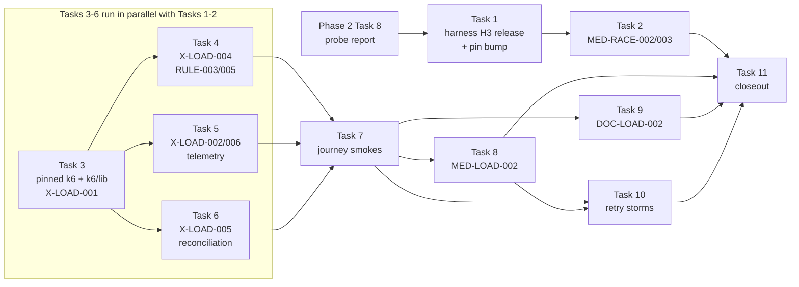

# P6 Phase 3 roadmap (Tasks 1–11)

This is a roadmap, not a build plan. It fixes the order, the scope and the done criteria for P6
Phase 3. Each task gets its own junior-engineer build plan just before it starts, in the structure
of [docs/reference/p1-plan-example-medusa.md](../reference/p1-plan-example-medusa.md), and every
such plan starts with a **live probe**. Nothing in this file is a probed value unless it cites a
file in this repo, the pinned harness, a pinned product source or a CI run; open values are marked
"the live probe must confirm".

## Context

- Repo: [Jayami123/k6-load-concurrency-suite](https://github.com/Jayami123/k6-load-concurrency-suite)
  (P6). Written on `plan/2026-10-22-p6-phase3`, branched from `plan/2026-10-22-p6-phase2` at
  `5574214` (whose base is `main` at `d33e775`), so the Phase 2 roadmap
  [2026-10-22-p6-phase2-roadmap.md](2026-10-22-p6-phase2-roadmap.md) is readable here.
- **Source of the scope:** the maintainer's agreed P6 Phase 3–4 proposal (2026-10-21). It is not in
  the repo; its Phase 3 content was given with this task and is restated in "Phase 3 cases" below.
  Phase 3 theme: **foundations + correctness under load**. Exit: every LOAD run ships a k6 summary,
  telemetry, a chart and a post-load audit; nightly green on ≥ 3 runs; no latency gating yet.
- **What it replaces:** master plan §9 Phase 3 was "k6 smoke+ramp all products; baseline.json
  committed" ([docs/master-plan.html](../master-plan.html)). The proposal replaces it. The
  master-plan HTML is not edited (Phase 1 Task 8 rule); README notes the change (Task 11).
- **Carried in from Phase 2:** D11 of the Phase 2 roadmap (a second Medusa instance is started and
  stopped by the harness, not by a P6 bridge), its Task 8 (read-only probe whose report is the
  input spec for that harness change) and its "Later" (`P6-MED-RACE-002/003` are the first item of
  Phase 3).
- **What exists for k6 today** (all read on this branch):
  - Scripts: `k6/smoke/{medusa,cal,documenso}-health.js` (1 VU, 5 iterations or similar, `checks`
    and `http_req_failed` thresholds only) and `k6/probe/health-load.js` (Phase 0 feasibility probe,
    closed-model `stages`, cited in
    [docs/feasibility/2026-10-18-cursor-cloud-medusa.md](../feasibility/2026-10-18-cursor-cloud-medusa.md)).
    No `k6/lib/`.
  - Tooling: `npm run k6:inspect` ([scripts/k6-inspect.mjs](../../scripts/k6-inspect.mjs)) runs
    `k6 inspect` on every `k6/**/*.js` and **skips** when k6 is missing; `tsconfig.json` type-checks
    `k6/**/*.js` with `checkJs` and `@types/k6`.
  - k6 versions: CI pins `K6_VERSION: "1.8.2"` through `grafana/setup-k6-action` v1.2.2
    ([perf.yml](../../.github/workflows/perf.yml) lines 31, 89–91, 277–279, 536–538). The Cursor
    image installs k6 **unpinned** from the Grafana apt repo `stable`
    ([.cursor/Dockerfile](../../.cursor/Dockerfile), "k6 from the official Grafana apt repo"). The
    Claude Code cloud environment installs k6 from its setup script, which is not in the repo
    (`.claude/hooks/session-start.sh` does not install or check k6). The maintainer reports 2.3.0 on
    the cloud images; this Claude Code cloud session reports `k6 v1.3.0` (`k6 version`, 2026-10-22).
    So three environments may run three versions today.
- **Oracles available for reuse** (Phase 1, on `main`): `src/oracles/pg.ts` (read-only pool,
  `assertSelectOnly`, `selectRows`, `waitForStable`); Cal `src/cal/oracle.ts`
  (`HOST_OVERLAP_SQL`/`readHostOverlaps`, `OVERLAP_PAIRS_SQL`, `leakCheck`); Medusa
  `src/medusa/oracle.ts` (`readOversellSnapshot`, `RESERVATION_QTY_SQL`, `INVENTORY_LEVEL_SQL`,
  `leakCheck`); Documenso `src/documenso/oracle.ts` (`SEAL_JOBS_SQL`, `readTerminalJobs`,
  `readWebhookCalls`, `readCompletedEmailCount`, `DOCUMENT_COMPLETED_AUDIT_SQL`, `leakCheck`) and
  the matching `invariants.ts`. Receivers: `src/documenso/webhook-receiver.ts` today; Phase 2
  Task 4 moves it to `src/receivers/webhook-receiver.ts`.
- **Harness:** `qa-portfolio-harness#v0.2.11` ([package.json](../../package.json)). Process
  records P6 telemetry can read: Medusa `medusa-backend.pid` (`medusa-backend-pid.ts`), Documenso
  `documenso-web.pid` (`documenso-web-pid.ts`), Cal process group in `results/harness/cal.pgid`
  (P6's own bridge in [scripts/harness.mjs](../../scripts/harness.mjs)). Documenso runs its jobs
  in-process: `NEXT_PRIVATE_JOBS_PROVIDER: "local"` (`documenso-env.ts` line 272).

### Rules that hold for every task below

Sources: [AGENTS.md](../../AGENTS.md), [README.md](../../README.md), the Phase 1 and Phase 2
roadmaps, and this task's rules.

- **Every LOAD case has a correctness oracle or contract.** A load test that cannot fail on
  correctness is not accepted. The DB oracle is read-only (`default_transaction_read_only=on`).
- **PRODUCT BUG vs TEST BUG** label with evidence before any test change. Failing CI is
  root-caused; never re-run blindly or weaken an assertion. `test.fail()` (Playwright) or an
  expected-failure verdict (LOAD runner) only for a proven product bug with repeated-run evidence.
- Data isolation by run prefix (`src/races/prefix.ts` `p6RunPrefix`), cleanup sweep and leak check
  per case. Tokens and passwords are never printed, logged or committed; the token scan
  (`scripts/evidence-token-scan.mjs`) runs before every artefact upload, including k6 summaries,
  k6 JSON output and telemetry files.
- Never edit product forks. P6 never edits `node_modules/qa-portfolio-harness`; harness changes go
  through a harness release (Task 1). `scripts/harness.mjs` owns starting/stopping.
- **No latency thresholds or gates in Phase 3.** k6 `thresholds` are allowed only on correctness
  metrics (`checks`, non-conflict `http_req_failed`), as the existing smokes do (D9).
- Cloud-session timings (Cursor Cloud, Claude Code cloud) prove a test works and are never
  published. Published numbers come only from GitHub Actions, median of ≥ 3 **valid** runs
  (`P6-RULE-005`), each carrying its environment (`P6-RULE-003`).
- Shared GitHub-hosted runners only (free). k6, product and Postgres share one runner, so every
  number is environment-bound.
- One PR per task, branch `<type>/<YYYY-MM-DD>-p6-<topic>`, Conventional Commits with a lowercase
  subject, `npm run check` before every push. Task 1's harness PR follows the harness repo's own
  conventions (`feat/<date>-harness-…`). Industry-standard structure and naming; any non-standard
  choice is flagged with the proper alternative.

### Primitive bar

Every case is a cross-domain primitive, not CRUD: **money / stock never goes negative**, **single
winner under contention**, **state-transition exclusivity**, **side-effect exactly-once**, **token
single use**, and for load specifically **a measurement is valid only if the generator was not the
bottleneck** and **a queue that fills must drain**. Each task has one line on what it proves and how
it transfers to finance and healthcare. Extra risky cases found in a source are listed as
**proposed extras** with a new ID; they are not in scope until the maintainer accepts them.

## Already done (not re-planned)

| Item                                         | Where                                                                                                                        |
| -------------------------------------------- | ---------------------------------------------------------------------------------------------------------------------------- |
| Phase 0: harness wiring, k6 health smokes    | `scripts/harness.mjs`, `scripts/bootstrap.sh`, `k6/smoke/*`, `k6/probe/health-load.js`                                       |
| Phase 1: race framework + six race cases     | `src/races/*`, `src/{medusa,cal,documenso}/*`, CI jobs `medusa-smoke`, `cal-smoke`, `documenso-smoke`, release `p6-phase1`   |
| Phase 1: evidence release + token scans      | `.github/workflows/evidence-release.yml`, `scripts/evidence-token-scan.mjs`, perf.yml "Check Documenso artefacts for tokens" |
| Phase 2: roadmap and decisions (plan branch) | [2026-10-22-p6-phase2-roadmap.md](2026-10-22-p6-phase2-roadmap.md) (Tasks 1–9; D1–D12)                                       |

Phase 2 is **planned, not built** on `main` at `d33e775`. Phase 3 depends on two Phase 2 outputs
that do not exist yet: the Phase 2 Task 8 report (input to Task 1 here) and, for the Medusa
balance audit, the Phase 2 money oracles (Task 6 here). See "Notes on the proposed order".

## Phase 3 cases

| Case ID           | Source (proposal unless noted)        | Summary                                                                                                  | Pri |
| ----------------- | ------------------------------------- | -------------------------------------------------------------------------------------------------------- | --- |
| —                 | Phase 2 D11; proposal "harness H3"    | Harness release: the harness starts and stops a second Medusa instance; P6 bumps its pin                 | —   |
| `P6-MED-RACE-002` | master plan MED02                     | Two Medusa instances × Redis lock: orders ≤ S                                                            | P1  |
| `P6-MED-RACE-003` | master plan MED02                     | Two instances × in-memory lock: characterization (records why a shared lock is required)                 | P2  |
| `P6-X-LOAD-001`   | proposal                              | Open-model workload library (`k6/lib`) + stub self-test that makes coordinated omission visible          | P0  |
| `P6-X-LOAD-004`   | proposal                              | Measurement validity guard: generator saturation marks a run INVALID with reasons                        | P0  |
| `P6-RULE-003`     | proposal                              | Absolute numbers are environment-bound: `run-meta.json` on every published number                        | —   |
| `P6-RULE-005`     | proposal                              | Invalid runs are not results: excluded from medians and README                                           | —   |
| `P6-X-LOAD-002`   | proposal                              | Outside-only telemetry sampler + one correlated HTML chart; gap > 2 intervals or clock skew → INVALID    | P0  |
| `P6-X-LOAD-006`   | accepted extra (2026-10-22)           | Sampler overhead: stub self-test with and without the sampler; k6 metrics within the probe's margin      | —   |
| `P6-X-LOAD-005`   | proposal                              | Post-load reconciliation after every LOAD run, reusing Phase 1/2 oracles; fail = PRODUCT BUG             | P0  |
| `P6-CAL-LOAD-001` | proposal (replaces master plan's)     | Journey smoke: getSchedule → book, unique attendee; checks == 1; booking ACCEPTED in DB                  | —   |
| `P6-MED-LOAD-001` | proposal (replaces master plan's)     | Journey smoke: browse → cart → complete; one order; stock −1                                             | —   |
| `P6-DOC-LOAD-001` | proposal                              | Journey smoke: create → distribute → both recipients sign; COMPLETED, one seal                           | —   |
| `P6-MED-LOAD-002` | proposal (master plan MED35 reshaped) | Inventory conservation under constant-arrival-rate checkouts vs stock S; orders ≤ S; clean 400; no 5xx   | P0  |
| `P6-DOC-LOAD-002` | proposal                              | Async pipeline lag at a steady rate; per-document stage times; backlog drains after load (drain time)    | P0  |
| `P6-DOC-LOAD-008` | accepted extra (2026-10-22)           | Webhook retry exactly-once: first delivery fails, Documenso's retry gives one accepted delivery (gated)  | —   |
| `P6-CAL-LOAD-007` | proposal                              | Retry storm: same booking body retried after a short client timeout; one ACCEPTED, one side effect       | —   |
| `P6-MED-LOAD-006` | proposal                              | Retry storm: cart complete with low timeout + retries; one order, stock −1 once, one payment             | P0  |
| `P6-DOC-LOAD-007` | proposal                              | Retry storm: completeDocumentWithToken retries; one SIGNED, rest ALREADY_SIGNED, one seal, one email set | —   |
| `P6-CAL-LOAD-009` | accepted extra (2026-10-22)           | Retry storm through a single-use private link: one booking per link (gated on Phase 2 `P6-CAL-RACE-006`) | —   |
| `P6-RULE-001`     | master plan X-P6-RULES                | baseline.json exists before thresholds are enforced (checked at closeout)                                | P0  |
| `P6-RULE-002`     | master plan X-P6-RULES                | README numbers match the latest artefact; no ideation figure as a result (checked at closeout)           | P0  |

"—" in Pri: the source gives none; the task's plan proposes one. Rate sizing for every LOAD case
in this phase: a small **fixed** rate chosen by the case's probe, well below saturation and
`P6-X-LOAD-004`-valid, labelled **"functional load, not capacity"** (D1).

## Task table

| Task | Title                                  | Cases                                                                              | Depends on                 | Branch (date set when the task starts)                                                  | Can run in parallel with |
| ---- | -------------------------------------- | ---------------------------------------------------------------------------------- | -------------------------- | --------------------------------------------------------------------------------------- | ------------------------ |
| 1    | Harness H3 release + P6 pin bump       | none (harness: second Medusa instance + Cal up/down fix; P6 bridge deleted)        | Phase 2 Task 8 report      | harness `feat/<date>-harness-medusa-second-instance`; P6 `chore/<date>-p6-harness-bump` | 3, 4, 5, 6               |
| 2    | Multi-instance Medusa races            | `P6-MED-RACE-002`, `P6-MED-RACE-003`                                               | 1; Phase 2 Task 1 (spread) | `feat/<date>-p6-med-multi-instance`                                                     | 3, 4, 5, 6               |
| 3    | Load foundation: one k6 + workload lib | `P6-X-LOAD-001`                                                                    | —                          | `feat/<date>-p6-load-foundation`                                                        | 1, 2                     |
| 4    | Run validity + metadata                | `P6-X-LOAD-004`, `P6-RULE-003`, `P6-RULE-005`                                      | 3                          | `feat/<date>-p6-load-validity`                                                          | 1, 2, 5                  |
| 5    | Telemetry sampler + correlated chart   | `P6-X-LOAD-002`, `P6-X-LOAD-006`                                                   | 3                          | `feat/<date>-p6-load-telemetry`                                                         | 1, 2, 4                  |
| 6    | Post-load reconciliation               | `P6-X-LOAD-005`                                                                    | 3                          | `feat/<date>-p6-load-reconciliation`                                                    | 1, 2, 4, 5               |
| 7    | Journey smokes (health smokes retired) | `P6-CAL-LOAD-001`, `P6-MED-LOAD-001`, `P6-DOC-LOAD-001`                            | 4, 5, 6                    | `feat/<date>-p6-journey-smokes`                                                         | —                        |
| 8    | Inventory conservation under load      | `P6-MED-LOAD-002`                                                                  | 7                          | `feat/<date>-p6-med-load-conservation`                                                  | 9                        |
| 9    | Documenso pipeline lag                 | `P6-DOC-LOAD-002`, `P6-DOC-LOAD-008` (gated)                                       | 7                          | `feat/<date>-p6-doc-load-pipeline-lag`                                                  | 8                        |
| 10   | Retry storms                           | `P6-CAL-LOAD-007`, `P6-MED-LOAD-006`, `P6-DOC-LOAD-007`, `P6-CAL-LOAD-009` (gated) | 7 (8 for the Medusa setup) | `feat/<date>-p6-retry-storms`                                                           | 9                        |
| 11   | Phase 3 closeout                       | all Phase 3 cases (evidence only); `P6-RULE-001/002` check                         | 2, 8, 9, 10                | `docs/<date>-p6-phase3-closeout`                                                        | —                        |

"Can run in parallel" means the probe, plan and build can proceed while the other task is in
progress. PRs that edit `.github/workflows/perf.yml` merge one at a time and rebase on each other.
Only one product stack runs at a time on a cloud VM; the stub self-tests (Tasks 3–5) need no
product.

### Notes on the proposed order (kept as is)

The proposed order 1 → 11 is kept. Points from the sources that bear on it (none changes the order;
each is resolved inside the named task):

1. **Task 1 is blocked on Phase 2.** Its input, the Phase 2 Task 8 report, does not exist yet
   (Phase 2 is planned, not built). Tasks 3–6 do not depend on Phase 2 and can start first.
   Task 2 also needs the Phase 2 Task 1 rerun-on-spread framework, because it is a race case.
2. **Task 6 Medusa "balances ≥ 0" has no oracle yet.** Phase 1 has stock/order oracles only.
   Balance oracles come from Phase 2 Task 2, and Phase 2 D5 may move the gift-card case
   (`P6-MED-RACE-006`) to "Later". So "balances ≥ 0" is reconciled on whatever money oracle Phase 2
   lands (refunds ≤ captured from `P6-MED-RACE-007/011`, captured ≤ authorized from `-010`); if none
   has landed when Task 6 starts, that clause is recorded as pending, not dropped (D7).
3. **Journey smokes depend on Tasks 4–6, not only Task 3.** The exit rule says every LOAD run ships
   a k6 summary, telemetry, a chart and a post-load audit; the journey smokes are LOAD cases, so
   they come after the validity guard, the sampler and the reconciliation. The task table encodes
   that (Task 7 depends on 4, 5, 6), which the proposal's linear list implies but does not state.
4. **Task 10 Medusa depends on Task 8.** `P6-MED-LOAD-006` reuses the checkout journey and the
   conservation oracle of `P6-MED-LOAD-002`.
5. **Master-plan IDs are redefined.** The master plan's `P6-CAL-LOAD-001` is "k6 smoke: booker GET
   healthy" and `P6-MED-LOAD-001` is "k6 smoke store catalogue"; the proposal reuses both IDs for
   journey smokes. The master plan's `P6-MED-LOAD-002` is "k6 checkout ramp with stock invariant …
   write baseline.json"; the proposal makes it constant-arrival-rate with no baseline. The master
   plan has no `P6-DOC-LOAD-*`, `P6-X-LOAD-*` or `P6-RULE-003..006`. The proposal wins (it is the
   agreed scope); README records the redefinitions (Task 11).
6. **`P6-RULE-001` and the existing smokes.** RULE-001 says "baseline.json exists before
   thresholds enforced", and master plan §1 says thresholds start as `thresholds: {}`. The current
   smokes already enforce `checks: rate==1` and `http_req_failed` thresholds. Those are correctness
   thresholds, not performance ones; D9 records that RULE-001 applies to latency/throughput
   thresholds only.
7. **Naming of "H3".** The proposal numbers harness changes H1–H3; this file uses **harness H3**
   for the second Medusa instance. The Phase 1 Task 6 plan
   ([2026-10-20-p6-phase1-task6-documenso-stack.md](2026-10-20-p6-phase1-task6-documenso-stack.md)
   §2.11 "Harness notes") also has an item labelled H3; this file calls that one **"the Documenso
   API-token note"** (`authenticate()` still asks for a pasted `DOCUMENSO_API_TOKEN`) and never
   "H3".
8. **k6 version reports disagree.** The maintainer reports 2.3.0 on the cloud images; this Claude
   Code cloud session reports v1.3.0; CI pins 1.8.2. Task 3's probe records each environment's
   actual version before choosing the pin.

## Task 1: Harness H3 release + P6 pin bump

- **Goal.** The harness can start and stop a **second Medusa backend** on its own port, sharing
  the first one's Postgres and (optionally) Redis, with a lock provider chosen per mode, and its Cal
  `up`/`down` are fixed. P6 bumps `qa-portfolio-harness` to the new tag, deletes its Cal bridge, and
  keeps every existing job green.
- **Cases.** None mapped (infrastructure for `P6-MED-RACE-002/003`).
- **What it proves / transfers.** Infrastructure only: scale-out is started by the same audited
  tool as every other stack, so a "two replicas, one ledger" claim in finance or a "two nodes, one
  bed register" claim in healthcare is tested on a reproducible topology.
- **Depends on.** The Phase 2 Task 8 report (ports, lock provider per mode, memory, down/cleanup of
  both processes; Phase 2 roadmap Task 8 and D11).
- **Scope.**
  - **Harness repo** [Jayami123/qa-portfolio-harness](https://github.com/Jayami123/qa-portfolio-harness):
    its own branch `feat/<date>-harness-medusa-second-instance`, its own PR, CHANGELOG entry, a new
    tag (next version after `v0.2.11`; the probe reads the harness's versioning rule), built from
    the Task 8 report. Unit tests in the harness for the new pid/port records. The Medusa adapter
    today runs one backend (`medusa-backend.pid`, `MEDUSA_DEFAULT_PORT = "9000"` in
    `medusa-env.ts`) and Redis on 6380 with `MEDUSA_REDIS=1`.
  - **P6 repo:** bump `package.json` (`github:Jayami123/qa-portfolio-harness#<tag>`) and
    `package-lock.json` with `npm install`, never by hand; update every `h0.2.11` cache-key suffix in
    `perf.yml` (Medusa, Cal, Documenso build caches); README harness version line; prove all three
    product jobs green on the bump PR.
  - **Cal `up`/`down` fix, a separate harness PR under the same version tag (D4):** the Phase 1
    roadmap's harness backlog item: Cal `up` returns once Cal is healthy, `down` stops the Cal web
    process, the seed check uses `users`, and no seed credentials appear in logs. Own branch (e.g.
    `fix/<date>-harness-cal-up-down`), own PR and CHANGELOG entry; both PRs merge before the tag is
    cut, so one version carries both.
  - **P6 pin-bump PR deletes the Cal bridge:** the `LONG_RUNNING` map, `upLongRunning`, `stopGroup`
    and the `results/harness/cal.pgid` handling in `scripts/harness.mjs` ("TEMPORARY BRIDGE"
    comment), plus the README sentence that describes the bridge ("Run Cal" section). Task 5's Cal
    process discovery then reads the harness's own Cal process record instead of `cal.pgid` (the
    probe confirms its name).
- **Files likely touched.** Harness, PR 1 (second instance): `src/adapters/medusa.adapter.ts`,
  `medusa-env.ts`, `medusa-backend-pid.ts` and their tests. Harness, PR 2 (Cal fix):
  `src/adapters/cal.adapter.ts` and its tests (the harness `scripts/up.mjs`/`down.mjs` if the fix
  needs them). Both: `README.md`, `CHANGELOG.md` (the probe must confirm the file exists in the
  harness repo; the installed package lists none). P6: `package.json`, `package-lock.json`,
  `.github/workflows/perf.yml` (cache keys), `scripts/harness.mjs` (bridge deleted), `README.md`,
  `.env.example` (new env names only, e.g. a second base URL), `src/races/env.ts`
  (second-instance URL getter).
- **The live probe must confirm.** The Phase 2 Task 8 report's values on the current harness `main`
  (not only `v0.2.11`); the env names and defaults for the second instance; that `down medusa`
  stops both processes and frees both ports; that the bump changes no existing behaviour (all three
  jobs green); that Cal `up` returns on its own when healthy and `down` leaves nothing on :3000
  without the P6 bridge (the Phase 1 Task 3 probe found `up.mjs` never returned and `down()` left
  `next start` running, per the `scripts/harness.mjs` comment); that the harness Cal logs carry no
  seed credentials; that this session can reach the harness repo (it is not in this session's
  GitHub scope today; the build adds it).
- **Build plan.** Two plans, both starting with a live probe and written as junior-engineer
  guides (exact file paths, code skeletons per new function and test, exact commands, expected
  outputs, step order) so a weaker model can build them without guessing: the harness plan (in the
  harness repo's docs, covering both harness PRs) and
  `docs/plans/<date>-p6-phase3-task1-harness-h3-bump.md`.
- **CI change.** Cache-key suffix bump in `perf.yml`; nothing else.
- **Done when.** Both harness PRs (second instance; Cal `up`/`down` fix) merged, each with a
  CHANGELOG entry, under one new tag; the P6 bump PR deletes the Cal bridge from
  `scripts/harness.mjs` and is green in all three jobs on the PR and once on `main` (Cal up/down
  through the harness alone); README states the new harness version and no longer describes the
  bridge; `npm run check` green.
- **Main risks.** A harness change breaking P1 (P1 pins the harness too; the harness PR runs P1's
  smoke or states why not); the Cal fix not covering every case the bridge handled (an `up` while
  Cal is already starting, a dead leader with live children), so the P6 PR keeps the bridge's checks
  as probe steps before deleting it; memory for two Medusa processes on a shared runner; cache
  invalidation making the first `main` run slow.

## Task 2: Multi-instance Medusa races (`P6-MED-RACE-002`, `P6-MED-RACE-003`)

- **Goal.** Prove the oversell guard holds across two instances with a shared Redis lock, and
  record what happens with the in-memory lock.
- **Cases.** `P6-MED-RACE-002` (P1), `P6-MED-RACE-003` (P2, characterization).
- **What it proves / transfers.** Single winner across replicas: two payment-service replicas must
  not both debit the last unit of a balance; two clinic nodes must not both book the last slot.
- **Depends on.** Task 1; Phase 2 Task 1 (rerun-on-spread) and Phase 2 Task 3 (single-instance
  Medusa races green).
- **Scope.** Master plan MED02: S=3, N=15, completes split across both instances behind one
  `fireTogether` barrier. `-002`: Redis lock, orders ≤ S (reuse `readOversellSnapshot`,
  `checkOversellInvariants` from `src/medusa/*`). `-003`: in-memory lock, result recorded as a
  characterization (oversell count per trial), asserted thereafter; an oversell there is
  **expected** and documents why a shared lock is required, not a product bug.
- **Files likely touched.** `src/medusa/run-case.ts` (or a `run-multi-instance.ts`; plan decides),
  `src/races/env.ts`, `tests/medusa/races/med-race-002-two-instances-redis.spec.ts`,
  `tests/medusa/races/med-race-003-two-instances-memory.spec.ts`, `tests/unit/medusa-*.test.ts`,
  `perf.yml` (a step or a separate job, because `MEDUSA_REDIS=1` and the in-memory mode need
  different harness starts; plan decides), `README.md`.
- **The live probe must confirm.** That the two modes can run in one job (down/up between them)
  within the job timeout (`medusa-smoke` is 45 min today); that requests really reach both
  instances (per-instance status counts); the lock provider each instance reports; memory.
- **Build plan.** `docs/plans/<date>-p6-phase3-task2-med-multi-instance.md`. Starts with the live
  probe; junior-engineer guide (exact file paths, code skeletons per new function and test, exact
  commands, expected outputs, step order) so a weaker model can build it without guessing.
- **CI change.** 3 trials on PRs, full count on `main`/nightly/dispatch (Phase 1 D2).
- **Done when.** `-002` passes (or a proven bug recorded with repeated evidence) and `-003`'s
  characterization is recorded and asserted, at PR and full counts; histograms uploaded; leak check;
  `npm run check` green.
- **Main risks.** Runner memory; both instances sharing one in-memory event bus assumption; a
  `-002` failure that is a configuration error (lock provider not registered), labelled TEST/ENV
  until the probe proves otherwise.

## Task 3: Load foundation, one pinned k6 + workload library (`P6-X-LOAD-001`)

- **Goal.** One k6 version everywhere, and a tested open-model workload library every LOAD case
  uses.
- **Cases.** `P6-X-LOAD-001` (P0).
- **What it proves / transfers.** That latency is measured the way users arrive (open model), not
  hidden by coordinated omission: a payment API or a patient-portal login measured closed-model
  under-reports exactly the slow periods that matter.
- **Depends on.** Nothing.
- **Scope.**
  - **One k6 version (environment change, first step of the task, D3).** The probe picks the
    version: the latest stable release that CI, Cursor Cloud and Claude Code cloud can all install
    **the same way**, checksum-verified (the standard way is the GitHub release tarball plus its
    published checksums file), with evidence. Then:
    - CI: `K6_VERSION` in `perf.yml` set to it (keep `grafana/setup-k6-action` if it installs that
      exact version, or replace it with the shared install script; plan decides with evidence).
    - A shared, checksum-verifying install script (e.g. `scripts/install-k6.sh`) used by CI, the
      Cursor image and the Claude Code setup script, so the three cannot drift.
    - `scripts/k6-inspect.mjs` (or `npm run check`) fails, not skips, when the installed k6 is not
      the pinned version and k6 is present; it still skips when k6 is absent (laptops without k6).
  - **Environment steps (both clouds).** The plan lists, for each:
    - **Cursor Cloud.** Automatic from the repo: `.cursor/Dockerfile` (replace the unpinned
      `apt-get install -y k6` with the pinned, checksum-verified install) and
      `.cursor/environment.json` (`install`/`start`, unchanged unless the probe needs it). By hand:
      rebuild the environment image in Cursor's settings so the new Dockerfile is used.
    - **Claude Code cloud.** Automatic from the repo: `.claude/hooks/session-start.sh` can warn
      when `k6 version` is not the pin (like its existing Node 24 and shellcheck warnings).
      By hand: the maintainer pastes the exact k6 install lines into the environment's **Setup
      script** (environment settings, Edit); and, if the probe finds the download host blocked,
      adds it under **Network access → Allowed domains**.
    - `AGENTS.md`: one line naming the pinned version and where it is installed.
  - **Workload library `k6/lib/`.** Executors (`constant-arrival-rate`, `ramping-arrival-rate`)
    with `preAllocatedVUs`/`maxVUs` sizing; journeys as composable steps; think time; dynamic
    per-user auth (credentials minted in setup, never logged); run prefix passed in from the
    runner; a standard `summaryTrendStats` and tags (`journey`, `step`, `case`).
  - **Pure logic is unit-tested** with `node --test`: rate and VU sizing math, journey step
    sequencing, prefix and tag builders live in plain ESM with no `k6/*` import, so `npm run
test:unit` covers them; k6 glue is covered by `k6 inspect`, `tsc` (`checkJs`, `@types/k6`) and
    the stub self-test.
  - **Stub self-test (no product).** A local Node HTTP stub that adds delay on purpose (for
    example a fixed service time with a periodic stall). Two runs at the same target: open model
    keeps the arrival rate and reports `dropped_iterations` when VUs run out; closed model sends
    fewer requests and reports a lower p95 on the same stub. The test asserts those **relations**,
    not absolute numbers.
- **Files likely touched.** `k6/lib/*.js` (e.g. `executors.js`, `journey.js`, `auth.js`,
  `prefix.js`, `options.js`), `k6/selftest/coordinated-omission.js`, `scripts/load/stub-server.mjs`
  (or `src/load/stub-server.ts`; plan decides), `tests/unit/k6-lib-*.test.ts`,
  `tests/unit/stub-server.test.ts`, `scripts/install-k6.sh`, `scripts/k6-inspect.mjs`,
  `.github/workflows/perf.yml`, `.cursor/Dockerfile`, `.claude/hooks/session-start.sh`,
  `AGENTS.md`, `README.md` ("How to read a LOAD run"), `package.json` (`load:selftest`).
- **The live probe must confirm.**
  1. The actual k6 version in each environment today (CI 1.8.2 from `perf.yml`; Cursor from its
     image; Claude Code cloud v1.3.0 in this session; the maintainer's 2.3.0 report) and the
     chosen pin with its release notes and checksum file name.
  2. That all three can install from the same source (download host reachable under each network
     policy) and verify the checksum.
  3. Whether `grafana/setup-k6-action` v1.2.2 can install the chosen version and verifies it.
  4. Breaking changes between 1.8.2 and the chosen version for the existing smokes
     (`k6 inspect` and a smoke run per product on the new version).
  5. Stub parameters (service time, stall pattern, rate, duration) that show the open/closed
     difference reliably on a shared runner without saturating the generator.
- **Build plan.** `docs/plans/<date>-p6-phase3-task3-load-foundation.md`. Starts with the live
  probe; junior-engineer guide (exact file paths, code skeletons per new function and test, exact
  commands, expected outputs, step order) so a weaker model can build it without guessing.
- **CI change.** Pinned k6 in all three jobs; a new step (in one job, or a small product-free job;
  plan decides) runs the stub self-test on every event.
- **Done when.** One k6 version in CI and in both cloud setups (documented, checksum-verified),
  `npm run check` fails on a mismatch; library unit tests green; the stub self-test shows open model
  holding the rate with `dropped_iterations` reported and closed model with fewer requests and lower
  p95, in CI on the PR and once on `main`; all existing smokes green on the new version; every new
  k6 script (`k6/selftest/*`, and any `k6/lib` example) also runs standalone with `k6 run`, inputs
  through env or a JSON file, with the exact command documented (D6).
- **Main risks.** A k6 major-version change breaking the smokes; the cloud network policies
  blocking the download host; the stub's relation flipping on a noisy runner (the probe sets
  margins and the run is marked INVALID by Task 4 rather than failed).

## Task 4: Run validity + metadata (`P6-X-LOAD-004`, `P6-RULE-003`, `P6-RULE-005`)

- **Goal.** Every LOAD run gets a verdict of **VALID** or **INVALID (reasons)** before any pass/fail,
  and every run carries its environment.
- **Cases.** `P6-X-LOAD-004` (P0), `P6-RULE-003`, `P6-RULE-005`.
- **What it proves / transfers.** A number is only evidence if the measuring tool was not the
  bottleneck and the environment is stated: the same rule as an audited latency figure for a
  trading gateway or an EHR SLA report.
- **Depends on.** Task 3.
- **Scope.**
  - Guard inputs: k6 process CPU, `dropped_iterations`, VU exhaustion (VUs at `maxVUs`), runner
    `nproc` and memory, plus (from Task 5) telemetry gaps. Thresholds for "saturated" are set by the
    probe and stated in the plan; INVALID is **not** pass and **not** fail.
  - `run-meta.json` per run: runner image, `nproc`, memory, product SHA (`MEDUSA_REF`, `CAL_REF`,
    `DOCUMENSO_REF`), harness tag, k6 version, event, run id, start/end, case id, fixed rate, and
    the label "functional load, not capacity". No secrets.
  - `P6-RULE-005`: the CI summary and the README tooling exclude INVALID runs from medians; the
    count of excluded runs and their reasons is shown.
  - `P6-RULE-003`: every published number links to its `run-meta.json`; no text calls a number the
    product's capacity.
  - A single **LOAD runner** (Node, TypeScript, e.g. `scripts/load/run-load.ts`) that every LOAD
    case uses: setup → sampler start → k6 → drain → reconciliation → cleanup → token scan → verdict
    (D6). Task 4 builds its skeleton with the validity step; Tasks 5 and 6 plug in. The runner
    passes inputs to k6 only through env vars or a JSON file, never through code only the runner
    knows, so every k6 script stays runnable with plain `k6 run`.
  - **Readiness preflight** (replaces the health smokes, D10): before k6 starts, the runner checks
    the product's health URL (Medusa `/health`, Cal `/pro/30min`, Documenso `/signin` and
    `/api/auth/csrf`, the routes the current smokes hit) and the race leak check result (D5); a
    failed preflight stops the run as ENV or TEST BUG with evidence, never as a LOAD result.
- **Files likely touched.** `src/load/validity.ts`, `src/load/run-meta.ts`, `src/load/types.ts`,
  `scripts/load/run-load.ts`, `src/ci/race-table.ts` or a new `src/ci/load-table.ts` (job
  summary), `scripts/write-ci-job-summary.ts`, `tests/unit/load-validity.test.ts`,
  `tests/unit/load-run-meta.test.ts`, `perf.yml`, `README.md`.
- **The live probe must confirm.** How to read k6's own CPU (k6 has no built-in CPU metric;
  candidates: `/proc/<k6 pid>/stat` sampled by the runner); the k6 summary fields for
  `dropped_iterations` and `vus_max` on the pinned version; the runner image name and version
  variables available on GitHub-hosted runners (`ImageOS`, `ImageVersion` env are the probe's
  candidates); a generator-saturation threshold that the stub self-test can trigger on purpose.
- **Build plan.** `docs/plans/<date>-p6-phase3-task4-load-validity.md`. Starts with the live probe;
  junior-engineer guide (exact file paths, code skeletons per new function and test, exact
  commands, expected outputs, step order) so a weaker model can build it without guessing.
- **CI change.** The stub self-test runs once deliberately saturated (expects INVALID with the
  right reason) and once normally (expects VALID).
- **Done when.** Unit tests green; the deliberate-saturation run is INVALID with reasons and the
  normal run is VALID, in CI on the PR and once on `main`; `run-meta.json` uploaded with every run
  and passes the token scan; the LOAD runner orchestrates k6, and the k6 script it runs still works
  standalone with `k6 run` (inputs via env/JSON; documented command) for debugging (D6); `npm run
check` green.
- **Main risks.** Shared-runner noise flipping verdicts (the probe sets margins); measuring k6 CPU
  perturbing k6; INVALID being used to hide a failure (only generator/telemetry reasons may make a
  run INVALID, never a correctness result, mirroring Phase 2 D3).

## Task 5: Telemetry sampler + correlated chart (`P6-X-LOAD-002`)

- **Goal.** Outside-only telemetry beside every LOAD run, on the k6 clock, with one correlated
  HTML chart.
- **Cases.** `P6-X-LOAD-002` (P0), `P6-X-LOAD-006` (accepted extra, sampler overhead).
- **What it proves / transfers.** Bottleneck attribution without touching the product: the same
  evidence an incident review needs in a bank or hospital (was it the database, locks, the app or
  the load tool?) when the system under test cannot be instrumented.
- **Depends on.** Task 3 (and Task 4's runner skeleton to plug into).
- **Scope.**
  - Sampler (Node, beside the run, fixed interval set by the probe): `pg_stat_activity` (active,
    idle-in-transaction, waiting by wait event), `pg_locks` (waiting locks), `pg_stat_database`
    deltas (xact commit/rollback, deadlocks, blocks), all over a **read-only** connection through
    `src/oracles/pg.ts` (`assertSelectOnly`); `/proc` stats (CPU, RSS, open fds) for the app
    process group (Medusa `medusa-backend.pid`, Documenso `documenso-web.pid`, Cal
    `results/harness/cal.pgid`); `docker stats` for the product's DB container; a health-probe
    latency series; log-grep counts (error lines) on the product log.
  - Output: CSV/JSON keyed on epoch ms aligned with k6's JSON output timestamps; one self-contained
    HTML chart (arrival rate, rolling p95, error rate, `dropped_iterations`, pg active/waiting, lock
    waits, app CPU/RSS, probe latency). No CDN dependency in the artefact (D8).
  - Self-test: no gap > 2 intervals, or the run is INVALID (reason fed to Task 4's guard). The same
    self-test checks **clock skew**: the sampler and k6 timestamps are cross-checked against a
    marker request at start and end; skew beyond one interval marks the run INVALID (folded in
    from the dropped extra, D14).
  - `P6-X-LOAD-006` sampler overhead: the stub self-test runs with and without the sampler; the k6
    metrics (request count, p95, `dropped_iterations`) must stay within a margin the probe sets
    and the plan records.
  - **No harness telemetry** in this phase: no `pg_stat_statements`, no `auto_explain`, no
    event-loop preload (harness H1 and H2 are Phase 5, D2).
- **Files likely touched.** `src/load/telemetry/{sampler,pg-stats,proc-stats,docker-stats,log-grep}.ts`,
  `src/load/chart/render-chart.ts` (or `scripts/load/render-chart.ts`), `tests/unit/telemetry-*.test.ts`,
  `tests/unit/render-chart.test.ts`, `tests/unit/telemetry-skew.test.ts`,
  `k6/selftest/sampler-overhead.js`, `scripts/load/run-load.ts`, `perf.yml` (artefact upload after
  the token scan), `README.md` ("How to read the chart").
- **The live probe must confirm.**
  1. Whether the harness DB users can read other sessions' rows in `pg_stat_activity` and
     `pg_locks` with `default_transaction_read_only=on` (full rows need superuser or
     `pg_read_all_stats`; Cal's harness URL uses `postgres`, Medusa's uses `medusa`). If not, which
     columns are still visible, stated plainly.
  2. The DB container names per compose project, and `docker stats --no-stream` cost per sample.
  3. Process-tree discovery from each pid/pgid record (the app may run children, e.g. Next.js under
     Cal), and `/proc` access on GitHub-hosted runners and both clouds.
  4. The sampler's own overhead (CPU, one extra DB connection) at the chosen interval, and the
     `P6-X-LOAD-006` margin that separates noise from real perturbation on a shared runner.
  5. Clock alignment between k6 JSON output and the sampler (both epoch ms on one host), and a
     marker request k6 and the sampler can both timestamp for the skew check.
  6. Which product log lines to grep, and that the grep output carries no token.
- **Build plan.** `docs/plans/<date>-p6-phase3-task5-load-telemetry.md`. Starts with the live
  probe; junior-engineer guide (exact file paths, code skeletons per new function and test, exact
  commands, expected outputs, step order) so a weaker model can build it without guessing.
- **CI change.** The stub self-test produces a telemetry file and chart (stub process and no DB:
  the pg series is shown as absent, not as zero); artefacts uploaded after the token scan.
- **Done when.** Unit tests green (gap detection, deltas, chart rendering from fixtures); the
  self-test run's telemetry has no gap > 2 intervals and a chart artefact, in CI on the PR and once
  on `main`; a forced gap and a forced clock skew each mark the run INVALID; `P6-X-LOAD-006` shows
  the with/without-sampler metrics within the recorded margin; `npm run check` green.
- **Main risks.** Read-only roles not seeing other sessions; the sampler perturbing the measurement;
  `docker stats` latency causing gaps; chart size.

## Task 6: Post-load reconciliation (`P6-X-LOAD-005`)

- **Goal.** After every LOAD run, an audit reuses the Phase 1/2 oracles; any violation is a
  **PRODUCT BUG**.
- **Cases.** `P6-X-LOAD-005` (P0).
- **What it proves / transfers.** Correctness is checked after the load, not only per request:
  the end-of-day reconciliation of a ledger, or a medication-count reconciliation after a busy
  shift.
- **Depends on.** Task 3 (and Task 4's runner skeleton).
- **Scope.**
  - **Cal:** no overlapping ACCEPTED pairs for the run's bookings (`HOST_OVERLAP_SQL` /
    `OVERLAP_PAIRS_SQL` in `src/cal/oracle.ts`). Known bug `P6-OBS-CAL-002` (high) is counted
    separately, never hidden: a load audit that finds pairs reports them under that ID.
  - **Medusa:** orders ≤ stock and reservations consistent (`readOversellSnapshot`,
    `RESERVATION_QTY_SQL`, `INVENTORY_LEVEL_SQL`); balances ≥ 0 using the money oracles Phase 2
    lands (Context, Note 2, D7).
  - **Documenso:** no stuck pending seal jobs after drain (`SEAL_JOBS_SQL` / `readTerminalJobs`),
    one seal per document (`DOCUMENT_COMPLETED_AUDIT_SQL`). Known bug `P6-OBS-DOC-002`
    ([documenso/documenso#3187](https://github.com/documenso/documenso/issues/3187)) is counted
    separately.
  - Scope of each audit is the run's prefix only (no global assertions on shared seed data).
  - Leak check per product (`leakCheck` in each `oracle.ts`) after cleanup.
- **Files likely touched.** `src/load/reconcile/{cal,medusa,documenso}.ts`, `src/load/reconcile/index.ts`,
  `tests/unit/reconcile-*.test.ts`, `scripts/load/run-load.ts`, `README.md`.
- **The live probe must confirm.** That each oracle can be scoped by run prefix for LOAD-created
  data (Cal attendee email, Medusa customer email or cart metadata, Documenso envelope title, as in
  Phase 1); how long Documenso's in-process jobs (`NEXT_PRIVATE_JOBS_PROVIDER: "local"`) take to
  drain after load; which Medusa money oracles exist on `main` when the task starts.
- **Build plan.** `docs/plans/<date>-p6-phase3-task6-load-reconciliation.md`. Starts with the live
  probe; junior-engineer guide (exact file paths, code skeletons per new function and test, exact
  commands, expected outputs, step order) so a weaker model can build it without guessing.
- **CI change.** None on its own (no product LOAD run exists yet); unit tests run in
  `npm run check`. The first product run is Task 7.
- **Done when.** Unit tests green with fixtures for a clean and a violating snapshot per product;
  the runner calls the audit and maps a violation to PRODUCT BUG with evidence; known bugs are
  counted under their IDs; `npm run check` green.
- **Main risks.** A known product bug drowning the audit (counted separately); drain time making
  the job long; scoping mistakes making the audit pass on nothing (each audit asserts it saw ≥ 1
  run-created row).

## Task 7: Journey smokes (`P6-CAL-LOAD-001`, `P6-MED-LOAD-001`, `P6-DOC-LOAD-001`)

- **Goal.** Each product has one end-to-end LOAD journey, run through the full LOAD runner
  (validity, telemetry, chart, audit), replacing the health smokes as the k6 entry point.
- **Cases.** `P6-CAL-LOAD-001`, `P6-MED-LOAD-001`, `P6-DOC-LOAD-001`.
- **What it proves / transfers.** That a real business journey (book an appointment, buy one unit,
  get a document signed) completes correctly under a small fixed load: the same smoke a payments or
  patient-scheduling team runs before any capacity test.
- **Depends on.** Tasks 4, 5, 6.
- **Scope.**
  - `P6-CAL-LOAD-001`: getSchedule → book with a unique prefixed attendee; `checks == 1`; the
    booking is ACCEPTED in the DB; no latency thresholds.
  - `P6-MED-LOAD-001`: browse → cart → complete; one order per iteration; stock −1 per order
    (inventory oracle).
  - `P6-DOC-LOAD-001`: create → distribute → both recipients sign; envelope COMPLETED; one seal.
  - Each at a small fixed rate set by its probe, labelled "functional load, not capacity" (D1).
  - **Old health smokes retired (D10):** delete `k6/smoke/medusa-health.js`, `cal-health.js`,
    `documenso-health.js`, the `smoke:medusa`, `smoke:cal`, `smoke:documenso` scripts in
    `package.json` and the three CI "k6 smoke" steps and their `k6-summary-*-health` artefact uploads
    in `perf.yml`. The LOAD runner's readiness preflight (Task 4) replaces them. In the same PR:
    `AGENTS.md` (the Cursor line "run `npm run smoke:medusa`") and README ("Run the smoke check
    locally", "Run Cal", "Run Documenso" command blocks) point at the journey smokes instead.
  - Auth: Documenso's API token and user are minted per run in the runner's setup (as the Phase 1
    self-test does through `src/documenso/account.ts`), handed to k6 through the environment, never
    as a CLI argument, never logged.
- **Files likely touched.** `k6/journeys/{cal-book,med-checkout,doc-sign}.js` (D11; master plan §2
  sketched `k6/products/`), `k6/cases/*.js`, `k6/lib/*`, `scripts/load/run-load.ts`, `package.json`
  (`load:cal`, `load:medusa`, `load:documenso`; `smoke:*` removed), `k6/smoke/*-health.js`
  (deleted), `perf.yml`, `README.md`, `AGENTS.md`, `tests/unit/*` for any pure helper.
  `k6/probe/health-load.js` is cited by the Phase 0 feasibility report and stays.
- **The live probe must confirm.** The Cal getSchedule route and parameters on `CAL_REF` (Phase 1
  books through `POST /api/book/event`; the slots route is unverified); free-slot supply for the
  fixed rate × duration (Phase 1 allocator); the Medusa browse/cart/complete calls k6 must make
  (Phase 1 does them from Node in `src/medusa/store.ts`); the Documenso create/distribute/sign API
  calls k6 can make with a per-run token; the fixed rate and duration per product that stay VALID
  on a shared runner; job time added per product.
- **Build plan.** `docs/plans/<date>-p6-phase3-task7-journey-smokes.md`. Starts with the live probe;
  junior-engineer guide (exact file paths, code skeletons per new function and test, exact
  commands, expected outputs, step order) so a weaker model can build it without guessing.
- **CI change.** Each product job runs its journey through the LOAD runner after its races (one
  stack start per job, D5); the LOAD step starts only if the race leak check passed: a short duration on PRs, the full fixed-rate duration on `main`,
  nightly and dispatch. Artefacts: k6 summary, k6 JSON, telemetry, chart, `run-meta.json`, audit,
  all after the token scan.
- **Done when.** All three journeys VALID and green with their audits on the PR and once on `main`;
  every run ships summary + telemetry + chart + audit; the health smokes, `smoke:*` scripts and CI
  "k6 smoke" steps are gone and the readiness preflight runs instead; `AGENTS.md` and README
  updated; each journey also runs standalone with `k6 run` (D6); `npm run check` green.
- **Main risks.** k6 cannot easily reuse the TS clients (journeys are re-written in k6 JS; the
  oracle stays in TS); slot supply; Documenso sealing per iteration slowing the job; job timeouts.

## Task 8: Inventory conservation under load (`P6-MED-LOAD-002`)

- **Goal.** Prove stock is conserved when many unique carts check out at a constant arrival rate.
- **Cases.** `P6-MED-LOAD-002` (P0).
- **What it proves / transfers.** Conservation of a finite resource under sustained contention:
  no over-allocation of a credit line or a vaccine stock, and a clean refusal (not an error) when
  it runs out.
- **Depends on.** Task 7 (Medusa checkout journey).
- **Scope.** `constant-arrival-rate` checkout journeys on unique prefixed carts against one variant
  with stock S at the probe's fixed rate (D1). Oracle (post-load audit + per-response contract):
  orders ≤ S; reservations consistent with orders; out-of-stock is a clean 400 (`not_allowed`, as in
  `P6-MED-RACE-001`'s README contract); no 5xx. Re-run at 50% of the knee in Phase 4 (D1).
- **Files likely touched.** `k6/journeys/med-checkout.js` (scenario options), a case config (e.g.
  `k6/cases/med-load-002.js`), `src/load/reconcile/medusa.ts`, `perf.yml`, `README.md`.
- **The live probe must confirm.** The fixed rate and S that make the stock run out mid-run while
  the run stays VALID; that `dropped_iterations` stays at 0; the loser body under load; reservation
  cleanup after the run.
- **Build plan.** `docs/plans/<date>-p6-phase3-task8-med-load-conservation.md`. Starts with the
  live probe; junior-engineer guide (exact file paths, code skeletons per new function and test,
  exact commands, expected outputs, step order) so a weaker model can build it without guessing.
- **CI change.** `medusa-smoke` LOAD step: short on PRs, full fixed-rate duration on
  `main`/nightly/dispatch.
- **Done when.** VALID runs with orders ≤ S, clean 400 losers and no 5xx (or a proven product bug
  with repeated evidence) on the PR and once on `main`; artefacts shipped; `npm run check` green.
- **Main risks.** Generator saturation on the shared runner (INVALID, not fail); checkout setup
  cost per iteration; a 5xx that is a harness env issue (label ENV with evidence).

## Task 9: Documenso pipeline lag (`P6-DOC-LOAD-002`)

- **Goal.** Measure and bound the async pipeline: every completed document is sealed, webhooked and
  emailed, and the backlog drains after load stops.
- **Cases.** `P6-DOC-LOAD-002` (P0), `P6-DOC-LOAD-008` (accepted extra, webhook retry
  exactly-once; gated).
- **What it proves / transfers.** "A queue that fills must drain": the same check as settlement
  jobs after a payments spike, or lab-result notifications after a clinic's morning peak.
- **Depends on.** Task 7 (Documenso journey).
- **Scope.** A steady fixed rate of **sequential** completions (no race; jobs provider `local`,
  in-process). Per document: completion → seal done (`SEAL_JOBS_SQL`) → `WebhookCall` row
  (`readWebhookCalls`) → receiver arrival (shared webhook receiver) → email (Inbucket,
  `src/documenso/inbucket.ts`). Backlog (pending jobs) sampled over time; after load stops it must
  drain; drain time recorded. Oracle: every document reaches every stage exactly once (known
  `P6-OBS-DOC-002` is a parallel-completion bug and must not appear with sequential completions; if
  it does, that is new evidence, labelled with the ID).
- **`P6-DOC-LOAD-008`** (gated): at the same fixed rate, the receiver answers 5xx (or stalls past
  Documenso's timeout) for the first delivery of each document. Oracle: Documenso retries, and
  exactly one delivery per event is accepted by the receiver; `WebhookCall` rows show the failed
  and the successful attempt. **Gate:** the probe must show Documenso retries a failed delivery at
  `DOCUMENSO_REF`; if it does not, `-008` moves to "Later" with that evidence.
- **Files likely touched.** `k6/journeys/doc-sign.js`, a case config (`k6/cases/doc-load-002.js`,
  `k6/cases/doc-load-008.js`), a failing mode in the receiver, `src/load/reconcile/documenso.ts`,
  `src/load/pipeline-lag.ts` (stage timing join), `tests/unit/pipeline-lag.test.ts`, the receiver
  (`src/receivers/webhook-receiver.ts` after Phase 2 Task 4), `perf.yml`, `README.md`.
- **The live probe must confirm.** The fixed rate that keeps the run VALID and the backlog bounded;
  timestamps available per stage (job rows, `WebhookCall`, receiver, Inbucket message time) and
  their clocks; a drain timeout that is a contract, not a guess (set from probe data, recorded in
  the plan); whether the webhook receiver must run in the LOAD runner process (it does in Phase 1
  Playwright tests); **gate for `-008`:** whether Documenso retries a failed webhook delivery, after
  how long and how many times, and how `WebhookCall` records each attempt.
- **Build plan.** `docs/plans/<date>-p6-phase3-task9-doc-load-pipeline-lag.md`. Starts with the
  live probe; junior-engineer guide (exact file paths, code skeletons per new function and test,
  exact commands, expected outputs, step order) so a weaker model can build it without guessing.
- **CI change.** `documenso-smoke` LOAD step: short on PRs, full on `main`/nightly/dispatch; stage
  times and drain time in the job summary.
- **Done when.** VALID runs where every document reaches every stage once and the backlog drains
  within the recorded contract, on the PR and once on `main`; `-008` either lands the same way
  (exactly one accepted delivery per event) or is listed under "Later" with the gate evidence;
  artefacts shipped; `npm run check` green.
- **Main risks.** In-process jobs competing with request handling (that is a finding, not a test
  bug); Inbucket timestamps; drain time longer than the job timeout.

## Task 10: Retry storms (`P6-CAL-LOAD-007`, `P6-MED-LOAD-006`, `P6-DOC-LOAD-007`)

- **Goal.** Prove client retries after timeouts never create a second effect.
- **Cases.** `P6-CAL-LOAD-007`, `P6-MED-LOAD-006` (P0), `P6-DOC-LOAD-007`, `P6-CAL-LOAD-009`
  (accepted extra; gated on Phase 2 `P6-CAL-RACE-006` having landed).
- **What it proves / transfers.** Side-effect exactly-once under retries: a retried payment must
  not charge twice; a retried prescription submit must not dispense twice.
- **Depends on.** Task 7 (journeys); Task 8 for the Medusa checkout setup and oracle.
- **Scope.** Each journey uses a short client timeout and a bounded retry of the **same** request
  body, at the fixed rate.
  - `P6-CAL-LOAD-007`: same booking body retried. Oracle: one ACCEPTED booking per logical request,
    one side effect. The unique key is `Booking_idempotencyKey_key`; Phase 1 found that a duplicate
    insert answers the redacted 400 (`P6-OBS-CAL-001`, README), so the retry status is expected to
    be that 400 and is counted under that ID, not as a new bug, unless the probe shows otherwise.
  - `P6-MED-LOAD-006`: cart complete retried. Oracle: one order, stock −1 once, one payment. Phase 1
    README records that a repeated complete of the same cart returns 200 with the same order id
    (idempotent complete, `P6-MED-RACE-001` same-cart extra); the probe confirms it under timeout.
  - `P6-DOC-LOAD-007`: `completeDocumentWithToken` retried. Oracle: one SIGNED, the rest
    ALREADY_SIGNED, one seal, one email set (the Phase 1 `P6-DOC-RACE-002` contract: duplicates are
    200 `ALREADY_SIGNED` by design).
  - `P6-CAL-LOAD-009` (gated): retry storm through a `maxUsageCount=1` private link, reusing the
    Phase 2 `P6-CAL-RACE-006` link setup. Oracle: one booking per link, `usageCount = 1`, however
    many retries. **Gate:** Phase 2 `P6-CAL-RACE-006` has landed on `main` (it owns scripted link
    creation); otherwise `-009` moves to "Later".
  - Logical-request id per iteration (prefix + counter) so the audit joins retries to one intent.
- **Files likely touched.** `k6/lib/retry.js` (+ `tests/unit/k6-lib-retry.test.ts` for its pure
  backoff/timeout logic), the three journeys, case configs (`k6/cases/*`, incl.
  `cal-load-009.js` if it lands), `src/cal/*` link helpers from Phase 2, `src/load/reconcile/*`, `perf.yml`,
  `README.md`.
- **The live probe must confirm.** The client timeout that makes the server finish **after** the
  client gives up (the retry storm needs that overlap; too short and nothing reaches the server);
  the Cal retry status (the prompt's "retry status to verify"); for `-009`, whether Phase 2
  `P6-CAL-RACE-006` is on `main` and its link setup is reusable from the LOAD runner; whether Medusa's payment is created
  once or per attempt (payment rows per cart); Documenso email count per retry; whether k6's
  request `timeout` aborts the connection in a way the server sees.
- **Build plan.** `docs/plans/<date>-p6-phase3-task10-retry-storms.md`. Starts with the live probe;
  junior-engineer guide (exact file paths, code skeletons per new function and test, exact
  commands, expected outputs, step order) so a weaker model can build it without guessing.
- **CI change.** One LOAD step per product job: short on PRs, full on `main`/nightly/dispatch.
- **Done when.** `CAL-LOAD-007`, `MED-LOAD-006` and `DOC-LOAD-007` VALID and green (or a proven product bug recorded with repeated
  evidence; known `P6-OBS-CAL-001` counted under its ID) on the PR and once on `main`;
  `P6-CAL-LOAD-009` lands the same way or is listed under "Later" because its gate failed;
  artefacts shipped; `npm run check` green.
- **Main risks.** Timeouts too short to reach the server (no storm) or too long (no retries);
  retries amplifying load into saturation (INVALID); Cal slot supply consumed by retries.

## Task 11: Phase 3 closeout

- **Goal.** Phase 3 is evidenced, not just merged.
- **Cases.** All Phase 3 cases. `P6-RULE-001` and `P6-RULE-002` are checked here.
- **Depends on.** Tasks 2, 8, 9, 10 (and so all others).
- **Scope.**
  - **≥ 3 green nightly runs with VALID verdicts** for every LOAD case (exit criterion), plus the
    race cases of Task 2 at full count.
  - Permanent `p6-phase3` evidence release through
    [evidence-release.yml](../../.github/workflows/evidence-release.yml) (inputs `tag`,
    `target_sha`, `run_ids`; the workflow checks the notes list exactly the selected runs, refuses
    an existing tag, and runs the token scan and gitleaks), notes in `docs/releases/p6-phase3.md`.
    The release must hold the k6 summaries, telemetry, charts, `run-meta.json` and audits; the probe
    checks the workflow's artefact download covers the new artefact names.
  - README "Phase 3 results": functional-load numbers labelled **"functional load, not capacity"**,
    medians of ≥ 3 VALID `main`/nightly runs, each linked to its `run-meta.json`; INVALID runs listed
    with reasons and excluded (`P6-RULE-005`); the master-plan Phase 3 replacement and the redefined
    IDs (Note 5) stated.
  - `P6-RULE-001`: no latency/throughput threshold exists without a committed baseline (D9);
    `P6-RULE-002`: README numbers match the cited artefacts; no ideation figure presented as a result.
  - Upstream issue drafts in each product's own issue template for any new confirmed product bug.
- **Files likely touched.** `README.md`, `docs/releases/p6-phase3.md`,
  `docs/plans/<date>-p6-phase3-task11-closeout.md`; `.github/workflows/evidence-release.yml` only if
  the probe shows the new artefacts are not collected.
- **The live probe must confirm.** The nightly run ids and verdicts; that full-duration LOAD steps
  fit each job timeout; the evidence workflow's artefact coverage and size; each product's issue
  template.
- **Build plan.** `docs/plans/<date>-p6-phase3-task11-closeout.md`. Starts with that probe;
  junior-engineer guide (exact file paths, exact commands, expected outputs, step order, text
  templates for README and release notes) so a weaker model can build it without guessing.
- **Done when.** ≥ 3 VALID green nightly runs; the `p6-phase3` release exists; README cites only
  those runs (and other VALID `main`/nightly runs) with environment metadata; RULE-001/002 checked
  and recorded; every open product bug has evidence and an upstream draft or URL; `npm run check`
  green.
- **Main risks.** Nightly CI minutes across four jobs; one INVALID nightly resetting the "≥ 3"
  count; release size with telemetry and charts.

## Later (not Phase 3; listed, not planned)

**Phase 4** (per the agreed Phase 3–4 proposal):

- Knees: `P6-CAL-LOAD-005`, `P6-MED-LOAD-004`, `P6-DOC-LOAD-005`.
- `P6-CAL-LOAD-003` steady latency baseline, right after `P6-CAL-LOAD-005` (D1).
- `P6-MED-LOAD-002` re-run at 50% of the knee (D1).
- Spikes / backpressure: `P6-CAL-LOAD-004`, `P6-MED-LOAD-003`, `P6-DOC-LOAD-004`.
- Soaks: `P6-CAL-LOAD-008`, `P6-MED-LOAD-005`, `P6-DOC-LOAD-006` (nightly 30 min, weekly 2 h on
  Sunday).
- Invariants under load: `P6-CAL-LOAD-002`, `P6-CAL-LOAD-006`, `P6-DOC-LOAD-003`,
  `P6-MED-LOAD-007`, `P6-MED-LOAD-008`, `P6-MED-LOAD-009`.
- `P6-X-LOAD-003` A/A, then the A/B gate; `P6-RULE-004`, `P6-RULE-006`.
- Dashboard.
- Soaks get their **own scheduled workflow** (D5), not the Phase 3 product jobs.
- Gated Phase 3 extras that fail their gate: `P6-DOC-LOAD-008` (Documenso does not retry a failed
  webhook delivery) and `P6-CAL-LOAD-009` (Phase 2 `P6-CAL-RACE-006` has not landed), each with
  its evidence.

**Phase 5:**

- Twenty load `P6-TW-LOAD-004`, `P6-TW-LOAD-005`, `P6-TW-LOAD-006`.
- Harness H1 (`pg_stat_statements` / `auto_explain`) and H2 (event-loop delay), or earlier only
  when a case needs them (D2).
- Long soak trend.

**Superseded / dropped (kept marked, not deleted):** `P6-TW-LOAD-001`, `P6-TW-LOAD-002`,
`P6-TW-LOAD-003` (master plan X-P6-LOAD; superseded); `P6-TW-LOAD-007` (dropped).

**Extras decided 2026-10-22:** `P6-X-LOAD-006` is in Task 5; `P6-DOC-LOAD-008` is in Task 9
(gated); `P6-CAL-LOAD-009` is in Task 10 (gated); the clock-skew check is part of the
`P6-X-LOAD-002` self-test and has no ID of its own (D14).

## Decisions (2026-10-22)

Numbered for this roadmap. "Agreed 2026-10-22" means given by the maintainer. All of D1–D14 are
agreed; values inside them that a probe sets (rates, margins, timeouts) are still recorded in each
task's plan.

- **D1 Rate sizing (agreed 2026-10-22).** Steady = 50% and spike = 150% of the measured knee, but
  the knee is a Phase 4 case. In Phase 3 every LOAD case runs at a small **fixed** rate chosen by
  its probe, well below saturation and `P6-X-LOAD-004`-valid, labelled "functional load, not
  capacity". `P6-CAL-LOAD-003` moves to Phase 4, right after `P6-CAL-LOAD-005`. `P6-MED-LOAD-002`
  stays in Phase 3 at the fixed rate and is re-run at 50% of the knee in Phase 4.
- **D2 Telemetry outside-only (agreed 2026-10-22).** Phases 3–4 use outside-only telemetry. Harness
  H1 (`pg_stat_statements` / `auto_explain`) and H2 (event-loop delay) are Phase 5, or earlier only
  when a case needs them.
- **D3 One pinned k6 (agreed 2026-10-22).** CI (1.8.2) and the cloud images are aligned on one
  pinned version in Task 3, before any LOAD case. The probe picks it (latest stable that all
  environments install the same way, checksum-verified) with evidence. Steps are listed for Cursor
  Cloud and Claude Code cloud, split into automatic-from-repo and pasted-by-hand.
- **D4 Second Medusa instance via a harness release (agreed 2026-10-22).** Phase 2 D11: the harness
  starts and stops it, not a P6 bridge. Task 1 is a harness release (own branch, tag, CHANGELOG)
  built from the Phase 2 Task 8 report, then the P6 pin bump. Named "harness H3"; the older
  Phase 1 Task 6 item is "the Documenso API-token note". The same version tag also ships the Cal
  `up`/`down` fix (up returns when healthy, down stops the web, seed check uses `users`, no seed
  credentials in logs) as a **separate harness PR**; the P6 pin-bump PR then deletes the Cal bridge
  in `scripts/harness.mjs`.
- **D5 Shared GitHub-hosted runners; LOAD steps in the product jobs (agreed 2026-10-22).** k6,
  product and Postgres share one runner; every number is environment-bound (`P6-RULE-003`). In
  Phase 3, LOAD steps run inside the existing product jobs after the races, and the race leak check
  must pass before the LOAD step starts. Phase 4 soaks get their own scheduled workflow (see
  "Later"); master plan §6's separate `p6-load.yml` is not used in Phase 3.
- **D6 One LOAD runner, k6 scripts still standalone (agreed 2026-10-22).** A Node/TypeScript
  runner orchestrates k6 and owns setup, preflight, sampler, drain, reconciliation, cleanup, token
  scan and verdict, so LOAD cases reuse the TS oracles and clients. Every k6 script must still run
  standalone with `k6 run` (inputs via env/JSON) for debugging; Tasks 3 and 4 make that a
  done-when.
- **D7 Medusa balance audit (agreed 2026-10-22).** `P6-X-LOAD-005` reconciles
  "balances ≥ 0" on the money oracles Phase 2 lands; if none has landed, the clause is recorded as
  pending, not dropped.
- **D8 Self-contained chart (agreed 2026-10-22).** The correlated chart is one
  HTML file with inline SVG/JS and no CDN, so the evidence release renders offline.
- **D9 RULE-001 scope (agreed 2026-10-22).** RULE-001 applies to latency and
  throughput thresholds; correctness thresholds (`checks`, non-conflict errors) are allowed from the
  start, as the existing smokes do.
- **D10 Health smokes retired (agreed 2026-10-22).** `k6/smoke/*-health.js`, the `smoke:*`
  scripts and the CI "k6 smoke" steps are retired in Task 7; the LOAD runner does a readiness
  preflight instead (Task 4). `AGENTS.md` and README are updated in Task 7.
- **D11 k6 folder names (agreed 2026-10-22).** `k6/lib/`, `k6/journeys/`, `k6/cases/`,
  `k6/selftest/`. Master plan §2's `k6/scenarios/` and `k6/products/` are not used (README notes it
  at closeout).
- **D12 Nightly soak and A/B gates (agreed 2026-10-22).** Phase 4, not Phase 3.
- **D13 Twenty load (agreed 2026-10-22).** Phase 5.
- **D14 Extras (agreed 2026-10-22).** `P6-X-LOAD-006` (sampler overhead) is accepted into Task 5.
  The clock-skew guard is not a separate case: it is folded into the `P6-X-LOAD-002` sampler
  self-test and its proposed ID is withdrawn. `P6-DOC-LOAD-008` (webhook retry exactly-once) is
  accepted into Task 9, gated on the probe showing Documenso retries a failed delivery, otherwise
  "Later" with evidence. `P6-CAL-LOAD-009` (retry storm via a single-use private link) is accepted
  into Task 10, gated on Phase 2 `P6-CAL-RACE-006` having landed, otherwise "Later".
