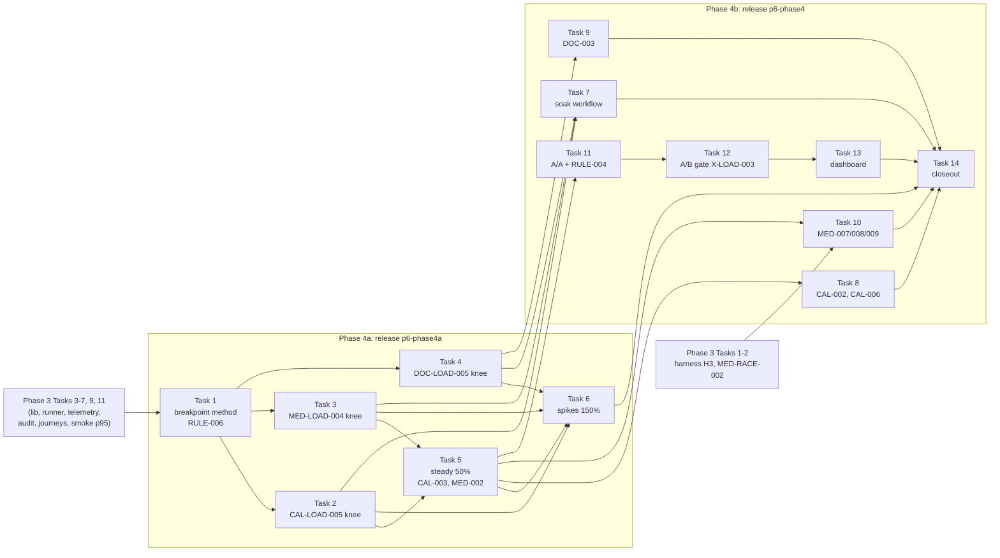

# P6 Phase 4 roadmap (Tasks 1–14)

This is a roadmap, not a build plan. It fixes the order, the scope and the done criteria for P6
Phase 4. Each task gets its own junior-engineer build plan just before it starts, in the structure
of [docs/reference/p1-plan-example-medusa.md](../reference/p1-plan-example-medusa.md), and every
such plan starts with a **live probe**. Nothing in this file is a probed value unless it cites a
file in this repo, the pinned harness, a pinned product source or a CI run; open values are marked
"the live probe must confirm". This file sets **no latency or throughput targets**: every number
in Phase 4 is measured, never claimed.

## Context

- Repo: [Jayami123/k6-load-concurrency-suite](https://github.com/Jayami123/k6-load-concurrency-suite)
  (P6). Written on `plan/2026-10-22-p6-phase4`, branched from `plan/2026-10-22-p6-phase3` at
  **`5693577`** ("docs: record p6 phase 3 roadmap decisions"), whose chain is `plan/2026-10-22-p6-phase2`
  at `5574214` and `main` at `d33e775`. So the Phase 2 and Phase 3 roadmaps are readable here:
  [2026-10-22-p6-phase2-roadmap.md](2026-10-22-p6-phase2-roadmap.md),
  [2026-10-22-p6-phase3-roadmap.md](2026-10-22-p6-phase3-roadmap.md).
- **Source of the scope:** the maintainer's agreed P6 Phase 3–4 proposal (2026-10-21). It is not in
  the repo; its Phase 4 content was given with this task and is restated in "Phase 4 cases". Phase 4
  theme: **limits, soak and regression gates**. Exit: knee ranges for 3 products from ≥ 3 valid
  runs; A/A noise measured; gate live; evidence release `p6-phase4`.
- **What it replaces:** master plan §9 Phase 4 was "Stress/spike, multi-instance Medusa, dashboard
  publish, README with measured numbers" ([docs/master-plan.html](../master-plan.html)). The
  proposal replaces it; multi-instance Medusa already moved to Phase 3 (Phase 3 roadmap Tasks 1–2).
  The master-plan HTML is not edited; README notes the change at closeout.
- **Phase 4 builds on code that does not exist yet.** On `main` at `d33e775` there is no `k6/lib/`,
  no LOAD runner, no telemetry and no journey script (only `k6/smoke/*-health.js` and
  `k6/probe/health-load.js`). Everything below that names Phase 3 code names **the Phase 3 task that
  creates it**:

| Phase 3 output (planned)                                                                  | Created by (Phase 3 roadmap) |
| ----------------------------------------------------------------------------------------- | ---------------------------- |
| Harness H3 (second Medusa instance) + Cal `up`/`down` fix; Cal bridge deleted             | Task 1                       |
| `P6-MED-RACE-002/003` two-instance setup                                                  | Task 2                       |
| One pinned k6; `k6/lib/` (arrival-rate executors, journeys, auth, prefix); stub self-test | Task 3 (`P6-X-LOAD-001`)     |
| LOAD runner `scripts/load/run-load.ts`, validity guard, `run-meta.json`, preflight        | Task 4 (`P6-X-LOAD-004`)     |
| Telemetry sampler + correlated HTML chart, sampler overhead, clock-skew check             | Task 5 (`P6-X-LOAD-002/006`) |
| Post-load reconciliation `src/load/reconcile/*`                                           | Task 6 (`P6-X-LOAD-005`)     |
| Journeys `k6/journeys/{cal-book,med-checkout,doc-sign}.js`, `k6/cases/*`                  | Task 7 (`P6-*-LOAD-001`)     |
| `P6-MED-LOAD-002` at a fixed rate                                                         | Task 8                       |
| Documenso stage-timing join `src/load/pipeline-lag.ts`                                    | Task 9 (`P6-DOC-LOAD-002`)   |
| `k6/lib/retry.js`                                                                         | Task 10                      |
| Journey-smoke p95 medians from ≥ 3 valid `main`/nightly runs; `p6-phase3` release         | Task 11                      |

- **What exists on `main` that Phase 4 reuses:** the read-only oracle `src/oracles/pg.ts`; Cal
  `src/cal/oracle.ts` (`HOST_OVERLAP_SQL`, `OVERLAP_PAIRS_SQL`, `SLOT_ACCEPTED_SQL`), Medusa
  `src/medusa/oracle.ts` (`readOversellSnapshot`, `RESERVATION_QTY_SQL`, `INVENTORY_LEVEL_SQL`),
  Documenso `src/documenso/oracle.ts` (`SEAL_JOBS_SQL`, `readTerminalJobs`, `readWebhookCalls`,
  `DOCUMENT_COMPLETED_AUDIT_SQL`, `readCompletedEmailCount`); the token scan
  `scripts/evidence-token-scan.mjs`; [perf.yml](../../.github/workflows/perf.yml) (product jobs,
  nightly `cron: "17 2 * * *"`, per-ref build caches such as `cal-next-${CAL_REF}-h0.2.11`); and
  [evidence-release.yml](../../.github/workflows/evidence-release.yml).
- **Product facts read for this roadmap (read-only, at the pinned refs):**
  - Cal at `CAL_REF` `c2b7ac44`: `apps/web/pages/api/book/event.ts` line 37 calls
    `checkRateLimitAndThrowError` (`rateLimitingType: "core"`), after a `BotDetectionService` check
    (lines 30–35). `packages/lib/rateLimit.ts` lines 34–41: when `UNKEY_ROOT_KEY` is unset it logs
    "Disabled because the UNKEY_ROOT_KEY environment variable was not found." and always returns
    success. The limiter is `@unkey/ratelimit` (line 1), a hosted service, so it cannot run offline.
  - Cal `getSchedule`: `packages/trpc/server/routers/viewer/slots/util.ts` has a Redis slot cache,
    `withSlotsCache` (line 104) and `DEFAULT_SLOTS_CACHE_TTL = 2000` (line 79). Whether a Redis
    client is configured in the harness stack (the harness Cal compose runs Postgres only) is for
    the probe.
  - Documenso: P6 itself turns the limiter off. `scripts/harness.mjs` line 33 sets
    `DANGEROUS_BYPASS_RATE_LIMITS ||= "true"` for every Documenso start. With the bypass unset, the
    Phase 1 Task 6 probe saw `10 × 429 {"code":"UNKNOWN_ERROR","message":"","statusCode":429}` on
    `POST /api/auth/email-password/authorize`
    ([2026-10-20-p6-phase1-task6-documenso-stack.md](2026-10-20-p6-phase1-task6-documenso-stack.md)
    §2.4 table). The proposal's `packages/lib/server-only/rate-limit` path comes from a local
    snapshot; the Documenso fork is not cloned in this session, so its route coverage at
    `DOCUMENSO_REF` is for the probe.
  - Documenso jobs run in the web process (`NEXT_PRIVATE_JOBS_PROVIDER: "local"`, harness
    `documenso-env.ts` line 272).

### Rules that hold for every task below

Sources: [AGENTS.md](../../AGENTS.md), [README.md](../../README.md), the Phase 1–3 roadmaps, and
this task's rules.

- **Every LOAD case has a correctness oracle or contract.** A load test that cannot fail on
  correctness is not accepted. Read-only DB oracle; post-load reconciliation (`P6-X-LOAD-005`,
  Phase 3 Task 6) after **every** run, including knees, spikes and soaks.
- **PRODUCT BUG vs TEST BUG** label with evidence before any test change. Failing CI is
  root-caused; never re-run blindly, never weaken an assertion. Expected-failure only for a proven
  product bug with repeated-run evidence. Known bugs (`P6-OBS-CAL-001`, `-002`, `-003`,
  `P6-OBS-DOC-002`) are counted under their IDs, never hidden.
- Data isolation by run prefix (`src/races/prefix.ts`), cleanup sweep and leak check. Tokens and
  passwords never printed, logged or committed; the token scan runs before every artefact upload
  **and before every GitHub Pages publish**.
- Never edit product forks; P6 never edits `node_modules/qa-portfolio-harness` (harness changes go
  through a harness release). `scripts/harness.mjs` owns starting/stopping.
- **Measured, never claimed.** No latency or throughput target anywhere. Cloud-session timings
  prove a test works and are never published. Published numbers come from GitHub Actions only,
  median of ≥ 3 VALID runs (`P6-RULE-005`), each with its environment label and `run-meta.json`
  (`P6-RULE-003`). Knees are step ranges (`P6-RULE-006`). No A/B gate before an A/A set exists
  (`P6-RULE-004`).
- Shared GitHub-hosted runners only (free); k6, product and Postgres share one runner. A
  GitHub-hosted job is capped at 6 h.
- Telemetry stays outside-only (Phase 3 D2); harness H1/H2 are Phase 5.
- One PR per task, branch `<type>/<YYYY-MM-DD>-p6-<topic>`, Conventional Commits with a lowercase
  subject, `npm run check` before every push. Industry-standard structure and naming; any
  non-standard choice is flagged with the proper alternative.
- Any environment change lists exact steps for **both** Cursor Cloud (`.cursor/environment.json`,
  `.cursor/Dockerfile`) and Claude Code cloud (setup script pasted in the environment settings,
  `.claude/hooks/session-start.sh`), split into automatic-from-repo and pasted-by-hand. No cloud
  change is expected in Phase 4; repo settings (GitHub Pages) are listed where they occur.

### Primitive bar

Every case is a cross-domain primitive, not CRUD: **money / stock never goes negative**, **single
winner under contention**, **state-transition exclusivity**, **side-effect exactly-once**, **token
single use**, and for load: **a measurement is valid only if the generator was not the bottleneck**,
**a queue that fills must drain**, **overload is refused cleanly, never by crashing**, **a
long-running process does not grow without bound**, and **a regression is called only above the
measured noise**. Each task has one line on what it proves and how it transfers to finance and
healthcare. Extras found in a source are listed as **proposed extras** with a new ID; they are not
in scope until the maintainer accepts them (the extras accepted on 2026-10-22 are in D17).

## Already done / assumed from Phases 2–3

| Item                                                           | Status on `main` at `d33e775` | Phase 4 assumes it from                                        |
| -------------------------------------------------------------- | ----------------------------- | -------------------------------------------------------------- |
| Race framework, Phase 1 races, oracles                         | done                          | —                                                              |
| Rerun-on-spread                                                | planned                       | Phase 2 Task 1                                                 |
| Medusa money oracles (`-005`, `-007`, `-010`, `-011`, `-006`?) | planned                       | Phase 2 Tasks 2–3 (`-006` only if its gate passed, Phase 2 D5) |
| Medusa order-state races `P6-MED-RACE-008/009`                 | planned                       | Phase 2 Task 3                                                 |
| Shared webhook receiver `src/receivers/webhook-receiver.ts`    | planned                       | Phase 2 Task 4                                                 |
| Everything in the Context table above                          | planned                       | Phase 3 Tasks 1–11                                             |

## Phase 4 cases

| Case ID           | Group                         | Summary                                                                                                                | Pri |
| ----------------- | ----------------------------- | ---------------------------------------------------------------------------------------------------------------------- | --- |
| `P6-RULE-006`     | rule                          | Knees are step ranges with the stop rule and run IDs, never a single "max RPS"                                         | —   |
| `P6-CAL-LOAD-005` | knee                          | Cal booking-journey knee: held ramping-arrival-rate steps; step range; first saturated resource                        | P0  |
| `P6-MED-LOAD-004` | knee                          | Medusa checkout-journey knee; high stock so stock-out never ends the run                                               | P0  |
| `P6-DOC-LOAD-005` | knee                          | Documenso signing-journey knee, plus seal-lag growth per step                                                          | P1  |
| `P6-CAL-LOAD-003` | steady baseline               | Cal constant-arrival-rate journey at 50% of the knee; p50/p95/p99, errors, drops, telemetry; overlap audit             | —   |
| `P6-MED-LOAD-002` | steady (re-run)               | Phase 3 conservation case re-run at 50% of the Medusa knee                                                             | P0  |
| `P6-CAL-LOAD-004` | backpressure + recovery       | Spike to 150% of the knee and back; no 5xx storm; refusals 4xx with a body; recovery time (characterisation)           | —   |
| `P6-MED-LOAD-003` | backpressure + recovery       | Same contract on checkout; post-spike stock invariant holds                                                            | —   |
| `P6-DOC-LOAD-004` | backpressure + recovery       | Limiter-covered routes 429 (never 500); others no 5xx storm; recovery time; links to `P6-OBS-DOC-001`                  | —   |
| `P6-DOC-LOAD-009` | backpressure (accepted extra) | 429 body + headers on every limiter-covered route, on the production-like limiter profile (D12)                        | —   |
| `P6-MED-LOAD-010` | recovery (accepted extra)     | Post-spike reservation release: abandoned spike carts leave no reservation that blocks stock                           | —   |
| `P6-CAL-LOAD-010` | recovery (accepted extra)     | Post-spike slot-hold release: no held reservation keeps a free slot unavailable (gated on `reserveSlot`)               | —   |
| `P6-CAL-LOAD-008` | soak                          | RSS / fds / pg connections slope; p95 drift first vs last window; DB growth tracked separately                         | —   |
| `P6-MED-LOAD-005` | soak                          | Same, plus Redis / event-bus backlog if present                                                                        | —   |
| `P6-DOC-LOAD-006` | soak                          | Web-process RSS / fds slope (it runs the jobs); pending-job backlog stays bounded                                      | —   |
| `P6-CAL-LOAD-002` | invariant under load          | Arrival-rate burst on one free slot inside steady load: exactly one ACCEPTED                                           | P0  |
| `P6-CAL-LOAD-006` | invariant under load          | Stale read: after commit, slot never offered again, or offered at most cache TTL + margin if the cache is active (D15) | P1  |
| `P6-DOC-LOAD-003` | invariant under load          | Exactly-once seal / audit / webhook / email under load; parallel pairs counted under `P6-OBS-DOC-002`                  | P1  |
| `P6-MED-LOAD-007` | invariant under load          | Two-instance conservation: orders ≤ stock across instances; no duplicate order per cart                                | P1  |
| `P6-MED-LOAD-008` | invariant under load          | Ledger conservation with promo / gift card on a share of carts, on the money oracles that landed                       | P1  |
| `P6-MED-LOAD-009` | invariant under load          | Double cancel and cancel-vs-fulfil fired inside steady load: one terminal transition                                   | P2  |
| `P6-RULE-004`     | rule                          | No A/B gate until an A/A run set exists; the tolerance cites its run IDs                                               | —   |
| `P6-X-LOAD-003`   | gate                          | Noise-aware regression gate: A/A, then interleaved A/B (≥ 3 each), ratio of medians vs A/A-derived tolerance           | P1  |
| `P6-X-LOAD-008`   | gate (accepted extra)         | Gate self-test: fails on a deliberately slowed candidate, passes on an unchanged one                                   | —   |
| —                 | publish                       | Dashboard publish on GitHub Pages + README with measured numbers; three showcases (D9, D10)                            | —   |

"—" in Pri: the source gives none; the task's plan proposes one.

## Phase 4 is split into 4a and 4b (D11, agreed 2026-10-22)

Fourteen tasks, three knees that each need ≥ 3 valid runs, a new scheduled workflow, a two-ref gate
and a dashboard are too much for one phase. Every ID and task number is kept; the two sub-phases
have their own exit:

- **Phase 4a — limits** (Tasks 1–6): breakpoint method + `P6-RULE-006`, the three knees, steady
  baselines at 50%, spikes at 150%. Exit: knee ranges for 3 products from ≥ 3 valid runs; baselines
  and spike characterisations from ≥ 3 valid runs; interim evidence release `p6-phase4a` (the
  release workflow's tag rule `^p6-[a-z0-9-]+$` allows it).
- **Phase 4b — soak, invariants, gate** (Tasks 7–14): soak workflow and the three soaks, the six
  invariants-under-load cases, A/A + `P6-RULE-004`, the A/B gate, dashboard, closeout. Exit: the
  proposal's Phase 4 exit (A/A noise measured; gate live) and the final release `p6-phase4`.

Phase 4a closes with its own interim release before Phase 4b starts its exit work; Phase 4b's
closeout (Task 14) cites both releases.

## Task table

| Task | Title                                | Cases                                                                                                                    | Depends on (exact)                                                         | Branch                                 | Parallel with |
| ---- | ------------------------------------ | ------------------------------------------------------------------------------------------------------------------------ | -------------------------------------------------------------------------- | -------------------------------------- | ------------- |
| 1    | Breakpoint method + knee report      | `P6-RULE-006` (method self-tested on the stub)                                                                           | Phase 3 Tasks 3, 4, 5, 6                                                   | `feat/<date>-p6-breakpoint-method`     | —             |
| 2    | Cal knee                             | `P6-CAL-LOAD-005`                                                                                                        | 1; Phase 3 Task 7 (`P6-CAL-LOAD-001`), Task 11 (smoke p95 median)          | `feat/<date>-p6-cal-knee`              | 3, 4          |
| 3    | Medusa knee                          | `P6-MED-LOAD-004`                                                                                                        | 1; Phase 3 Task 7 (`P6-MED-LOAD-001`), Task 11                             | `feat/<date>-p6-med-knee`              | 2, 4          |
| 4    | Documenso knee + seal lag            | `P6-DOC-LOAD-005`                                                                                                        | 1; Phase 3 Task 7 (`P6-DOC-LOAD-001`), Task 9 (`pipeline-lag.ts`), Task 11 | `feat/<date>-p6-doc-knee`              | 2, 3          |
| 5    | Steady baselines at 50%              | `P6-CAL-LOAD-003`, `P6-MED-LOAD-002` (re-run)                                                                            | 2, 3; Phase 3 Task 8 (`P6-MED-LOAD-002`)                                   | `feat/<date>-p6-steady-baselines`      | 6 (Documenso) |
| 6    | Spikes at 150% + recovery            | `P6-CAL-LOAD-004`, `P6-MED-LOAD-003`, `P6-DOC-LOAD-004`, `P6-DOC-LOAD-009`, `P6-MED-LOAD-010`, `P6-CAL-LOAD-010` (gated) | 2, 3, 4, 5 (baseline band)                                                 | `feat/<date>-p6-spike-recovery`        | 7             |
| 7    | Soak workflow + soaks                | `P6-CAL-LOAD-008`, `P6-MED-LOAD-005`, `P6-DOC-LOAD-006`                                                                  | 2, 3, 4 (rate below knee)                                                  | `feat/<date>-p6-soak-workflow`         | 6, 8, 9, 10   |
| 8    | Cal invariants under load            | `P6-CAL-LOAD-002`, `P6-CAL-LOAD-006`                                                                                     | 5 (`P6-CAL-LOAD-003` steady rate)                                          | `feat/<date>-p6-cal-load-invariants`   | 7, 9, 10      |
| 9    | Documenso exactly-once under load    | `P6-DOC-LOAD-003`                                                                                                        | 4 (steady rate from the knee); Phase 3 Task 9                              | `feat/<date>-p6-doc-load-exactly-once` | 7, 8, 10      |
| 10   | Medusa invariants under load         | `P6-MED-LOAD-007`, `P6-MED-LOAD-008`, `P6-MED-LOAD-009`                                                                  | 5; Phase 3 Tasks 1–2; Phase 2 Tasks 2–3                                    | `feat/<date>-p6-med-load-invariants`   | 7, 8, 9       |
| 11   | A/A noise + tolerance                | `P6-RULE-004` (A/A half of `P6-X-LOAD-003`)                                                                              | 5                                                                          | `feat/<date>-p6-aa-noise`              | 7–10          |
| 12   | A/B regression gate                  | `P6-X-LOAD-003`, `P6-X-LOAD-008`                                                                                         | 11                                                                         | `feat/<date>-p6-ab-gate`               | 13            |
| 13   | Dashboard (GitHub Pages) + showcases | dashboard publish, three showcases                                                                                       | 2–12 (data); Pages setting by hand                                         | `feat/<date>-p6-dashboard`             | 12            |
| 14   | Phase 4 closeout (4b)                | all Phase 4 cases (evidence only); release `p6-phase4`                                                                   | 1–13                                                                       | `docs/<date>-p6-phase4-closeout`       | —             |

Phase 4a = Tasks 1–6 (closes with the interim release `p6-phase4a`, Task 6's done-when); Phase 4b
= Tasks 7–14. PRs that edit a workflow merge one at a time and rebase on each other. Only one product stack runs
at a time on a cloud VM.

### Notes on the agreed order (kept as is)

The agreed order (knees → steady 50% → spikes 150%, soaks, invariants → A/A → A/B → closeout) is
kept. Points from the sources that bear on it:

1. **The stop rule needs Phase 3's smoke p95 medians.** D2's "p95 ≥ 10× the journey-smoke p95" uses
   the `P6-*-LOAD-001` median from Phase 3 CI runs. Phase 3 publishes a median only from ≥ 3 VALID
   runs (Phase 3 Task 11). A product without that median has no stop-rule reference, so its knee
   task cannot start. Tasks 2–4 depend on Phase 3 Task 11 for that reason.
2. **A/A does not depend on soaks or invariants.** A/A needs only the steady baseline (Task 5). It
   is placed after them as agreed, but can run in parallel with Tasks 7–10 (the task table says so);
   this shortens the critical path without reordering.
3. **The Documenso knee feeds the Documenso steady rate**, but the proposal defines no Documenso
   steady baseline case. Task 9 (`P6-DOC-LOAD-003`) and Task 7 (`P6-DOC-LOAD-006`) take 50% of the
   Documenso knee directly; Task 6 uses that as the Documenso "steady" before its spike.
4. **Spike at 150% of the knee may saturate the generator.** Saturating the product is the point;
   saturating k6 makes the run INVALID (`P6-X-LOAD-004`). Task 6's probe proves the generator has
   headroom at 150% on a shared runner, or the spike is reduced and the plan says why.
5. **Documenso's limiter is off in every P6 start.** `scripts/harness.mjs` line 33 forces
   `DANGEROUS_BYPASS_RATE_LIMITS=true` unless already set. `P6-DOC-LOAD-004`'s 429 assertions need a
   Documenso start with the bypass off, in its own step, because the races and journeys need it on.
   D12 (agreed) names that start the **production-like limiter profile**: a configuration profile,
   not a workaround.
6. **Cal has no offline limiter.** `rateLimit.ts` lines 34–41 disable it without `UNKEY_ROOT_KEY`,
   and Unkey is a hosted service, so `P6-CAL-LOAD-004` is a characterisation (as the proposal
   expected), not a 429 contract.
7. **`P6-CAL-LOAD-006` and the slot cache.** If the Redis slot cache (`util.ts` line 79, TTL
   2000 ms) is active in the harness stack, a stale offer within the TTL is by design and "never
   offered again after commit" would be the wrong assertion. D15 (agreed) sets both contracts; the
   Task 8 probe records which applies.
8. **The evidence release drops non-JSON artefacts.** `evidence-release.yml` "Check each run, then
   download its artefacts" deletes every file that is not `*.json` or `*.log`, so HTML charts,
   CSV telemetry and k6 output in other formats never reach the release. D14 (agreed): the filter is
   widened in **Phase 3 Task 11** to an explicit extension allowlist (tracked in the maintainer's
   backlog; this branch does not edit the Phase 3 roadmap); Phase 4 only verifies it (Task 6 for
   `p6-phase4a`, Task 14 for `p6-phase4`).
9. **Threshold file location.** The proposal says `thresholds/`; master plan §2 names
   `k6/thresholds/baseline.json`. D13 (agreed): `k6/thresholds/`.
10. **Master-plan Phase 4 items:** "multi-instance Medusa" moved to Phase 3; "stress/spike" and
    "dashboard publish" stay here; master plan's `P6-*-LOAD-003/004` names ("ramp to baseline RPS",
    "stress then spike") are redefined by the proposal (Phase 3 roadmap Note 5 pattern).

## Task 1: Breakpoint method + knee report (`P6-RULE-006`)

- **Goal.** One tested way to find a knee: held `ramping-arrival-rate` steps, the agreed stop rule,
  and a knee report that is always a step range with its evidence.
- **Cases.** `P6-RULE-006` (method and report format; the three knees are Tasks 2–4).
- **What it proves / transfers.** A capacity statement is a measured range with its stop rule and
  environment, the form an audited capacity plan for a payment switch or a hospital scheduling
  system needs.
- **Depends on.** Phase 3 Task 3 (`k6/lib/` executors), Task 4 (LOAD runner, validity guard,
  `run-meta.json`), Task 5 (telemetry), Task 6 (reconciliation).
- **Scope.**
  - Step plan: start rate, step size, hold per step, max steps; all set per product by its probe;
    held steps so each step has a stable window.
  - **Stop rule (D2):** stop when the non-conflict error rate > 1% **or** p95 ≥ 10× the journey-smoke
    p95 (the product's `P6-*-LOAD-001` median from Phase 3 CI). Evaluated per held step, from k6
    output, by the LOAD runner; k6 aborts on the rule (`abortOnFail` on a computed threshold, or the
    runner stops k6; plan decides).
  - **Knee report:** "between step s and s+1" with both rates, the stop reason, run IDs,
    `run-meta.json` (environment label), and the **first saturated resource** named from telemetry
    (pool / pg active+waiting, lock waits, app CPU, RSS) by a documented rule, never by eye.
  - INVALID if the generator saturates (`P6-X-LOAD-004`); an INVALID step range is not a knee.
  - Self-test on the Phase 3 stub with a stall that starts at a known step: the method must report
    the range containing it.
- **Files likely touched.** `k6/lib/breakpoint.js` (step builder; pure parts in plain ESM),
  `src/load/knee/{stop-rule,knee-report,first-saturated}.ts`, `tests/unit/knee-*.test.ts`,
  `k6/selftest/breakpoint-stub.js`, `scripts/load/run-load.ts` (knee mode), `README.md` ("How to
  read a knee").
- **The live probe must confirm.** How the runner evaluates the stop rule per held step on the
  pinned k6 (thresholds with `abortOnFail` and `delayAbortEval`, or streaming output parsed by the
  runner); the "non-conflict error" definition per product (Cal 409 `no_available_users_found_error`
  and the redacted 400 of `P6-OBS-CAL-001`, Medusa 400 `not_allowed`, Documenso `ALREADY_SIGNED`
  are conflicts, not errors; the plan lists them from the Phase 1 README contracts); the stub stall
  that the method must find; the rule for "first saturated resource".
- **Build plan.** `docs/plans/<date>-p6-phase4-task1-breakpoint-method.md`. Starts with the live
  probe; junior-engineer guide (exact file paths, code skeletons per new function and test, exact
  commands, expected outputs, step order) so a weaker model can build it without guessing.
- **CI change.** The stub breakpoint self-test runs on every event (product-free).
- **Done when.** Unit tests green (stop rule, report, first-saturated rule from fixtures); the stub
  self-test reports the known stall's step range in CI on the PR and once on `main`; the report
  format meets `P6-RULE-006`; the k6 script runs standalone with `k6 run` (Phase 3 D6); `npm run
check` green.
- **Main risks.** Shared-runner noise moving the range between runs (the knee tasks need ≥ 3 valid
  runs and report the spread); the stop rule tripping on conflict responses that are not errors.

## Task 2: Cal knee (`P6-CAL-LOAD-005`)

- **Goal.** Measure the Cal booking-journey knee as a step range with its bottleneck.
- **Cases.** `P6-CAL-LOAD-005` (P0).
- **What it proves / transfers.** Where an appointment-booking flow stops degrading gracefully and
  which resource gives first: the same evidence a clinic-scheduling or branch-booking system needs
  before sizing.
- **Depends on.** Task 1; Phase 3 Task 7 (`k6/journeys/cal-book.js`, `P6-CAL-LOAD-001`) and Task 11
  (Cal smoke p95 median).
- **Scope.** Breakpoint run on the Cal journey (getSchedule → book) with unique prefixed attendees;
  post-load audit (no overlapping ACCEPTED pairs, `HOST_OVERLAP_SQL`; `P6-OBS-CAL-002` counted under
  its ID); ≥ 3 valid runs; the knee range, its spread across runs and the first saturated resource.
- **Files likely touched.** `k6/cases/cal-load-005.js`, `src/load/reconcile/cal.ts` (Phase 3 Task 6),
  `.github/workflows/perf.yml` (or a dispatch + weekly-Saturday knee workflow, D16), `README.md`.
- **The live probe must confirm.** Slot supply for the whole ramp (each booking consumes a slot;
  Phase 1 allocator, and the README note that PENDING bookings count as busy); whether the
  `BotDetectionService` in `event.ts` lines 30–35 refuses k6 traffic; step plan that reaches the
  stop rule within the job timeout (`cal-smoke` is 60 min today); generator headroom; memory.
- **Build plan.** `docs/plans/<date>-p6-phase4-task2-cal-knee.md`. Starts with the live probe;
  junior-engineer guide (exact file paths, code skeletons per new function and test, exact
  commands, expected outputs, step order) so a weaker model can build it without guessing.
- **CI change.** Knee runs are `workflow_dispatch` plus a weekly Saturday schedule on `main`, never
  on PRs (soaks own Sunday); PRs run the stub self-test of Task 1 (D16).
- **Done when.** ≥ 3 VALID dispatch runs on `main` each with a knee range, stop reason, first
  saturated resource and a clean audit (or a recorded product bug); the ranges and their spread in
  the job summary; `npm run check` green.
- **Main risks.** Slot exhaustion ending the run before the knee (a TEST BUG, not a knee); the
  Next.js production server's single process making CPU the first resource on every run (a valid
  result, stated as environment-bound).

## Task 3: Medusa knee (`P6-MED-LOAD-004`)

- **Goal.** Measure the Medusa checkout-journey knee with stock high enough that stock-out never
  ends the run.
- **Cases.** `P6-MED-LOAD-004` (P0).
- **What it proves / transfers.** Where a checkout (or a payment-initiation flow) saturates and
  why, separated from business refusals.
- **Depends on.** Task 1; Phase 3 Task 7 (`k6/journeys/med-checkout.js`, `P6-MED-LOAD-001`) and
  Task 11 (Medusa smoke p95 median).
- **Scope.** Breakpoint run on browse → cart → complete; stock S sized above the total orders the
  ramp can produce (from the probe); post-load audit (orders ≤ S, reservations consistent,
  `readOversellSnapshot`); ≥ 3 valid runs.
- **Files likely touched.** `k6/cases/med-load-004.js`, `src/load/reconcile/medusa.ts`, the knee
  workflow (D16), `README.md`.
- **The live probe must confirm.** Orders per step at each rate (to size S); the harness Medusa mode
  (in-memory lock and fake Redis by default, `MEDUSA_REDIS=1` optional, harness README) used for the
  knee, stated in the environment label; DB growth per run and cleanup; job time.
- **Build plan.** `docs/plans/<date>-p6-phase4-task3-med-knee.md`. Starts with the live probe;
  junior-engineer guide (exact file paths, code skeletons per new function and test, exact
  commands, expected outputs, step order) so a weaker model can build it without guessing.
- **CI change.** Knee step on `workflow_dispatch` plus weekly Saturday (D16).
- **Done when.** ≥ 3 VALID runs with a knee range, stop reason, first saturated resource and a clean
  audit (or a recorded product bug); `npm run check` green.
- **Main risks.** Checkout setup cost dominating the step; the lock mode changing the knee (the
  label says which).

## Task 4: Documenso knee + seal lag (`P6-DOC-LOAD-005`)

- **Goal.** Measure the Documenso signing-journey knee and how seal lag grows per step.
- **Cases.** `P6-DOC-LOAD-005` (P1).
- **What it proves / transfers.** That an async back end can break before the HTTP front does:
  settlement lag in payments, result-delivery lag in a lab system.
- **Depends on.** Task 1; Phase 3 Task 7 (`k6/journeys/doc-sign.js`), Task 9
  (`src/load/pipeline-lag.ts`), Task 11 (Documenso smoke p95 median).
- **Scope.** Breakpoint run on create → distribute → sign; per held step, completion → seal lag from
  the Phase 3 stage join; the knee report states whether lag or HTTP hit the stop rule first (lag is
  reported per step; the stop rule stays D2 unless the plan proposes a lag rule with evidence);
  audit: one seal per document, no stuck jobs after drain (`P6-OBS-DOC-002` counted separately).
- **Files likely touched.** `k6/cases/doc-load-005.js`, `src/load/pipeline-lag.ts`,
  `src/load/reconcile/documenso.ts`, the knee workflow (D16), `README.md`.
- **The live probe must confirm.** Drain time after the top step (fits the job timeout); seal-lag
  measurement per step; whether the in-process jobs (`NEXT_PRIVATE_JOBS_PROVIDER: "local"`) make
  web CPU the first resource; Inbucket under load.
- **Build plan.** `docs/plans/<date>-p6-phase4-task4-doc-knee.md`. Starts with the live probe;
  junior-engineer guide (exact file paths, code skeletons per new function and test, exact
  commands, expected outputs, step order) so a weaker model can build it without guessing.
- **CI change.** Knee step on `workflow_dispatch` plus weekly Saturday (D16).
- **Done when.** ≥ 3 VALID runs with a knee range, per-step seal lag, stop reason, first saturated
  resource, drained backlog and a clean audit; `npm run check` green.
- **Main risks.** Seal work per document making steps slow; drain longer than the job allows.

## Task 5: Steady baselines at 50% (`P6-CAL-LOAD-003`, `P6-MED-LOAD-002` re-run)

- **Goal.** Measured steady behaviour at half the knee, the band later tasks compare against.
- **Cases.** `P6-CAL-LOAD-003`; `P6-MED-LOAD-002` re-run at 50% of the Medusa knee.
- **What it proves / transfers.** A reproducible normal-load profile (latency spread, errors,
  resources) with correctness held: the reference every change-control or SLA review starts from.
- **Depends on.** Tasks 2 and 3 (knees); Phase 3 Task 8 (`P6-MED-LOAD-002` at a fixed rate).
- **Scope.** Rate = 50% of the knee's **lower bound** (D3) unless the plan argues otherwise with
  evidence. `P6-CAL-LOAD-003`: constant-arrival-rate journey; p50/p95/p99, error rate,
  `dropped_iterations`, telemetry; post-load audit (no overlapping ACCEPTED pairs); measure-only,
  no threshold (`P6-RULE-001`). `P6-MED-LOAD-002`: same conservation oracle as Phase 3 at the new
  rate. ≥ 3 valid runs each; the **baseline band** (spread of medians) per metric is recorded.
- **Files likely touched.** `k6/cases/cal-load-003.js`, `k6/cases/med-load-002.js` (rate input),
  `perf.yml` (nightly), `README.md`.
- **The live probe must confirm.** That 50% of the lower bound is VALID on a shared runner; slot
  supply for the Cal duration; the window length that defines the band; nightly job time.
- **Build plan.** `docs/plans/<date>-p6-phase4-task5-steady-baselines.md`. Starts with the live
  probe; junior-engineer guide (exact file paths, code skeletons per new function and test, exact
  commands, expected outputs, step order) so a weaker model can build it without guessing.
- **CI change.** Nightly and dispatch on `main` in the product jobs (Phase 3 D5: after the races,
  after the race leak check); PRs keep the short Phase 3 journey run.
- **Done when.** ≥ 3 VALID nightly runs each with metrics, telemetry, chart and a clean audit; the
  band recorded with run IDs; `npm run check` green.
- **Main risks.** The knee spread making 50% land near saturation on a slow runner (INVALID, not
  fail); nightly time.

## Task 6: Spikes at 150% + recovery (`P6-CAL-LOAD-004`, `P6-MED-LOAD-003`, `P6-DOC-LOAD-004`, extras)

- **Goal.** Overload is refused cleanly and the system comes back.
- **Cases.** `P6-CAL-LOAD-004`, `P6-MED-LOAD-003`, `P6-DOC-LOAD-004`; accepted extras
  `P6-DOC-LOAD-009` (429 contract on every covered route), `P6-MED-LOAD-010` (post-spike
  reservation release), `P6-CAL-LOAD-010` (post-spike slot-hold release; gated).
- **What it proves / transfers.** Backpressure and recovery: under a burst a trading API or a
  patient portal must refuse with a clear 4xx (or 429), never crash, and return to normal in a
  measured time.
- **Depends on.** Tasks 2–4 (knees, so 150% is defined) and Task 5 (the baseline band that defines
  recovery).
- **Scope.** Steady (50%) → spike (150% of the knee lower bound, D3) → back to steady.
  - Contract for all three: no 5xx storm (the plan defines "storm" from probe data, recorded);
    every refusal is a 4xx with a body; **recovery time** = first window back inside the baseline
    band; post-spike audit (`P6-X-LOAD-005`).
  - `P6-CAL-LOAD-004`: characterisation (Note 6): no limiter can run offline.
  - `P6-MED-LOAD-003`: post-spike stock invariant holds; no built-in limiter (to verify).
  - `P6-DOC-LOAD-004`: on the **production-like limiter profile** (D12): a separate Documenso
    start with `DANGEROUS_BYPASS_RATE_LIMITS=false`, a configuration profile, not a workaround; all
    other Documenso runs keep the bypass. Covered routes answer
    429, never 500 (`Retry-After` / rate-limit headers asserted only if the probe sees them; the
    Phase 1 429 body was `{"code":"UNKNOWN_ERROR","message":"","statusCode":429}`); other routes: no
    5xx storm; recovery time. Any 500 on the sign-in route links to `P6-OBS-DOC-001` (wrong password
    / CSRF → 500), counted under that ID.
  - `P6-DOC-LOAD-009` (same profile): for **every** limiter-covered route the probe finds, the 429
    body and the rate-limit headers it sends are asserted (an error-code contract), not only the
    sign-in route.
  - `P6-MED-LOAD-010`: after the spike, abandoned carts leave no reservation that blocks stock
    (`RESERVATION_QTY_SQL` vs live orders, `INVENTORY_LEVEL_SQL`); the release rule (expiry, cart
    deletion) is what the probe finds, stated in the plan.
  - `P6-CAL-LOAD-010` (gated): after the spike, no slot hold keeps a free slot unavailable. **Gate:**
    the Cal journey (Phase 3 Task 7) uses `reserveSlot`
    (`packages/trpc/server/routers/viewer/slots/reserveSlot.handler.ts` at `CAL_REF`); if it does
    not, `-010` moves to "Later" with that evidence.
- **Files likely touched.** `k6/cases/{cal-load-004,med-load-003,doc-load-004,doc-load-009,med-load-010,cal-load-010}.js`,
  `src/load/recovery.ts` (band comparison), `tests/unit/recovery.test.ts`, `perf.yml` (dispatch /
  weekly), `README.md`.
- **The live probe must confirm.**
  1. Generator headroom at 150% (Note 4).
  2. Medusa: whether any limiter or queue exists at `MEDUSA_REF` (none found so far).
  3. Documenso: the rate-limit middleware's location and route coverage at `DOCUMENSO_REF`
     (the proposal's `packages/lib/server-only/rate-limit` is from a local snapshot); whether
     setting `DANGEROUS_BYPASS_RATE_LIMITS=false` before `up:documenso` turns the limiter on
     (`scripts/harness.mjs` uses `||=`, so a pre-set value wins); the 429 body and headers per
     covered route (for `-009`).
  4. Cal: that `UNKEY_ROOT_KEY` is unset in the harness Cal env (`bootstrap.sh` writes the product
     `.env`), and what `BotDetectionService` does under a spike.
  5. The window length for recovery and the 5xx-storm definition.
  6. Medusa reservation release after abandoned carts (`-010`): which rule frees them and when.
  7. **Gate for `P6-CAL-LOAD-010`:** whether the Cal journey calls `reserveSlot`, and how a hold is
     read from the DB.
- **Build plan.** `docs/plans/<date>-p6-phase4-task6-spike-recovery.md`. Starts with the live
  probe; junior-engineer guide (exact file paths, code skeletons per new function and test, exact
  commands, expected outputs, step order) so a weaker model can build it without guessing.
- **CI change.** `workflow_dispatch` plus weekly Saturday on `main` (D16); the production-like
  limiter profile is its own Documenso start with its own `down`.
- **Done when.** ≥ 3 VALID runs per case with contract results, recovery time and a clean audit (or
  a recorded product bug / characterisation); Cal labelled characterisation; `-009` and `-010`
  (Medusa) land; `P6-CAL-LOAD-010` lands or is in "Later" with its gate evidence. **Phase 4a
  closes here:** knee ranges for 3 products from ≥ 3 valid runs, baselines and spikes evidenced, the
  widened release filter verified (D14), and the interim release `p6-phase4a` published through
  `evidence-release.yml` with `docs/releases/p6-phase4a.md`; `npm run check` green.
- **Main risks.** Generator saturation; the limiter profile leaking into other Documenso steps;
  recovery never reached inside the job (recorded, not hidden).

## Task 7: Soak workflow + soaks (`P6-CAL-LOAD-008`, `P6-MED-LOAD-005`, `P6-DOC-LOAD-006`)

- **Goal.** Long runs below the knee find growth that does not plateau.
- **Cases.** `P6-CAL-LOAD-008`, `P6-MED-LOAD-005`, `P6-DOC-LOAD-006`.
- **What it proves / transfers.** No unbounded growth (memory, handles, connections, backlog) in a
  long-running service: the leak a payment gateway or an EHR interface engine shows only after
  hours.
- **Depends on.** Tasks 2–4 (rate below the knee; 50% unless the plan argues otherwise).
- **Scope.**
  - **Own scheduled workflow** (Phase 3 D5, D4): e.g. `.github/workflows/soak.yml`, nightly 30 min
    and weekly 2 h on Sunday; own timeouts under the 6 h job cap; a schedule offset from `perf.yml`'s
    `17 2 * * *`; own concurrency group.
  - Per product: slope of app RSS, open fds and pg connection count over time; p95 drift first vs
    last window; growth that does not plateau is flagged by a documented rule; **DB growth tracked
    separately** so data growth is not read as a leak; slot supply sized for the duration (Cal).
  - `P6-MED-LOAD-005`: plus Redis / event-bus backlog if present (the harness default is a fake
    Redis, harness README / `docs/adr/0001-medusa-fake-redis.md`; to verify).
  - `P6-DOC-LOAD-006`: web-process RSS / fds (it also runs the jobs); pending-job backlog bounded.
  - Post-load audit after each soak.
- **Files likely touched.** `.github/workflows/soak.yml` (new), `k6/cases/*-soak.js` (or
  `k6/cases/{cal-load-008,med-load-005,doc-load-006}.js`), `src/load/soak/{slope,plateau}.ts`,
  `tests/unit/soak-*.test.ts`, `src/load/telemetry/*` (Phase 3 Task 5), `README.md`.
- **The live probe must confirm.** That a 2 h soak plus stack start and build fits the 6 h cap per
  product; Cal slot supply for 2 h; the slope/plateau rule and window sizes; telemetry file size and
  gap rate over 2 h (a gap > 2 intervals makes the run INVALID, Phase 3 Task 5); Medusa event-bus
  observability from outside.
- **Build plan.** `docs/plans/<date>-p6-phase4-task7-soaks.md`. Starts with the live probe;
  junior-engineer guide (exact file paths, code skeletons per new function and test, exact
  commands, expected outputs, step order) so a weaker model can build it without guessing.
- **CI change.** New `soak.yml` (schedule + dispatch); no change to `perf.yml`.
- **Done when.** ≥ 3 VALID nightly 30-min soaks and ≥ 1 VALID weekly 2-h soak per product with
  slopes, plateau verdicts, DB growth and a clean audit; `npm run check` (actionlint) green.
- **Main risks.** Telemetry gaps over long runs (INVALID); DB growth masking or mimicking a leak;
  CI minutes.

## Task 8: Cal invariants under load (`P6-CAL-LOAD-002`, `P6-CAL-LOAD-006`)

- **Goal.** Single winner and no stale offer, while the system is busy.
- **Cases.** `P6-CAL-LOAD-002` (P0), `P6-CAL-LOAD-006` (P1).
- **What it proves / transfers.** Contention guards hold under background load, and a committed
  booking disappears from what others are offered: the same as "no double-sold seat" and "no stale
  balance shown after a debit".
- **Depends on.** Task 5 (`P6-CAL-LOAD-003` steady rate and runner config).
- **Scope.**
  - `P6-CAL-LOAD-002`: an arrival-rate burst on one free slot S inside steady journey load. Oracle:
    exactly one ACCEPTED on S (`SLOT_ACCEPTED_SQL`); loser histogram; the redacted 400 of
    `P6-OBS-CAL-001` ([calcom/cal.diy#30375](https://github.com/calcom/cal.diy/issues/30375))
    counted separately as a known bug; any 5xx = PRODUCT BUG; `Booking_uid_key` P2002 log lines
    (`P6-OBS-CAL-003`, [#30376](https://github.com/calcom/cal.diy/issues/30376)) counted as a
    collision-rate-vs-load characterisation.
  - `P6-CAL-LOAD-006`: under journey load, book S; after the 2xx, poll `getSchedule`; record the
    stale-offer count and time-to-disappear. Contract (D15): if the slot cache is **active**,
    bounded staleness: S is offered for at most the cache TTL (`DEFAULT_SLOTS_CACHE_TTL = 2000`,
    `util.ts` line 79) plus a margin set from probe data, and any booking attempt on a stale offer is
    refused (never a second ACCEPTED). If **inactive**: S is never offered again after commit. The
    plan and README record which contract applied.
- **Files likely touched.** `k6/cases/{cal-load-002,cal-load-006}.js`, `src/load/reconcile/cal.ts`,
  a log-grep rule for `Booking_uid_key` (Phase 3 Task 5 log-grep), `perf.yml`, `README.md`.
- **The live probe must confirm.** Whether the `getSchedule` slot cache (`withSlotsCache`,
  `util.ts` line 104, 2000 ms TTL) is active in the harness Cal stack (a real Redis client or a
  no-op), recorded with evidence; if active, the margin above the TTL from probe data; the `getSchedule` call k6 makes (Phase 3 Task 7
  defines it); burst size and timing inside steady load; that the Cal web log carries the P2002 line
  without tokens.
- **Build plan.** `docs/plans/<date>-p6-phase4-task8-cal-load-invariants.md`. Starts with the live
  probe; junior-engineer guide (exact file paths, code skeletons per new function and test, exact
  commands, expected outputs, step order) so a weaker model can build it without guessing.
- **CI change.** Nightly + dispatch in `cal-smoke` (after the races and leak check).
- **Done when.** ≥ 3 VALID runs each: `-002` exactly one ACCEPTED per burst with known bugs counted
  under their IDs; `-006` passes the D15 contract that applies (bounded staleness with no second
  ACCEPTED, or never offered), with the applied contract recorded; `npm run check` green.
- **Main risks.** Burst and background competing for slots; the cache margin chosen too tight on a
  slow runner (set from probe data, never tuned to pass).

## Task 9: Documenso exactly-once under load (`P6-DOC-LOAD-003`)

- **Goal.** Side effects stay exactly-once under load.
- **Cases.** `P6-DOC-LOAD-003` (P1).
- **What it proves / transfers.** One completion → one seal, one audit row, one webhook, one email
  set, under load: the same as "one settlement message per trade" or "one result notification per
  test".
- **Depends on.** Task 4 (Documenso steady rate = 50% of its knee, Note 3); Phase 3 Task 9 (stage
  join, receiver in the runner).
- **Scope.** Sequential completions at the steady rate → exactly one seal, audit row
  (`DOCUMENT_COMPLETED_AUDIT_SQL`), webhook (`readWebhookCalls` + receiver) and email set
  (`readCompletedEmailCount`) per document. A share of concurrent last-recipient pairs → known
  `P6-OBS-DOC-002` ([documenso/documenso#3187](https://github.com/documenso/documenso/issues/3187))
  counted separately. Upstream
  [documenso/documenso PR #3353](https://github.com/documenso/documenso/pull/3353) is still open
  (checked 2026-10-22) and only adds a terminal-status entry guard, which may not make concurrent
  sealing single-winner. So the pair share turns green **only when this test shows exactly one seal
  per document after a pin move**, not merely because #3353 merges.
- **Files likely touched.** `k6/cases/doc-load-003.js`, `src/load/reconcile/documenso.ts`,
  `perf.yml`, `README.md`.
- **The live probe must confirm.** The share of concurrent pairs that keeps the run VALID; the
  status of documenso/documenso PR #3353 on the day the task starts (open on 2026-10-22); email counting under load (Inbucket, by document id, as
  Phase 1 does).
- **Build plan.** `docs/plans/<date>-p6-phase4-task9-doc-load-exactly-once.md`. Starts with the live
  probe; junior-engineer guide (exact file paths, code skeletons per new function and test, exact
  commands, expected outputs, step order) so a weaker model can build it without guessing.
- **CI change.** Nightly + dispatch in `documenso-smoke`.
- **Done when.** ≥ 3 VALID runs: sequential share exactly-once on every document; concurrent share
  counted under `P6-OBS-DOC-002`; `npm run check` green.
- **Main risks.** The known bug's duplicates being miscounted as new ones (count by document id and
  pair id).

## Task 10: Medusa invariants under load (`P6-MED-LOAD-007`, `-008`, `-009`)

- **Goal.** Conservation and exclusivity hold under steady load, across instances and with money.
- **Cases.** `P6-MED-LOAD-007` (P1), `P6-MED-LOAD-008` (P1), `P6-MED-LOAD-009` (P2).
- **What it proves / transfers.** Stock and money are conserved across replicas and promotions, and
  an order takes one terminal transition: the ledger and order-lifecycle guarantees of any
  payments or pharmacy system.
- **Depends on.** Task 5 (Medusa steady rate); Phase 3 Tasks 1–2 (harness H3, `P6-MED-RACE-002`
  setup) for `-007`; Phase 2 Tasks 2–3 (money oracles, `P6-MED-RACE-005/007/011`, `-006` only if it
  landed per Phase 2 D5) for `-008`; Phase 2 Task 3 (`P6-MED-RACE-008/009`) for `-009`.
- **Scope.**
  - `-007`: journey load split across two instances; orders ≤ stock across instances; no duplicate
    order per cart.
  - `-008`: a share of carts apply the promo / gift card; redemptions ≤ budget; balances ≥ 0; sum of
    debits = balance change; clauses whose oracle did not land are recorded as **pending**, not
    dropped (Phase 3 D7).
  - `-009`: the double-cancel and cancel-vs-fulfil races fired inside steady load; exactly one
    terminal transition; side effects once; hit rate vs load recorded. If Phase 2 recorded X04/X05
    as proven product bugs, the same IDs count them here.
- **Files likely touched.** `k6/cases/{med-load-007,med-load-008,med-load-009}.js`,
  `src/load/reconcile/medusa.ts`, `src/medusa/oracle.ts` (money and order-state SQL from Phase 2),
  `perf.yml`, `README.md`.
- **The live probe must confirm.** Which Phase 2 money oracles exist on `main`; that both instances
  receive load (per-instance counts); how the race requests are injected inside k6 load (from k6 or
  from the runner); memory with two instances under load.
- **Build plan.** `docs/plans/<date>-p6-phase4-task10-med-load-invariants.md`. Starts with the live
  probe; junior-engineer guide (exact file paths, code skeletons per new function and test, exact
  commands, expected outputs, step order) so a weaker model can build it without guessing.
- **CI change.** Nightly + dispatch in `medusa-smoke` (two-instance mode for `-007`).
- **Done when.** ≥ 3 VALID runs per case with clean audits or recorded bugs; pending clauses listed
  with the reason; `npm run check` green.
- **Main risks.** Two-instance memory under load; money oracles not yet landed.

## Task 11: A/A noise + tolerance (`P6-RULE-004`)

- **Goal.** Measure how much the same ref differs from itself on the same runner.
- **Cases.** `P6-RULE-004`; the A/A half of `P6-X-LOAD-003`.
- **What it proves / transfers.** A regression call is only meaningful above measured noise: the
  same discipline as a performance change-control board in a bank or a validated-system change in
  healthcare.
- **Depends on.** Task 5 (steady baselines define what is compared).
- **Scope.** Same runner, same job: the steady case run repeatedly on the current pinned ref (≥ 3
  arms, interleaved as A A A …); per metric the A/A spread of medians; the **tolerance** derived from
  it by a documented rule; stored with its source run IDs in the threshold file (D13). No gate yet.
- **Files likely touched.** `k6/thresholds/` tolerance file (D13),
  `src/load/gate/{aa-noise,tolerance}.ts`, `tests/unit/gate-*.test.ts`, a gate workflow (e.g.
  `.github/workflows/gate.yml`, dispatch), `README.md`.
- **The live probe must confirm.** Arm duration and count that fit one job (stack restarts between
  arms or not); whether a runner-to-runner difference is visible (the gate is same-runner only); the
  tolerance rule (e.g. a multiple of the A/A spread; the plan states and justifies it).
- **Build plan.** `docs/plans/<date>-p6-phase4-task11-aa-noise.md`. Starts with the live probe;
  junior-engineer guide (exact file paths, code skeletons per new function and test, exact
  commands, expected outputs, step order) so a weaker model can build it without guessing.
- **CI change.** New dispatch workflow (or job) for A/A sets.
- **Done when.** ≥ 1 A/A set per product with ≥ 3 VALID arms; tolerance file committed with its run
  IDs; `P6-RULE-004` check (no A/B config without a cited A/A set) in `npm run check` or CI;
  `npm run check` green.
- **Main risks.** One noisy runner inflating the tolerance; INVALID arms reducing the set below 3.

## Task 12: A/B regression gate (`P6-X-LOAD-003`)

- **Goal.** A live, noise-aware gate that fails only on repeated regression.
- **Cases.** `P6-X-LOAD-003` (P1); accepted extra `P6-X-LOAD-008` (gate self-test).
- **What it proves / transfers.** Upgrades and code changes are gated on evidence, not on one noisy
  number: a dependency bump in a payments service or an EHR release is blocked only by a real,
  repeated slowdown.
- **Depends on.** Task 11 (A/A set and tolerance, `P6-RULE-004`).
- **Scope.**
  - A = current pinned ref, B = candidate; same runner, same job; interleaved A B A B A B (≥ 3 each).
  - Gate on the ratio of medians vs the A/A tolerance; fails only on repeated regression (the rule
    for "repeated" is stated, e.g. all or a majority of B arms; plan decides from A/A data).
  - **Triggers (D5):** product ref bumps (`CAL_REF`, `MEDUSA_REF`, `DOCUMENSO_REF`) and changes to
    P6 `k6/` or LOAD-runner code (Phase 3 `scripts/load/*`, `src/load/*`). For a P6-code change, A =
    `main`, B = PR head.
  - Correctness is never traded: each arm still runs its post-load audit; a failing audit is a
    PRODUCT/TEST BUG, not a gate result.
  - **`P6-X-LOAD-008` gate self-test:** the gate runs against a candidate with a deliberate, known
    slowdown (the Phase 3 stub, or a P6 test build) and must **fail**, and against an unchanged
    candidate and must **pass**. Proves the gate can fail (the "a test that cannot fail is not
    accepted" rule, applied to the gate).
  - **Cal two-ref build:** A/B with two refs doubles the Cal `next build`; the probe measures it and
    the gate reuses the Phase 1 Cal build cache keyed on ref (`cal-next-${CAL_REF}-h…` in
    `perf.yml`).
- **Files likely touched.** `.github/workflows/gate.yml` (path and ref-bump triggers),
  `src/load/gate/{ab-gate,ratio}.ts`, `tests/unit/gate-ab.test.ts`, `k6/selftest/gate-slowdown.js`,
  the tolerance file in `k6/thresholds/`,
  `scripts/bootstrap.sh` (checkout of a second ref, if needed), `README.md` ("How the gate works").
- **The live probe must confirm.** Job time for 6 arms per product including stack switches (each
  arm on a different ref needs a stack restart, or two stacks side by side if memory allows) under
  the 6 h cap; Cal cold build time for the B ref and the cache hit for A; how a ref bump is detected
  (diff of `*_REF` in `perf.yml` / `bootstrap.sh`); `paths` filters for `k6/**`, `scripts/load/**`,
  `src/load/**`.
- **Build plan.** `docs/plans/<date>-p6-phase4-task12-ab-gate.md`. Starts with the live probe;
  junior-engineer guide (exact file paths, code skeletons per new function and test, exact
  commands, expected outputs, step order) so a weaker model can build it without guessing.
- **CI change.** `gate.yml` runs on the triggers; it becomes a required check only if the
  maintainer decides so (repo settings, by hand).
- **Done when.** The gate runs on one real trigger of each kind (a P6 k6 change, and a ref bump on a
  probe branch) and passes on an unchanged B; `P6-X-LOAD-008` fails on the deliberately slowed
  candidate and passes on the unchanged one, in CI; history stored for the dashboard; `npm run
check` green.
- **Main risks.** Job time; cache misses on the B ref; the gate flaking (the A/A tolerance and the
  "repeated" rule are the defence).

## Task 13: Dashboard (GitHub Pages) + showcases

- **Goal.** A public, self-contained view of the measured results.
- **Cases.** Dashboard publish (master plan §7 / §9).
- **What it proves / transfers.** Evidence is published with its environment and run links, readable
  by a reviewer without CI access, as an audit pack would be.
- **Depends on.** Tasks 2–12 (data); the Pages setting by hand.
- **Scope (D9, agreed 2026-10-22; the repo is public).**
  - A static site on GitHub Pages, built by Actions from evidence artefacts; self-contained HTML (no
    CDN, Phase 3 D8): knee charts with the first saturated resource, soak slopes, gate history; every
    number linked to its run and `run-meta.json`; INVALID runs listed, not plotted as results.
  - The token scan (`scripts/evidence-token-scan.mjs`, and gitleaks as `evidence-release.yml` does)
    runs over the **built site** before deploy; a hit stops the deploy.
  - **Showcases (D10, agreed 2026-10-22),** each with a "what this proves" note on the dashboard
    **and** in README: (a) a knee chart with the first saturated resource named; (b) the soak leak
    check (slope + plateau verdict); (c) two-instance Medusa conservation (`P6-MED-RACE-002` +
    `P6-MED-LOAD-007`).
- **Files likely touched.** `.github/workflows/pages.yml`, `scripts/dashboard/build-site.ts`,
  `tests/unit/build-site.test.ts`, `README.md` (link).
- **Repo / environment steps.** The one manual step for the maintainer: **Settings → Pages →
  Source "GitHub Actions"**. Automatic from the repo: `pages.yml`. No Cursor Cloud or Claude Code
  cloud change.
- **The live probe must confirm.** Site size; that the token scan and gitleaks read every file of
  the built site; the Pages deploy action versions (pinned by SHA, as the other workflows pin
  actions).
- **Build plan.** `docs/plans/<date>-p6-phase4-task13-dashboard.md`. Starts with the live probe;
  junior-engineer guide (exact file paths, code skeletons per new function and test, exact
  commands, expected outputs, step order) so a weaker model can build it without guessing.
- **CI change.** `pages.yml` on `main` after a successful evidence step (or dispatch).
- **Done when.** The site builds from artefacts, the scans pass over the built site, it deploys to
  Pages, and it shows the three showcases with their "what this proves" notes and run links; README
  carries the same three notes and links the site; `npm run check` green.
- **Main risks.** Publishing something the scan misses (two scanners; nothing raw, only derived
  summaries); stale pages.

## Task 14: Phase 4 closeout

- **Goal.** Phase 4 is evidenced, not just merged.
- **Cases.** All Phase 4 cases; `P6-RULE-001` to `-006` checked.
- **Depends on.** Tasks 1–13.
- **Scope.**
  - Exit: knee ranges for 3 products from ≥ 3 valid runs; A/A noise measured; gate live.
  - Final evidence release `p6-phase4` through `evidence-release.yml` (Phase 4a's `p6-phase4a`
    was published at Task 6). This task only **verifies** that the release keeps HTML charts, CSV
    telemetry and k6 output under the allowlist widened in Phase 3 Task 11 (D14); it does not change
    the filter.
  - README "Phase 4 results": knee ranges with stop rule and run IDs (`P6-RULE-006`); baselines,
    spikes, soaks and invariants with medians of ≥ 3 VALID runs and environment labels; INVALID runs
    listed; the master-plan Phase 4 replacement stated.
  - Upstream issue drafts in each product's own template for any new confirmed product bug.
- **Files likely touched.** `README.md`, `docs/releases/p6-phase4.md`,
  `docs/plans/<date>-p6-phase4-task14-closeout.md`. If the D14 allowlist is missing on `main`, that
  is a blocker reported to the maintainer (it is Phase 3 Task 11's change), not a fix here.
- **The live probe must confirm.** Run ids and verdicts; release size with telemetry and charts;
  each product's issue template.
- **Build plan.** `docs/plans/<date>-p6-phase4-task14-closeout.md`. Starts with that probe;
  junior-engineer guide (exact file paths, exact commands, expected outputs, step order, text
  templates for README and release notes) so a weaker model can build it without guessing.
- **Done when.** Exit met; release exists; README cites only VALID GitHub Actions runs with labels;
  RULE-001..006 checked and recorded; every open bug has evidence and an upstream draft or URL;
  `npm run check` green.
- **Main risks.** CI minutes; an INVALID run resetting a "≥ 3" count; release size.

## Later (not Phase 4; listed, not planned)

**Phase 5:**

- Twenty load `P6-TW-LOAD-004`, `P6-TW-LOAD-005`, `P6-TW-LOAD-006`.
- Harness H1 (`pg_stat_statements` / `auto_explain`) and H2 (event-loop delay), and the top-query
  and event-loop telemetry rows they enable.
- Long soak trend (soak results across weeks).

**Superseded / dropped (kept marked, not deleted):** `P6-TW-LOAD-001`, `P6-TW-LOAD-002`,
`P6-TW-LOAD-003` (master plan X-P6-LOAD; superseded); `P6-TW-LOAD-007` (dropped).

**Gated Phase 4 extra that fails its gate:** `P6-CAL-LOAD-010` (the Cal journey does not use
`reserveSlot`), with that evidence.

**Withdrawn ID:** `P6-X-LOAD-007` (clock skew, folded into `P6-X-LOAD-002`, Phase 3 D14) is not
reused.

**Extras accepted 2026-10-22 (D17):** `P6-X-LOAD-008` in Task 12; `P6-MED-LOAD-010`,
`P6-CAL-LOAD-010` (gated) and `P6-DOC-LOAD-009` in Task 6.

## Decisions (2026-10-22)

Numbered for this roadmap. "Agreed 2026-10-22" means given by the maintainer. All of D1–D17 are
agreed; values a probe sets (step plans, margins, windows) are recorded in each task's plan.

- **D1 Order inside Phase 4 (agreed 2026-10-22).** Knees first, then steady baselines at 50%, then
  spikes at 150%, soaks and invariants under load, then A/A → A/B gate, then closeout. Flags: the
  stop rule needs Phase 3 smoke medians (Note 1); A/A may run in parallel with Tasks 7–10 (Note 2).
- **D2 Breakpoint stop rule (agreed 2026-10-22).** Stop when the non-conflict error rate > 1% or
  p95 ≥ 10× the journey-smoke p95 (`P6-*-LOAD-001` median from Phase 3 CI). The knee is measured,
  never claimed.
- **D3 Steady and spike sizing (agreed 2026-10-22).** Steady = 50%, spike = 150% of the measured
  knee, using the knee range's lower bound unless the plan argues otherwise with evidence.
- **D4 Soak schedule (agreed 2026-10-22).** Nightly 30 min and weekly 2 h on Sunday, in their own
  scheduled workflow (Phase 3 D5), own timeouts, under the 6 h job cap.
- **D5 A/B gate triggers (agreed 2026-10-22).** Product ref bumps (`CAL_REF`, `MEDUSA_REF`,
  `DOCUMENSO_REF`) and changes to P6 `k6/` or LOAD-runner code. Cal's two-ref build is probed and
  reuses the Phase 1 Cal build cache keyed on ref.
- **D6 Shared GitHub-hosted runners only (agreed 2026-10-22).** Every number is environment-bound
  (`P6-RULE-003`); invalid runs excluded (`P6-RULE-005`).
- **D7 Telemetry outside-only (agreed 2026-10-22).** Harness H1/H2 are Phase 5.
- **D8 Twenty load (agreed 2026-10-22).** Phase 5.
- **D9 Dashboard on GitHub Pages (agreed 2026-10-22).** The repo is public. A static,
  self-contained site built by Actions from evidence artefacts; the token scan (and gitleaks) runs
  over the built site before deploy. One manual step: Settings → Pages → Source "GitHub Actions".
- **D10 Showcases (agreed 2026-10-22).** (a) Knee chart with the first saturated resource named;
  (b) soak leak check; (c) two-instance Medusa conservation (`P6-MED-RACE-002` + `P6-MED-LOAD-007`).
  Each has a "what this proves" note on the dashboard and in README.
- **D11 Split into 4a / 4b (agreed 2026-10-22).** Phase 4a = Tasks 1–6, interim release
  `p6-phase4a`; Phase 4b = Tasks 7–14, final release `p6-phase4`. Task numbers and IDs kept.
- **D12 Production-like limiter profile (agreed 2026-10-22).** `P6-DOC-LOAD-004` and
  `P6-DOC-LOAD-009` run on a separate Documenso start with `DANGEROUS_BYPASS_RATE_LIMITS=false`,
  documented as a "production-like limiter profile" (a configuration profile, not a workaround),
  in its own step with its own `down`. All other Documenso runs keep the bypass.
- **D13 Threshold file location (agreed 2026-10-22).** `k6/thresholds/`. It holds the A/A tolerance
  with its source run IDs, and any baseline file `P6-RULE-001` requires.
- **D14 Evidence-release filter (agreed 2026-10-22).** Widened in **Phase 3 Task 11** to an explicit
  allowlist of extensions (e.g. `json`, `log`, `csv.gz`, `html`, `txt`), with the token scan and
  gitleaks unchanged. Tracked in the maintainer's backlog; this branch does not edit the Phase 3
  roadmap. Phase 4 only verifies it (Task 6 for `p6-phase4a`, Task 14 for `p6-phase4`).
- **D15 `P6-CAL-LOAD-006` contract (agreed 2026-10-22).** The Task 8 probe checks whether the
  `getSchedule` slot cache (`util.ts`, 2000 ms TTL) is active in the harness stack. If active:
  bounded staleness: after the booking commits, S is offered for at most the cache TTL plus a margin
  set from probe data, and any booking attempt on a stale offer is refused (never a second
  ACCEPTED). If inactive: "never offered again after commit". The plan and README record which.
- **D16 Where heavy runs live (agreed 2026-10-22).** Knees and spikes run on `workflow_dispatch`
  plus a weekly schedule on **Saturday** on `main`, never on PRs (soaks own Sunday); steady
  baselines and invariants run nightly in the product jobs; soaks in `soak.yml`; A/A and A/B in
  `gate.yml`. PRs run only the Phase 3 journeys and the product-free self-tests.
- **D17 Extras (agreed 2026-10-22).** `P6-X-LOAD-008` (gate self-test) in Task 12; `P6-MED-LOAD-010`
  (post-spike reservation release), `P6-CAL-LOAD-010` (post-spike slot-hold release, gated on the
  journey using `reserveSlot`, otherwise "Later" with evidence) and `P6-DOC-LOAD-009` (429 body +
  headers on every limiter-covered route, on the D12 profile) in Task 6.
