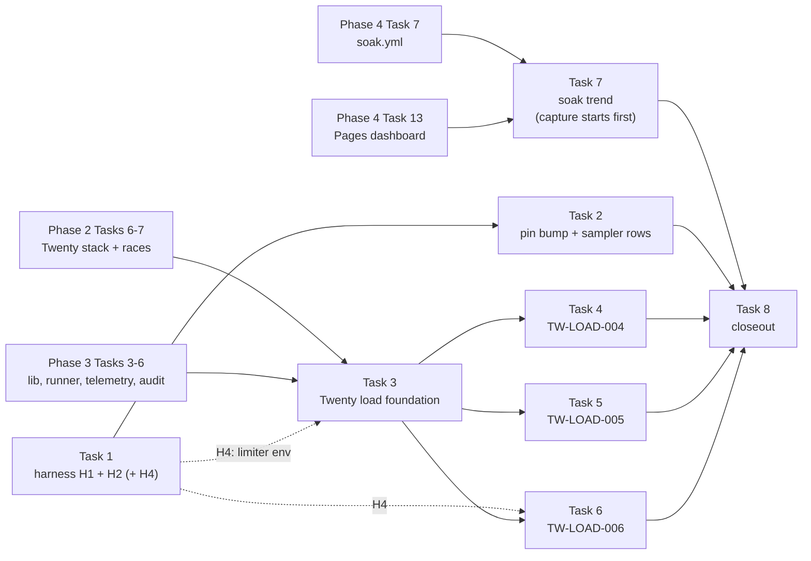

# P6 Phase 5 roadmap (Tasks 1–8)

This is a roadmap, not a build plan. It fixes the order, the scope and the done criteria for P6
Phase 5. Each task gets its own junior-engineer build plan just before it starts, in the structure
of [docs/reference/p1-plan-example-medusa.md](../reference/p1-plan-example-medusa.md), and every
such plan starts with a **live probe**. Nothing in this file is a probed value unless it cites a
file in this repo, the pinned harness, a pinned product source or a CI run; open values are marked
"to verify" and listed under each task's probe items. No latency or throughput targets are set.

## Context

- Repo: [Jayami123/k6-load-concurrency-suite](https://github.com/Jayami123/k6-load-concurrency-suite)
  (P6). Written on `plan/2026-10-22-p6-phase5`, branched from `plan/2026-10-22-p6-phase4` at
  **`001b590`** ("docs: record p6 phase 4 roadmap decisions"). Chain: Phase 4 plan branch →
  `plan/2026-10-22-p6-phase3` `5693577` → `plan/2026-10-22-p6-phase2` `5574214` → `main` `d33e775`.
  So [Phase 2](2026-10-22-p6-phase2-roadmap.md), [Phase 3](2026-10-22-p6-phase3-roadmap.md) and
  [Phase 4](2026-10-22-p6-phase4-roadmap.md) roadmaps are readable here.
- **Source of the scope:** the owner's P6 Phase 3–4 proposal (Phase 5 part, not in the repo; its
  case definitions were given with this task and are restated below), the Phase 3 roadmap "Later"
  (Phase 5: Twenty load, harness H1/H2, long soak trend) and Phase 4 roadmap "Later". Phase 5 theme:
  **Twenty under load, harness telemetry tier, long-term trend**.
- **Exit (D5):** Twenty load cases evidenced from ≥ 3 valid nightly runs; harness telemetry tier
  live (or explicitly declined with a reason); soak trend shows ≥ 3 weekly points; evidence release
  `p6-phase5`.
- **What Phase 5 builds on** (none of it exists on `main` at `d33e775`; each item is named by the
  task that creates it):

| Needed by Phase 5                                                                     | Set by                        |
| ------------------------------------------------------------------------------------- | ----------------------------- |
| Twenty stack in P6 (`up:twenty`, `src/twenty/env.ts`, `src/twenty/oracle.ts`, CI job) | Phase 2 Task 6                |
| Twenty races `P6-TW-RACE-001/004/005/006`, `src/twenty/{api,payloads,mailpit}.ts`     | Phase 2 Task 7                |
| Harness H3 release process (second Medusa instance + Cal fix) and pin-bump pattern    | Phase 3 Task 1                |
| Pinned k6, `k6/lib/`, stub self-test                                                  | Phase 3 Task 3                |
| LOAD runner `scripts/load/run-load.ts`, validity, `run-meta.json`, preflight          | Phase 3 Task 4                |
| Outside-only sampler + chart (`src/load/telemetry/*`), overhead and clock-skew checks | Phase 3 Task 5                |
| Post-load reconciliation `src/load/reconcile/*` (Cal, Medusa, Documenso)              | Phase 3 Task 6                |
| Evidence-release extension allowlist                                                  | Phase 3 Task 11 (Phase 4 D14) |
| Soak workflow `soak.yml` (nightly 30 min, weekly 2 h Sunday)                          | Phase 4 Task 7                |
| Production-like limiter profile pattern (Documenso)                                   | Phase 4 Task 6 (Phase 4 D12)  |
| `k6/thresholds/`, A/A + A/B gate (`gate.yml`)                                         | Phase 4 Tasks 11–12           |
| GitHub Pages dashboard (`pages.yml`, `scripts/dashboard/build-site.ts`)               | Phase 4 Task 13               |

### Facts checked for this roadmap (read-only)

- **Harness `v0.2.11`** (`node_modules/qa-portfolio-harness`, read only):
  - Twenty overlay `docker/twenty.compose.yml` sets the server/worker image
    `twentycrm/twenty:${TAG:-v2.44.0}`, `SERVER_URL`, `IS_MULTIWORKSPACE_ENABLED: "false"`, Mailpit
    SMTP and `IS_EMAIL_VERIFICATION_REQUIRED: "false"`. It sets **no** `API_RATE_LIMITING_*` and
    **no** `NODE_OPTIONS`, and has no generic env passthrough; the `db` service only remaps the port
    (5434). The fork's own `packages/twenty-docker/docker-compose.yml` (at `TWENTY_REF`) uses
    `postgres:16` and `redis`, and also sets no `API_RATE_LIMITING_*`.
  - The harness generates `ENCRYPTION_KEY` / `APP_SECRET` into the fork's gitignored docker `.env`
    (`twenty-env.ts` `bootstrapTwentyDockerEnv`); that file feeds compose variable substitution, not
    arbitrary container env (to verify against the fork compose's `env_file` use, none seen).
  - No harness adapter sets Postgres flags (`shared_preload_libraries`, `auto_explain`,
    `log_min_duration_statement`): Medusa and Documenso use `postgres:15` in
    `docker/medusa.compose.yml` and `docker/documenso.compose.yml` with no `command:`; Cal's DB
    comes from the fork's `packages/prisma/docker-compose.yml` with only a port overlay
    (`docker/cal.compose.yml`).
  - App env today: Cal `nodeHeapEnv()` sets `NODE_OPTIONS` to `process.env.NODE_OPTIONS` **or**
    `--max-old-space-size=8192` (`cal.adapter.ts` lines 89–93), so a P6-set `NODE_OPTIONS` would
    **replace** the heap flag. Medusa's backend env is parsed only from its `.env`
    (`backendProcessEnv()`, `medusa.adapter.ts` lines 253–259; no `process.env` spread), so P6
    cannot pass `NODE_OPTIONS` to Medusa today. Documenso uses `buildDocumensoAppEnv(cfg)`
    (`documenso.adapter.ts` line 96; whether it forwards `NODE_OPTIONS` is to verify).
- **Twenty source** (fork `Jayami123/twenty-CRM` at `TWENTY_REF` `7cbdfec6…`, commit dated
  2026-09-30; sparse read):
  - Rate-limit config defaults in
    `packages/twenty-server/src/engine/core-modules/twenty-config/config-variables.ts`:
    `API_RATE_LIMITING_SHORT_TTL_IN_MS = 1000` (line 1713), `API_RATE_LIMITING_SHORT_LIMIT = 100`
    (1722), `API_RATE_LIMITING_LONG_TTL_IN_MS = 60_000` (1730), `API_RATE_LIMITING_LONG_LIMIT = 100`
    (1739), plus `APPLICATION_API_RATE_LIMITING_TTL_IN_MS = 60_000` and `…_LIMIT = 500`. Which
    routes the limiter guards, what it keys on (token, workspace, IP) and which headers it sends are
    **to verify** (a tree-wide grep did not finish in this session).
  - Docker image: `packages/twenty-docker/twenty/Dockerfile` final stage `FROM node:24.19.0-alpine…`,
    `CMD ["node", "dist/main"]`, `ENTRYPOINT ["/app/entrypoint.sh"]`; `entrypoint.sh` ends with
    `exec "$@"`; no runtime `NODE_OPTIONS` (the only one is a build-stage `--max-old-space-size`,
    line 79). The worker runs `yarn worker:prod` (fork compose line 66).
  - Phase 2 roadmap already recorded: update-one has no version / `If-Match` check
    (`common-update-one-query-runner.service.ts`), and the reset token is validated by a plain
    `findOne` then revoked by an unconditional update (`reset-password.service.ts` lines 254–308).
- **Twenty image `v2.44.0`:** Docker Hub `twentycrm/twenty:v2.44.0` exists (amd64 + arm64, last
  pushed 2026-10-01). Upstream `twentyhq/twenty` has **no** git tag `v2.44.0` (only `cli/v2.4x` and
  `sdk/v2.x` tags were listed by `git ls-remote --tags`), so the image's exact source commit is
  **to verify**; the fork pin is dated one day before the image push, which is suggestive, not proof.
- **Artefact retention:** Actions artefacts expire after 14 days (`docs/releases/p6-phase1.md`), so
  weekly soak artefacts alone cannot hold a ≥ 3-week trend (Note 4).

### Rules that hold for every task below

Sources: [AGENTS.md](../../AGENTS.md), [README.md](../../README.md), the Phase 1–4 roadmaps and this
task's rules.

- **Every LOAD case has a correctness oracle or contract**; a load test that cannot fail on
  correctness is not accepted. Read-only DB oracle; post-load reconciliation (`P6-X-LOAD-005`) after
  every run, including Twenty's (Task 3 adds it).
- **PRODUCT BUG vs TEST BUG** label with evidence before any test change; root-cause failing CI;
  never re-run blindly or weaken an assertion; expected-failure only for a proven product bug with
  repeated-run evidence. A recorded silent overwrite (`P6-TW-LOAD-004` variant B) is a **finding**,
  labelled as such, not hidden and not called a pass.
- Data isolation by run prefix, cleanup sweep and leak check. Reset tokens, passwords, API keys and
  JWTs are never printed, logged or committed; the token scan runs before every artefact upload and
  Pages publish. No seed password is ever written into a doc or plan.
- Never edit product forks or `node_modules/qa-portfolio-harness`; harness changes go through a
  harness release (Task 1). Never start or stop products outside `scripts/harness.mjs` and the repo's
  npm scripts.
- Measured, never claimed: published numbers from GitHub Actions only, median of ≥ 3 VALID runs,
  environment label and `run-meta.json` (`P6-RULE-003/005`); fixed functional rates in Phase 5
  unless a Twenty knee is accepted (D4).
- Shared GitHub-hosted runners only; free options only. One PR per task, branch
  `<type>/<YYYY-MM-DD>-p6-<topic>` (harness repo: its own convention), Conventional Commits with a
  lowercase subject, `npm run check` before every push. Any environment change lists steps for
  **both** Cursor Cloud and Claude Code cloud (automatic from repo vs pasted by hand); none is
  expected in Phase 5.

### Primitive bar

Every case is a cross-domain primitive, not CRUD: **no lost update** (concurrent edits either both
survive or conflict visibly), **token single use**, **overload is refused cleanly and recovers**,
**a long-running process does not grow without bound**, **telemetry must not perturb what it
measures**. Each task has one line on what it proves and how it transfers to finance and healthcare.
Extras are **proposed** with new IDs and are not in scope until the owner accepts them.

## Phase 5 cases

| Case ID          | Status                       | Summary                                                                                                                                                            | Pri |
| ---------------- | ---------------------------- | ------------------------------------------------------------------------------------------------------------------------------------------------------------------ | --- |
| —                | harness H1                   | Opt-in Postgres flags in harness DB containers: `pg_stat_statements` (`shared_preload_libraries`), `auto_explain` / `log_min_duration_statement`; default off      | —   |
| —                | harness H2                   | Opt-in extra app env (e.g. `NODE_OPTIONS=--require <preload>` with `perf_hooks.monitorEventLoopDelay`); default off                                                | —   |
| —                | P6 sampler rows              | `P6-X-LOAD-002` gains top-query rows (`pg_stat_statements` deltas) and true event-loop-delay rows; the 1 Hz health-probe series stays, labelled as the proxy       | —   |
| `P6-TW-LOAD-004` | in scope                     | Lost update under sustained edits: variant A (different fields) both survive; variant B (same field) conflict or recorded silent overwrite; overwrite rate vs load | P0  |
| `P6-TW-LOAD-005` | in scope                     | One-time token under load: many reset tokens, each redeemed N times in parallel inside steady load; one success per token; hash changed once                       | P1  |
| `P6-TW-LOAD-006` | in scope                     | Rate-limit contract: below / at / above the limit, then idle; above → 429 (headers to verify), never 500; below → no 429; recovery time                            | P1  |
| —                | in scope                     | Long soak trend: weekly 2 h soak results accumulated per product (RSS, fds, connections, p95 slope) on the Pages dashboard                                         | —   |
| `P6-TW-LOAD-001` | **retired** (owner decision) | Master plan "k6 smoke GraphQL people list": superseded by `-004`..`-006`                                                                                           | —   |
| `P6-TW-LOAD-002` | **retired** (owner decision) | Master plan "k6 ramp create people": superseded                                                                                                                    | —   |
| `P6-TW-LOAD-003` | **retired** (owner decision) | Master plan "k6 stress + spike": superseded                                                                                                                        | —   |
| `P6-TW-LOAD-007` | **Later, out of P6** (owner) | Optional Playwright characterisation of the `/welcome` login loader: UI flake study, belongs with P1                                                               | —   |

Retired IDs stay listed and are never reused.

## Task table

| Task | Title                                      | Cases                                  | Depends on (exact)                                                  | Branch                                       | Parallel with |
| ---- | ------------------------------------------ | -------------------------------------- | ------------------------------------------------------------------- | -------------------------------------------- | ------------- |
| 1    | Harness telemetry release (H1 + H2, + H4?) | none (harness)                         | Phase 3 Task 1 (release pattern)                                    | harness `feat/<date>-harness-telemetry-tier` | 3, 7          |
| 2    | P6 pin bump + flags on + new sampler rows  | sampler rows; `P6-X-LOAD-009`? (extra) | 1; Phase 3 Task 5; Phase 4 Task 7 (`soak.yml`)                      | `chore/<date>-p6-harness-telemetry-bump`     | 3, 7          |
| 3    | Twenty load foundation                     | none (foundation)                      | Phase 2 Tasks 6–7; Phase 3 Tasks 3–6; Task 1 for H4 (D6)            | `feat/<date>-p6-twenty-load-foundation`      | 1, 2, 7       |
| 4    | Lost update under sustained edits          | `P6-TW-LOAD-004`                       | 3; Phase 2 Task 7 (`P6-TW-RACE-001`, `-005`)                        | `feat/<date>-p6-tw-load-lost-update`         | 5             |
| 5    | One-time token under load                  | `P6-TW-LOAD-005`                       | 3; Phase 2 Task 7 (`P6-TW-RACE-004`, `-006`)                        | `feat/<date>-p6-tw-load-reset-token`         | 4             |
| 6    | Rate-limit contract (limiter profile)      | `P6-TW-LOAD-006`                       | 3; Task 1 (H4, D6); Phase 4 Task 6 (profile pattern)                | `feat/<date>-p6-tw-load-rate-limit`          | 7             |
| 7    | Long soak trend                            | soak trend                             | Phase 4 Tasks 7 and 13; capture can start before Tasks 1–6 (Note 4) | `feat/<date>-p6-soak-trend`                  | 1–6           |
| 8    | Phase 5 closeout                           | all (evidence only)                    | 1–7                                                                 | `docs/<date>-p6-phase5-closeout`             | —             |

### Notes on the suggested order (D2, challenged where the analysis says so)

The owner's order is H1/H2 release → pin bump + sampler rows → Twenty load foundation →
`-004` → `-005` → `-006` → soak trend → closeout. Kept as task numbers, with four changes to
**when** work starts (no ID or scope change):

1. **Twenty's limiter appears to be ON by default, and P6 cannot change it today.** The fork's
   defaults are a short window of 100 requests per 1 s and a long window of 100 per 60 s
   (config-variables.ts lines 1713–1739), and neither the harness overlay nor the fork compose sets
   `API_RATE_LIMITING_*`. If the image matches the fork, every Twenty run (Phase 2 races, Phase 5
   load) is limited at about 100 requests/minute on whatever key the limiter uses. That contradicts
   D3's premise that "every other Twenty run keeps the CI setting" as an unlimited setting: the CI
   setting **is** the limiter. Two consequences:
   - A **functional profile** (limits raised for load, or the limiter off if a switch exists) needs
     env passed into the Twenty containers, which the harness cannot do today. Proposed **harness
     H4** (D6): opt-in Twenty env passthrough for `API_RATE_LIMITING_*`, in the **same** harness
     release as H1/H2 (Task 1). Then Task 3 depends on Task 1 for the profile, not only Task 2.
   - `P6-TW-LOAD-006` may need no special start for "limiter ON" (the default may already be the
     production-like profile); it needs a **known** limit, which again needs H4 or reading the
     defaults from the running image (Task 6 probe).
2. **Task 3 can start in parallel with Tasks 1–2** for everything except the limiter profile:
   `k6/lib` Twenty auth, the background journey, container telemetry and Twenty reconciliation do
   not need H1/H2.
3. **H2 for Twenty is feasible in principle** (Task 1 probe must confirm on `v2.44.0`): the image
   runs `node dist/main` via an entrypoint that ends in `exec "$@"`, and sets no runtime
   `NODE_OPTIONS`, so the harness overlay can add `NODE_OPTIONS=--require /p6/el-delay.cjs` and a
   read-only bind mount for server and worker (`yarn worker:prod` passes env to its node child).
   No product code or image change. The preload's output must leave the container (a mounted
   directory or stdout lines the sampler reads).
4. **The soak trend needs wall-clock weeks, so capture starts first.** ≥ 3 weekly points take ≥ 3
   weeks after `soak.yml` (Phase 4 Task 7) is live, and Actions artefacts expire after 14 days. Task
   7's **capture** (persist each weekly summary, D8) should land as early as possible, in parallel
   with Task 1; the dashboard trend view can come later. Left last, the exit would wait ≥ 3 extra
   weeks.
5. **"Master plan updated" at closeout conflicts with an earlier rule.** Phase 1 Task 8 and the
   Phase 3/4 roadmaps say the master-plan HTML is not edited (README notes changes). D9 asks the
   owner which applies.

## Task 1: Harness telemetry release (H1 + H2, proposed H4)

- **Goal.** One `qa-portfolio-harness` release with opt-in, default-off flags: H1 Postgres
  statistics/explain flags, H2 extra app env for an event-loop preload, and (if the owner accepts D6)
  H4 Twenty env passthrough. P1 and other users see no change.
- **Cases.** None mapped (infrastructure).
- **What it proves / transfers.** Deeper attribution without touching product code: query-level and
  event-loop evidence of the kind a bank's or hospital's performance review asks for, kept opt-in so
  normal users of the tool are unaffected.
- **Depends on.** Phase 3 Task 1 (the harness release + pin-bump pattern, H3).
- **Scope.**
  - **H1:** an opt-in flag (name to verify with the harness's conventions, e.g.
    `HARNESS_PG_STATS=1`) that starts each harness-owned Postgres with
    `shared_preload_libraries=pg_stat_statements` (and `auto_explain` + `log_min_duration_statement`
    when a second flag is set) and runs `CREATE EXTENSION IF NOT EXISTS pg_stat_statements` once
    after start (P6's oracle is read-only and must never run DDL). Covers Medusa and Documenso
    (`postgres:15` overlays), Twenty (`db` service via the overlay) and Cal (its fork compose DB
    through `docker/cal.compose.yml`; feasibility to verify).
  - **H2:** an opt-in extra-env mechanism per product that **appends** to existing `NODE_OPTIONS`
    (Cal's `nodeHeapEnv()` would otherwise drop `--max-old-space-size=8192`), reaches Medusa's
    backend (today env comes only from its `.env`), and for Twenty adds env + a read-only preload
    mount to `server` and `worker` (Note 3). The preload file is supplied by the caller (P6), not
    shipped as product code.
  - **H4 (proposed, D6):** opt-in passthrough of `API_RATE_LIMITING_*` (and only those) to the
    Twenty server and worker.
  - Unit tests in the harness for each flag's default-off behaviour; CHANGELOG entry; one new tag.
    Separate harness PRs per concern under one tag are allowed (as Phase 3 D4 did).
- **Files likely touched (harness repo).** `docker/{medusa,documenso,twenty,cal}.compose.yml`,
  `src/adapters/{cal,medusa,documenso,twenty}.adapter.ts`, `src/adapters/{medusa,documenso,twenty}-env.ts`,
  `src/config.ts` (flag parsing), tests, `README.md`, `CHANGELOG.md` (existence to verify).
- **Probe items (to verify).**
  1. Postgres images accept `-c shared_preload_libraries=…` via compose `command:` (`postgres:15`,
     `postgres:16`), and the Cal fork's DB service can be overridden from the harness overlay.
  2. The role used for `CREATE EXTENSION` and who may read `pg_stat_statements` and call
     `pg_stat_statements_reset()` (superuser or `pg_read_all_stats`).
  3. `auto_explain` / `log_min_duration_statement` log volume per run.
  4. On the `v2.44.0` image (inspected without starting a stack, e.g. `docker image inspect` and
     reading `/app` files): `CMD`, `ENTRYPOINT`, absence of runtime `NODE_OPTIONS`, Node version for
     `perf_hooks.monitorEventLoopDelay`, and that the worker's node inherits `NODE_OPTIONS`.
  5. Whether `buildDocumensoAppEnv` forwards extra env.
  6. Twenty limiter env names and defaults **in the image** (the fork pin's values are known), and
     whether a "disable" switch exists.
  7. That every flag off reproduces `v0.2.11` behaviour (P1's suite passes on the new tag).
- **Build plan.** Harness-repo plan + `docs/plans/<date>-p6-phase5-task1-harness-telemetry.md`
  (P6 side: what P6 needs). Both start with a live probe and are junior-engineer guides (exact file
  paths, code skeletons per new function and test, exact commands, expected outputs, step order).
- **CI change.** None in P6.
- **Done when.** Harness PR(s) merged under one new tag with CHANGELOG; all flags default off;
  harness tests green; P1 green on the tag (or its owner confirms no impact); the D6 decision on H4
  recorded.
- **Main risks.** P1 regressions; `CREATE EXTENSION` timing on a reused volume; preload output
  leaving tokens in logs (the preload writes numbers only).

## Task 2: P6 pin bump + flags on + sampler rows

- **Goal.** P6 uses the new harness tag, turns H1/H2 on for perf and soak jobs only, and the sampler
  gains top-query and event-loop-delay rows.
- **Cases.** `P6-X-LOAD-002` extension (no new mapped ID); proposed extra `P6-X-LOAD-009`
  (overhead of the harness tier).
- **What it proves / transfers.** Which query and which event-loop stall explain a saturation,
  measured without product changes, and shown not to distort the measurement.
- **Depends on.** Task 1; Phase 3 Task 5 (`src/load/telemetry/*`); Phase 4 Task 7 (`soak.yml`).
- **Scope.**
  - Bump `package.json` / `package-lock.json` (`npm install`, never by hand) and every
    `h0.2.11`-style cache-key suffix in `perf.yml` (set by Phase 3 Task 1 to that tag's suffix).
  - Flags on **only** in the LOAD steps of `perf.yml` and in `soak.yml`; race steps and PR runs keep
    them off.
  - Sampler rows: **top queries** from `pg_stat_statements` as **deltas** between a start and an
    end snapshot (D7: no reset by default; reset only if the harness owns it), top-N by total time,
    query text normalised (no literals by design of `pg_stat_statements`) and still token-scanned;
    **true event-loop delay** (p50/p99/max per interval from the preload). The 1 Hz health-probe
    latency stays and is labelled "event-loop proxy" on the chart.
  - The chart (Phase 3 Task 5) gains the two series; README "How to read the chart" updated.
- **Files likely touched.** `package.json`, `package-lock.json`, `.github/workflows/perf.yml`,
  `.github/workflows/soak.yml`, `src/load/telemetry/{pg-top-queries,event-loop}.ts`,
  `src/load/telemetry/preload/el-delay.cjs` (the preload P6 supplies), `src/load/chart/*`,
  `tests/unit/telemetry-top-queries.test.ts`, `tests/unit/telemetry-event-loop.test.ts`, `README.md`.
- **Probe items (to verify).** Snapshot cost of `pg_stat_statements` at the sampler interval; that
  the read-only role can read it; preload output path per product (host process vs container);
  overhead with flags on vs off (`P6-X-LOAD-009`, if accepted); that query text carries no secrets.
- **Build plan.** `docs/plans/<date>-p6-phase5-task2-telemetry-bump.md`; starts with a live probe;
  junior-engineer guide.
- **CI change.** Flags on in LOAD and soak steps only.
- **Done when.** All jobs green on the bump PR and once on `main`; a nightly LOAD run and a soak run
  ship top-query and event-loop rows in telemetry and chart; the proxy series is labelled; token
  scan passes; `npm run check` green.
- **Main risks.** Overhead changing results (measure it); `pg_stat_statements` text size.

## Task 3: Twenty load foundation

- **Goal.** Twenty can be load-tested through the same LOAD runner: auth in `k6/lib`, a background
  journey, container telemetry, Twenty reconciliation and a functional limiter profile.
- **Cases.** None mapped (foundation).
- **What it proves / transfers.** The fourth product joins the load pipeline with the same validity,
  telemetry and audit rules: a CRM is the same shape as a customer-record system in banking or a
  patient-record system in healthcare.
- **Depends on.** Phase 2 Tasks 6–7 (Twenty stack, `src/twenty/*`, races); Phase 3 Tasks 3–6
  (lib, runner, telemetry, reconciliation); Task 1 for H4 if D6 is accepted (Note 1).
- **Scope.**
  - `k6/lib/twenty-auth.js`: per-run credentials minted by the runner (Phase 2 Task 6 decides the
    mechanism: harness `authenticate()` or a per-run API key), passed through env/JSON (Phase 3 D6),
    never logged; works standalone with `k6 run`.
  - `k6/journeys/tw-background.js`: steady REST read/write mix on prefixed records (the "steady API
    load" `-005` runs inside); fixed functional rate (D4).
  - Telemetry for containers: Twenty runs in Docker, so app CPU/RSS/fds come from the server and
    worker containers (`docker stats`, and `/proc` of container pids on the host; to verify) rather
    than a host pid file; DB telemetry on port 5434 read-only.
  - `src/load/reconcile/twenty.ts`: post-load audit (no leaked prefixed records incl. soft-deleted,
    `deletedAt`; token rows revoked; counts match the run's intents).
  - **Functional limiter profile** for all Twenty LOAD runs except `-006`: limits raised (or the
    limiter off) via H4, recorded in `run-meta.json`. Without H4, the runs stay under the default
    limit and say so (D3, D6).
  - CI: a LOAD step in the Twenty job (Phase 2 Task 6's `twenty-smoke`) after the races and their
    leak check (Phase 3 D5 pattern).
- **Files likely touched.** `k6/lib/twenty-auth.js`, `k6/journeys/tw-background.js`,
  `k6/cases/tw-background.js`, `src/load/reconcile/twenty.ts`, `src/load/telemetry/docker-stats.ts`,
  `scripts/load/run-load.ts`, `tests/unit/reconcile-twenty.test.ts`, `.github/workflows/perf.yml`,
  `README.md`.
- **Probe items (to verify).** What the limiter keys on and whether the background journey alone
  hits it at the chosen rate; REST vs GraphQL paths for the journey; container process visibility on
  GitHub-hosted runners; Twenty job time with seed (Phase 2 Task 6 measures first boot).
- **Build plan.** `docs/plans/<date>-p6-phase5-task3-twenty-load-foundation.md`; live probe first;
  junior-engineer guide with the exact commands Phase 2 Task 6 defines (`npm run up:twenty`,
  `npm run down:twenty`, `race:twenty`; names set by Phase 2 Task 6).
- **CI change.** Twenty LOAD step (short on PRs, full on `main`/nightly/dispatch).
- **Done when.** The background journey runs VALID with telemetry, chart and a clean Twenty audit on
  the PR and once on `main`; the active limiter profile is recorded per run; `npm run check` green.
- **Main risks.** The default limiter turning every run into a 429 count; seed time; container
  telemetry gaps.

## Task 4: Lost update under sustained edits (`P6-TW-LOAD-004`)

- **Goal.** Show whether concurrent edits survive under sustained load.
- **Cases.** `P6-TW-LOAD-004` (P0).
- **What it proves / transfers.** No lost update: two clerks editing one account, or two clinicians
  one patient record, must both keep their changes or see a conflict, never silently lose one.
- **Depends on.** Task 3; Phase 2 Task 7 (`P6-TW-RACE-001` same field, `P6-TW-RACE-005` disjoint
  fields).
- **Scope.** Many writers PATCH a small set of prefixed records at a fixed arrival rate.
  - **Variant A (different fields of one record):** both changes must survive (REST read back +
    DB oracle). A missing change is a PRODUCT BUG with evidence.
  - **Variant B (same field):** either a version conflict (4xx with a body) or a **recorded silent
    overwrite**, labelled a finding. "Final value is A or B" is **not** a pass. The oracle joins each
    write intent (writer id, value, k6 timestamp, response) to the final value and counts overwritten
    intents; the **overwrite rate vs load** is recorded.
  - Phase 2 already found no version/`If-Match` check in update-one, so variant B is expected to be
    a silent-overwrite finding; the README states the design question (last-write-wins) plainly.
- **Files likely touched.** `k6/cases/tw-load-004.js`, `src/twenty/oracle.ts` (final values,
  `updatedAt`), `src/load/reconcile/twenty.ts`, `src/load/lost-update.ts` (intent join),
  `tests/unit/lost-update.test.ts`, `perf.yml`, `README.md`.
- **Probe items (to verify).** Whether PATCH writes only the sent fields (variant A depends on it;
  Phase 2 Task 7 probes it at race level); whether any conflict status exists; the column and table
  for the record and `updatedAt` resolution; writer count and record count that keep runs VALID.
- **Build plan.** `docs/plans/<date>-p6-phase5-task4-tw-load-lost-update.md`; live probe first;
  junior-engineer guide.
- **CI change.** Nightly + dispatch Twenty LOAD step; short on PRs.
- **Done when.** ≥ 3 VALID nightly runs: variant A with zero lost fields (or a recorded product bug),
  variant B with its conflict or overwrite counts and the rate vs load; `npm run check` green.
- **Main risks.** Timestamp resolution hiding order; limiter interference (Task 3 profile).

## Task 5: One-time token under load (`P6-TW-LOAD-005`)

- **Goal.** Each reset token admits exactly one redemption while the system is busy.
- **Cases.** `P6-TW-LOAD-005` (P1).
- **What it proves / transfers.** Token single use under load: one-time payment-approval codes or
  record-access links must not be redeemable twice when servers are busy.
- **Depends on.** Task 3 (background journey); Phase 2 Task 7 (`P6-TW-RACE-004` parallel redemption,
  `-006` sequential replay; throwaway-user creation; Mailpit client).
- **Scope.** While `tw-background` runs, many reset tokens (one per throwaway prefixed user) are
  requested, read from Mailpit, and each redeemed N times in parallel. Oracle: exactly one success
  per token; the user's password hash changed exactly once (pg oracle); token rows revoked; any 5xx
  a PRODUCT BUG. If Phase 2 proved a multi-winner bug in `-004`, this case counts it under the same
  finding ID and records the rate vs load.
- **Files likely touched.** `k6/cases/tw-load-005.js`, `src/twenty/mailpit.ts` (Phase 2 Task 7),
  `src/twenty/oracle.ts` (hash-change and token queries), `src/load/reconcile/twenty.ts`, `perf.yml`,
  `README.md`.
- **Probe items (to verify).** Reset email throughput through Mailpit; whether auth mutations have
  a stricter limit than the API limiter; how to detect "hash changed once" without reading the hash
  value into logs (compare hashes inside SQL, return booleans/counts only); throwaway-user cleanup.
- **Build plan.** `docs/plans/<date>-p6-phase5-task5-tw-load-reset-token.md`; live probe first;
  junior-engineer guide.
- **CI change.** Nightly + dispatch.
- **Done when.** ≥ 3 VALID nightly runs with one success per token and one hash change per user (or
  a recorded product bug with repeated evidence); no token or hash in any artefact (scan);
  `npm run check` green.
- **Main risks.** Tokens leaking into k6 output (redemption bodies must not be logged); email
  latency making tokens expire mid-run.

## Task 6: Rate-limit contract (`P6-TW-LOAD-006`)

- **Goal.** Twenty refuses overload with 429 and recovers when the window resets.
- **Cases.** `P6-TW-LOAD-006` (P1).
- **What it proves / transfers.** Backpressure contract: an open-banking or patient-API client must
  get a clear 429 (never a 500) above the limit, none below it, and service back after the window.
- **Depends on.** Task 3; Task 1 (H4, if accepted) to set a known limit; Phase 4 Task 6 (the
  production-like limiter profile pattern, Phase 4 D12).
- **Scope.** On the **production-like limiter profile** (D3): a separate Twenty start whose limiter
  values are known and recorded (defaults, or set through H4). Arrival rate below, at and above the
  limit, then idle until the window resets. Above: 429 with a body and the headers the probe finds,
  never 500; below: no 429; **recovery time** after reset recorded. Every other Twenty run keeps the
  functional profile (Task 3).
- **Files likely touched.** `k6/cases/tw-load-006.js`, `src/load/recovery.ts` (Phase 4 Task 6),
  `perf.yml` (separate start step with its own down), `README.md`.
- **Probe items (to verify).** The guarded routes; the limiter key; the 429 body and headers
  (`Retry-After`, rate-limit headers); short vs long window interaction (100/1 s and 100/60 s at the
  fork pin); whether the limiter state lives in Redis (shared across server restarts) and must be
  flushed between runs by the harness (P6 never writes to Redis).
- **Build plan.** `docs/plans/<date>-p6-phase5-task6-tw-load-rate-limit.md`; live probe first;
  junior-engineer guide.
- **CI change.** Dispatch + weekly Saturday (Phase 4 D16 pattern) on its own Twenty start.
- **Done when.** ≥ 3 VALID runs with the below/at/above verdicts, 429 contract and recovery time; the
  profile values in `run-meta.json`; `npm run check` green.
- **Main risks.** Limiter state carried between runs; generator timing at the window edge.

## Task 7: Long soak trend

- **Goal.** Weekly 2 h soak results become a per-product trend on the Pages dashboard.
- **Cases.** Long soak trend (no mapped ID; proposal "Phase 5").
- **What it proves / transfers.** Slow degradation across releases is visible over weeks, not only
  within one run: the trend a payments platform or an EHR interface team watches between upgrades.
- **Depends on.** Phase 4 Task 7 (`soak.yml`, slopes), Phase 4 Task 13 (`pages.yml`,
  `build-site.ts`). **Capture should start first** (Note 4).
- **Scope.**
  - **Capture:** after each weekly 2 h soak, a small summary per product (RSS, fds, connections, p95
    slope, plateau verdict, VALID/INVALID, run id, product SHA, harness tag, k6 version) is
    persisted outside the 14-day artefact window (D8).
  - **View:** the dashboard plots each metric per week with run links; INVALID weeks are shown as
    gaps, never as points; a product SHA or harness change is marked on the axis.
  - No trend threshold or gate (measure-only).
- **Files likely touched.** `.github/workflows/soak.yml` (summary + persist step),
  `src/load/soak/trend.ts`, `scripts/dashboard/build-site.ts`, `tests/unit/soak-trend.test.ts`,
  the D8 store (a release asset per week, or a data branch), `README.md`.
- **Probe items (to verify).** Which store is free and append-safe (weekly evidence release
  `p6-soak-<yyyy>-w<ww>` via `evidence-release.yml`, or a `data` branch written by the workflow with
  `contents: write`); token scan on summaries; how Pages reads past weeks.
- **Build plan.** `docs/plans/<date>-p6-phase5-task7-soak-trend.md`; live probe first;
  junior-engineer guide.
- **CI change.** `soak.yml` weekly job persists its summary; `pages.yml` reads the store.
- **Done when.** ≥ 3 weekly VALID points per product on the dashboard with links; `npm run check`
  green.
- **Main risks.** Weeks lost to INVALID soaks; store permissions (a workflow with write access must
  stay limited to the store).

## Task 8: Phase 5 closeout

- **Goal.** Phase 5 is evidenced and P6 has its final numbers.
- **Cases.** All Phase 5 items.
- **Depends on.** Tasks 1–7.
- **Scope.** Exit (D5); evidence release `p6-phase5` through `evidence-release.yml` (allowlist set
  by Phase 3 Task 11); README final numbers (Twenty load results, harness tier, trend) with medians
  of ≥ 3 VALID runs and environment labels; retired and Later IDs listed; the master-plan question
  (D9) resolved; upstream issue drafts in Twenty's own template for any new confirmed product bug
  (e.g. a multi-winner reset token).
- **Files likely touched.** `README.md`, `docs/releases/p6-phase5.md`,
  `docs/plans/<date>-p6-phase5-task8-closeout.md`, and `docs/master-plan.html` only if D9 says so.
- **Probe items (to verify).** Run ids and verdicts; Twenty's issue template; release size.
- **Build plan.** `docs/plans/<date>-p6-phase5-task8-closeout.md`; junior-engineer guide.
- **Done when.** Exit met; release exists; README cites only VALID Actions runs; `npm run check`
  green.
- **Main risks.** One INVALID nightly resetting a "≥ 3" count; weekly points arriving late.

## Later (not Phase 5; listed, not planned)

- `P6-TW-LOAD-007` `/welcome` login-loader Playwright characterisation: **out of P6**, belongs with
  P1 (owner decision).
- Retired, kept marked, never reused: `P6-TW-LOAD-001`, `-002`, `-003` (superseded by
  `-004`..`-006`); `P6-X-LOAD-007` (withdrawn in Phase 3).
- A Twenty knee (`P6-TW-LOAD-008`, proposed extra) unless the owner accepts it into Phase 5.
- A/B gate coverage of `TWENTY_IMAGE_TAG` bumps (the Phase 4 gate triggers name only `CAL_REF`,
  `MEDUSA_REF`, `DOCUMENSO_REF`).

### Proposed extras (new IDs, not in scope until the owner accepts them)

- **`P6-X-LOAD-009` harness-tier overhead.** Run a steady case with H1/H2 on and off (A/A style);
  metrics must stay within the Phase 4 A/A tolerance. Reason: telemetry must not perturb what it
  measures (the Phase 3 `P6-X-LOAD-006` rule, applied to the new tier).
- **`P6-TW-LOAD-008` Twenty knee (D4).** Breakpoint method (Phase 4 Task 1) on `tw-background`.
  Cheap only if H4 can raise the limiter; otherwise the knee is just the limit. Reason: the other
  three products have knees; without H4 a Twenty knee would measure the limiter, not the system.
- **`P6-TW-LOAD-009` limiter fairness.** Two credentials, one flooding above the limit, one at a low
  rate: the low-rate client must not get 429 if the limiter is per key (or the finding is recorded
  if it is per IP / global). Reason: tenant isolation under overload is a cross-domain primitive
  (one noisy bank partner or clinic must not starve others). Depends on the limiter key (Task 6
  probe).
- **`P6-TW-LOAD-010` worker queue drains.** Twenty's worker (`yarn worker:prod`, Redis-backed) must
  drain its backlog after a write burst (pending jobs over time, drain time). Reason: "a queue that
  fills must drain", as `P6-DOC-LOAD-002`; observable only if job state is readable from outside
  (to verify).
- **`P6-TW-LOAD-011` reset-token expiry boundary.** Redemptions just before and just after the
  token's expiry under load: before → one success, after → refused, never both. Reason: boundary of
  token single use; expiry comes from `generatePasswordResetToken` (`reset-password.service.ts`
  line 117 computes `expiresAt`).

## Decisions (2026-10-22)

"Agreed 2026-10-22" means given by the owner; "proposed" means open.

- **D1 Harness tier (agreed 2026-10-22).** H1 + H2 as one harness release in
  `Jayami123/qa-portfolio-harness`, opt-in, default off; this branch never edits the harness. A P6
  pin bump then turns the flags on for perf/soak jobs only; the `P6-X-LOAD-002` sampler gains
  top-query (`pg_stat_statements` deltas) and true event-loop-delay rows; the 1 Hz health-probe
  series stays, labelled as the proxy. Twenty can take H2 in principle (Note 3; to verify on the
  image).
- **D2 Order (agreed 2026-10-22, with start-time changes).** Task numbers follow the owner's order;
  Notes 1, 2 and 4 move start times (H4 inside Task 1; Task 3 in parallel with 1–2; soak-trend
  capture first).
- **D3 Twenty limiter profile (agreed 2026-10-22, premise to verify).** `P6-TW-LOAD-006` runs on a
  separate start with a known, production-like limiter; every other Twenty run keeps the CI
  setting. Today the harness sets no limiter env at all, so the CI setting is Twenty's built-in
  default, which appears to be ON (Note 1).
- **D4 Fixed functional rates (agreed 2026-10-22).** A Twenty knee only as the proposed extra
  `P6-TW-LOAD-008`.
- **D5 Exit (agreed 2026-10-22).** As in Context.
- **D6 Harness H4 Twenty env passthrough (proposed).** Add opt-in `API_RATE_LIMITING_*` passthrough
  to the same release as H1/H2. Without it, Twenty load runs under the default limit and
  `P6-TW-LOAD-006` uses the image defaults read by the probe.
- **D7 Top-query deltas without reset (proposed).** Snapshot `pg_stat_statements` at run start and
  end and subtract; `pg_stat_statements_reset()` only if the harness owns it. Standard practice and
  keeps P6's oracle read-only; the owner's "reset per run" stays possible via the harness.
- **D8 Trend store (proposed).** A weekly evidence release (`p6-soak-<yyyy>-w<ww>`, immutable,
  scanned) is the default; a `data` branch is the alternative (simpler reads, but a workflow with
  write access to the repo).
- **D9 Master plan at closeout (proposed).** Either keep the rule (README records changes; the HTML
  stays as written) or allow one closeout edit that marks phases done and points to the roadmaps.
- **D10 Retired and Later IDs (agreed 2026-10-22).** `P6-TW-LOAD-001..003` retired as superseded;
  `P6-TW-LOAD-007` Later, out of P6.
